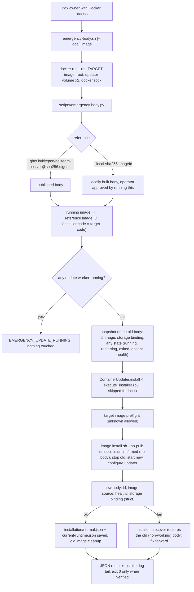
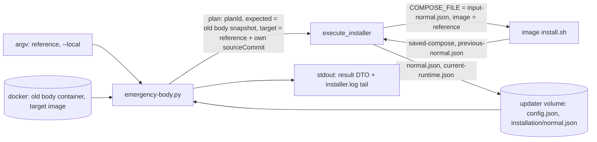

# Emergency body path: put a body in when the body cannot start (a505, 2026-11-22)

Owner: Molly (body container / swap). Related: [bundled updater and worker](container-update-bundled.md), [host updater](container-update.md), [recovery](recovery.md).

## Why

2026-11-22 08:26-09:59 JST the body could not start. Every supported way in needed a running body:

| Path | Why it failed with the body down |
| --- | --- |
| App Update (`plan/start` on the updater socket) | the only peer of the updater socket is the body (uid 1001); an Owner-authenticated request cannot reach it |
| `scripts/deploy.sh` | needs a running container (`BELLTEAM_ORIGINAL_CONFIG_UNAVAILABLE`), saves the queue with `docker exec bellteam curl .../api/queue`, and is the internal-box path (main-server), not the public box |
| `execute_installer` check `inspect_current() == plan.expected` | requires the old body running and healthy |

The box owner had to build an image by hand and recreate the container from a copy of the updater model.

## Shape

One host command, no running body needed, same installer as App Update:

`sh emergency-body.sh [--local] <image>` (file `distribution/server/emergency-body.sh`, also inside every image at `/app/distribution/server/emergency-body.sh`).

It starts the TARGET image itself as a short-lived root container laid out exactly like the update worker (updater volume at its prefix and at its host mountpoint, Docker socket, same caps, read-only root). Inside, `scripts/emergency-body.py` runs the existing `ContainerUpdater.install` -> `execute_installer` -> the target image's own `install.sh`. Nothing else is new.

## Packaging (a506m2)

The image is built from the public package, not from the whole repository: `scripts/package-server.mjs` archives an explicit file list, rebuilds `distribution/` from named files only, and `publish-server-image.yml` builds on pushes to its `paths` list (`test/server-image-paths.test.mjs` keeps the two aligned). `scripts/emergency-body.py` is in both lists and `distribution/server/emergency-body.sh` is copied into the rebuilt `distribution/server/` (test: `test/server-distribution.test.mjs`). Z172 lab found both files missing from image `dfe6686f` for this reason.

## Data flow

State ownership is unchanged: the updater volume stays root-private; the data/home/Aiterm state volumes are untouched by this entry (the image's `install.sh` handles Aiterm state exactly as in App Update). No queue backup is taken: with no body there is no queue API, and the state volume is not touched.

## Contract

- Input: one reference. Published: `ghcr.io/kitepon/bellteam-server@sha256:<64 hex>`. Local: `--local sha256:<64 hex>` (an image ID the operator built, e.g. `docker build -t bellteam-local . && docker image inspect --format '{{.Id}}' bellteam-local`). Running the command is the approval; there is no catalog, signature or ledger check (the signed catalog is the normal path; this one exists for when it cannot be used).
- The container runs from the target image, so the installer code is the target's. The entry refuses when the running image ID differs from the reference image ID (`EMERGENCY_IMAGE_MISMATCH`).
- One swap at a time: any running update worker for the project refuses the entry (`EMERGENCY_UPDATE_RUNNING`).
- The old body may be in any state, even absent health; it must still exist as the project's `bellteam` container (a first install is `install.sh`, not this path) and its mounts must match the saved model, as in App Update.
- `config.json` `release` need not equal the target source: the updater service may be older than the body being put in. The swap's own `install.sh --configure` step recreates the updater service from the new image.
- Rollback restores the old model; if the old body could not start, that body is also down. The result says so; the fix is another emergency swap with a body that starts.
- Result: stdout JSON `{result: {execution, verification, cleanup, rollback, error}, previous: {state}, installerLog}`; exit 0 only when `verification == 'succeeded'`.

## Verification (changed range only)

`test/emergency-body.test.py`: reference forms and `--local` rule; image mismatch refusal; running worker refusal; old body in `exited` / `restarting` state yields a stable expected snapshot and the swap succeeds through the real `execute_installer` with a fixture `install.sh`; a new body that is not healthy fails verification; exit codes. Real Docker is covered by the lab (Centi) as one disposable-box run: stop the body, run the command with the fixed image.
