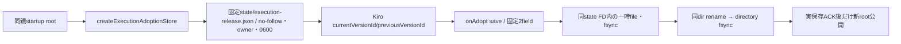

# execution親の選択保存ACK

runtimeエピネル。Kiroの実engine transactionは変更せず、Mollyの初期選択/onAdoptへ同形adoption recordを提供する。業務session/pending/uncertaintyはこのfileへ保存しない。

`createExecutionAdoptionStore({root})`はread/saveだけ。rootは親startup値、filename/component/pathを保存paramsへ追加しない。readは欠測時null、それ以外は既`bellteam.execution.adoption.v1`の厳密current/previous各null又はSHA64を返す。state dirとfileは同process UID/GID、group-other write/special mode・symlink・hardlinkを拒否する。原稿/資格/手動snapshotを混ぜない。

saveは固定2fieldを先に捕捉し、既fileの所有/形/0600/nlink1/4KiBを確認する。開いたstate directory FDへLinux procfs経由で相対書込し、file fsync→同dir rename→dir fsync→本人inode再検査→close後にだけACK。新dirや他保存先を作らない。rename試行後の失敗はoutcome=unknownで成功にしない。単一save以外は拒否し、親getは原子的に旧又は新recordを読む。

直接fixtureは実file/rename/fsync、private mode、symlink/link/余剰入力拒否、directory fsync失敗時のunknownと公開済bytesを確認する。実Root/UID1001・親無停止交換の証明はMolly/Kiro/Centi接続の別結果へ。Host設置口と保存helperの納品を相互gateにしない。
