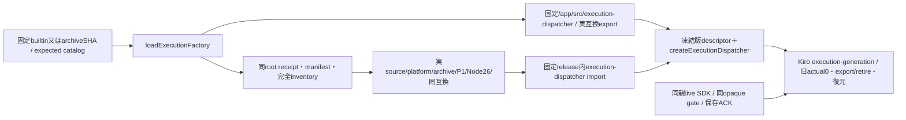

# executionの固定host factory読込

共通loader/installed readerはruntimeエピネル、実engine/generation transaction/復元はKiro、親ports/採用保存ACK/通常mainはMolly、bundle/署名/配置はCenti。業務transactionを共通child controllerへ移植しない。[業務host factory](../execution/host-factory.md)のexportと同じ実互換値を参照する。

`loadExecutionFactory(versionId=null,{expectedRelease}={})`は`Object.freeze({versionId,sourceCommit,createExecutionDispatcher})`を返す。nullは/appの固定builtin、他は64桁SHAだけ。任意URL/path/entryは受けない。builtin sourceCommitは/app/distribution.jsonのroot0/no-follow/regular/nlink1/no-group-other-write/4KiB/schema/sourceCommit検査で取得し、未供給を推測しない。ロードはfactory関数の取得までで、engineを生成せず親portも渡さない。

signed版は既root installer receipt/manifest SHA/完全inventory/0555・0444を確認し、固定`/run/bellteam-maintenance/execution/releases/SHA/payload/src/execution-dispatcher.mjs`だけをimportする。Node26/P1とruntime.stateCompatibilityはbuiltinの`EXECUTION_STATE_COMPATIBILITY`実export文字列へ完全一致。新しいbusiness保存schemaは足さない。catalogは同source/platform/archiveと5key compatibility（stateSchema/containerUpdateはnull）を照合し、選択bundle自身のexportも照合する。importしたfactory関数をKiroへ返し、任意namespaceやSDK instanceをwireへ出さない。

Kiroの`createExecutionGeneration({ports,loadFactory,onAdopt,currentVersionId,previousVersionId,exchangeMutex,onState})`へこの関数を注入する。同bundleの相対engine closureを使い、旧actual0→export→retire→new initialize→親onAdopt実ACK後にだけ新rootを公開する。失敗candidateのclosed欠測/保存ACK不明ならunavailable、共有SDK/PTYclose0。具体transactionと同期project fenceはKiro正本へ接続し、共通loaderで二重実装しない。

`createExecutionFactoryLoader`は同じ固定path選択のままI/Oだけを試験DIできる。限定7境界はbuiltin identity、署名済み配置を仮定したdescriptorと固定URL選択、catalog/platform/state不一致、任意path/不正namespace/取消拒否、実互換を使うmanifestを確認する。namespace/receiptは人工で、実root・別bundle・engine/native・署名受入へ補完しない。既usage/diagnostics/memoryの変更manifest接点3だけを追加確認し、作者のengine成功群は再走しない。
