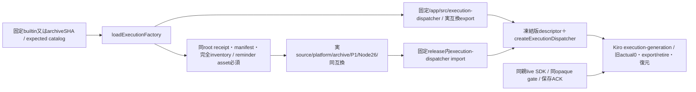
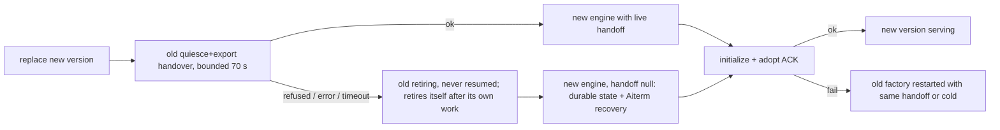

# executionの固定host factory読込

Generation recovery follows the [single module lifecycle contract](module-process.md#shared-automatic-lifecycle-recovery-owner-2026-11-07). The runtime controller retains engine/handoff ownership and retries lifecycle work; Kiro owns native jobs and identity protections. Unavailable is a retrying state, not a terminal cleanup-ACK fence.

共通loader/installed readerはruntimeエピネル、generation controllerはruntime、実engine/native internalsはKiro、親ports/採用保存ACK/通常mainはMolly、bundle/署名/配置はCenti。業務transactionを共通child controllerへ移植しない。[業務host factory](../execution/host-factory.md)のexportと同じ実互換値を参照する。

`loadExecutionFactory(versionId=null,{expectedRelease}={})`は`Object.freeze({versionId,sourceCommit,createExecutionDispatcher})`を返す。nullは/appの固定builtin、他は64桁SHAだけ。任意URL/path/entryは受けない。builtin sourceCommitは/app/distribution.jsonのroot0/no-follow/regular/nlink1/no-group-other-write/4KiB/schema/sourceCommit検査で取得し、未供給を推測しない。ロードはfactory関数の取得までで、engineを生成せず親portも渡さない。

signed版は既root installer receipt/manifest SHA/完全inventory/0555・0444を確認し、固定`/run/bellteam-maintenance/execution/releases/SHA/payload/src/execution-dispatcher.mjs`だけをimportする。Node26/P1とruntime.stateCompatibilityはbuiltinの`EXECUTION_STATE_COMPATIBILITY`実export文字列へ完全一致。新しいbusiness保存schemaは足さない。catalogは同source/platform/archiveと5key compatibility（stateSchema/containerUpdateはnull）を照合し、選択bundle自身のexportも照合する。importしたfactory関数をKiroへ返し、任意namespaceやSDK instanceをwireへ出さない。

Kiroの`createExecutionGeneration({ports,loadFactory,onAdopt,currentVersionId,previousVersionId,exchangeMutex,onState})`へこの関数を注入する。同bundleの相対engine closureを使い、旧actual0→export→retire→new initialize→親onAdopt実ACK後にだけ新rootを公開する。Failed candidate cleanup or adoption persistence enters shared lifecycle backoff with the retained handle/handoff; no shared SDK/PTY is closed. 具体transactionと同期project fenceはKiro正本へ接続し、共通loaderで二重実装しない。

`createExecutionFactoryLoader`は同じ固定path選択のままI/Oだけを試験DIできる。限定7境界はbuiltin identity、署名済み配置を仮定したdescriptorと固定URL選択、catalog/platform/state不一致、任意path/不正namespace/取消拒否、実互換を使うmanifestを確認する。namespace/receiptは人工で、実root・別bundle・engine/native・署名受入へ補完しない。既usage/diagnostics/memoryの変更manifest接点3だけを追加確認し、作者のengine成功群は再走しない。

実dispatchのglobal-instructions.taskSettingsReminderが読む`payload/config/common-agents.md`はexecutionだけの必須inventoryへ含める。既知asset欠測はimport/旧engine退役より前のmanifest検査で拒否し、親/appの別版assetで補完しない。内容の認証は既署名・source・SHA-size/完全inventoryのままで、互換値/root条件を緩めない。変更したmanifest境界1件で同asset入り正例と欠測拒否を確認し、Kiroの実dispatch→人工pty_send結果やCentiのliteral closure検査は本人原本を継承する。

## The old module cannot veto its replacement (Owner 2026-11-08)

Owner: "大きな箱側が、部品をダウンロードして置き換えるのではないのか。" Job 611ef3ae failed because the installed execution module answered the handover quiesce/export with EXECUTION_BUSY, and `replace()` resumed the old engine and failed the job. Kiro's #543 removed the refusal from new module code, but the module being replaced is always the old code, so the box must not depend on it.

| Step in `execution-generation.replace` | Before | Now |
| --- | --- | --- |
| Handover `quiesce(old,{handover})` + `exportState({handover})` | throw -> resume old, job failed | bounded 70 s; any refusal, error or timeout -> forced replacement |
| Forced replacement | n/a | old marked retiring and never resumed; no handoff; background `retireUnreleased`: the old engine drains only its own accepted work (`control('quiesce')`, 60 s each try, 1 s apart) then `disconnect()`; the loop ends when that succeeds or the generation closes. New engine created with `handoff: null` = the existing cold-start contract (recover from durable state and Aiterm; running CLI turns keep running in their terminals) |
| New engine init / adopt failure | rollback to old with handoff | unchanged; with no handoff the rollback cold-starts the old factory |

Guard review (guards): no new refusal. The 70 s bound exists only so a hung old module cannot block the swap; its exit is the forced path. Protection kept: the exchange mutex, the update hold and the adopt ACK. Recovery contract owned by Kiro: a cold-started engine must not resend turns that are in flight and must tolerate the unreleased predecessor in the same process finishing its accepted turns. This file is body code (`src/execution-generation.mjs`, not in the execution payload), so it reaches production with the next approved body swap. Until then, a module update succeeds only when the installed module accepts the handover. #543 code always accepts, so once #543 is installed the old-code veto does not return.

Sweep (2026-11-08): `replace`/`reserve` also accept a stopped or never-ready engine (a missing old is skipped; an old that never became ready is only disconnected), and `exclusive` queues behind recovery instead of answering UPDATE_IN_PROGRESS. See [update-jobs.md sweep](../integration/update-jobs.md#update-path-guard-sweep-owner-2026-11-08-ハッシュで確認してるんだから止める必要ない).
