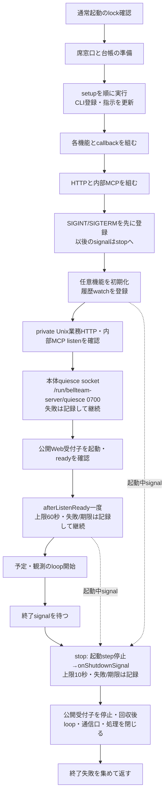
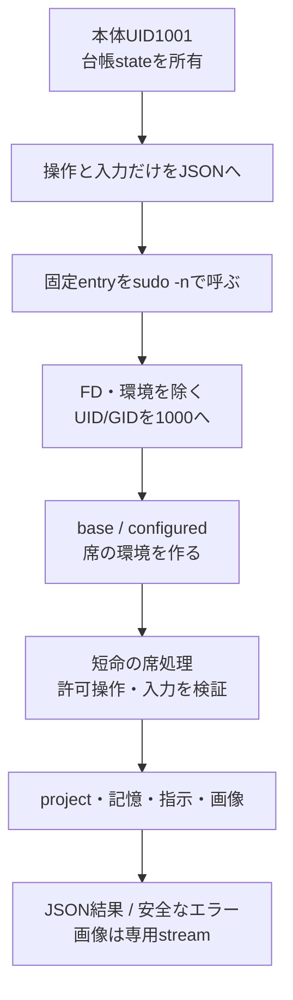
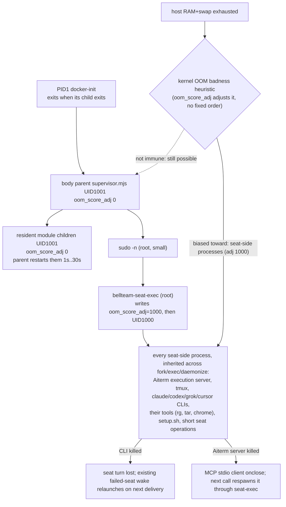
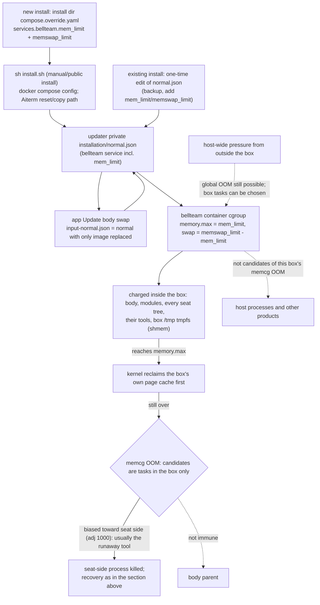
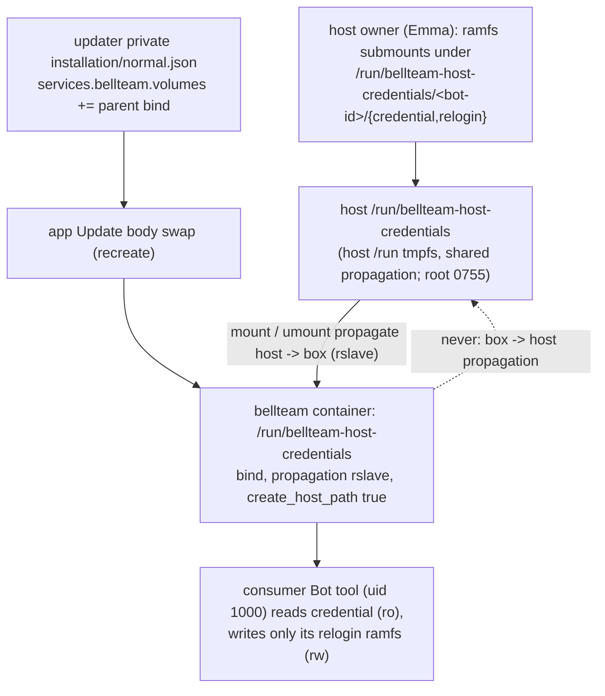
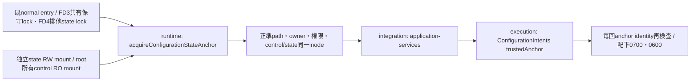
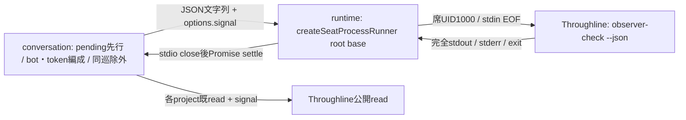

# 起動・席の実行機構

責任者：エピネル。現行の起動・席実行を説明する。サービス組立ては[integration](../integration/README.md)、project構造は[members](../members/README.md)、記憶形式は[memory](../memory/README.md)が所有する。調査起点と確認範囲は[全体図](../../feature-map.md)を参照。[機能図](../../feature-map.md)の起動と席境界を詳しくする。ここで示すUID/設定は製品のコード上の契約であり、Host設定の新しい変更指示ではない。

## 正本を用意してからサービスを開始する

| 段階 | 実関数 | 正本・副作用・失敗 |
| --- | --- | --- |
| 通常起動の入場 | `supervisor.mjs`のUID1001分岐 | 固定entryから受けたFD3/4のinode/metadata/flockを検証。失敗はbootstrapより前に126 |
| H1起動採用 | `adoptRuntimeResume/adoptResumeGeneration` | [H1接続候補](resume.md)。既lock後・bootstrap import前にprivate入力を1000 CLIへpipe。失敗/不明はbootstrapへ進まず、採用済みbundleは再投入しない |
| 組立て前 | `bootstrap.mjs` | top-levelで実処理を行う。席側でnative Aiterm登録を解決→settings/Owner/rules/Bot台帳→directory→旧CLI写し整理→setup→CLI登録→指示生成 |
| service生成 | `createApplicationServices` | 台帳/会話/制御/記憶等の同じ実体を組む。詳細は各機能図へ。HTTPごとに別writerを作らない |
| 入口の生成 | `createApplicationRuntime` | 同じserverOptionsで非公開Unixの公開API handlerとloopback内部HTTPを構築。公開Web受付子との境界は[integrationの正本](../integration/README.md#公開web受付の二プロセス化初回差分)。内部MCPは同じserviceと内部API中継を使う |
| signal登録 | `supervisor.mjs`→`waitForShutdown().then(runtime.stop)` | `createApplicationRuntime`の後、`start`より前に登録。FD3/4検証・`adoptRuntimeResume`・bootstrapの順は不変。それより前のsignalは従来どおりNode既定の終了 |
| 開始 | `start` | features.initialize→公開serverのwatch→既停止意図のenforce→private0700一時directory/socket→両listenの準備完了→supervisorが渡した時だけ本体quiesce socket（[本体更新](container-update-bundled.md#pre-stop-quiesce-of-the-exact-old-body-z-c-slice-1-2026-11-08)。listen失敗は`BODY_QUIESCE_UNAVAILABLE`をstderrへ出して起動を続ける）→最小環境/stdio ignore,inherit,inherit,ipcの受付子ready→`afterListenReady`→各loop.start。各await後にstop要求を確認し、要求済みなら`STARTUP_INTERRUPTED`で後段を開始しない（実行中のstepは取り消さない）。それ以外の同期/awaitで捕えた失敗はcloseも試し、両方の例外を保持 |
| listen後の接点 | `services.lifecycle.afterListenReady()` | 公開Unix・内部loopback/MCP・受付子readyの後、updateCenter通知・scheduler/selfTurns/seatTurns/idleより前に一度だけawait。上限60秒。throwは`LIFECYCLE_CONTACT_FAILED`、期限は`LIFECYCLE_CONTACT_TIMEOUT`をstderrへ出し、どちらもdispatchを開始する（一席の不調で受付や他席を止めない）。待機中のstopは`LIFECYCLE_CONTACT_INTERRUPTED`で待機を抜け、dispatchは開始しない。未供給はno-op |
| 終了待ち | `waitForShutdown` | SIGINT/SIGTERMを待ち、keepaliveをfinallyで除く。起動前に呼ぶ |
| 停止 | `stop` | 一つのstopping Promise。①stop要求を立てて起動の後段とafterListenReady待機を止める（新規dispatchを開始しない）②`services.lifecycle.onShutdownSignal({phase})`を上限10秒でawait（phaseは起動完了後`running`、未完了`starting`。startingは回復・drainが済んでいないことを示し、executionは既holdと元のunknownを保持する。失敗/期限はstderrへ記録し続行）③実行中の起動stepの終了を待つ④下の`close`。supervisorは`STARTUP_INTERRUPTED`を正常終了として扱い`BellTeam ready`を出さない |
| 終了 | `close` | 一つのclosing Promiseに集約。最初に本体quiesce socketの受付を止めsocketを消す（処理中の要求を待たない）→受付子のdrain（5秒でその子だけ強制終了、stdio回収後に失敗返却）→既終了群→private socket directory削除。各終了を順に試し、失敗しても次を閉じる。最後にAggregateError。受付子の単独終了からここへは到達しない |

二つの接点はexecution組立てが`execution.lifecycle = {afterListenReady, onShutdownSignal}`として供給し、`createApplicationServices`が`services.lifecycle`として渡す（未供給は`{}`で両方no-op、挙動不変）。中身（R-resume・held行の再配送・gap summary・hold解放、終了markerの永続化）はKiro/N102が所有し、runtimeは呼ぶ順序と上限だけを持つ。既`close`の内部順序（drain後にlistener停止）は変えず、30秒のstop graceに対しては接点を先に置くだけで、close全体が30秒に収まる保証はしない。超過時はDockerが終了させ、installerは停止結果を記録する（[本体更新](container-update-bundled.md#lifecycle-contact-points-z-c-slice-2-2026-11-08)）。

`createApplicationRuntime`のfactoryをimportしただけではportは開かないが、`bootstrap`のimportは設置や設定更新を行う。二つを同じ「読取り」と扱わない。`server.listen`の呼出しと、OSのlistener準備完了を確認することも同義ではない。この図では新しい起動・停止を実行していない。

## 本体の状態と席のファイルを分ける

| 窓口 | 主な実装 | 維持する契約 |
| --- | --- | --- |
| 操作のproxy | `SeatRuntime.call/projectFiles/memory` | serverの全環境や設定文書を渡さず、操作ごとの入力。response.errorはname/message/code/statusを復元 |
| コマンド構成 | `seatCommandSpec/requireSeatProject` | 絶対project、mode、command/argsを検証。渡す環境は最小PATH。root-owned entryをcheckoutへ置換しない |
| identity変更 | `scripts/seat-exec.c` | FD3以降・継承環境・groupsを除き、`oom_score_adj=1000`を設定（失敗しても起動は続ける）、実効/実/保存UID/GIDを1000へ。変更後にだけNode/対象commandを実行 |
| env選択 | `run-seat-command` → `baseBotEnvironment/loadBotEnvironment` | configuredのみprojectのenv.shを評価。baseはsetupや短命操作用。env.shのJSON値を通常logへ出さない |
| H1固定base | `fixedResumeBase/checkResumeEnvironment` | 信頼済み固定pathをclearenv後に適用し、configured読込後の逸脱は拒否。汎用dynamic envは許可しない |
| 子の取消 | `run-seat-command.run/signalGroup` | detached process groupへsignal。250ms後のKILLを受信時に予約し、leader終了後もgroupが残れば待つ |
| JSONの回収 | `createSeatProcessRunner` | stdout/stderr合計maxBuffer、stdin EOF、start/input/nonzero/abortを区別。stdio close前に取消完了を返さない |
| 許可操作 | `run-seat-runtime.operate` | UID/cwd/root/home検証後、project/memoryは公開method集合だけ。通常memory操作で全件initializeしない |
| 会話添付の一時file | `SeatRuntime.writeTemporaryImage/removeTemporaryImage` | UID1000で生成名の画像を0600/wx作成・削除し、読むCLIと所有者を揃える。server UID1001で作らない |
| project管理 | `ProjectFiles.claim/initialize/writeInstructions/prepareStartupContext/remove` | 既存projectをclaimしない。docs/environment/設定画、git初期化、個別AGENTSと短期記憶を所有 |
| 設定画 | `CharacterSheets.list/open` | 正本直下の許可画像のみ。openはO_NOFOLLOWとfile検証。draftsを一覧へ出さない |
| 画像stream | `createSeatStreamRunner/run-seat-character-sheet` | 先頭metadata→body、size/終了codeを確認するまで最後の1byteを保留。HTTP切断で子を停止 |

streamの役割は巨大な画像を全量JSONへ載せないこと。通常の`SeatRuntime.readImage`は小さい会話添付をbase64で回収する別窓口であり、二つを同じbuffer方式へ統合しない。

席のenv.shは席のUIDで動く。本体専用の診断合鍵は`runtimeEnvironment`が除き、bootstrapからの席呼出しでは固定C entryでも継承環境を除く。これを「全Botが互いのprojectから隔離される」と広げない。全席UID1000という既存の責任境界である。

CLI登録・共有設定・hookの正本は[runtimeの登録図](cli-registration.md)。登録更新の所有と失敗の契約も同図で管理する。

## Host memory exhaustion: bias the OOM killer toward seats (Molly, 2026-11-10)

Owner ruling 2026-11-04: the container is never taken down as a whole; only children are lost and restarted. Production 2026-11-10 08:45:18 JST broke it: with host RAM+swap full, the kernel OOM killer chose the body parent `node /app/src/supervisor.mjs` (UID1001, largest single RSS ~820MB, `oom_score_adj` 0). docker-init (PID1) exits with its only child, so Docker restarted the whole container and every seat lost its turn. Each seat CLI was smaller (~300MB) but there were ~40 of them at the same `oom_score_adj` 0.

| Item | Contract |
| --- | --- |
| Where | One point: `seat-exec.c`, before dropping root. Every UID1000 process the body starts goes through it (`seatCommandSpec`). Children inherit the value across fork/exec/daemonize. Docker drops `CAP_SYS_RESOURCE`, so a seat process could write it back down to 0 itself; no BellTeam, Aiterm or CLI code does that (checked 2026-11-10 with the compiled entry: seat reads 1000). |
| Body side | Parent and module children keep the kernel default 0. No negative value: the body runs without `CAP_SYS_RESOURCE`, and the Host's own processes keep their order relative to the body. |
| Effect | A priority bias toward seat processes in the kernel's OOM badness heuristic ([kernel contract](https://docs.kernel.org/6.12/filesystems/proc.html#oom-adj)). It does not guarantee a victim order and does not make the body immune. |
| Failure | Writing `/proc/self/oom_score_adj` failing is ignored; the seat starts and the prior behavior (inherited value, 0) is retained. Not a guard. |
| No new limit | Turn start and concurrency are unchanged. The box memory bound is the next section (body container owner, Molly, since 2026-11-11). Host swap/OS changes stay Host-owned (Emma). |
| Not covered | The body can still be chosen. The parent's own ~800MB+ RSS is a separate question, not changed here. |

## Box memory bound: BellTeam's demand stays inside its own cgroup (Molly, 2026-11-11)

Production 2026-11-09..11 (Trony, Emma's host assessment r20): the host OOM killer fired 30 times in 48 h. The body container had no memory bound (`HostConfig.Memory` 0, cgroup `memory.max` max), so one runaway seat-side process (a `node` at 5.4-8.0 GB anon killed 7 times on 11-09 14:15-14:18 JST; a `grep` at 3.8 GB on 11-10 10:46) plus the other seats pushed the whole host into global OOM. The kernel then also chose processes outside BellTeam (the nightly backup `tar`, spotter, dbus, systemd). The seat bias above only biases victim selection; it never stops BellTeam's demand from reaching the host.

| Item | Contract |
| --- | --- |
| Carrier | The bound is installation configuration, not image content. Its home is the bundled updater's private `installation/normal.json`. A new install gets it from the install directory's `compose.override.yaml` (the documented place in `distribution/server/README.md`) through `sh install.sh`. Do not re-run `sh install.sh` on an existing install only to add the bound: manual/public installs take the Aiterm reset/copy path, and only the bundled worker preserves Aiterm ([container-update-bundled](container-update-bundled.md)). An existing install adds the two keys to `normal.json` once (backup first, root 0600, string byte values as `docker compose config` renders them), and the next app Update applies them. `docker update --memory/--memory-swap` gives the same bound live until that swap. App Update replaces only `services.bellteam.image` in that model; `module-update-compose.mjs` and `container-update-compose.mjs` add their mounts in place and keep every other key, so the bound survives every later body swap. A new image's `compose.yaml` never changes it. |
| Production value | `mem_limit: 18g`, `memswap_limit: 18g` (no box swap). Host 29265 MiB RAM + 8 GiB swap; other products about 3.3 GiB; observed box peak 15.43 GiB including page cache, light load 7.6 GiB. 18 GiB keeps the box above its observed peak and leaves the host RAM for its own jobs without host swap. Production 2026-11-11: live `docker update` 07:5x JST, then both keys added to `normal.json` before the 0.70.12 app Update. To change it, edit the same two keys in `normal.json`, and apply them live with `docker update` or with the next app Update. |
| At the bound | Reclaim, then memcg OOM inside the box. That memcg OOM chooses only among the box's tasks, so host processes and other products are not its candidates. The bound does not make anything immune to a host-wide (global) OOM caused by host-wide pressure; then the 2026-11-10 bias-only contract above applies (no guaranteed victim order, body not immune). No turn is refused, queued or stopped by BellTeam; only the kernel's victim (normally the largest seat-side process) is lost, and the existing seat recovery applies. Not a guard. |
| Distributed default | None. `compose.yaml` keeps no `mem_limit`, because the right value depends on the machine; the README already tells installers to set it in the override. |
| Not covered | Memory written on the host outside the box (for example host `/tmp` tmpfs files created over ssh) is Host-owned. A box that needs more than the bound loses seat-side processes until the value is raised. |

## Host credential mount: host-delivered secrets reach the box without a restart (Molly, 2026-11-11)

Request: Emma (host owner) for Sora's optional Plaud OAuth vault adapter (K-XQ4SMA, caller `bot-565a9f93/docs/plaud-oauth-writeback-design.md`): a read-only runtime credential and a private writable scratch, both on host ramfs, never in container env, argv or persistent disk. Every existing bind of the body container is `rprivate`, so a host mount made after the container starts is never visible inside. One parent bind with `rslave` propagation fixes that once; after it, the host adds and removes submounts live.

| Item | Contract |
| --- | --- |
| Carrier | Installation configuration, like the memory bound above: one entry in `installation/normal.json` `services.bellteam.volumes`: `{type: bind, source: /run/bellteam-host-credentials, target: /run/bellteam-host-credentials, bind: {propagation: rslave, create_host_path: true}}`. App Update keeps it (only `image` is replaced). Adding or changing it needs one recreate; production adds it with the next approved body swap, never a separate restart. Not in the public `compose.yaml` (no distributed default). |
| Live after that | The host mounts or unmounts ramfs under the parent at any time; the box sees it at once (rslave). The box cannot propagate mounts back to the host. Host reboot: `/run` is empty again and `create_host_path` recreates an empty directory so the box still starts; the consumer sees no credential until the host owner remounts it. |
| Paths | Per consumer `/run/bellteam-host-credentials/<bot-id>/credential` (ro ramfs, files 0400 uid 1000) and `/run/bellteam-host-credentials/<bot-id>/relogin` (rw ramfs, 0700 uid 1000). Same path inside and outside. The host owner owns ownership, modes, ramfs verification and teardown. |
| UID limit | Every seat and Bot tool in the box runs as uid 1000 (`bell`); the server is uid 1001. The box has no per-Bot uid, so a file readable by one Bot's tool is readable by every Bot seat in the box. The mount keeps the secret out of env, argv, image and persistent disk; it does not isolate Bots from each other. |
| Not a guard | Nothing is refused or stopped: an empty parent only means the credential is absent, which the consumer reports as its own unavailable state. |

## 設定保存へ管理済みstateだけを渡す

`acquireConfigurationStateAnchor(root)`は既`lifecycle`窓口の固定state条件を公開する。`root === /srv/bellteam`の通常本体だけ、実効/実UID・GID1001、FD3/4のinodeと本人PIDのFLOCK、root0:1001/0750の保守root、state1001:1001/非group-other write、全固定pathのrealpath一致、保守root内stateと固定stateの同一dev/ino、実mountinfoのcontrol RO/state RWを確認し、frozen `{path,uid,dev,ino}`を返す。上位`/`・`/srv`・`/run`はroot所有かつ非group-other write、`/srv/bellteam`は既1000:1000/0711のまま。独立mountのleafは席所有の親からrenameできず、controlのroot所有親とnormal/maintenance lockが管理済み実体を束縛する。実装は[configuration-state-anchor.mjs](../../../../src/configuration-state-anchor.mjs)。

組立ては本値を`new ConfigurationIntents(fixedIntentsRoot,{trustedAnchor})`へ渡す。executionは毎回anchorのrealpath/owner/mode/dev/inoと配下のprivate0700/file0600/symlink/wrongownerを検査する。固定root以外はundefinedで従来の全祖先厳格検査を使う。production条件不成立は`CONFIGURATION_STORAGE_INVALID`で公開受付より前に失敗し、広いUID1000許可や自動chmod/chownへ変えない。パス/UID/anchorをHTTP/MCP入力やenv設定へ追加しない。

信頼するのは既管理mountと正常本体の同UID writerであり、root/Host/Docker管理者や悪意ある同UID1001から隔離する契約ではない。state0711は既call-bridge等の到達に必要なまま保持し、configuration-intents/Botの0700と対象file0600をconsumerが所有する。保存/prepare/pending/原要求終端と診断の正本は[execution](../execution/configuration-requests.md)、既mount/移行条件は[recovery](recovery.md)。新しい保存サービスや本番権限操作を追加しない。

## Throughline公開observer-checkの実行接続

N102のconsumer差分と同時に採用する。runtimeの旧SeatRuntime.throughlineChangedとthroughline-signature dispatchを除き、私有DB/WALのmtimeを席機構から読まない。consumer実装・結果検証・token/cursor保存・分割はN102、製品schema/binはThroughlineが所有する。正式CLI0.16.56/sourcee7f8a701e521abbbe822bdb7fbdfdcf0e243cb57をDockerfileと既同image版検査へ固定する。公開check/read・hook命令・JSON/schema12契約は不変として継承し、本番の採用記録とは分ける。

CLI登録は既`configureHarnesses → throughline install`を使う。通常のCodex `post-tool-use`失敗では、Throughlineが元例外/stack/event/stage/取得済みsession/transcript参照を私有ログへ先行保存し、既公開runtime-errorsへfingerprint/count/unknown影響を記録してexit1を保持する。診断の保存・収集設定・DBはThroughlineが所有し、BellTeamは私有DBを読まず、実席の収集設定を変更しない。正式供給の隔離CLI確認と、同source image/本番への実反映は別工程。元container例外の原因・利用者影響はunknown、repair_success=falseであり、この版更新を修理成功へ補完しない。

consumerは既createSeatProcessRunner(root,{environment:'base'})を直接使う。inputはUTF8 1MiB以内、stdout/stderr合計は既16MiB、input+EOF/close/非0拒否/取消時の子回収は既runnerの契約のまま。signalをJSONへ入れずoptionsへ渡す。結果schema/両上限での編成・分割/pending/消費cursor/tokenの保存はruntimeへ移さない。ThroughlineのDB/WAL fallbackや新しいruntime業務handler、daemonは加えない。

runtimeの限定確認は旧method非公開と旧dispatch拒否、残存callerの責任確認だけ。conversation-services/self-turnsの旧callerはN102のconsumer差分で外すため、runtime単独では採用しない。既runner人工8case/製品試験/実DB/席/Host/本番は再走しない。
