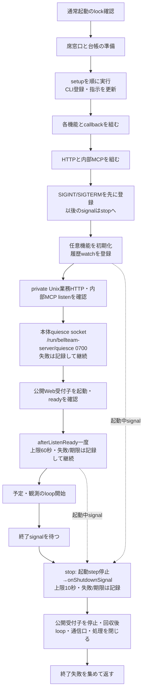
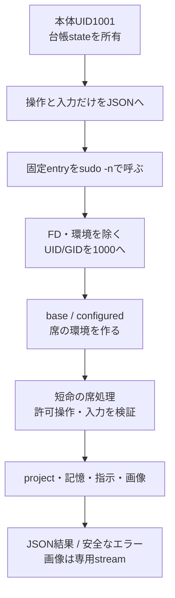
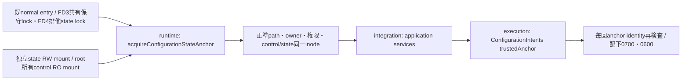
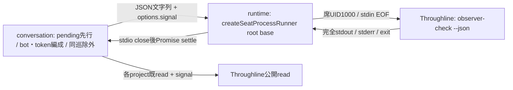

# 起動・席の実行機構

責任者：エピネル。現行の起動・席実行を説明する。サービス組立ては[integration](../integration/README.md)、project構造は[members](../members/README.md)、記憶形式は[memory](../memory/README.md)が所有する。調査起点と確認範囲は[全体図](../../feature-map.md)を参照。[機能図](../../feature-map.md)の起動と席境界を詳しくする。ここで示すUID/設定は製品のコード上の契約であり、Host設定の新しい変更指示ではない。

## 正本を用意してからサービスを開始する

| 段階 | 実関数 | 正本・副作用・失敗 |
| --- | --- | --- |
| 通常起動の入場 | `supervisor.mjs`のUID1001分岐 | 固定entryから受けたFD3/4のinode/metadata/flockを検証。失敗はbootstrapより前に126 |
| H1起動採用 | `adoptRuntimeResume/adoptResumeGeneration` | [H1接続候補](resume.md)。既lock後・bootstrap import前にprivate入力を1000 CLIへpipe。失敗/不明はbootstrapへ進まず、採用済みbundleは再投入しない |
| 組立て前 | `bootstrap.mjs` | top-levelで実処理を行う。席側でnative Aiterm登録を解決→settings/Owner/rules/Bot台帳→directory→旧CLI写し整理→setup→CLI登録→指示生成 |
| service生成 | `createApplicationServices` | 台帳/会話/制御/記憶等の同じ実体を組む。詳細は各機能図へ。HTTPごとに別writerを作らない |
| 入口の生成 | `createApplicationRuntime` | 同じserverOptionsで非公開Unixの公開API handlerとloopback内部HTTPを構築。公開Web受付子との境界は[integrationの正本](../integration/README.md#公開web受付の二プロセス化初回差分)。内部MCPは同じserviceと内部API中継を使う |
| signal登録 | `supervisor.mjs`→`waitForShutdown().then(runtime.stop)` | `createApplicationRuntime`の後、`start`より前に登録。FD3/4検証・`adoptRuntimeResume`・bootstrapの順は不変。それより前のsignalは従来どおりNode既定の終了 |
| 開始 | `start` | features.initialize→公開serverのwatch→既停止意図のenforce→private0700一時directory/socket→両listenの準備完了→supervisorが渡した時だけ本体quiesce socket（[本体更新](container-update-bundled.md#pre-stop-quiesce-of-the-exact-old-body-z-c-slice-1-2026-11-08)。listen失敗は`BODY_QUIESCE_UNAVAILABLE`をstderrへ出して起動を続ける）→最小環境/stdio ignore,inherit,inherit,ipcの受付子ready→`afterListenReady`→各loop.start。各await後にstop要求を確認し、要求済みなら`STARTUP_INTERRUPTED`で後段を開始しない（実行中のstepは取り消さない）。それ以外の同期/awaitで捕えた失敗はcloseも試し、両方の例外を保持 |
| listen後の接点 | `services.lifecycle.afterListenReady()` | 公開Unix・内部loopback/MCP・受付子readyの後、updateCenter通知・scheduler/selfTurns/seatTurns/idleより前に一度だけawait。上限60秒。throwは`LIFECYCLE_CONTACT_FAILED`、期限は`LIFECYCLE_CONTACT_TIMEOUT`をstderrへ出し、どちらもdispatchを開始する（一席の不調で受付や他席を止めない）。待機中のstopは`LIFECYCLE_CONTACT_INTERRUPTED`で待機を抜け、dispatchは開始しない。未供給はno-op |
| 終了待ち | `waitForShutdown` | SIGINT/SIGTERMを待ち、keepaliveをfinallyで除く。起動前に呼ぶ |
| 停止 | `stop` | 一つのstopping Promise。①stop要求を立てて起動の後段とafterListenReady待機を止める（新規dispatchを開始しない）②`services.lifecycle.onShutdownSignal({phase})`を上限10秒でawait（phaseは起動完了後`running`、未完了`starting`。startingは回復・drainが済んでいないことを示し、executionは既holdと元のunknownを保持する。失敗/期限はstderrへ記録し続行）③実行中の起動stepの終了を待つ④下の`close`。supervisorは`STARTUP_INTERRUPTED`を正常終了として扱い`BellTeam ready`を出さない |
| 終了 | `close` | 一つのclosing Promiseに集約。最初に本体quiesce socketの受付を止めsocketを消す（処理中の要求を待たない）→受付子のdrain（5秒でその子だけ強制終了、stdio回収後に失敗返却）→既終了群→private socket directory削除。各終了を順に試し、失敗しても次を閉じる。最後にAggregateError。受付子の単独終了からここへは到達しない |

二つの接点はexecution組立てが`execution.lifecycle = {afterListenReady, onShutdownSignal}`として供給し、`createApplicationServices`が`services.lifecycle`として渡す（未供給は`{}`で両方no-op、挙動不変）。中身（R-resume・held行の再配送・gap summary・hold解放、終了markerの永続化）はKiro/N102が所有し、runtimeは呼ぶ順序と上限だけを持つ。既`close`の内部順序（drain後にlistener停止）は変えず、30秒のstop graceに対しては接点を先に置くだけで、close全体が30秒に収まる保証はしない。超過時はDockerが終了させ、installerは停止結果を記録する（[本体更新](container-update-bundled.md#lifecycle-contact-points-z-c-slice-2-2026-11-08)）。

`createApplicationRuntime`のfactoryをimportしただけではportは開かないが、`bootstrap`のimportは設置や設定更新を行う。二つを同じ「読取り」と扱わない。`server.listen`の呼出しと、OSのlistener準備完了を確認することも同義ではない。この図では新しい起動・停止を実行していない。

## 本体の状態と席のファイルを分ける

| 窓口 | 主な実装 | 維持する契約 |
| --- | --- | --- |
| 操作のproxy | `SeatRuntime.call/projectFiles/memory` | serverの全環境や設定文書を渡さず、操作ごとの入力。response.errorはname/message/code/statusを復元 |
| コマンド構成 | `seatCommandSpec/requireSeatProject` | 絶対project、mode、command/argsを検証。渡す環境は最小PATH。root-owned entryをcheckoutへ置換しない |
| identity変更 | `scripts/seat-exec.c` | FD3以降・継承環境・groupsを除き、実効/実/保存UID/GIDを1000へ。変更後にだけNode/対象commandを実行 |
| env選択 | `run-seat-command` → `baseBotEnvironment/loadBotEnvironment` | configuredのみprojectのenv.shを評価。baseはsetupや短命操作用。env.shのJSON値を通常logへ出さない |
| H1固定base | `fixedResumeBase/checkResumeEnvironment` | 信頼済み固定pathをclearenv後に適用し、configured読込後の逸脱は拒否。汎用dynamic envは許可しない |
| 子の取消 | `run-seat-command.run/signalGroup` | detached process groupへsignal。250ms後のKILLを受信時に予約し、leader終了後もgroupが残れば待つ |
| JSONの回収 | `createSeatProcessRunner` | stdout/stderr合計maxBuffer、stdin EOF、start/input/nonzero/abortを区別。stdio close前に取消完了を返さない |
| 許可操作 | `run-seat-runtime.operate` | UID/cwd/root/home検証後、project/memoryは公開method集合だけ。通常memory操作で全件initializeしない |
| 会話添付の一時file | `SeatRuntime.writeTemporaryImage/removeTemporaryImage` | UID1000で生成名の画像を0600/wx作成・削除し、読むCLIと所有者を揃える。server UID1001で作らない |
| project管理 | `ProjectFiles.claim/initialize/writeInstructions/prepareStartupContext/remove` | 既存projectをclaimしない。docs/environment/設定画、git初期化、個別AGENTSと短期記憶を所有 |
| 設定画 | `CharacterSheets.list/open` | 正本直下の許可画像のみ。openはO_NOFOLLOWとfile検証。draftsを一覧へ出さない |
| 画像stream | `createSeatStreamRunner/run-seat-character-sheet` | 先頭metadata→body、size/終了codeを確認するまで最後の1byteを保留。HTTP切断で子を停止 |

streamの役割は巨大な画像を全量JSONへ載せないこと。通常の`SeatRuntime.readImage`は小さい会話添付をbase64で回収する別窓口であり、二つを同じbuffer方式へ統合しない。

席のenv.shは席のUIDで動く。本体専用の診断合鍵は`runtimeEnvironment`が除き、bootstrapからの席呼出しでは固定C entryでも継承環境を除く。これを「全Botが互いのprojectから隔離される」と広げない。全席UID1000という既存の責任境界である。

CLI登録・共有設定・hookの正本は[runtimeの登録図](cli-registration.md)。登録更新の所有と失敗の契約も同図で管理する。

## 設定保存へ管理済みstateだけを渡す

`acquireConfigurationStateAnchor(root)`は既`lifecycle`窓口の固定state条件を公開する。`root === /srv/bellteam`の通常本体だけ、実効/実UID・GID1001、FD3/4のinodeと本人PIDのFLOCK、root0:1001/0750の保守root、state1001:1001/非group-other write、全固定pathのrealpath一致、保守root内stateと固定stateの同一dev/ino、実mountinfoのcontrol RO/state RWを確認し、frozen `{path,uid,dev,ino}`を返す。上位`/`・`/srv`・`/run`はroot所有かつ非group-other write、`/srv/bellteam`は既1000:1000/0711のまま。独立mountのleafは席所有の親からrenameできず、controlのroot所有親とnormal/maintenance lockが管理済み実体を束縛する。実装は[configuration-state-anchor.mjs](../../../../src/configuration-state-anchor.mjs)。

組立ては本値を`new ConfigurationIntents(fixedIntentsRoot,{trustedAnchor})`へ渡す。executionは毎回anchorのrealpath/owner/mode/dev/inoと配下のprivate0700/file0600/symlink/wrongownerを検査する。固定root以外はundefinedで従来の全祖先厳格検査を使う。production条件不成立は`CONFIGURATION_STORAGE_INVALID`で公開受付より前に失敗し、広いUID1000許可や自動chmod/chownへ変えない。パス/UID/anchorをHTTP/MCP入力やenv設定へ追加しない。

信頼するのは既管理mountと正常本体の同UID writerであり、root/Host/Docker管理者や悪意ある同UID1001から隔離する契約ではない。state0711は既call-bridge等の到達に必要なまま保持し、configuration-intents/Botの0700と対象file0600をconsumerが所有する。保存/prepare/pending/原要求終端と診断の正本は[execution](../execution/configuration-requests.md)、既mount/移行条件は[recovery](recovery.md)。新しい保存サービスや本番権限操作を追加しない。

## Throughline公開observer-checkの実行接続

N102のconsumer差分と同時に採用する。runtimeの旧SeatRuntime.throughlineChangedとthroughline-signature dispatchを除き、私有DB/WALのmtimeを席機構から読まない。consumer実装・結果検証・token/cursor保存・分割はN102、製品schema/binはThroughlineが所有する。正式CLI0.16.56/sourcee7f8a701e521abbbe822bdb7fbdfdcf0e243cb57をDockerfileと既同image版検査へ固定する。公開check/read・hook命令・JSON/schema12契約は不変として継承し、本番の採用記録とは分ける。

CLI登録は既`configureHarnesses → throughline install`を使う。通常のCodex `post-tool-use`失敗では、Throughlineが元例外/stack/event/stage/取得済みsession/transcript参照を私有ログへ先行保存し、既公開runtime-errorsへfingerprint/count/unknown影響を記録してexit1を保持する。診断の保存・収集設定・DBはThroughlineが所有し、BellTeamは私有DBを読まず、実席の収集設定を変更しない。正式供給の隔離CLI確認と、同source image/本番への実反映は別工程。元container例外の原因・利用者影響はunknown、repair_success=falseであり、この版更新を修理成功へ補完しない。

consumerは既createSeatProcessRunner(root,{environment:'base'})を直接使う。inputはUTF8 1MiB以内、stdout/stderr合計は既16MiB、input+EOF/close/非0拒否/取消時の子回収は既runnerの契約のまま。signalをJSONへ入れずoptionsへ渡す。結果schema/両上限での編成・分割/pending/消費cursor/tokenの保存はruntimeへ移さない。ThroughlineのDB/WAL fallbackや新しいruntime業務handler、daemonは加えない。

runtimeの限定確認は旧method非公開と旧dispatch拒否、残存callerの責任確認だけ。conversation-services/self-turnsの旧callerはN102のconsumer差分で外すため、runtime単独では採用しない。既runner人工8case/製品試験/実DB/席/Host/本番は再走しない。
