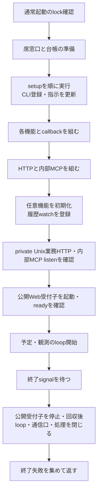
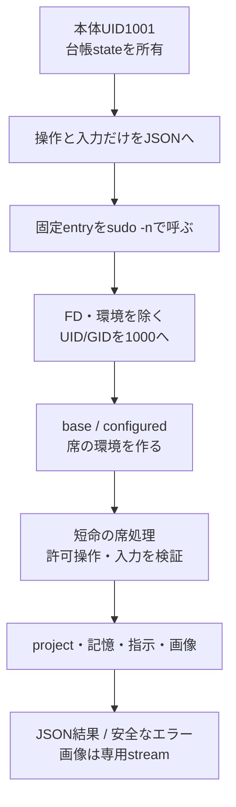
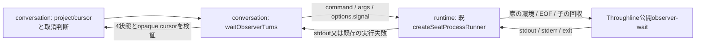

# 起動・席の実行機構

責任者：エピネル。現行の起動・席実行を説明する。サービス組立ては[integration](../integration/README.md)、project構造は[members](../members/README.md)、記憶形式は[memory](../memory/README.md)が所有する。調査起点と確認範囲は[全体図](../../feature-map.md)を参照。[機能図](../../feature-map.md)の起動と席境界を詳しくする。ここで示すUID/設定は製品のコード上の契約であり、Host設定の新しい変更指示ではない。

## 正本を用意してからサービスを開始する

| 段階 | 実関数 | 正本・副作用・失敗 |
| --- | --- | --- |
| 通常起動の入場 | `supervisor.mjs`のUID1001分岐 | 固定entryから受けたFD3/4のinode/metadata/flockを検証。失敗はbootstrapより前に126 |
| H1起動採用 | `adoptRuntimeResume/adoptResumeGeneration` | [H1接続候補](resume.md)。既lock後・bootstrap import前にprivate入力を1000 CLIへpipe。失敗/不明はbootstrapへ進まず、採用済みbundleは再投入しない |
| 組立て前 | `bootstrap.mjs` | top-levelで実処理を行う。席側でnative Aiterm登録を解決→settings/Owner/rules/Bot台帳→directory→旧CLI写し整理→setup→CLI登録→指示生成 |
| service生成 | `createApplicationServices` | 台帳/会話/制御/記憶等の同じ実体を組む。詳細は各機能図へ。HTTPごとに別writerを作らない |
| 入口の生成 | `createApplicationRuntime` | 同じserverOptionsで非公開Unixの公開API handlerとloopback内部HTTPを構築。公開Web受付子との境界は[integrationの正本](../integration/README.md#公開web受付の二プロセス化初回差分)。内部MCPは同じserviceと内部API中継を使う |
| 開始 | `start` | features.initialize→公開serverのwatch→既停止意図のenforce→private0700一時directory/socket→両listenの準備完了→最小環境/stdio ignore,inherit,inherit,ipcの受付子ready→各loop.start。同期/awaitで捕えた失敗はcloseも試し、両方の例外を保持 |
| 終了待ち | `waitForShutdown` | SIGINT/SIGTERMを待ち、keepaliveをfinallyで除く |
| 終了 | `close` | 一つのclosing Promiseに集約。受付子のdrain（5秒でその子だけ強制終了、stdio回収後に失敗返却）→既終了群→private socket directory削除。各終了を順に試し、失敗しても次を閉じる。最後にAggregateError。受付子の単独終了からここへは到達しない |

`createApplicationRuntime`のfactoryをimportしただけではportは開かないが、`bootstrap`のimportは設置や設定更新を行う。二つを同じ「読取り」と扱わない。`server.listen`の呼出しと、OSのlistener準備完了を確認することも同義ではない。この図では新しい起動・停止を実行していない。

## 本体の状態と席のファイルを分ける

| 窓口 | 主な実装 | 維持する契約 |
| --- | --- | --- |
| 操作のproxy | `SeatRuntime.call/projectFiles/memory` | serverの全環境や設定文書を渡さず、操作ごとの入力。response.errorはname/message/code/statusを復元 |
| コマンド構成 | `seatCommandSpec/requireSeatProject` | 絶対project、mode、command/argsを検証。渡す環境は最小PATH。root-owned entryをcheckoutへ置換しない |
| identity変更 | `scripts/seat-exec.c` | FD3以降・継承環境・groupsを除き、実効/実/保存UID/GIDを1000へ。変更後にだけNode/対象commandを実行 |
| env選択 | `run-seat-command` → `baseBotEnvironment/loadBotEnvironment` | configuredのみprojectのenv.shを評価。baseはsetupや短命操作用。env.shのJSON値を通常logへ出さない |
| H1固定base | `fixedResumeBase/checkResumeEnvironment` | 信頼済み固定pathをclearenv後に適用し、configured読込後の逸脱は拒否。汎用dynamic envは許可しない |
| 子の取消 | `run-seat-command.run/signalGroup` | detached process groupへsignal。250ms後のKILLを受信時に予約し、leader終了後もgroupが残れば待つ |
| JSONの回収 | `createSeatProcessRunner` | stdout/stderr合計maxBuffer、stdin EOF、start/input/nonzero/abortを区別。stdio close前に取消完了を返さない |
| 許可操作 | `run-seat-runtime.operate` | UID/cwd/root/home検証後、project/memoryは公開method集合だけ。通常memory操作で全件initializeしない |
| 会話添付の一時file | `SeatRuntime.writeTemporaryImage/removeTemporaryImage` | UID1000で生成名の画像を0600/wx作成・削除し、読むCLIと所有者を揃える。server UID1001で作らない |
| project管理 | `ProjectFiles.claim/initialize/writeInstructions/prepareStartupContext/remove` | 既存projectをclaimしない。docs/environment/設定画、git初期化、個別AGENTSと短期記憶を所有 |
| 設定画 | `CharacterSheets.list/open` | 正本直下の許可画像のみ。openはO_NOFOLLOWとfile検証。draftsを一覧へ出さない |
| 画像stream | `createSeatStreamRunner/run-seat-character-sheet` | 先頭metadata→body、size/終了codeを確認するまで最後の1byteを保留。HTTP切断で子を停止 |

streamの役割は巨大な画像を全量JSONへ載せないこと。通常の`SeatRuntime.readImage`は小さい会話添付をbase64で回収する別窓口であり、二つを同じbuffer方式へ統合しない。

席のenv.shは席のUIDで動く。本体専用の診断合鍵は`runtimeEnvironment`が除き、bootstrapからの席呼出しでは固定C entryでも継承環境を除く。これを「全Botが互いのprojectから隔離される」と広げない。全席UID1000という既存の責任境界である。

CLI登録・共有設定・hookの正本は[runtimeの登録図](cli-registration.md)。登録更新の所有と失敗の契約も同図で管理する。

## Throughline待機の接続案

状態：N102のconsumer切替と同時に行う分離案。現行の`SeatRuntime.throughlineChanged`と`run-seat-runtime`の`throughline-signature`はまだ残っている。これらのDB/WALのmtime参照を公開待機へ移し、両側のcaller/注入を合わせてから除く。

runtimeは既runnerのまま、stdout/stderr合計buffer、空stdinのEOF、実行終了/取消後のstdio回収を持つ。AbortSignalはoptionsへ渡してJSON化しない。callerのabortではstdio close後にABORT_ERRを返す。CLI自身の取消exit1/空stdoutをtimeoutやchangedへ変えず、既nonzero失敗として返す。runnerは製品のstderr JSONを業務結果へ自動変換しない。汎用runnerを待機だけのために緩和しない。

公開waitの状態とcursorの仕様は[Throughline正本](../throughline/README.md)、consumerのcursor/seen/pending・ページング・初回reset/resync・Bot間の待機方法は[conversation正本](../conversation/README.md)へ辿る。最小waitは1秒で、複数projectを安価に一括確認する公開窓口は現行にはない。既全体booleanと同等の性能を保証しない。新しいruntime業務handler、daemon、DB fallbackは作らない。

切替時の直接境界は、conversation側のwait注入/停止時取消と、runtime側の旧signature caller除去。N102がreadの未消化分を保持したまま、停止が待機回収まで待つことを限定試験で合わせる。公式供給版・実DB・実席の確認をsource契約の読取で代用しない。
