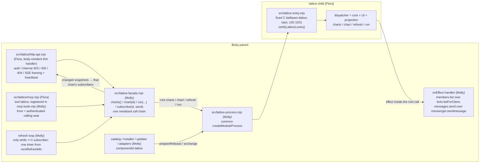

# lattice as an independently updated module child

Owner of this page: Molly (parent side). Child entry, protocol, channel factories, core/cli/projection, the body-resident HTTP handler and the MCP tool schema/handler: Flora ([lattice](../lattice/README.md)). Lattice itself: Snow White. Ruling: Trony 2026-11-11 JST, Owner order. Lattice工程表 runs as a normal module child with the same shape as [work-graph](work-graph-child.md), so a module change or a Lattice version bump updates it without stopping the body.

## Function map

## Data flow

| Step | From → to | Data | Owner of the data |
| --- | --- | --- | --- |
| 1 | Owner client → http-api | `GET /api/lattice/charts`, `GET /api/lattice/charts/:id`, `GET /api/lattice/charts/:id/events` (common authorizer; internal server 403 `LATTICE_OWNER_REQUIRED`; non-GET 405) | none |
| 2 | http-api → facade.charts() / facade.chart(id) → child root `charts {}` / `chart {projectId}` | `bellteam.lattice-charts.v1` / `bellteam.lattice-chart.v1`, JSON body as is | child memory, chart stores |
| 3 | http-api → facade.subscribe(id, send) | per-chart subscriber set. The first subscriber of any chart starts the loop with one root `refresh` at once; the last unsubscribe of all charts clears the timer | facade memory |
| 4 | loop → facade → child root `refresh {projectIds}` | every subscribed chart id, sorted, in slices of 50, serialized. Result `{snapshots, nextRefreshMs}`; each snapshot goes whole to that chart's subscribers; one timer from `nextRefreshMs` (a failed refresh re-arms with 2000 ms) | child memory |
| 5 | seat → bellteam MCP → facade.run({from, projectId, args, input, name?}) → child root `run` | `from` = the calling seat's Bot id resolved by `seat-mcp` (a fork resolves to its parent Bot), never a tool argument. `name` is forwarded only when the seat gave it (the child validates it: `LATTICE_NAME_INVALID`). Result `{exitCode, result, stdout, stderr}`. When the chart has subscribers, one root `refresh {projectIds:[projectId]}` follows on the same chain at once | chart stores (Lattice CLI in the child) |
| 6 | child → parent effect (only inside a root call) | `members.list {}` → `{members:[{id,name,color,avatarVersion,deleting}]}` (bots.listForClient, the same normalization as work-graph) | members (read only) |
| 7 | child → parent effect (only inside root `run` / `deliver`) | `messages.send {from, target, message}` (three non-empty strings, `message` <= 4000) → `{delivery, deliveryId, code?}`: `messenger.sendmessage({from, target, message})`, `delivery_id` mapped to `deliveryId`; `from` or `target` equal to `user` (the messenger would make an Owner turn or Owner-screen post) → `{delivery:'refused', deliveryId:null, code:'LATTICE_SEND_USER_NOT_ALLOWED'}` without calling it; `SENDER_NOT_FOUND` / `BOT_NOT_FOUND` / `MESSAGE_REQUIRED` → `{delivery:'refused', deliveryId:null, code}`; any other error is thrown (the child keeps the notice unacked) | direct messages (messenger) |
| 8 | module-process onGeneration → facade.deliver() → child root `deliver {}` | once per generation, held until ready; result `{delivered, failed}`; a refusal (old child) is swallowed | chart stores (notice acks, Lattice) |

The parent writes no lattice state and creates no directory for it. The child creates `/srv/bellteam/state/lattice/<project>/` and `/srv/bellteam/state/lattice-home/` itself, and keeps one writer lock `/srv/bellteam/state/lattice.lock` (the common fixed-C rule). Adoption record: `state/lattice-release.json` (the common `bellteam.<component>.adoption.v1`). A new child means a new epoch; its first refresh pushes every subscribed chart again.

## Seam (Flora 2026-11-11)

- Child (Flora): `src/lattice-protocol.mjs` (`LATTICE_PROTOCOL_VERSION=1`, `LATTICE_STATE_COMPATIBILITY={state:'none'}`, `assertLatticeStateCompatibility`, root `charts`/`chart`/`refresh`/`run`/`deliver`, effects `members.list`/`messages.send`, control validators, `validateLatticeReady`), `src/lattice-ipc.mjs` (`createLatticeParentChannel(child, {generation, onEffect})`, `createLatticeChildChannel({dispatcher})`), `src/lattice-dispatcher.mjs`, `src/lattice-entry.mjs`, `src/lattice/{core,cli,projection,notices,http-api,mcp}.mjs`.
- Parent (Molly): the files below. The parent channel validates every effect request before `onEffect(method, params)` and every root result. The lattice channel has no `drainIncoming`: its effect runs only inside root calls, which the common controller already drains.
- Facade errors: `LATTICE_CHART_NOT_FOUND` (404), `LATTICE_PROJECT_INVALID`, `LATTICE_INPUT_CONFLICT`, `LATTICE_COMMAND_NOT_SEAT_SURFACE`, `LATTICE_INVALID` (400) pass through with their status; every other failure becomes 503 `LATTICE_UNAVAILABLE`.
- Ready probe of a new child (common `probeCandidate`): root `refresh {projectIds:['bellteam-ready-probe']}`. An id with no chart answers `{snapshots:[], nextRefreshMs}` without spawning the Lattice CLI, so a slow chart cannot fail an exchange.
- Compatibility in the catalog: `{ nodeMajor: 26, parentProtocol: 1, stateSchema: null, containerUpdate: null, stateCompatibility: {state:'none'} }`.
- A new effect method, a tool schema change or a route change is a parent change and ships with a body image. Core, projection, cli and the bundled Lattice version ship only in the child asset.

## Bundled Lattice package

The child spawns `@quolu/lattice/bin/lattice.mjs`, resolved from the payload's own `node_modules`. The body's root `package.json` does not carry it. The packager replaces `payload/package.json` and `payload/package-lock.json` with `distribution/lattice/package.json` and `distribution/lattice/package-lock.json` from the same source commit, then runs the common `npm ci --omit=dev` ([business artifacts](../distribution/business-artifacts.md)). The pin is 0.85.5, the first release with `todo display source/read`.

The builtin child (`/app`) carries the same pin: the image runs `npm ci --omit=dev` on the same `distribution/lattice` lock and places its `node_modules` at `/app/src/lattice/node_modules`, so `src/lattice/cli.mjs` resolves the CLI there before `/app/node_modules`, and the body's root dependencies stay unchanged. The image build fails if that resolve fails. `scripts/package-server.mjs` carries `distribution/lattice/{package.json,package-lock.json}` into the server context (kept at the same path through its distribution cleanup), and publish-server-image's `paths` include both, so a pin bump also cuts an image. Why: the updater treats a signed release from the body's own source commit as already current (`UPDATE_ALREADY_CURRENT`), and module-process falls back to the builtin on a state mismatch, so the builtin must run Lattice on its own (lab 2026-11-11, train bfa089b9: seat tool `LATTICE_UNAVAILABLE`, release not installable). A Lattice bump still ships module-only in the signed asset's own `payload/node_modules`.

## Parent changes (this slice)

| Area | Files |
| --- | --- |
| Fixed start | `scripts/lattice-start.c` (module-start.c, MODULE_NAME `lattice`), Dockerfile compile/install, publish-server-image path filter, package-server list |
| Process | `src/lattice-process.mjs`, `src/lattice-locks.mjs` (wired in `src/lattice-entry.mjs`); `module-process.mjs` / `module-locks.mjs` / `module-release.mjs` / `module-exchange-diagnostic.mjs` closed sets gain `lattice` |
| Assembly | `src/lattice-facade.mjs`; `application-services` / `bootstrap`: create the process, the effect handler and the facade; `application-runtime`: pass the facade to the HTTP servers and the seat MCP; `http-server.mjs`: `createLatticeApi({ facade, internal })`; `mcp-tools.mjs`: `latticeTools` and `latticeToolHandlers({lattice, from, args})` |
| Update | `update-module-catalog.mjs`, `update-module-adapters.mjs`, `update-center.mjs`, `update-center-contract.mjs` (`updateComponents` entry), `scripts/update_catalog.py`, `scripts/container-update-host.py` (MODULES + validator), `scripts/body-preflight.mjs` (fallback set), `scripts/install-lattice-release.py`, `src/lattice-install-plan.mjs`, `scripts/verify-lattice.py`, `config/lattice-verification.json`, `web_gateway_artifact.py` / `module_artifact_package.py` / `module_artifact_verifier.py` / `install-web-gateway-release.py`, `web-gateway-release.mjs` / `web-gateway-install-plan.mjs`. The `config/update-catalog.json` record is added at supply time, after the signed asset is published |
| Distribution | `scripts/package-lattice.py`, `scripts/probe-lattice-runtime.mjs`, `.github/workflows/publish-lattice.yml`, `distribution/lattice/package.json` + lock, `test/helpers/business-artifact-probe.py` / `members-artifact-probe.py` |

## Failure handling

| Failure | Behavior | Self-exit |
| --- | --- | --- |
| Child not available (start, exchange, crash) | facade rejects 503 `LATTICE_UNAVAILABLE`; http-api returns it; the seat tool returns the error | Shared `module-child-restart` lifecycle (1→30 s backoff, no limit) |
| Refresh fails while subscribers exist | Nothing is sent; the loop re-arms with 2000 ms | Next refresh after the child is back; a new epoch is pushed whole |
| Parent `members.list` fails | Effect returns the error; the child keeps the last roster, `degraded:['members']` | Next read |
| Incompatible adopted release | Common prepareRelease refusal, same as the other modules; a state-format mismatch falls back to builtin | Common adoption path |

No new guard. The route and the tool never wait on anything except the child request itself.
