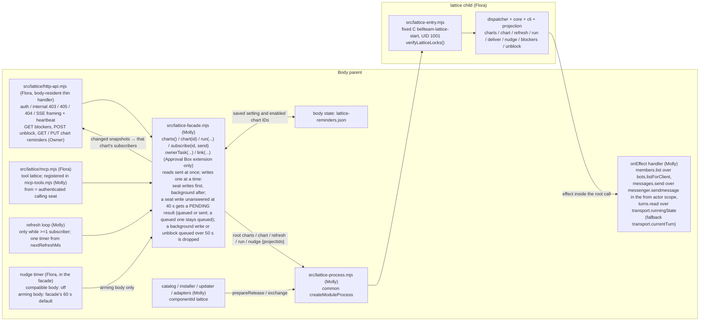

# lattice as an independently updated module child

Owner of this page: Molly (parent side). Child entry, protocol, channel factories, core/cli/projection, the body-resident HTTP handler and the MCP tool schema/handler: Flora ([lattice](../lattice/README.md)). Lattice itself: Snow White. Ruling: Trony 2026-11-11 JST, Owner order. Lattice工程表 runs as a normal module child with the same shape as [work-graph](work-graph-child.md), so a module change or a Lattice version bump updates it without stopping the body.

## Function map

## Data flow

| Step | From → to | Data | Owner of the data |
| --- | --- | --- | --- |
| 1 | Owner client → http-api | `GET /api/lattice/charts`, `GET /api/lattice/charts/:id`, `GET /api/lattice/charts/:id/events` (common authorizer; internal server 403 `LATTICE_OWNER_REQUIRED`; non-GET 405) | none |
| 2 | http-api → facade.charts() / facade.chart(id) → child root `charts {}` / `chart {projectId}` | `bellteam.lattice-charts.v1` / `bellteam.lattice-chart.v1`, JSON body as is | child memory, chart stores |
| 3 | http-api → facade.subscribe(id, send) | per-chart subscriber set. The first subscriber of any chart starts the loop with one root `refresh` at once; the last unsubscribe of all charts clears the timer | facade memory |
| 4 | loop → facade → child root `refresh {projectIds}` | every subscribed chart id, sorted, in slices of 50, one slice after another; a read, sent at once. Result `{snapshots, nextRefreshMs}`; each snapshot goes whole to that chart's subscribers; one timer from `nextRefreshMs` (a failed refresh re-arms with 2000 ms) | child memory |
| 5 | seat → bellteam MCP → facade.run({from, projectId, args, input, name?}) → child root `run` | `from` = the calling seat's Bot id resolved by `seat-mcp` (a fork resolves to its parent Bot), never a tool argument. `name` is forwarded only when the seat gave it (the child validates it: `LATTICE_NAME_INVALID`). Result `{exitCode, result, stdout, stderr}`. When the chart has subscribers, one root `refresh {projectIds:[projectId]}` follows at once (a read) | chart stores (Lattice CLI in the child) |
| 6 | child → parent effect (only inside a root call) | `members.list {}` → `{members:[{id,name,color,avatarVersion,deleting}]}` (bots.listForClient, the same normalization as work-graph) | members (read only) |
| 7 | child → parent effect (only inside root `run` / `deliver`) | `messages.send {from, target, message}` (three non-empty strings, `message` <= 4000) → `{delivery, deliveryId, code?}`: `messenger.sendmessage({from, target, message})` run under the conversation actor scope that `from` names (`scheduler` → `{kind:'scheduler'}`, a Bot id → `{kind:'bot', botId}`, as direct receipts derive it), because `deliver` and the nudge timer run outside any request scope; `delivery_id` mapped to `deliveryId`; `from` or `target` equal to `user` (the messenger would make an Owner turn or Owner-screen post) → `{delivery:'refused', deliveryId:null, code:'LATTICE_SEND_USER_NOT_ALLOWED'}` without calling it; `SENDER_NOT_FOUND` / `BOT_NOT_FOUND` / `MESSAGE_REQUIRED` → `{delivery:'refused', deliveryId:null, code}`; any other error is thrown (the child keeps the notice unacked) | direct messages (messenger) |
| 8 | module-process onGeneration → facade.deliver() → child root `deliver {}` | once per generation, held until ready; result `{delivered, failed}`; a refusal (old child) is swallowed | chart stores (notice acks, Lattice) |
| 9 | facade -> child root `nudge {projectIds}` | The compatible body keeps `nudgeMs: null`. Install it first and confirm the compatible Lattice child is ready before deploying the separately built arming body. Its facade uses the 60 s default, reads persisted enabled project IDs at dispatch, and the child sweeps those that exist after its 3-minute warm-up. An old child rejects the scoped request. See [rollout order](../lattice/README.md#reminder-rollout-order). | chart switches (BellTeam body); chart and decision records through the child |
| 10 | Approval Box extension module child (Delta, R5) → facade.ownerTask({projectId, args, input}) / facade.link({projectId, plan, taskId}) → child root `ownerTask` / `link` (a156, Flora R3) | Owner-task writes for that module child only. Neither is on the HTTP API or the seat MCP, because a seat must never reach the Owner actor. Both queue as seat writes through `call` (one at a time, wait bound 50 s). After an `ownerTask` the chart's subscribers get one `refresh` at once, like `run`. The child's `LATTICE_OWNER_TASK_REFUSED` keeps its code with status 403 (PASS set); an old child answers `LATTICE_INVALID`, which maps to 503. How the extension's child reaches these two methods is R5 (Molly and Delta); nothing calls them before that module ships | chart stores (Lattice CLI in the child) |
| 10 | child → parent effect (only inside root `nudge`) | `turns.read {botIds}` (1-200 distinct non-empty strings) → `{turns: {<id>: 'working'\|'idle'\|'unknown'}}` from `transport.runningState(id)` (the execution judgement: a running turn or the Bot's own CLI background work; a schedule never makes a Bot read `working`, Owner ruling 2026-11-14, task a72), falling back to `transport.currentTurn(id).state` when the method is missing (anything else, a throw or no method on both reads `unknown`); the child then sends with step 7, `from: 'scheduler'` | execution turn state (read only) |
| 11 | child → parent effects (only inside root `nudge`) | `decisions.file {title, context, options, requester, session_label}` → `{decisionId, existing}` and `decisions.read {decisionId}` → `{status, answer?}` (lattice README L18-L19). The body answers them with `src/lattice-approval.mjs`: its own Approval Box connection, token from the secret store (usage secret-credentials.md, Lattice consumer). 5 s per Approval Box request. No binding, no token, timeout, network or HTTP 5xx → `LATTICE_DECISIONS_UNAVAILABLE`: the child records nothing and ends this tick's decisions work (the root chain is shared with seat calls); HTTP 4xx → `LATTICE_DECISIONS_REFUSED`: logged, the next card goes on. The parent channel (`src/lattice-ipc.mjs`) returns these two codes to the child as they are (`REFUSED` 409, `UNAVAILABLE` 503); every other effect failure, an invalid effect result included, reaches the child as `LATTICE_EFFECT_FAILED` 503 with no detail |
| 12 | Owner client → http-api → facade.blockers() → child root `blockers {}` | `GET /api/lattice/blockers` → `bellteam.lattice-blockers.v1` as is (an old child's `LATTICE_INVALID` → 503 `LATTICE_UNAVAILABLE`) | chart stores (read) |
| 13 | Owner client → http-api → facade.unblock({projectId, stopId}) → child root `unblock` | `POST /api/lattice/charts/:id/unblock`, `Content-Type: application/json` (else 415 `LATTICE_JSON_REQUIRED`), body exactly `{stopId}` (24 hex, ≤ 1 KiB; else 400 `LATTICE_INVALID`) → 200 `removed`/`already-gone`, 409 `LATTICE_UNBLOCK_REFUSED` with `code`/`reason`; an old child → 503. When the chart has subscribers, one root `refresh` follows, as after `run` | chart stores (Lattice CLI in the child, actor `owner`) |
| 14 | Approval Box extension (Delta) → facade.ownerTask({projectId, args, input}) / facade.link({projectId, plan, taskId}) → child root `ownerTask` / `link` | not on the HTTP API or the seat MCP (a module-to-module port, lattice README L20). Writes: both queue in the seat queue, run one at a time with the other root writes (a write queued over 50 s is not sent, row 13). `ownerTask` result as `run` (`{exitCode, result, stdout, stderr}`), the actor is `owner`; `link` result `bellteam.lattice-link.v1 {projectId, plan, taskId, linked: true}`. `LATTICE_OWNER_TASK_REFUSED` (403) passes through with its status. The facade methods and the PASS entry are the parent's (Molly); an old child answers `LATTICE_INVALID` → 503 | owner-decisions.json (`link`), chart stores (`ownerTask`) |
| 15 | Body scheduler / registry removal hook (a164) → facade.run({from: schedule owner Bot, projectId, args}) → child root `run` | the fixed 接続 verbs of lattice README L21 (`todo connect condition add\|resolve\|remove --to schedule:<id>`, `todo show` for the lane). Same seat queue as row 5: writes run one at a time, a write answered `LATTICE_WRITE_PENDING` is never resent by the caller as unknown (the three verbs are idempotent on Lattice's side, so the NEXT run or removal may repeat them). The scheduler reaches the facade through a lazy getter (the scheduler is built before the facade). The child gets no new root method. In members mode the removal reaches the parent through the members effect `schedules.connectionRemoved` (members-assembly `onEffect` -> `scheduler.releaseConnection`), and the add runs in the parent wrapper of `facade.bots.setSchedule` after the members save (README L21) |

Owner clients read or save the per-chart switch through the parent’s [reminders route](../lattice/README.md#get-and-put-apilatticechartsprojectidreminders). The parent writes the BellTeam settings file in its state directory. Lattice owns its chart state. The child creates `/srv/bellteam/state/lattice/<project>/` and `/srv/bellteam/state/lattice-home/` itself, and keeps one writer lock `/srv/bellteam/state/lattice.lock` (the common fixed-C rule). Adoption record: `state/lattice-release.json` (the common `bellteam.<component>.adoption.v1`). A new child means a new epoch; its first refresh pushes every subscribed chart again.

## Seam (Flora 2026-11-11)

- Child (Flora): `src/lattice-protocol.mjs` (`LATTICE_PROTOCOL_VERSION=1`, `LATTICE_STATE_COMPATIBILITY={state:'none'}`, `assertLatticeStateCompatibility`, root `charts`/`chart`/`refresh`/`run`/`deliver`/`nudge`/`blockers`/`unblock`/`link`/`ownerTask`, effects `members.list`/`messages.send`/`turns.read`, control validators, `validateLatticeReady`), `src/lattice-ipc.mjs` (`createLatticeParentChannel(child, {generation, onEffect})`, `createLatticeChildChannel({dispatcher})`), `src/lattice-dispatcher.mjs`, `src/lattice-entry.mjs`, `src/lattice/{core,cli,projection,notices,http-api,mcp}.mjs`.
- Parent (Molly): the files below. The parent channel validates every effect request before `onEffect(method, params)` and every root result. The lattice channel has no `drainIncoming`: its effect runs only inside root calls, which the common controller already drains.
- Facade errors: `LATTICE_CHART_NOT_FOUND` (404), `LATTICE_PROJECT_INVALID`, `LATTICE_INPUT_CONFLICT`, `LATTICE_COMMAND_NOT_SEAT_SURFACE`, `LATTICE_INVALID` (400), `LATTICE_OWNER_TASK_REFUSED` (403, row 14) pass through with their status; every other failure becomes 503 `LATTICE_UNAVAILABLE`.
- Ready probe of a new child (common `probeCandidate`): root `refresh {projectIds:['bellteam-ready-probe']}`. An id with no chart answers `{snapshots:[], nextRefreshMs}` without spawning the Lattice CLI, so a slow chart cannot fail an exchange.
- Compatibility in the catalog: `{ nodeMajor: 26, parentProtocol: 1, stateSchema: null, containerUpdate: null, stateCompatibility: {state:'none'} }`.
- A new effect method, a tool schema change or a route change is a parent change and ships with a body image. Core, projection, cli and the bundled Lattice version ship only in the child asset.

## Bundled Lattice package

The child spawns `@quolu/lattice/bin/lattice.mjs`, resolved from the payload's own `node_modules`. The body's root `package.json` does not carry it. The packager replaces `payload/package.json` and `payload/package-lock.json` with `distribution/lattice/package.json` and `distribution/lattice/package-lock.json` from the same source commit, then runs the common `npm ci --omit=dev` ([business artifacts](../distribution/business-artifacts.md)). The pin is 0.85.5, the first release with `todo display source/read`.

The builtin child (`/app`) carries the same pin: the image runs `npm ci --omit=dev` on the same `distribution/lattice` lock and places its `node_modules` at `/app/src/lattice/node_modules`, so `src/lattice/cli.mjs` resolves the CLI there before `/app/node_modules`, and the body's root dependencies stay unchanged. The image build fails if that resolve fails. `scripts/package-server.mjs` carries `distribution/lattice/{package.json,package-lock.json}` into the server context (kept at the same path through its distribution cleanup), and publish-server-image's `paths` include both, so a pin bump also cuts an image. Why: the updater treats a signed release from the body's own source commit as already current (`UPDATE_ALREADY_CURRENT`), and module-process falls back to the builtin on a state mismatch, so the builtin must run Lattice on its own (lab 2026-11-11, train bfa089b9: seat tool `LATTICE_UNAVAILABLE`, release not installable). A Lattice bump still ships module-only in the signed asset's own `payload/node_modules`.

## Parent changes (this slice)

| Area | Files |
| --- | --- |
| Fixed start | `scripts/lattice-start.c` (module-start.c, MODULE_NAME `lattice`), Dockerfile compile/install, publish-server-image path filter, package-server list |
| Process | `src/lattice-process.mjs`, `src/lattice-locks.mjs` (wired in `src/lattice-entry.mjs`); `module-process.mjs` / `module-locks.mjs` / `module-release.mjs` / `module-exchange-diagnostic.mjs` closed sets gain `lattice` |
| Assembly | `src/lattice-facade.mjs`; `application-services` / `bootstrap`: create the process, the effect handler and the facade; `application-runtime`: pass the facade to the HTTP servers and the seat MCP; `http-server.mjs`: `createLatticeApi({ facade, internal })`; `mcp-tools.mjs`: `latticeTools` and `latticeToolHandlers({lattice, from, args})` |
| Update | `update-module-catalog.mjs`, `update-module-adapters.mjs`, `update-center.mjs`, `update-center-contract.mjs` (`updateComponents` entry), `scripts/update_catalog.py`, `scripts/container-update-host.py` (MODULES + validator), `scripts/body-preflight.mjs` (fallback set), `scripts/install-lattice-release.py`, `src/lattice-install-plan.mjs`, `scripts/verify-lattice.py`, `config/lattice-verification.json`, `web_gateway_artifact.py` / `module_artifact_package.py` / `module_artifact_verifier.py` / `install-web-gateway-release.py`, `web-gateway-release.mjs` / `web-gateway-install-plan.mjs`. The `config/update-catalog.json` record is added at supply time, after the signed asset is published |
| Distribution | `scripts/package-lattice.py`, `scripts/probe-lattice-runtime.mjs`, `.github/workflows/publish-lattice.yml`, `distribution/lattice/package.json` + lock, `test/helpers/business-artifact-probe.py` / `members-artifact-probe.py` |

## Call queue (facade)

The child runs writes one at a time and reads beside them (Flora #1382: Lattice reads take no store lock; seat runs per chart stay serialized by core's lock). The facade matches:

- Reads: `charts`, `chart`, `refresh`, `blockers`, and a seat `run` that writes nothing (`latticeRunReads(params)` in `src/lattice-protocol.mjs`, the same classifier the child uses: `--version`, `status`, `session-context`, `todo show` and the like; never with input or name: a named run renames the chart). Sent at once, even while a write is in flight. A Lattice write can take ~40 s on a large plan (production 2026-11-14), and a read waiting behind it took 36-83 s.
- Beside both, the child's Lattice CLI spawns are gated: at most 3 children at once, the rest wait in arrival order (lattice README L3, a466f). A read sent at once by the facade can therefore wait for a slot, never longer than the children in front of it.
- Writes, one at a time from two queues. Seat writes: every other `run`, and `unblock` (a seat or the Owner waits on the answer). Background writes: `nudge`, `deliver` (timers; nobody waits). When the write in flight ends (the child finished it), the next write is the oldest seat write; a background write goes only when no seat write waits. A write in flight is never interrupted. Its IPC timeout (60 s, `run` 70 s) starts when it is sent.

A seat write (`run`) always gets a definite answer before its MCP caller gives up (Claude Code aborts an HTTP MCP call at 60 s with the text "The operation timed out."; BellTeam cannot raise it, a162, 2026-11-15). The facade starts a 40 s answer timer (`SEAT_ANSWER_MS`) when the call enters:

- Still queued or already sent at 40 s: the call resolves `{exitCode: null, result: {code: 'LATTICE_WRITE_PENDING', next_action}, stdout: null, stderr: null}` (accepted: running, or waiting behind other writes; never resend, check with `todo show` or `todo note list`). A queued write stays queued, is exempt from the 50 s queue wait bound and is sent in its turn; a sent write keeps running to its end. Since a292 (2026-11-16) no seat `run` is dropped: the former answer `LATTICE_WRITE_NOT_SENT` made the caller redo the write by hand (4 of ~12 writes in 4 minutes on one seat, behind ~40 s writes of the one-at-a-time child) and lost declarations that an enforced plan needs before a task can start.
- Answered before 40 s: the real result, as before.

The write slot (`busy`) is released when the child finishes the write (the call's `completion`), not when the parent's IPC deadline fires. Before a162 the slot was released at the 60 s IPC deadline while the child still held the write, so the next write was sent beside it and a late write could start after its caller had gone. Now sent order is child order.

Named protection: no late write behind a caller that already read a failure, and no failure reported for a write that may land (so a seat write is never failed or dropped after it entered; it is answered PENDING at 40 s instead). Self-exit: the answer timer needs no other event; `busy` ends when the child answers or exits (`completion` settles on both), and the next queued write is sent then. A background write (`nudge`, `deliver`) has no caller and keeps the 50 s queue wait bound (`QUEUE_WAIT_MS`), as does a seat write that was never answered PENDING (`unblock`, `ownerTask`): older than that it is dropped (the nudge timer re-arms after 60 s, deliver runs again on the next generation); `unblock` keeps the same bound and fails with 503 `LATTICE_UNAVAILABLE`. Reads are never queued, so they are never dropped.

An old child (before #1382) still runs every root call one at a time. With it, reads wait inside the child as before, and nothing breaks.

Limit: a pending write is not cancelled. Its real duration is the child chain (maintain of the code chart up to 120 s, the Lattice CLI up to 60 s, notice sends) and can exceed 40 s on a large plan (production 2026-11-15: ~49 s for a note on bellteam-dev-added, ~24 s on a tiny chart behind the nudge); the speed of the Lattice write itself is Snow White's. No client request id exists yet: a retry after a pending answer would write twice, hence "never resend".

## Failure handling

| Failure | Behavior | Self-exit |
| --- | --- | --- |
| Child not available (start, exchange, crash) | facade rejects 503 `LATTICE_UNAVAILABLE`; http-api returns it; the seat tool returns the error | Shared `module-child-restart` lifecycle (1→30 s backoff, no limit) |
| Refresh fails while subscribers exist | Nothing is sent; the loop re-arms with 2000 ms | Next refresh after the child is back; a new epoch is pushed whole |
| Parent `members.list` fails | Effect returns the error; the child keeps the last roster, `degraded:['members']` | Next read |
| Nudge tick fails (child unavailable, old child) | Swallowed; nothing is sent this tick | Next tick 60 s later |
| A seat write still queued after 40 s (the child is behind) | `LATTICE_WRITE_PENDING` result (not an error); the write stays queued and is sent in its turn | The slot passes on at each write's `completion`; the seat checks with `todo show` |
| A seat write sent and unanswered after 40 s | `LATTICE_WRITE_PENDING` result (not an error); the write keeps running | The child finishes it; the slot passes on at its `completion`; the seat checks with `todo show` |
| A background write or `unblock` waited over 50 s in the facade queue | 503 `LATTICE_UNAVAILABLE`; the write is never sent | The next queued write is sent at once; see Call queue |
| Incompatible adopted release | Common prepareRelease refusal, same as the other modules; a state-format mismatch falls back to builtin | Common adoption path |

Guards: the 40 s seat answer timer (it answers, never drops) and the 50 s queue wait bound for background writes and `unblock` (Call queue: named protection and self-exit). Beyond them, the route and the tool wait only on the child request itself.
