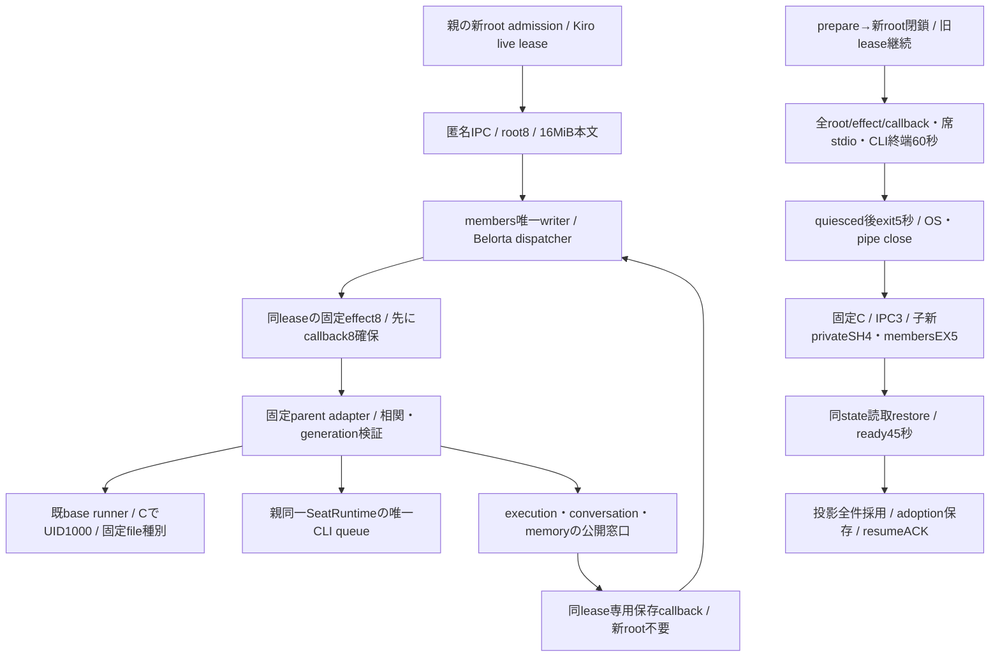

# membersの起動・排他・固定逆effect

runtime所有エピネル。Root members-update-contract-20261103.mdを実装する担当図。基準9e83の業務意味を維持し、通常main34496e43から実装する。機構sourceの成立と通常配線/実物/本番は別記録。

固定rootは/app builtin又は/run/bellteam-maintenance/members/releases/SHA/payload、entry src/members-entry.mjs、UID1001、state/members.lockとmembers-release.json。親lock FD3/4を継承せず子が新SH/EXを取り、OS終了と全pipe close前の新子0。stateはBot8/schedule1/既Owner/deletion形式、compatibilityは作者の実在形式へ固定しmigrationを交換readyへ入れない。

席writerは親root/bots＋botId、固定homeのCLI AGENTSだけ。本文生成はmembers版。claim/initialize/remove/readPreviousSession/writeInstructions/prepareStartupContext/appendInstructions/global.writeInstructionsの閉集合で任意path/env/UID/関数methodを受けない。操作をUID1000入口でも再検証しsymlink/別owner/link fileを拒否する。CLAUDEは固定@AGENTS.md、previous-session600、個別AGENTS644/global600。複数file同時transactionへ保証を拡張しない。CLI設定は既SeatRuntime一実体の唯一Promiseを使い、子へaiterm/設定JSON/秘密を渡さない。

権限は親の認証済みleaseから注入。Owner grantは既専用登録の固定根拠だけからprovision、一般caller自己申告や任意CLI JSONから作らない。同UID内秘密隔離は未提供。未供給grantだけ拒否し、他担当の独立実装を止めない。

容量/期限/unknown/交換・戻しはRoot固定値。送信後期限や断線は取消証明ではなくactiveを実終端まで維持し、別ID再送0。新root閉鎖で旧lease/callbackを拒否しない。親effect中の同Bot保存callbackがmutation lockを待つ循環を作らない。control/診断別枠は常時残す。

## 公開接点と固定schema

createMembersProcess({root,membersAdmission,onEffect,onProjection,onGeneration,onDiagnostic,onState,authorizeOwner,prepareRelease})→start/close/request/callback/snapshot/replace/reserve。同executionのmembers-admissionを一実体で使い、入場後に送信前trackCompletionを登録する。deadline後もactual completion/親effect終端まではgateをlive保持。root/effect/callback各8、受理済返却/control/診断は新rootで塞がない。未送信/受信待ち業務buffer64MiB/control1MiB、payload16MiB＋envelope64KiB。初期snapshotは一profileごとACK、avatar無し、半端な投影を採用しない。rootIdは単調IDの文字列。

contextはgeneration/leaseId/rootId/ownerWrite/continuationの固定5field。Owner booleanは親opaque認証資料から、continuationは親assertLease後のlease.epochと現在epochの差だけから生成する。child自己申告やbody/paramsを権限にしない。child新root受付はaccepting又は検証済continuation、callbackは同live leaseのみ。callbackからの汎用effect再帰を拒否する。CLI同期はprofiles.cli専用callbackでqueue実開始時の最新IDsを取得し親固定projectへ解決する。

readyとmanifest.runtimeは作者MEMBERS_STATE_COMPATIBILITYの実6値exact。members catalogだけ5key compatibility（26/1/null/null/実6値）、他3componentは4keyのまま。prepareMembersRelease/replaceのexpectedReleaseを通しcatalog/source/platform/digestとarchive/runtime/consumerを計画時と旧子交換直前に照合する。署名済宣言とquiesceの実state read-restore検証は別。root Host catalog selectionの閉集合にもmembersだけ追加、未知component許可を緩めない。

署名前probeはscripts/probe-members-runtime.mjs、引数0/root Node26→固定非特権Cの実1001。空state/bots+.initializedと既Owner schema/user-rulesをdisposable runnerだけで準備、ready→resume→quiesce→exit、親effect/実席/予定0、全OS/IPC/pipe close後だけ固定成功JSON。初期通常bootstrapのseed/migration/cleanup/setupはMolly/Belortaが一回区切り、交換read-restoreで呼ばない。

親onEffectのcontextにはwire5fieldに加えてopaque membersLease/membersEffectがある。runtime adapterのDTO検証はwire5fieldだけへ射影し、CLI callbackへは同じ親context objectを保持する。これは既固定wire/親権限境界内の修理で機能線は変えない。

固定semantic code/statusの正規化はmembers作者errors.mjsが所有し、runtimeは自由message/stackを通さない。実IPCで確定404/既入力400、保存後generation失敗の最新metadata投影とunknown維持、親Room正規化404を確認する。本文/秘密や旧成功群を採取・再走しない。

profiles.readはfresh ACK snapshotを全件送った後の小さい{revision}だけを返す。runtimeは配列の一括frameを仮定しない。実IPCの601profile/metadata合計16MiB超・各record64KiB未満・result100B未満と確定revisionを照合し、新しい件数上限やpaging RPCを追加しない。
