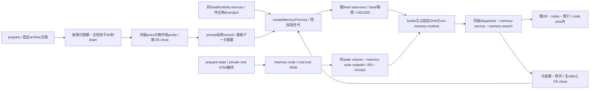

# 記憶業務sourceを含めた短命席runnerの世代交換

Recovery follows the [single module lifecycle contract](module-process.md#shared-automatic-lifecycle-recovery-owner-2026-11-07): start can reopen, lifecycle failures enter persistent backoff, and invalid output stays request-local. Recovery probes the normally selected source against current data; business writes are never replayed or rolled back.

runtimeエピネル。業務factory/dispatcher/実保存互換は[memory正本](../memory/update.md)のBiscuit、親の安定service/assemblyと共通durable更新はMolly、署名・RO code viewはCenti。root処理/実Host/本番をこのsource変更で実行しない。

席のentryと業務closureを一緒に選択する。親の旧`run-seat-runtime`へ戻り旧/app版memory-serviceをimportする分岐は削除し、`SeatRuntime.memoryModule`一実体へ既10methodを委譲する。通常HTTP/MCPの引数・認可・scopeの業務判定は変えない。親registryは呼出時にid/projectだけ投影し、別Botの台帳や関数を子へ送らない。

`createMemoryProcess({root,run,prepareRelease,exchangeMutex,onState})`はstart/request/replace/reserve/snapshot/closeとmemory(registry)を公開。新規scope初期化は従来callerのinitialize/ensureScopeだけ。各短命子はcontrol initialize/resume→業務1件→quiesce/exitを実行し、restore probeはinitialize/quiesce/exitだけでDBへ触れない。その後のready probeは`MEMORY_READY_PROBE`（recallMemory shared/固定語"ready"/limit1）を実業務読み1件として同じ短命子で実行し、空の状態ではshared領域を作って空結果を返す。queryは空にしない（実検索はSEARCH_QUERY_INVALIDで拒否し、start()が永久待ちになる）。protocol1/generation/実stateCompatibilityと閉responseを親が検査する。既runnerのUID/clearenv/取消/合計buffer/stdio回収を再利用し、新stdin path/env/関数窓口を作らない。

固定release entryは `/run/bellteam-memory-code/SHA/payload/src/run-memory-runtime.mjs`、builtinは同imageのentry。コードだけのRO viewは既private volumeのmemory-code subpath、root directory0555/file0444。installation/manifestはprivate memory/releases/SHAに残し、root installerの正式検証receipt・完全inventory・platform/Node26/protocol1/Biscuit実互換を親1001で確認。codeだけ残った未完installは選べない。DB/WAL/本文/資格をviewへ載せない。初回view mountは通常image導入時、以後の版追加は同volume内。

`prepareServerStateRuntime`は初回と既prepared再開の両方でprivate volume直下の`memory-code`だけをroot:root/0555へ準備する。symlinkを拒否し、既archive内容へ再帰chown/chmodしない。private rootのroot:1001/0750と既採用receiptは保つ。`stateWriterPlan`は通常viewが存在する場合に限り、既stateと同じvolumeの固定subpath/RO/nocopyを検査する。view無しの旧構成を受け付け、別volume・RW・別subpath・重複を拒否する。writer探索は既state volumeを共有し、新しい保存rootを増やさない。

replaceはprepare後に新受付を閉じ、既全requestの元結果/例外検査と**実OS/stdio close**まで60秒待つ。未終端ならbusyで旧sourceを開き、既子をkill/再送せず新版0。終端後もう一度固定版を確認し、新版entryの無作用probe→private memory-release.jsonの原子的採用→新規処理を開く。失敗は旧record/sourceへ戻し、Failed selection rollback enters shared lifecycle backoff and rereads normal adoption before reopening. データsnapshotは巻き戻さない。closeは準備/採用中の操作と全所有子を待ち、完了後新子を起こさない。

採用recordは`bellteam.memory.adoption.v1`、currentVersionId/previousVersionIdはnull又はarchiveSHA。公開結果からcurrentを推測せず、更新を含むdurable requestId ledgerはMollyの共通module/allに保持する。今回の採用recordは既json-file.writeAtomicと同じ完成rename契約であり、共通ledgerの耐久受付や正式catalog発行の代用ではない。
