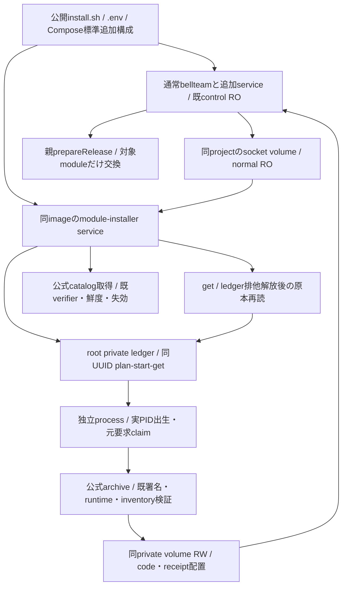

# 箱に同梱するmodule導入プログラム

担当エピネル。Rootの2026-11-04 12:30裁定。source実装の契約。正式main/imageと公開Docker製品受入は各版の別結果で確認する。

標準Dockerと公開install.shだけで同imageの専用Compose serviceを導入する。別Host-image/sourceの選択、Host sudo/package/unit/daemon変更、Docker socketは要求しない。本体container全体更新のHost機構とは能力を分ける。

公開NDJSONのcapabilities/catalog/plan/start/getとmoduleInstallProtocol:1を維持する。capabilitiesのsupportedはcontainer全体更新用でfalse、moduleInstallSupportedでmodule能力を明示する。runtime clientは新しい明示値を優先し、旧Hostのみsupportedへfallbackする。HTTP/operation ledgerを新しく二重実装しない。

root専用永続volumeはcatalog/plan/operation/incomingを持つ。socket volumeの親inodeは維持しleafだけ更新。private state volumeは既通常Composeで選んだ同じものを専用serviceへRW公開し、normal control ROを保持。他projectのvolumeや任意path/URL/env/entryはRPC入力にしない。module planはroot自身のsource/platformと実private mountの本人性に束縛し、Dockerから得ていないCID/imageIdを捏造しない。親prepareReleaseは同volumeの正式receipt/互換を再検査する。

workerは同IDを一回claimし、実process出生と永続ACK後だけaccepted。副作用の欠測/worker消失はunknown、元operation GETへ戻して再実行しない。受付寿命と独立のworker processを使い、service全体消失は耐久unknownとして残す。本体の停止/更新を行う機構ではない。

getは[既HostUpdaterの台帳待機契約](container-update.md#実行保存と異常)を共用する。正常なworker書込みとの短い競合では排他解放を待ち、最新原本を読む。既通信期限やworker消失によるunknownと、設置後の親module交換は分けて保持する。

catalog/署名/公開codeの既verifierと既固定component installerを使い、全体保守の排他やroot所有境界を保持する。まず既正式usage1249の導入/交換までを先行受入し、全module/3OS全群を待ち条件にしない。局所試験は新しいbackendと直結client/installer/Composeだけ、Docker製品受入はセンチが公開導入→通常利用→module単品更新で確認する。

固定entryは`/app/scripts/module-update-service.py`、モデル生成は`/app/scripts/module-update-compose.mjs`。backendモデルは凍結normalのbellteamから同image ID・同project・選択private volumeだけを使って生成し、利用者の任意service/command/envをroot serviceへ転送しない。normalの追加serviceは保持し、生成する`module-installer`名との衝突を拒否する。保守/Cursorのimage選択はbellteamを明示する。package-serverの明示収録と既image CIのpath filterに含める。

実装は既HostUpdaterの署名catalog/plan/start/get/元worker台帳を使う。code_root/worker_identity/worker_aliveの内部差し替え点だけを設け、既Hostのroot code配置とsystemmanager unit本人性は同じ既定を維持する。同梱側のexpectedは実source/platform・private root dev/inoであり、workerは実PID/birth/pidnamespaceを記録する。clientは同梱sourceと自身のdistribution sourceを照合し、異なる箱のprogramを利用可能へ投影しない。公開DTOに架空CID/image IDを加えない。

初回起動で公式catalogを既verifierへ渡して受入し、成功後にsocketを公開する。以後15分間隔で取得し、失敗は既refresh.jsonへ保存する。受入catalogの鮮度/失効はplan/start/workerとhealthで再確認する。healthはstale socket fileだけを成功にせず実listenへ接続する。専用serviceの失敗はinstaller非0、normalの既到達点と保存設定を保持する。正常本体が起動しただけでmodule導入可能とはしない。
