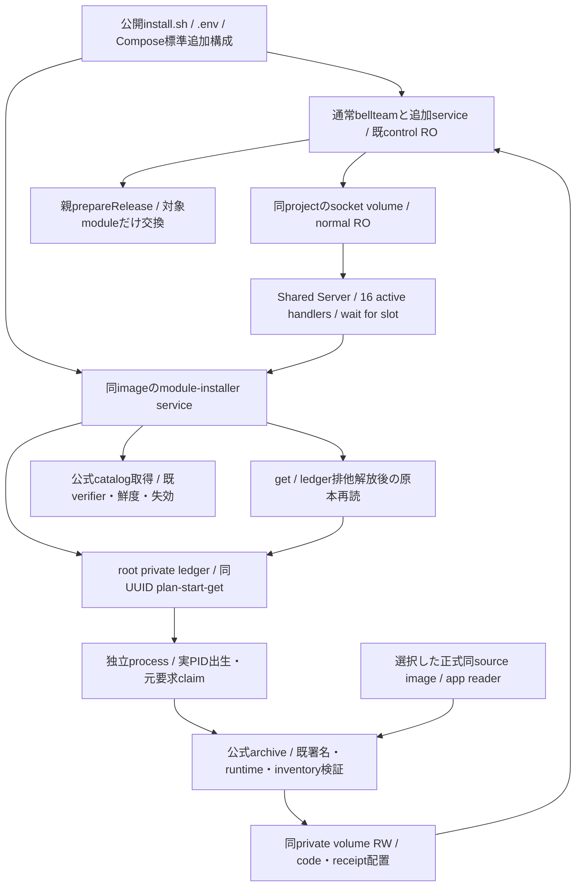
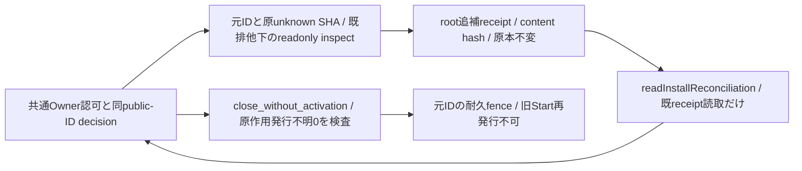
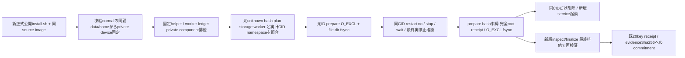

# 箱に同梱するmodule導入プログラム

担当エピネル。Rootの2026-11-04 12:30裁定。source実装の契約。正式main/imageと公開Docker製品受入は各版の別結果で確認する。

標準Dockerと公開install.shだけで同imageの専用Compose serviceを導入する。別Host-image/sourceの選択、Host sudo/package/unit/daemon変更、Docker socketは要求しない。本体container全体更新は[専用service](container-update-bundled.md)へ分け、このmodule serviceへDocker socketを与えない。

公開NDJSONのcapabilities/catalog/plan/start/getとmoduleInstallProtocol:1を維持する。capabilitiesのsupportedはcontainer全体更新用でfalse、moduleInstallSupportedでmodule能力を明示する。runtime clientは新しい明示値を優先し、旧Hostのみsupportedへfallbackする。HTTP/operation ledgerを新しく二重実装しない。

root専用永続volumeはcatalog/plan/operation/incomingを持つ。socket volumeの親inodeは維持しleafだけ更新。private state volumeは既通常Composeで選んだ同じものを専用serviceへRW公開し、normal control ROを保持。他projectのvolumeや任意path/URL/env/entryはRPC入力にしない。module planはroot自身のsource/platformと実private mountの本人性に束縛し、Dockerから得ていないCID/imageIdを捏造しない。親prepareReleaseは同volumeの正式receipt/互換を再検査する。

workerは同IDを一回claimし、実process出生と永続ACK後だけaccepted。副作用の欠測/worker消失はunknown、元operation GETへ戻して再実行しない。受付寿命と独立のworker processを使い、service全体消失は耐久unknownとして残す。本体の停止/更新を行う機構ではない。

getは[既HostUpdaterの台帳待機契約](container-update.md#実行保存と異常)を共用する。正常なworker書込みとの短い競合では排他解放を待ち、最新原本を読む。既通信期限やworker消失によるunknownと、設置後の親module交換は分けて保持する。

catalog/署名/公開codeの既verifierと既固定component installerを使い、全体保守の排他やroot所有境界を保持する。まず既正式usage1249の導入/交換までを先行受入し、全module/3OS全群を待ち条件にしない。局所試験は新しいbackendと直結client/installer/Composeだけ、Docker製品受入はセンチが公開導入→通常利用→module単品更新で確認する。

固定entryは`/app/scripts/module-update-service.py`、モデル生成は`/app/scripts/module-update-compose.mjs`。backendモデルは凍結normalのbellteamから同image ID・同project・選択private volumeだけを使って生成し、利用者の任意service/command/envをroot serviceへ転送しない。normalの追加serviceは保持し、生成する`module-installer`名との衝突を拒否する。保守/Cursorのimage選択はbellteamを明示する。package-serverの明示収録と既image CIのpath filterに含める。

archive readerは選択した正式image内の`/app/scripts/install-web-gateway-release.py`→隣接`web_gateway_artifact.py`で固定し、incoming archiveから選ばない。executionの非node_modules inventoryは、既署名47件、automatic-configuration-application.mjsを加えた旧48件、aiterm-hooks.mjsとmodel-handoff.mjsを両方加えた新50件の各完全閉集合だけを受入する。任意extra/他の必須欠落や片方だけの49件は拒否し、producerは50件を必須とする。旧署名47/48の選択・既配置を維持しつつ新50を導入するには、このreaderと必要な親配線を含む同source正式imageを標準導入/本体更新で供給する。module単品交換だけではreader imageは更新されず、別source backendだけの差し替えは行わない。

実装は既HostUpdaterの署名catalog/plan/start/get/元worker台帳を使う。code_root/worker_identity/worker_aliveの内部差し替え点だけを設け、既Hostのroot code配置とsystemmanager unit本人性は同じ既定を維持する。同梱側のexpectedは実source/platform・private root dev/inoであり、workerは実PID/birth/pidnamespaceを記録する。clientは同梱sourceと自身のdistribution sourceを照合し、異なる箱のprogramを利用可能へ投影しない。公開DTOに架空CID/image IDを加えない。

初回起動で公式catalogを既verifierへ渡して受入し、成功後にsocketを公開する。以後15分間隔で取得し、失敗は既refresh.jsonへ保存する。受入catalogの鮮度/失効はplan/start/workerとhealthで再確認する。healthはstale socket fileだけを成功にせず実listenへ接続する。専用serviceの失敗はinstaller非0、normalの既到達点と保存設定を保持する。正常本体が起動しただけでmodule導入可能とはしない。

## 元install-IDの追補照合・明示解決

Root横断契約 `same-install-id-reconciliation-contract-20261104.md`の意味で、元operationのunknownとは別にroot-owned追補receiptを持つ。commonの既Owner認証→private client→peer1001の既Unix境界だけから明示inspect/closeを受け、通常get/readは既耐久結果だけを返す。元planはID/target/storage証拠で、期限切れplanを権限にしない。親のfresh認可/decisionとclosed証拠を照合し、本番は別正式供給/製品/Root発行を要する。

inspectionはworker/ledger/private保守/component installer排他と元storage本人性を検査し、固定execution targetだけのroot immutable receipt/manifest/payload inventory/hashを読取る。既component直下に未所有stageがあれば削除せずunconfirmed。incoming cacheの存在を設置成功にしない。placement verified_present/absent/unconfirmed、quiescence confirmed/busy/unconfirmedを分ける。原operation/install receiptのbytes・理由・時刻を保持し、照合をcompletedへ投影しない。新口未完成の間は公開capabilityを広告しない。commonだけが別の明示consumeと公開副資源/busy解消を所有する。

### inspection先行I/O v1

private clientは`inspectModuleInstall({requestId,originalOperationSha256})`と`readInstallReconciliation({requestId,originalOperationSha256})`を分離し、両方とも`{receiptSha256,receipt}`を返す。read未発行は`HOST_MODULE_RECONCILIATION_NOT_FOUND`。receiptはschema=`bellteam.module-install-inspection.v1`と次の閉keyだけ：requestId/planId/componentId/versionId/sourceCommit/originalOperationSha256/planSha256/targetSha256/storageBindingSha256/runtimeCurrentSha256/inspectionTime/placement/quiescence/stageState/manifestSha256/recoveryState/fence/evidenceSha256/reason。componentは初回executionのみ。

placement=`verified_present|absent|unconfirmed`、quiescence=`confirmed|busy|unconfirmed`、stageState=`clear|unconfirmed`、recoveryState=`not_issued|verified|unknown`、fence=`open|closed`。manifestSha256はverified_presentだけ64hex、他はnull。reasonはnull又は固定HOST_UPDATE_BUSY/HOST_MODULE_UNOWNED_STAGE/HOST_MODULE_RECOVERY_UNCONFIRMED/HOST_MODULE_INSPECTION_UNCONFIRMEDだけ。各SHAは小文字64hex、IDはUUIDv4、sourceは40hex。再検査は別inspectionTimeを持ち、元完了時刻にしない。

hashは全階層のobject keyを辞書順へ整列し、compact JSON/UTF-8/非ASCII非escape/末尾LF一つをSHA256する。target hashは元plan.target全体、storage hashは元plan.expected.privateVolumeと実bindingの一致したobject、runtime current hashは検査時のinspect_current object。`src/container-update-client.mjs`は`validateInstallReconciliation(envelope)->boolean`と`installReconciliationHash(value)`をexportし、共通が閉validator/hashを再利用できる。これは入力DTO/hashからOwner権限を作る口ではない。

初回版はinspect/readと以下のclose/fenceだけを実装し、recover/consumeは未提供。normal read/get/snapshotが検査を起動せず、原unknown/receiptを変更しない条件は全工程で維持する。

### fresh明示close/fence I/O v1

`finalizeInstallReconciliation({requestId,originalOperationSha256,decision,commonProof})`は`close_without_activation`だけを受理する。`readInstallReconciliationFence({requestId,originalOperationSha256})`は既fenceの読取だけで、未発行はNOT_FOUND。restore_placement/consume/独立回復workerは未提供・広告0。配置やengine applyを起動しない。

decisionは`{decisionSha256,decision}`、本体は閉key `schema,publicRequestId,publicPlanId,requestId,planId,originalOperationSha256,publicOperationSha256,inspectionSha256,targetSha256,storageBindingSha256,runtimeCurrentSha256,currentSha256,catalogSha256,action,issuedAt,expiresAt,ownerGrantRef`。schema=`bellteam.module-install-decision.v1`。commonProofは`{proofSha256,proof}`、本体は閉key `schema,publicRequestId,publicPlanId,requestId,planId,originalOperationSha256,publicOperationSha256,decisionSha256,currentSha256,applyState,applyClaimSha256,resultSha256,claimedAt,verifiedAt,ownerGrantRef`、schema=`bellteam.module-install-common-proof.v1`。ID/hash/canonical規則はinspectionと同じ。applyState=not_issued、applyClaimSha256/resultSha256=nullだけ許す。

共通の既Owner fresh認可・私有grant・原apply未発行/同ID close claim/current検証を、信頼済peer1001の同source私有clientから受ける。runtimeは公開body/hashから権限を作らない。受付から最大600秒、原target/storage/runtime current/inspection/現有効catalogと元IDへ束縛し、最終排他内でも期限/本人性を再確認する。旧targetが現catalogに無くてもcloseは復活配置をしないため検証済現catalog自体を要求し、旧targetの許可を捏造しない。

worker/ledger/private保守/component installerの排他内で、実元worker終端・未所有stage無し・回復claim無し・現在配置absent又は固定inventory検証済みを再確認する。元workerのPID namespaceが現在と違う/本人情報不足/proc読取不能ならunconfirmedで拒否し、process世代変更を終端証拠にしない。元workerと同namespaceで元PID出生が既に存在しない場合だけ実終端の候補とする。全body/current/旧native・writerの終端は共通担当のproof側でも別に要求される。

成功時は元operationと別のroot-owned一回fenceをO_EXCL/file fsync/directory fsyncで保存する。閉返値は`{fenceSha256,fence}`、fence本体は`schema,requestId,planId,originalOperationSha256,decisionSha256,commonProofSha256,action,closedAt`、schema=`bellteam.module-install-fence.v1`/action=close_without_activation。`validateInstallReconciliationFence`を共通へexportする。応答不明/再起動後は同ID readだけで、別decisionでも再発行しない。

共通HostUpdaterにoperation_pendingという内部判定点を設け、既Host/本体serviceの挙動は従来どおり、同梱moduleだけ検証済同ID fenceをbusy集計から除外する。原unknown/get/台帳pointerは保持し、別要求/in-flightのbusyは保持する。同IDのstartは既原本を返すだけで、旧workerやwork(entry)を再発行しない。共通公開busy解除は有効fence＋共通終端記録の両方を要求する。runtimeだけのfenceを公開成功にしない。

## 正規切替時の元worker終端bridge

Root 2026-11-05採用契約。旧worker namespaceを新版namespace不一致だけで終端扱いしない。公開install.shが選択した同正式imageのmodule-worker-termination.pyだけを短命helperとして起動する。固定helper modelはmodule-update-compose.mjs --termination-helperがnormalのproject/image/private volumeと検証済data/home同親runtimeから導出し、ledger/privateと固定Docker socketだけをmountする。通常module-installer/本体にはDocker socketを追加しない。helperのDocker権限は既公開installerと同等であり、一般利用者向けRPCは追加しない。

helperは対象namespace内で固定readonly Python probeを実行し、元workerのPID出生が不在/別出生でnamespaceが元記録と一致することを停止前に確認する。probeは新正式helper内の固定codeで、旧serviceの/appを差し替えず、本文/資格を読まない。旧serviceのproject/service/image/StartedAt・固定entrypoint/root/read-only/private PID namespaceと3volumeを照合する。正常な初回導入は旧service/未完operationが共に無い場合だけskip。通常切替もworker/ledger排他を維持し、他の未完workerを停止してprepare条件を作らない。

prepareの閉schema bellteam.module-worker-prepare.v1はschema/requestId/planId/originalOperationSha256/planSha256/targetSha256/storageBindingSha256/ledgerBinding/worker/oldService/target/preparedAt。oldServiceはcontainerId/imageId/sourceCommit/startedAt/pidNamespace/modelSha256/project、targetはsourceCommit/imageId。ledgerBindingはdevice/inode、workerは元pid/birth/pidNamespace。元IDのoperations/<requestId>/worker-termination-prepare.jsonにroot-onlyで一回保存する。

完全receiptは閉{prepareSha256,prepare,terminationSha256,termination}でworker-termination.jsonへroot-only保存する。terminationの閉schema bellteam.module-worker-termination.v1はschema/requestId/originalOperationSha256/prepareSha256/oldContainerId/status/running/restarting/pid/finishedAt/exitCode/stoppedAt。status=stopped、running/restarting=false、pid=0、同CIDのStartedAt/image/再起動禁止/stop-wait結果を最終照合する。完全保存後だけ同CIDを削除し、service名を引き直して別CIDを停止/削除しない。

prepare保存不明・stop応答不明・途中record・hash不一致はunconfirmed。再試行でprepareやstopを再発行せず、同IDの既完全recordを読む。完全recordと同停止済みCIDが一致する場合の削除収束、および既削除CIDについて完全record読取だけによる新版起動の再開は可能。不明中は通常installerの保守/起動も非0で止める。対応helperが同imageに無い場合も旧stop/rmへfallbackせず停止前に拒否する。record保存前に旧CIDを削除しない。旧namespaceが事前に失われた場合は拒否し、歴史的な無作用/成功や元unknownを変更しない。

新版backendは既排他内で元operation生bytes/plan/target/storage/ledger/worker/旧service namespaceと切替sourceを完全recordへ再照合する。同namespaceが残っていても途中prepareがあれば完全recordを要求する。recordはroot所有・祖先・mode/nlink/no-follow・canonical hashを検査し、公開JSONを証拠化しない。完全record hashは既evidenceSha256のworkerTerminationSha256へ含め、既公開20key/decision/claim/fence/二providerを変更しない。

privileged private readの固定口は同正式imageの `/app/scripts/module-worker-termination.py --read <元UUID>`。既worker/ledger/private/component排他内で保存recordだけを検証し、閉code MODULE_WORKER_TERMINATION_READ/requestId/originalOperationSha256/oldContainerId/worker/receiptSha256/statusをstdoutへ返す。Docker操作/inspect作用/record書込は行わない。Centiは保存済みmodule modelでentrypointをこの固定scriptへ指定した短命読取を使える。通常RPCや利用者bodyからこの私有証拠を渡す口は無い。

切替consoleは閉code MODULE_WORKER_SWITCH/stage/requestId/receiptSha256/oldContainerIdだけ。stageはnot_needed/prepared/stop_returned/recorded/removed/already_stopped。未適用fieldはnull、本文/自由error/環境は出さない。実stop/waitとroot耐久recordは標準Docker製品側で別確認し、fixtureのcommand注入結果を本番成功へ流用しない。

shortcut: 完全receiptは初回切替先sourceへ固定、別sourceへの再切替は元intentのfence完了後か別の明示契約が必要。namespace再生成を自動追認しない。

### 正規private volumeのstorage照合

固定helperの第4引数は凍結normalの同親data/home bindから導出したruntime/server-only/state-dataだけ。既installerのpermission probeが選ぶEngine内local volume（Options null/{}）又は同project label＋exact Options {type:none,o:bind,device:固定device}のprivate volumeを受け入れる。module-updaterはlocal/noOptionsだけ。任意device/driver/追加Options/追加mountを許可せず、private bindの正規形を一般bind許可へ広げない。Docker socket以外のHost bindをhelperへ増設しない。公開20key/元worker namespace/排他/prepareと完全receiptの意味は同じ。

The socket capacity and safe exception logging contract is owned by [the shared runtime Server](container-update.md#socket-capacity-and-diagnostics). Module installation uses that same handler; source supply and parent apply remain separate.
