# 固有channelを載せる共通child世代controller

runtimeエピネル。既members交換手順の共通機構を`src/module-process.mjs`へ接続し、conversation/usage/diagnosticsの固定3componentだけを扱う。業務DTO/actor/opaque lease/stream/投影ACKは各作者のclosed channel、親facade/実サービス組立はMolly、固定資材と署名はCenti。先行members/通知controllerをこの変更で置換しない。

```mermaid
flowchart LR
  Caller[親安定facade / 固有authority] --> Channel[固有ParentChannel / 実completion]
  Controller[createModuleProcess] --> Channel
  Prepare[固定prepareRelease / catalogと互換検証] --> Closed[新受付閉鎖 / 既lease継続だけ]
  Closed --> Drain[実completion＋外部admission drain / 60秒]
  Drain --> Quiesce[child quiesce / 保存・stream・callback終端]
  Quiesce --> Handoff[固有private export / 必要moduleだけ]
  Handoff --> Exit[exit / OS・IPC・pipe全close]
  Exit --> Launch[固定C / advanced IPC / 新generation]
  Launch --> Init[initializeParams / restore・投影ACK / ready45秒]
  Init --> Record[private adoption / 同stateデータ維持]
  Record --> Resume[resume ACK / 親新受付公開]
  Resume --> Caller
```

`createModuleProcess({component,root,createChannel,prepareRelease,validateReady,initializeParams?,exportHandoff?,admission?,canContinue?,onGeneration?,onState?,investigationsFile?,spawnProcess?})`はstart/close/request/callback/initialize/replace/reserve/snapshotを返す。spawnProcessは実起動の試験DI、通常はNode spawn。component/実行path/argvは固定、envは空又はdiagnosticsの既notes設定一変数だけ。createChannel(child,{generation})は本人のready/request/callback/control/reapedを供給する。descriptorの固定appRootを共通検査し、prepareReleaseとvalidateReadyが作者の署名済版・protocol・実stateCompatibilityを検査する。

usage固有のstartPaused:trueはstartをsettings ready後のinitializingで返し、親がinitializeで既3段を進めた後activate()の実resume ACKで新rootを開く。他componentへのstartPausedは拒否する。初回順序/secret/private snapshotの意味は[module readerとwrapper](module-release.md)と業務正本に従う。

usage/conversationのparent channelは共通endpointの`drainIncoming()`も公開する。childのOS/pipe終了後に親effect/保存/投影commitが残る場合、その実終端を待ってからreapedと次子を許す。親effect無しのdiagnosticsは同portを省略可能。outgoing RPCのreaped待ちcompletionをdrainIncomingへ含めない。

admissionを使うmoduleは同親のclose/drain/adopt/resumeを注入する。canContinueは同親が元opaque leaseとgenerationを照合する関数で、既受付の継続だけを閉鎖中に通す。既定は拒否。callbackの本人性/相関は固有channelが毎回検査し、新root枠へ転用しない。requestと後続initializeはcaller Promiseだけでなく`.completion`を追跡する。quiesce期限も実completionを切らず保持する。既子の全OS/IPC/pipe終了後だけreapedを通知し、次子を起こす。

initializeParams({generation,mode,handoff})は初回bootstrap、採用済起動/交換はrestoreを固有paramsへ変換する。usageのsettings/subscriptions/services段階は同親がinitialize(stage)で進め、交換はexportHandoff(channel)から得た同private handoffを一回のrestoreへ渡す。snapshot start/end/abort・権限はcreateChannelの閉closureへ注入する。本文/path/envをHTTPや更新DTOへ追加しない。

quiesce失敗/60秒未終端は旧resume、新子0・kill0・unknown再送0。新版ready/保存/resume失敗時は未受付candidateをOS終了まで回収し、旧固定版と同handoffから再生成する。既にresume済みで終端不明ならkillで済ませずunavailableに保持し二重writerを作らない。closeは起動/交換中operationと既writerを回収し、新子の起動を止める。exitの5秒killはquiesce成功後だけ。

quiesce RPCは残りdrain時間を明示し、共通controller自身もその残時間のwithinで囲む。固有channelのACK/進捗によるcaller期限変更を実drain期限の延長にしない。期限後は元control.completionをactiveへ残し、旧resumeと子epoch検査を使い、遅着quiesceで新受付を再閉鎖しない。close/次交換はその実終端を待つ。

private recordは既0600/no-follow/nlink1/所有/4KiB検査の`bellteam.<component>.adoption.v1`。module/allのdurable requestId ledgerや公開source identityはMollyが所有し、このrecordから捏造しない。reserveはcompletionを返し、実replace終端又はcancelまで同親mutexを保持できる。

このsourceの限定fake-child境界と、各作者の実IPC fixture、Centi同imageの実UID/署名/OS交換は別の証拠。初回親組立とmountはimage導入が必要で、未登録moduleを既imageへ無再起動追加できるとは扱わない。導入後の登録済controller経由コード交換が対象。
