# 固有channelを載せる共通child世代controller

## Current conversation lifecycle (Owner ruling 2026-11-07)

This replaces the conversation admission close/drain/adopt/recover ceremony described in the older sections below. Usage and diagnostics keep their own contracts. Conversation operation references retain actual target/actor/callback identity and completion facts; they do not gate new operations on a ticket, failed generation, active count, or unconfirmed outcome. The current live child receives new operations. Child loss fails only that child's pending callers with unknown outcome and records the fact; recovery never replays their business requests. Observed writer death permits the next child without waiting for native references or acceptance proofs. A planned exchange still quiesces the actual live writer before replacing it to prevent concurrent file writers.

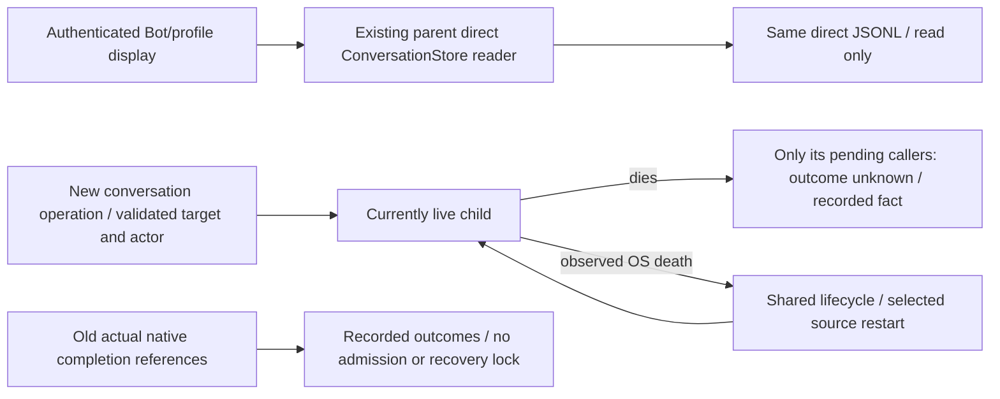

## Shared automatic lifecycle recovery (Owner 2026-11-07)

This is the single recovery contract for common module-process, members, notifications, memory, and execution-generation. The existing `module-child-restart` lifecycle owns one cancellable timer: 1/2/4/8/16/30 seconds, capped at30 seconds without an attempt limit; a healthy minute resets the delay. Initial failure also enables recovery. Public start waits for that same actor to become available, keeping parent bootstrap from tearing down the graph on a transient child failure; internal retry attempts release their operation before the next backoff. Close releases startup waiters without reopening a controller. An unavailable snapshot is transient: it always registers lifecycle recovery, including when an instance is retained. Closing cancels recovery and never reopens the controller.

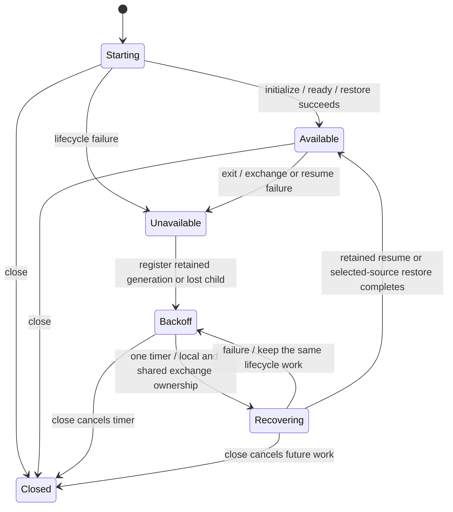

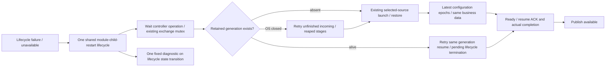

Child and memory controllers reread normal adoption before recovery, so a failed adoption save cannot leave the running source and persisted selection inconsistent. A retained writer whose selected source changed is drained through its existing lifecycle before replacement. Only lifecycle work is retried. No memory mutation, notification send, delivery, or accepted business request is replayed. Invalid output fails that request without latching the module. Memory start is coalesced only while starting, not cached forever; recovery rereads normal selection and probes its source without rolling back business data. Execution retains engine/handoff ownership and retries resume or actual cleanup before reconstructing its selected generation; native jobs, shared SDKs, and conversation identity are not reset. Conversation writer retirement continues to require its actual writer/effect protections. Retained OS-closed children retry the failed termination stage instead of awaiting a permanently rejected `end` promise. A live writer is resumed, never killed as an unavailable shortcut.

Conversation protocol failure uses this same actor. The existing admission failure notification enters writer retirement; an issued retirement failure registers backoff before it can return. A retained live failed writer retries its same-generation quiesceWriter/exitWriter lifecycle stages; validated quiescence is required before requesting its exit. An already OS-closed writer with drained parent effects and completed reaping is observed gone, so an absent exit ACK cannot permanently block the new generation. `recoverFailedGeneration` preserves the retired native references and prevents old callbacks from contaminating the new generation. Delivery-release/background peer failures close their IPC peer and follow the same actual-child-loss path. Per-frame/target identity validation remains unchanged.

Lifecycle diagnostics report backoff/available/closed transitions once; retry attempts do not repeat records. Existing termination evidence remains bounded and stage-specific. Parent assembly and public module-update APIs stay unchanged; recovery restores availability before normal update availability checks. The shared implementation is reused rather than adding per-module timers or public recovery APIs. The specialized failure text below is governed by this contract; unavailable is never an indefinite terminal latch.

runtimeエピネル。既members交換手順の共通機構を`src/module-process.mjs`へ接続し、conversation/usage/diagnosticsの固定3componentだけを扱う。業務DTO/actor/opaque lease/stream/投影ACKは各作者のclosed channel、親facade/実サービス組立はMolly、固定資材と署名はCenti。先行members/通知controllerをこの変更で置換しない。

```mermaid
flowchart LR
  Caller[親安定facade / 固有authority] --> Channel[固有ParentChannel / 実completion]
  Controller[createModuleProcess] --> Channel
  Mutex[親の共有exchangeMutex.runExclusive] --> Prepare
  Prepare[固定prepareRelease / catalogと互換検証] --> Closed[新受付閉鎖 / 既lease継続だけ]
  Closed --> Drain[実completion＋外部admission drain / 60秒]
  Drain --> Quiesce[child quiesce / 保存・stream・callback終端]
  Quiesce --> Handoff[固有private export / 必要moduleだけ]
  Handoff --> Exit[exit / OS・IPC・pipe全close]
  Exit --> ChildClosed[固有childClosed / 発行済callbackと自身の保存effect終端]
  ChildClosed --> Reaped[親incoming完了 / reaped]
  Reaped --> Launch[固定C / advanced IPC / 新generation]
  Launch --> Init[initializeParams / restore・投影ACK / ready45秒]
  Init --> Record[private adoption / 同stateデータ維持]
  Record --> Resume[resume ACK / 親新受付公開]
  Resume --> Caller
```

`createModuleProcess({component,root,createChannel,prepareRelease,validateReady,initializeParams?,exportHandoff?,admission?,canContinue?,onGeneration?,onState?,onModuleChildExit?,investigationsFile?,exchangeMutex?,spawnProcess?})`はstart/close/request/callback/initialize/replace/reserve/snapshotと会話限定retireProtocolFailedWriterを返す。spawnProcessは実起動の試験DI、通常はNode spawn。component/実行path/argvは固定、envは空又はdiagnosticsの既notes設定一変数だけ。createChannel(child,{generation})は本人のready/request/callback/control/reapedを供給する。descriptorの固定appRootを共通検査し、prepareReleaseとvalidateReadyが作者の署名済版・protocol・実stateCompatibilityを検査する。

usage固有のstartPaused:trueはstartをsettings ready後のinitializingで返し、親がinitializeで既3段を進めた後activate()の実resume ACKで新rootを開く。他componentへのstartPausedは拒否する。初回順序/secret/private snapshotの意味は[module readerとwrapper](module-release.md)と業務正本に従う。

usage/conversationのparent channelは共通endpointの`drainIncoming()`も公開する。childのOS/pipe終了後に親effect/保存/投影commitが残る場合、その実終端を待ってからreapedと次子を許す。親effect無しのdiagnosticsは同portを省略可能。outgoing RPCのreaped待ちcompletionをdrainIncomingへ含めない。

固有channelの任意口`childClosed():Promise<void>`は実OS/IPC/全pipe終了後、`drainIncoming()`前にawaitする。会話は発行済callbackだけを各callback自身の保存effect終端後に失敗終端させ、incoming→callback completion→reaped→incomingの循環を解く。root/control/背景ACK/nativeは既reapedまで保持する。A rejected hook remains the pending incoming stage and is retried by the shared lifecycle before reaping or relaunch. 未提供channelの既順序は同じ。

admissionを使うmoduleは同親のclose/drain/adopt/resumeを注入する。canContinueは同親が元opaque leaseとgenerationを照合する関数で、既受付の継続だけを閉鎖中に通す。既定は拒否。callbackの本人性/相関は固有channelが毎回検査し、新root枠へ転用しない。requestと後続initializeはcaller Promiseだけでなく`.completion`を追跡する。quiesce期限も実completionを切らず保持する。既子の全OS/IPC/pipe終了後だけreapedを通知し、次子を起こす。

initializeParams({generation,mode,handoff})は初回bootstrap、採用済起動/交換はrestoreを固有paramsへ変換する。usageのsettings/subscriptions/services段階は同親がinitialize(stage)で進め、交換はexportHandoff(channel)から得た同private handoffを一回のrestoreへ渡す。snapshot start/end/abort・権限はcreateChannelの閉closureへ注入する。本文/path/envをHTTPや更新DTOへ追加しない。

quiesce失敗/60秒未終端は旧resume、新子0・kill0・unknown再送0。新版ready/保存/resume失敗時は未受付candidateをOS終了まで回収し、旧固定版と同handoffから再生成する。A retained resumed writer enters shared lifecycle retry; it is not killed as a shortcut, and real writer/effect ownership is preserved. closeは起動/交換中operationと既writerを回収し、新子の起動を止める。exitの5秒killはquiesce成功後だけ。

admission.drainが明示busyを返した時は、子quiesceへ進まず同DRAIN_TIMEOUTで旧resumeへ戻る。

quiesce RPCは残りdrain時間を明示し、共通controller自身もその残時間のwithinで囲む。固有channelのACK/進捗によるcaller期限変更を実drain期限の延長にしない。期限後は元control.completionをactiveへ残し、旧resumeと子epoch検査を使い、遅着quiesceで新受付を再閉鎖しない。close/次交換はその実終端を待つ。

private recordは既0600/no-follow/nlink1/所有/4KiB検査の`bellteam.<component>.adoption.v1`。module/allのdurable requestId ledgerや公開source identityはMollyが所有し、このrecordから捏造しない。reserveはcompletionを返し、実replace終端又はcancelまで同親mutexを保持できる。

このsourceの限定fake-child境界と、各作者の実IPC fixture、Centi同imageの実UID/署名/OS交換は別の証拠。初回親組立とmountはimage導入が必要で、未登録moduleを既imageへ無再起動追加できるとは扱わない。導入後の登録済controller経由コード交換が対象。

親が注入する同exchangeMutexのrunExclusiveでreplace全体（prepare前からdrain/旧OS終端/採用保存ACK/失敗復旧まで）を囲む。mutexが使用中ならMODULE_EXCHANGE_BUSYでprepare・受付閉鎖前に拒否し、子/現在版を変えない。省略時は既個別controller排他だけ。start/close/requestの寿命管理と親の公開Update ledger mutexは変えない。conversation/usage/diagnostics薄wrapperは同identityを転送し、親assemblyの共有一実体DIはintegrationが所有する。

## 交換失敗のprivate診断

既candidate launch/adoption/resume失敗のAggregateErrorに`moduleDiagnostic`を追加する。元code無し/errors/制御は保持。`module-exchange-diagnostic.mjs`の単一validatorは厳密7key schema/component/stage/code/rollback/rollbackStage/rollbackCode、1024 UTF8 bytes以内、固定stageとOS/Node/component code閉集合を検査する。未知codeはnull。候補の最初の失敗段階を固定し、戻しのresumeまで完了した時だけrollback succeeded、戻し失敗は独立stage/codeを保存する。旧子exit前のDRAIN_TIMEOUTは後述のdrain variant、それ以外のprepare/quiesce/export失敗にはDTOを作らない。

Molly共通executorは当該component一致と同validatorで検証したコピーだけを既step.runtimeDiagnosticへ任意保存し、旧ledger field無しを受け入れる。公開error/schema/unknown、同ID非再applyは保持。message/stack/stderr/秘密/本文/環境/PID/任意nested errorsを含めず、過去要求へ欠測を補完しない。

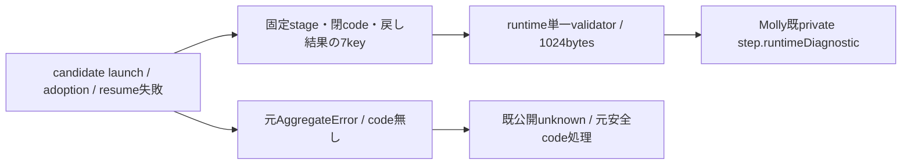

## 子だけの自動再生成

成功稼働子が意図close/交換以外で終了したら新受付を閉じ、OS/IPC/pipe→await channel.childClosed（提供時）→drainIncoming→await channel.reaped→旧要求completion終端を待つ。採用済み同版を再検証し新generationのrestore/ready/resume ACK後だけ再開。旧admissionではrecover(ticket,old,next)で閉鎖採用し、未resume候補再失敗は同ticketの通常adopt。会話の新しい正式口は次段に従う。旧要求や作用不明は再送しない。usageは初回段階順序を保ち、障害復帰ではsettings後subscriptions/servicesも復元する。

会話の故障世代分離はRoot `conversation-failed-generation-contract-20261104.md`とKiro `q-retired-generation-io-20261104.md`を契約正本とする。新しい`admission.recoverFailedGeneration(ticket,previousGeneration,nextGeneration)->void`が提供される場合、会話の異常終了又はその未resume再生成candidateのOS/IPC/全pipe/incoming/effect/reapedを実完了した世代だけを同正式口へ渡す。retiredの元native/watch実参照は終端専用のまま保持し、新currentは閉じた空bucketで同採用版restore/ready/resume ACKを待つ。同ticketのままcandidate再失敗時もそのcandidate実barrier後に新しい未使用nextを採用する。新口未提供の旧admissionは既recover/adoptの互換を保つ。

正常module交換と既recover/adoptの全体active0/未確認検査へ新口を流用しない。旧opaque/authority/実completionは元bucketに残り、旧callbackのfailure/unknownを新writerへ書かず成功ACKも作らない。新gateの空きを同Botの旧native/receipt占有の解除へ変換しない。native実追跡とcallback失敗の分離、現在/退役の実参照routingはKiro、旧writer/restore/ACKはN102、安定admission/moduleOperationsの親組立はMollyが所有する。

会話の全体closeは正式`admission.drainForClose(ticket,{timeoutMs=60000})`を使い、両世代の実参照が残る間は未確認でも待つ。実参照0で元未確認をrejectし、期限のbusyは既DRAIN_TIMEOUTとして失敗する。正常交換は既drainの即時未確認拒否を維持。現在子が無い場合も全体closeは同口で退役実参照を回収し、未確認又はbusyをclosed成功へ変えずunavailableと元例外を返す。既admissionに同口が無い場合のcloseは互換を維持する。

module-child-restartは既controller排他へ接続し初回1秒、連続失敗2/4/8/16/最大30秒、正常60秒で初期化。回数による恒久停止無し、closeでtimer取消。members/notifications/web-gatewayも採用版と固有初期化を保持し同timerを使う。親/他子/Dockerは再起動しない。終了logは固定MODULE_CHILD_EXITED/component/整数exitCode/閉signalのみ、stderrは最大8KiBのrawを全chunkの4KiB区間ごとに処理し、大chunk中央/区間境界の固定4codeも検出する。任意本文を保存/公開しない。常駐子のstdout/stderrはpipeで排出し、inheritで本文を親logへ流さない。

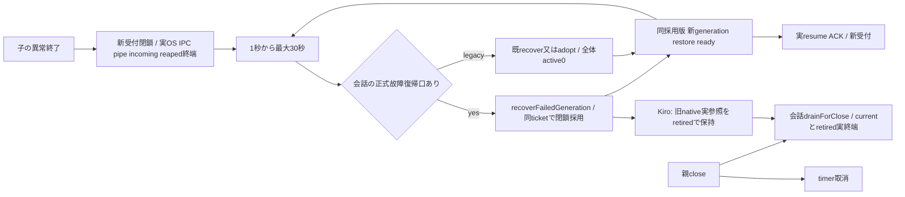

共通3componentの再生成試行は既consoleへ`MODULE_CHILD_RECOVERY`を記録する。固定component/stage/event、safe整数attempt、既runner/admissionの安全な件数とclosed/unconfirmed、閉failureCode又はnullだけ。operation/mutex/runner/prepare/recover_admission/spawn/channel/initialize/ready/restore/resumeの各待機開始と試行完了・失敗・不要時skipを残し、未完待機は最後の段階として識別する。Recovery evidence is deduplicated by stage/event during one recovery episode, so retry attempts do not repeat it; the shared1–30-second schedule is retained.

`local_mutex`はcontroller内排他の取得/拒否地点、既`mutex`はその取得後の親共有排他を表す。controller排他の競合は既UPDATE_IN_PROGRESSで即時拒否する。両者の間に新しい排他や期限を設けず、元Promise・実completion・例外を保持する。lostはtimer登録呼出への到達で、復旧完了又は全復帰期限ではない。

会話子の終了理由は既bounded stderr observerへ接続する。固有peerが一回だけ出すexact3key `{code:'CONVERSATION_CHILD_EXIT_ORIGIN',origin,failureCode}` を、1024文字以内の未切断JSON行で検証し最初の有効値だけ保持する。originはpeer_failure/parent_disconnect/exit_control/exit_writer_control、failureCodeはCONVERSATION_接頭のIPC_INVALID/IPC_DISCONNECTED/IPC_TIMEOUT/IPC_ACK_TIMEOUT/IPC_SEND_FAILED/CHILD_EXITED/BACKGROUND_UNCONFIRMED/DELIVERY_RELEASE_UNCONFIRMED/PROTOCOL_UNCONFIRMED又はnull。未知field/code/origin・長行/切断行を証拠にしない。

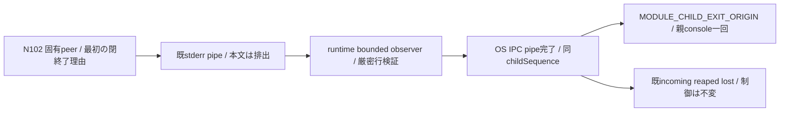

親は同childのOS/IPC/全pipe終了後、正常closeや未受付candidateを含む会話子の各終了にexact6key `MODULE_CHILD_EXIT_ORIGIN/component:'conversation'/childSequence/observedAt/origin/failureCode`を一回記録する。未取得originはunknown/failureCode=null。console失敗はbarrierへ伝播しない。childSequenceは親process内の相関値であり、Centiは親CID/StartedAt/sourceと一組で扱い、再起動後の同整数を同世代にしない。この記録は固有peerが選んだ終了経路で、実OS終了原因・過去事故の根因・native終端の証明ではない。既`bellteam.module-child-exit.v1`、診断writer/HTTP/ledgerと再生成条件は変更しない。

admission snapshot不在/失敗とconsole失敗は観測欠測になり、元制御へ伝播しない。自由error/message/stack/本文/lease/generation/pathは渡さない。このconsole envelopeは公開DTO/既private exchange又はdrain ledgerのvariantを追加せず、Signalの診断writerや親登録を増やさない。意図close/交換は既recovery条件で除外し、実処理終端・gate active=0・世代recover/adopt・元要求非再送を変えない。旧事故の未保存段階/根因/19:38復帰を後付けしない。

## 子終了診断のcallback

共通3componentとmembers/notifications/web-gatewayの6常駐子factoryは`onModuleChildExit(dto)`を受ける。usage/conversation/diagnosticsの薄wrapperも同identityで転送する。既OS/IPC/pipe終了後の異常終了条件から一回だけ通知し、意図close/交換・未resume候補は報告しない。callbackの同期throw/戻りPromise失敗は再起動・元completionへ伝播しない。初回1秒/最大30秒の再生成、incoming/reaped待ちと元要求非再送は維持する。

`observeModuleChild()`の内部snapshotは固定4code、既Node heap OOM marker、GCのbeforeMiB/afterMiB/capacityMiB/pauseMsだけを返す。rawは8KiB以内でpipe close時に破棄する。最大8件の末尾証拠は`heap_oom`又は`gc`の有限0..1e9数値。stderrBytesは非負safe整数で飽和、raw/evidence上限超過はstderrTruncated=true。不明なstderrやOSのSIGKILLからOOM原因を推定しない。既固定console出力は維持する。

`reportModuleChildExit()`は、componentが`conversation`で、かつ`observeModuleChild()`が会話子の閉形式`CONVERSATION_CHILD_EXIT_ORIGIN`行を取得した時だけ、同じ閉pair `childExitOrigin:{origin,failureCode}`をDTOへ加える（2026-11-08 I-5）。未取得、又は他componentのstderrに同形の行があってもkeyを付けない（他componentのDTOは従来形のまま有効）。

閉DTO `bellteam.module-child-exit.v1`と単一validator/formatter/保存/取得は[diagnostics正本](../diagnostics/README.md#子終了の有限診断)。親登録と診断停止中の最大6最新値・ready時flushは[integration](../integration/README.md)。runtimeは新しいwriter/queue/再送機構を持たない。

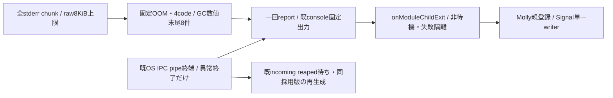

## 旧exit前のdrain timeout

**Superseded 2026-11-08** by [the old module cannot veto its replacement](#the-old-module-cannot-veto-its-replacement-owner-2026-11-08): DRAIN_TIMEOUT no longer resumes the old child or fails the update, so this diagnostic is no longer attached. The validator still accepts saved drain-v1 rows.

更新のDRAIN_TIMEOUTだけ既error.moduleDiagnosticへ`bellteam.module-drain-diagnostic.v1`を付ける。schema/component/stage/runnerActive/admissionActive/admissionClosed/admissionUnconfirmedの閉7key・1024 bytes以内。stageはparent_drain/child_quiesce/handoff。activeは非負safe整数又は欠測null、boolも欠測null可。既admission.snapshotからactive/closed/unconfirmedだけを選び、generation/lease/correlation・自由error・本文・stackを含めない。snapshot失敗は欠測にし、元error/code/60秒/旧resume/非再送を変えない。

診断は旧resumeの前に捕捉し、親は既private step.runtimeDiagnosticへ保存する。validateModuleExchangeDiagnosticは旧exchange-v1又は新drain-v1の閉variantだけを許可し、既7key exchangeの検査と過去field無しledgerを維持。公開Operation DTOへ追加しない。現在の本番f3f098bbの段階/activeを新sourceから後付けせず、元欠測を保持する。

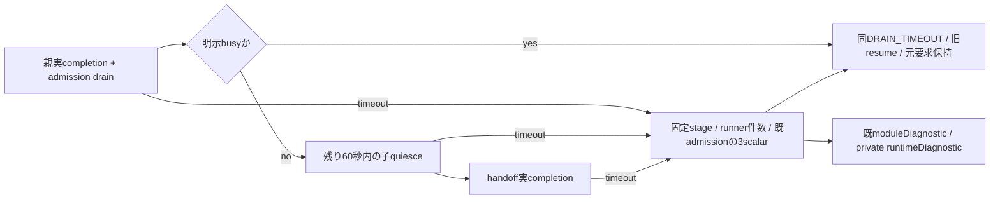

## T：終了report後の段階診断

既consoleのMODULE_CHILD_TERMINATIONは異常稼働子と未resume回復candidateのOS/IPC/pipe終了後だけ発行する。閉keyはcode/component/stage/event/childSequence/observedAt/failureCode/runnerActive/admissionActive/admissionClosed/admissionUnconfirmed。stageはos_closed/incoming/reaped/lost、eventはwaiting/completed/failed。childSequenceはcontroller内起動順の非負safe整数で、生generation/lease/本文は含めない。時刻はISO UTC（収集者がJSTへ変換）、不明code/件数/状態はnull。標準Docker logの固定JSONをread契約とし、新HTTP/別writerを作らない。

os_closed completed→incoming waiting/completed→reaped waiting/completed→lost completedの順。lostは既recovery.lostの呼出完了であり、新子readyやtimer実発火の証明ではない。後続のMODULE_CHILD_RECOVERYを同container/親process/component/時刻で結ぶ。incoming/reapedが未完なら次段階へ進まず、拒否はその段階のfailedを残して元例外を保持。console/snapshot失敗は診断欠測として元制御を変えない。close/交換の意図終了はこの診断の対象外。欠測やsequenceを実終端証明にしない。

注入admission.close(source)は既引数無し互換のKiro契約で、module_start/module_replace/module_close/module_child_exit/module_recoveryを各既callerから渡す。ticket/failed/閉鎖主体の保持とinspectAdmissionの単一validatorはexecution担当。共通は既snapshotの安全な3scalarだけを投影し、生存gateの強制再開は行わない。

## 同ID closeの会話writer保持

conversationのwithInstallReconciliationProof(operation)はlocal operation排他だけを保持する。親integrationが同共有exchangeMutex.runExclusiveを一回外側で保持し、execution proof→conversation proof→両assert合成operationの順へ接続する。共有mutex再入やbypass tokenを受け付けず、通常交換は既共有排他を維持。provider単体を全writer証明にしない。

利用可能でopenな同instance/generationだけを捕捉し、admission閉鎖→実runnerと両世代実drain→child quiesce ACKとcompletion→incoming/effectの実完了後だけcallback(assertQuiescent)を呼ぶ。callback前後と親のclaim/RPC前後に同じassertを使う。assertはcallback寿命外/instance変化/子終了/親closeで拒否。snapshot/診断で実終端を代用しない。生存子のquiescenceでありOS/reaped終端を主張せず、旧子終端不明は拒否する。

callback成功/失敗後とも同子の実resumeを試み、元失敗とresume失敗はAggregateErrorで両方保持する。親closeが始まった場合は再開しない。旧unknown/原Start/台帳作用はproviderに持ち込まない。会話固有drain/唯一writer意味とwrapperはN102、engine実参照はKiro、認可・同ID・共有排他と集約はMollyが所有する。

callbackのcaller結果と任意.completionを両方settleまで保持する。callback期間はcontroller request/callbackも拒否し、終了後assertは失効。finallyのresume ACKと実completionの両方が終わり、同instance/generation/生存を再検査してからだけadmissionを開く。既閉ticket/failedは開始時assertOpenで拒否し借用しない。親は自身の会話leaseを持ってこの口へ入らず、callbackからwriterへ再入場しない。snapshotのactive/unconfirmedは拒否の追加guardだけで、実drain/quiesceの代用にはしない。

## 生存protocol-failed writerの正式退役

Owner K-PEJQSP v3 / Root protocol-failed-writer-retirement-proposal-20261105契約。親内部の`retireProtocolFailedWriter({generation})`はexact1keyだけを受け、conversationの同instance/current generationと同admissionのcapture/inspectAdmission.failedを同期再検査する。任意PID/子/target/停止signalを受ける口ではない。親assemblyが既共有exchangeMutexを外側で一回保持し、controllerは既local operation排他だけを使う。通常replace/既close/finishExitは流用しない。

```mermaid
flowchart LR
  Failed[Molly: 同assembly初回protocol通知] --> Shared[親共有exchangeMutex一回]
  Shared --> Local[同controller local排他 / 同instance世代failed再検査]
  Local --> Quiesce[N102 quiesceWriter / writer保存effect実終端ACK＋completion]
  Quiesce --> Incoming[親drainIncoming / 同identity再検査]
  Incoming --> Exit[N102 exitWriter / writerClosed ACK＋completion]
  Exit --> OS[実OS IPC 全owned pipe終端]
  OS --> Parent[親incoming effect reaped終端]
  Parent --> Lost[failedWriterReaped / 共通lifecycle lost]
  Quiesce -->|生存子への失敗| Backoff[共通backoff / 同世代の退役stage再試行]
  Backoff --> Quiesce
  Lost --> Return[available false snapshotを返し共有mutex解放]
  Return --> Q[既Q timer / 同採用版restore ready resume]
  Native[Kiro: 元native watch opaque 同Bot占有] --> Retained[元実参照のまま保持]
  Retained --> Q
```

N102正式channel.control('quiesceWriter',{},60000)はexact {writerQuiesced:true}と同Promiseの実.completionを要求する。既受付writer保存とreverse effect/event終端だけを待ち、全native/global admission drainや全runner drainに読み替えない。親drainIncomingも実完了し、同target/current failedを再検査後だけcontrol('exitWriter',{},5000)へ進む。exitWriterにはexact {writerClosed:true}と実.completionを検証し、復帰には実OS/IPC/pipe/incoming/reaped完了を要する。ACK欠測を成功ACKへ補完せず、子の実終了と親effects/reaped完了は別の実観測として復帰に使う。

同instanceの退役は直列化し、失敗したlifecycle stageだけ再試行できる。開始後の新request/callbackは拒否する。生存writerは同世代のquiesceWriter実ACKと保存/effect終端を確認してからexitWriterを要求し、失敗は共通backoffで同じ退役stageを再試行する。実OS/IPC/pipe終了と親incoming/reaped完了を観測済みなら、exit ACKの欠測だけで新世代への復帰を止めない。caller期限が先にrejectしても実.completionまでlocal排他を保持し、期限kill/強制resume/failed手消去/偽native finish/元要求再送はない。親closeは従来の全体close契約を維持する。

返値は旧writerの全barrierと既Q lost接続時の既snapshotでavailable=false。同共有mutexを解放してから既Qが同mutexを取得して新子を作るため、新readyを退役callback内で待たない。admission.snapshot.unconfirmedは旧retiredFailed/nativeUnknownを含むので新resumeの追加拒否に使わず、既recoverFailedGeneration/resumeのcurrent failed検査と元native/watch実参照を保持する。writer専用保存/effect分類と二control/子ACKは[conversation正本](../conversation/process.md)、通知/同親bindingはintegration、元native/同Bot占有は[execution正本](../execution/conversation-lifetimes.md)が所有する。

The 2026-11-07 durable job / real readiness / restart-limit contract is canonical in [update-jobs.md](update-jobs.md). It supersedes unknown-as-job-state and worker-bound-only acceptance text for new jobs. Legacy historical receipts remain unchanged.

## The old module cannot veto its replacement (Owner 2026-11-08)

`replace`: a drain, quiesce or handoff-export failure or timeout no longer resumes the old child and fails the job. The old child is stopped like a crash (`finishExit`: exit, then SIGKILL after 5 s), and the candidate launches with `handoff: undefined`, i.e. the existing restore path used after an unexpected exit (durable state). Only a candidate `prepare` failure still resumes the old child, because nothing was replaced. A stopped or never-started module is replaceable (no `available`/`initialized` precondition; a missing or ended old child is skipped); success sets `initialized`. `exclusive` queues behind recovery instead of answering UPDATE_IN_PROGRESS; `reserve` refuses only a second reservation (two exchanges at once), which exits when that reservation's completion settles. The `moduleDrainDiagnostic` on DRAIN_TIMEOUT is gone with the refusal it explained. Sweep table: [update-jobs.md](../integration/update-jobs.md#update-path-guard-sweep-owner-2026-11-08-ハッシュで確認してるんだから止める必要ない).

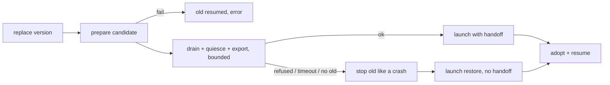

## Requests between children wait instead of 503 (2026-11-08, Molly; Epinel runtime / Kiro execution OK)

Owner: a module exchange or a child loss must be invisible to callers. Members got this in #603 (`MembersAdmission`, [execution/members-admission.md](../execution/members-admission.md)). The other controllers share one wait primitive in the recovery controller.

| Function | Input | Behaviour |
| --- | --- | --- |
| `createModuleChildRestart(...).hold(retry, refuse)` (`src/module-child-restart.mjs`) | a request that found no usable child | waits for the next `running()` (exchange success, rollback, recovery) or `close()`, then runs `retry` once. Closed: `refuse()` at once. No `running()` within `MODULE_HOLD_MS` = 60 s: `refuse()` (the old 503) and the waiter is removed, so a later `running()` never runs a request whose caller already got the refusal (same for members `#afterExchange`). The timer is unref'd; waiters hold no lease or active entry, so drain/quiesce never wait for them |
| `module-process` `invoke('request')` (conversation, usage, diagnostics) | no instance, ended instance, or `!available` without `canContinue` | `recovery.hold(() => invoke(...), () => <C>_NOT_ACCEPTING)`. Callbacks keep their refusal (they belong to a live lease) |
| `memory-process` `request` | `!available` or `changing` (exchange in progress) | hold; the replace `finally` calls `recovery.running()` when the module is still available, so waiters resume after the exchange |
| `notifications-process` `request` | `!available`, `exchanging` or no instance | hold for reads; a captured `configure` stays epoch-bound and keeps `PUSH_CONFIGURATION_BUSY` + `PUSH_NOT_ACCEPTING` |
| `execution-generation` `dispatch` | `!available` (except the existing `transport.runningBots` read from the readable previous engine) | hold, then dispatch to the new engine. `project` stays synchronous and unchanged |

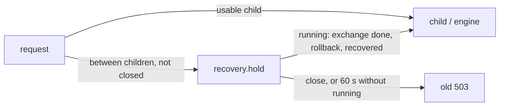

No new refusal, lock or state writer. Body-resident (parent controllers in `/app/src`). Not changed: the conversation child's own refusals while it quiesces (child-internal), and the conversation lifetime admission, which never gated new work by ticket.
