# 業務moduleのinstalled readerと固定wrapper

所有エピネル。業務と固有channelはMika/Signal、親の一実体facadeと組立はMolly、archive/署名/root配置はCenti。既[共通controller](module-process.md)と[固定C](module-start.md)を使い、各作者の互換値/ready validatorを参照する。

```mermaid
flowchart LR
  Catalog[固定component・source・platform・archive・実互換] --> Prepare[prepareModuleRelease / usage又はdiagnosticsだけ]
  Prepare --> Reader[既root receipt・manifest SHA・完全inventory reader]
  Reader --> Descriptor[固定appRoot / sourceCommit / P1 / 作者互換]
  Descriptor --> Wrapper[固定createUsageProcess又はcreateDiagnosticsProcess]
  Wrapper --> Controller[同createModuleProcess / 唯一childと実終端]
  Controller --> Adapter[本人ParentChannel・ready validator]
  Adapter --> Writer[同版entry・閉dispatcher・唯一writer]
  Writer --> Data[既state・logs・秘密・質問 / 新保存schema無し]
```

`src/module-release.mjs`のprepareModuleRelease(component,versionId,{expectedRelease?,signal?})はusage/diagnosticsの閉集合だけ。既web-gateway-release readerのroot0/no-symlink/immutable0555/regular0444/nlink1、root installer receipt/同manifest hash、完全inventory SHA/sizeを再利用する。未配置archiveをreaderで取得/設置しない。release pathは/run/bellteam-maintenance/固定component/releases/SHA/payload。memoryの別RO codeDirectoryとWeb source/platform metadataは維持する。

manifestはP1/Node26/platform、実USAGE_STATE_COMPATIBILITY又はDIAGNOSTICS_STATE_COMPATIBILITYを完全一致検査し、entry・固有channel/dispatcher・共通IPC/stream/locksとpackage metadataを要求する。catalogの固定5key compatibility（stateSchema/containerUpdateはnull）をsource/platform/archiveへ結ぶ。validator通過は未署名shapeの確認にすぎず、認証はroot installerの別工程。

各互換validatorはNode26の同期ESM読込で選択componentを検査する時だけ取得する。同期validateBusinessModuleManifest契約を保ち、executionや他componentのreader importを未導入usage/diagnostics業務へ依存させない。閉relative path以外をresolverへ渡さず、未導入の選択moduleは拒否する。

`createDiagnosticsProcess({root,investigationsFile=null,onState,onModuleChildExit?,exchangeMutex?,prepareRelease?,spawnProcess?})`は同作者createDiagnosticsParentChannel/validateDiagnosticsReadyへ直結し、共通start/request/replace/reserve/snapshot/closeを返す。notesは既親configだけ、固定Cの唯一env許可から同factoryへ。list配列/row/HTTP契約は変更しない。初回writer lockは固定Cが準備済みstateでO_CREAT/no-follow/0600として取得し、既inode/owner不一致は拒否する。広いchown/chmodやlock削除を追加しない。

`createUsageProcess`はroot/admission/bootstrap/authorizeActor、固定effect/private projectionの各親port、onGeneration/onState/onModuleChildExitを受ける。親live object/秘密を公開snapshotへ出さない。初回startはsettings seed/readyだけでphase=initializing/available=false、同admissionを閉じたまま返す。親が既順序でinitialize('subscriptions')、他module組立後initialize('services')、activate()を呼び、実resume ACK後だけ新rootを公開する。偽resume成功を作らない。交換のrestoreは同control一回で全stage/private snapshot ACKを終え、旧control('export')の実completion付き{handoff}をunwrapして渡す。

conversationもprepareModuleRelease/同期validateModuleReleaseManifestの閉集合へ追加する。作者CONVERSATION_STATE_COMPATIBILITYの実7値と既manifestの明示runtime.stateSchema:nullを維持し、欠測/整数schemaを拒否する。descriptorもstateSchema:nullを返し、catalogのnullと区別しない。entry/channel/dispatcher/locks/conversation-streams再export/module-streamsとpackage metadataの固定closureを確認する。会話固有薄wrapper/probeはN102へ正式handoffし、親表示bots snapshot・権限・accepted Promiseの意味は本人が同channelへ接続する。runtimeは共通reader/C/配置を維持する。

cold parent restartは既採用recordから選択した同版へsettings restore:true→subscriptions→servicesと進める。private volatileが失われた通常cold起動はMika3a3eの既read-only restore/新規volatileを使い、人工handoffを作らない。hotswapのmode=restoreでは実handoff必須を維持する。同期設定はprivate seed/commitだけを読み、fresh認可GETとは区別する。

限定境界は新manifest/catalog/拒否5と実Node wrapper2。usageの3段bootstrap/実activate/handoff交換、diagnosticsのrecord/list/実IPCとOS closeを確認する。Cはspawn DIで置換し、同じfixture codeへSHA識別を付けるため別署名bundle/実UID1001/実root receipt/同image/nativeの代証にしない。既shared reader変更接点のWeb4/memory manifest1だけを検査し、業務作者の既成功群を再走しない。

usage/diagnosticsの固定wrapperは親が渡したexchangeMutexを再生成せず同identityで共通createModuleProcessへ転送する。親組立てとledgerの別予約はintegration所有で、この変更で親のlockを重ねない。

usage/conversation/diagnosticsの薄wrapperは親の`onModuleChildExit`を[共通controller](module-process.md#子終了診断のcallback)へそのまま転送する。診断writerや復旧の寿命をwrapperへ増やさない。
