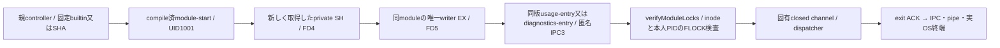

# usage・diagnosticsの固定起動とlock本人性

runtimeエピネル。固有業務/closed channel/entryはMikaとSignal、親assemblyはMolly、imageへの固定binary/closure収録と実UID受入はCentiが所有する。共通controllerの世代交換を、この入口のsource成立だけで完了扱いにしない。

`scripts/usage-start.c`と`diagnostics-start.c`は共通`module-start.c`へcompile時に固定名/entry/errorを渡す。公開argvはbuiltin又は64桁SHAだけ、rootは/app又は/run/bellteam-maintenance/固定module/releases/SHA/payload。UID/GID実効値と補助group、private root0:1001/0750、transaction無し、state owner1001、writer0600/nlink1/no-followを検査する。親lockを継承せず新SH/EXを取得し、同module二重起動を拒否する。固定binaryは非setuid、root:root0755として通常imageへ収録する。

exec前に環境をclearenvし、固定PATH/HOME/IPC3とadvanced serializationを設定する。診断だけ既親設定`BELLTEAM_DIAGNOSTIC_INVESTIGATIONS`の一変数を保持する。親controllerが同既設定だけをspawn envへ注入し、entryはそれをfactoryへ渡す。body/initializeからpathを受けず、notes無しは未設定のまま。usageへこの変数や本体の環境/秘密を渡さない。

`verifyUsageLocks()` / `verifyDiagnosticsLocks()`は共通`verifyModuleLocks(component)`を呼ぶ。IPC接続/全UID・GID1001、FD4/5と固定pathのdev/ino、所有/mode/link、fdinfoのREAD/WRITEと**自身PID**を照合する。Cの取得成功をentry内の推測で代用しない。親はOS/IPC/pipe全終端後だけ次子を開始し、reapedで低層IPC completionを解放する。

限定fixtureはcompile時のUID/rootだけを現在席へ置換し、実kernel SH/EX・二重writer拒否・環境消去・診断一変数・Bufferのadvanced往復・OS close後の再入場を確認する。本番UID1001やroot mountの実物受入は同source imageの別工程であり、ここへ補完しない。
