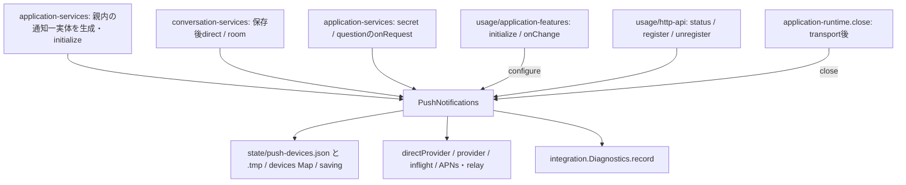
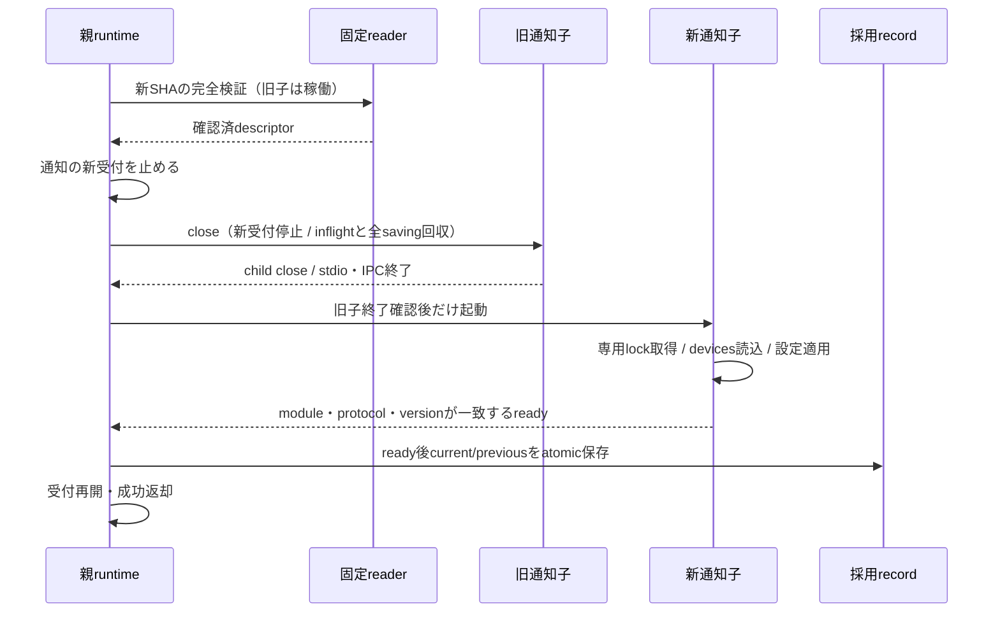

# 通知の固定資材・起動・writer排他（契約提案）

所有：runtime エピネル。基準main `03c952bf33b58b4eff322a8514f5448336c1a5be`。この文書はRoot裁定前の提案。通知子・専用lock・署名供給は未実装。現行の[全体図](../../feature-map.md)から[runtime](README.md)、[usage](../usage/README.md)、[integration](../integration/README.md)、[distribution](../distribution/README.md)へ辿れる。現行Webの契約は[web-gateway-release.md](web-gateway-release.md)。

## 現物の接続と変更範囲



| 現source・関数 | 既callerと契約 | 次差分の所有 |
| --- | --- | --- |
| `src/application-services.mjs:createApplicationServices` | 36-37行でPushNotifications生成・initialize、91/97行でカードcallback、conversationへ同実体注入 | モリーが通知proxy一実体へ組替え。親内providerを並存させない |
| `src/conversation-services.mjs:createConversationServices` | 25/58行のdirect/roomはvoid。元recordは本文を含み得る | ミカのproxy/DTO投影で必要値だけ渡す。会話内部を変更する必要が出たらN102と合意 |
| `src/usage/http-api.mjs:createUsageApi` | 63行status同期、65/67行register/unregisterをawait。本文上限32768/4096 | ミカ。statusのキャッシュ又はawait変更をRootと決定。HTTP認証/response形式は保持 |
| `src/usage/application-features.mjs:createApplicationFeatures` | 47/73行configureを初期化/変更時にawait。適用失敗は設定保存と別 | ミカ。設定正本は親、子へ最小設定DTOを渡す |
| `src/push-notifications.mjs:initialize/save/publish/close` | 22-35行APNs鍵・devices読込、118-119行送信後unregister、138-150行saving/inflight | ミカ。子がdevices/保存/providerを単独所有。closeはsavingも含む有限終了へ接続 |
| `src/application-runtime.mjs:start/close` | features.initialize前にservices構築、closeは同一Promise/AggregateErrorで後続も閉じる | モリーが通知start/closeを組む。runtimeは子回収APIを供給 |
| `src/http-gateway-process.mjs:createHttpGatewayProcess` | prepare→旧close→新ready→writeAtomic、15秒start/5秒drain、失敗rollback、親close取消 | runtime。共通化できる順序を参考にし、Webのport/assets処理は通知に持ち込まない |
| `src/web-gateway-release.mjs:prepareGatewayRelease` | 固定store、root所有・mode・manifest/hash/完全file集合・互換再確認、読取専用descriptor | runtime。固定notifications policyを追加し内容検証の重複だけ縮める。Web wrapper/schemaは保持 |
| `scripts/install-web-gateway-release.py` | private SH＋component EX、公式verifier、installation最後、NOREPLACE publish | runtime。固定二moduleの分岐へ限定。配布verifier/schemaはセンチ |
| `src/web-gateway-install-plan.mjs` / `distribution/server/install.sh` | 現CID/image/mount検証、既image固定root helper、normal停止0 | runtime callerを固定通知modeへ拡張。収録/build/署名はセンチ |
| `scripts/server-start.c` / `src/server-state-writers.mjs` | private root SH＋state全体EX、六state領域にapns含むwriter検査 | 維持。通知子で全体EXを再取得しない。新専用entryをruntimeが実装する案 |

全consumerは上表の通知method接点。`test/push-notifications.test.mjs`、`test/notification-relay.test.mjs`、`test/usage-module.test.mjs`、`test/application-runtime.test.mjs`、`test/web-gateway-release.test.mjs`、`test/gateway-version-switch.test.mjs`が直接試験の接続先。Web成功群を定型で再走せず、共通reader変更時だけ影響する既試験を選ぶ。

## 通知だけを増やす固定接続案

module固定名の候補は`notifications`。entry候補は`payload/src/notifications-entry.mjs`。以下の名前/schema/数値はRoot・ミカ・センチの合意対象であり、既に供給された契約として利用しない。

```mermaid
flowchart TD
  Installer[既installer: 固定moduleと承認済digest/source/signer] --> RootWriter[root writer: private SH + notifications配置EX]
  Distribution[センチ: module専用manifest / 公式署名verifier] --> RootWriter
  RootWriter --> Store[root immutable notifications/releases/digest]
  Store --> Reader[runtime: prepareNotificationsRelease]
  Reader --> Parent[親: 一件の交換制御 / 採用record writer]
  Parent -->|固定Node入口 / UID1001 / 最小env| Entry[通知専用起動entry]
  Entry --> Locks[子自身のprivate SH + 通知writer EX]
  Locks --> Child[通知子: state読込 / 設定適用 / ready]
  Proxy[ミカ: 親proxy / 必要値だけDTO] <-->|専用Unix IPC / 閉じたmethod集合| Child
  Proxy --> Parent
  Child --> Devices[state/push-devices.json / 保存一実体]
  Child --> APNs[既APNs鍵読取 / APNs・relay送信]
  Child -->|固定診断DTO| Proxy
  Parent -->|ready後だけatomic更新| Adoption[state/notifications-release.json]
  Web[Web受付交換] -. 通知close・transport.closeへ接続しない .-> Parent
```

| 資材・状態 | 固定候補・writer |
| --- | --- |
| 完成資材 | helper `/srv/bellteam-private/notifications/releases/<archiveSHA64>/`、normal `/run/bellteam-maintenance/notifications/releases/<archiveSHA64>/`。root/0555・0444、既readonly mount、state再帰chown外 |
| 受入記録 | `bellteam.notifications.installation.v1`、component=notifications、archive/manifest/source/公式verificationを束縛。rootだけが署名成功後最後に公開 |
| manifest | `bellteam.notifications.artifact.v1`、component=notifications、固定entry、linux/native arch/Node26/parentProtocol1。通知専用file集合、package/lockと全依存を自己完結。Web assets必須条件を通知へ流用しない |
| root配置排他 | private rootの既SHとnotifications専用`.install.lock` EX。同module配置一件、全体EX保守とは競合。stateのwriter EXとは用途を分ける |
| 業務state | 既`/srv/bellteam/state/push-devices.json`と`.tmp`を維持。通知子だけがMap/save/APNS_UNREGISTEREDの更新を持つ。設定json/共通診断のwriterは親に残す |
| 鍵 | 既`shared/tools/apns`を通知内部が読む。親秘密全env/鍵bytesをIPCに載せない。同UID1001のプロセス分離であり、通知子から他の1001領域へのOSアクセス隔離は保証しない |
| 採用record | 親が`state/notifications-release.json`を1001/0600・writeAtomicで更新。current/previous SHAと専用schemaだけ。業務stateをsnapshotへ巻き戻さない |
| UID・起動 | UID/GID1001固定、image内の固定起動entry、固定Node、builtin又はSHA64だけを入力。appRoot/UID/command/shell/全envを外から受けない |
| socket | Nodeの専用匿名Unix IPC一本を候補にする。公開/内部HTTP port・Web public.sockを流用しない。FD3は新規IPCだけ。ファイルsocketを追加する場合は別途0700親所有dir・0600socket・unlink本人性の契約が必要 |

readerは`prepareNotificationsRelease(versionId,{signal}) -> {versionId,appRoot,protocolVersion:1}`の通知専用公開窓口にする案。公開module入力を自由文字列にせず、内部でWeb/notificationsだけを固定分岐する。任意schema/entry/verifier/path/UIDを指定できる汎用policy registryは作らない。署名期待値は承認済配布情報から受け、archiveから自己生成しない。Web既APIを互換wrapperで保持し、共通化するなら祖先/通常file/完全集合の検査とroot publicationの既実装だけ。

## writer排他は子の生存期間で保持する

親の交換フラグだけでは、親crash後の旧通知子と新親の通知子が重なる。既state全体EXは親が保持しているため、そのEXを子で取り直すと通常起動から競合する。親のFD3/4を無条件継承すると子だけで既lockを延命し、所有が不明になる。

最小案は通知専用の固定非特権entry（C、既server-start方式）を一つ用意すること。起動時UID/GID1001と固定引数を確認し、親lock FDは渡さず、子自身がprivate rootのSHと固定`state/notifications.lock`のEX/NBを取る。lock fileは1001/0600・通常file・NOFOLLOW・nlink1・inode確認後に保持し、unlink/recreateしない。SHは親が死んだ後の保守EXも拒否する。EXは初回state読込より前に取り、子が生きている間とsaving回収まで保持する。Node実行後まで新規lock FDを保持し、IPC FD3と衝突しないFDを使う（例4/5はこの子が新規openしたlockだけ）。

Node spawnが作るIPC用の固定環境だけを再構成し、NODE_OPTIONS/NODE_PATH等・親全env・Aiterm stdio/lockは渡さない。C entryでclearenvする場合もIPC FDの固定値を明示し、Node通信不能を正常readyにしない。初回imageへ固定entryを収録する必要があり、既imageに無いentryを配置済みとはしない。C追加の要否/IPC方式はRoot裁定で確定する。

同一UID内の単独writerを守る機構で、任意の非協調writer/Host管理者を隔離した証明ではない。既正常親と新親の同時起動拒否は既server-start EXを保持する。親が死んだ場合、旧子はIPC切断で新受付停止・有限終了する。新親は子lockが残れば通知を起動できないと返し、lockを削除して強行しない。

## 交換・失敗・中断



1. 検証失敗は旧子へ作用しない。二重交換とconfigure/register等との交差は通知proxy/runtimeの一つの受付境界で解決する。停止中の新要求は未受付として返し、メモリや永続配送queueへ溜めて後で自動再送しない。
2. 旧closeは送信inflightだけでなく、進行中register/unregister/configure・APNS_UNREGISTEREDに由来する全saveを含む。親はclose ACKだけで次子を起こさず、OS child closeとstdio/IPC回収を待つ。無期限awaitを新しく作らない。
3. gatewayの5秒drain/15秒startは順序の再利用元。通知ではrelay30秒/APNs15秒が現物にあるため、数値を機械流用せずRoot・ミカと決定する。有限期限を超えた旧子は対象PIDだけKILL→close回収。終了を確認できなければ新子も旧版戻しも起こさない。強制終了時の外部送信は結果不明、保存中操作は保存有無不明として返す。
4. 新readyはmodule/protocol/version/初期化完了/単独writerの準備完了と結び付ける。設定disabledやprovider無しでも通知子自体のreadyは可能という案。provider利用可否はstatusと分ける。実APNs送信成功をready条件にしない。
5. 新ready又は採用record保存が失敗したら新子を回収、旧descriptorを再検証し、**その時点の同じ業務state**で旧版を起動する。旧採用recordを保持する。旧版も起動失敗なら両例外と通知利用不可を返す。業務親/会話保存/AI/native/transportを閉じない。
6. schema互換は初回state形式据置、旧版が新版による保存結果を読めることを必須とする。破壊的state移行をこの初回交換に含めない。採用前に新版が既stateを変えても戻せるという裏付けが無ければ自動rollback可能とはしない。
7. 親closeは交換をabortし、新版起動/旧版戻しを抑止して全子を回収する。親crash後は採用recordを再検証してcurrentだけ起動する。record無し初回だけimage内蔵版、破損/未知recordを内蔵版へ黙ってfallbackしない。
8. 通知子だけの終了は通知利用不可へ投影し、親runtime.close/会話/AIへ伝播しない。自動再起動/自動retry/新ID体系/永続queueは追加しない。gateway.replaceは通知closeを呼ばない。

送信の未受付・受付済み・結果不明を区別するDTOと診断はミカ/Rootが確定する。既delivery/message/request IDを使い、APNsへ一度出たか不明な要求を再送しない。direct/room/secret/questionの通知失敗を会話/カード保存の失敗へ変換しない。register/unregisterの応答喪失も保存の成否不明として扱い、成功や未保存へ推測しない。

## 契約確定後の最小実装と直接受入

runtimeは固定通知entry、通知専用process controller、reader/rootwriter/installer固定分岐と採用recordを持つ。usageのproxy/DTO/entry内サービス/診断/closeはミカ。assemblyと公開更新入口/認可はモリー。配布manifest/verifier/packager/image収録はセンチ。公開契約裁定はRoot。

- 同じ実C/Nodeの人工子を使い、旧子lock保持中の新子拒否、旧子終了/stdio close後の新writer開始、親crash後の旧子回収とlock再取得を直接観測する。現UIDへの置換fixtureは実1001/rootの成功として数えない。
- 正常交換/ready不一致/無応答/非0/lock競合/保存失敗/rollback失敗/親close交差を有限に検証する。各失敗後の残子・lock・socketを確認する。
- 同stateを旧→新→旧で読み書きし端末登録が保持されること、旧inflight/APNS_UNREGISTERED/saveとの境界をミカの人工providerと合わせる。実送信は0。
- module/schema/entry/arch/Node/protocol不一致・未署名/欠測/root所有違い/部分配置の拒否を固定readerで確認。rootwriterの配置EXと業務writer EXが混同されず、既Web交換/配置に必要な互換を守る。
- モリーの結合で通知停止中も会話保存/AI処理が継続し、Web交換が通知を閉じないことを観測する。実AIの本番保持試験はRootの別工程。

## 未確定

Root：固定module名/entry・専用entry/IPC方式・停止/開始期限・状態互換/戻し条件・公開更新窓口。
ミカ：通知DTO/受付境界/status同期互換/configure交差/全savingを含むclose。
センチ：通知資材完全集合/専用schema/公式verifier/署名source identityと収録接点。
本工程はsource読取と設計図。コード変更・新試験・実署名・実UID切替・Host/root本番・実APNs/relay送信は行っていない。
