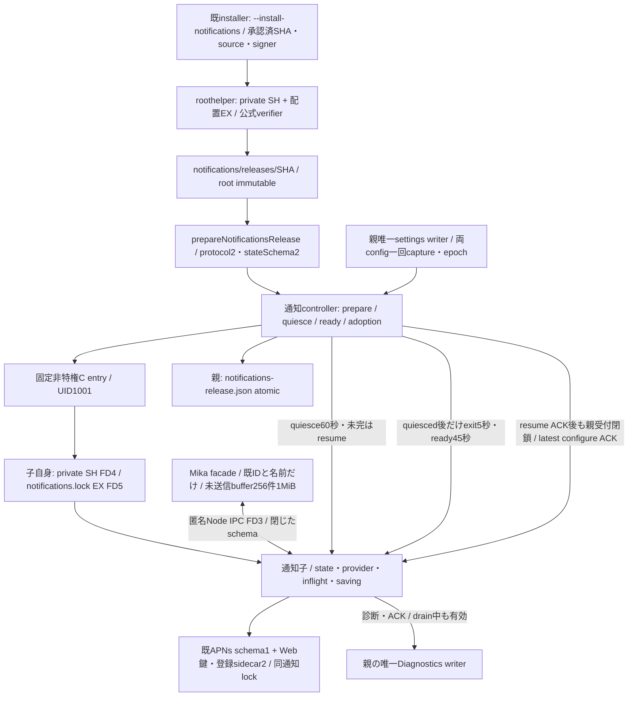

# 通知の固定資材・起動・writer排他 / ABI2

runtime所有：エピネル。基準03c952bf。Rootの固定通知契約とWebPush v1.1/b64a `/srv/bellteam/bots/bot-7b140b27/docs/web-push-contract-20261103.md` に従う。[全体図](../../feature-map.md)→[runtime](README.md)、通知内部は[usage](../usage/README.md)、組立ては[integration](../integration/README.md)、署名供給は[distribution](../distribution/README.md)。同UID1001の協調writerと寿命を分ける。別UIDのOS隔離は残る。

## 公開sourceと所有

- `src/notifications-process.mjs:createNotificationsProcess({root,configuration,onDiagnostic,onState,prepareRelease})`。start/close/request/replace/snapshot/reserve、同一controllerをassembly/facade/更新HTTPへ注入。reserveは202 finish後start/cancel、二重更新・configure進行中409。phaseとexchanging/availableをonStateへ返しMikaのunsent bufferを接続。
- `src/notifications-ipc.mjs`は専用channelのschema/相関/accepted/期限。業務5methodだけ、UTF8 JSON64KiB/未終端64、status/device30秒・configure90秒。送信試行後の期限/断線はunknown、未送信/明示拒否だけnot_accepted。再送しない。
- 同moduleのchild factoryはvalidateRequest/dispatch/control/disconnectを通知内部へ接続。controlはinitialize/quiesce/resume/exit。readyは固定version/protocol/stateSchemaとstatus/applyError。診断専用相関5秒、親writerの失敗を送信retryにしない。
- `scripts/notifications-start.c`はimage固定`/usr/local/libexec/bellteam-notifications-start`。builtin又はSHA64だけ、Node固定、最小env、親のlock FD非継承。IPC3は新channel、lock4/5は子自身で開く。Node側`src/notifications-locks.mjs:verifyNotificationsLocks`がFD/inode/metadata/kernel flockを確認してから通知のstateへ触れる。
- `src/notifications-release.mjs:prepareNotificationsRelease(id,{signal,expectedRelease?})`→`{versionId,appRoot,protocolVersion:2,stateSchema:2}`。既Web readerの固定component内部検査を共用、Web schemaは不変。
- `scripts/install-notifications-release.py`は固定3引数。Web roothelperの安全処理を固定通知policyで共用。`src/notifications-install-plan.mjs`と既install.sh専用modeはnormalの停止0・CID/image/mount厳密確認・既private volumeだけRW。verifier/packager/Dockerfile収録はCenti。

現callerはapplication-services生成/初期化、conversation-servicesのdirect/room、SecretRequests/OwnerQuestionsのonRequest、usage HTTP status/register/unregister、application-features configure、application-runtime close。通知内部/facade/handler awaitはMika、共通組立て/HTTP/診断はMolly。親内PushNotificationsを生成し続ける互換fallbackは置かない。設定と診断writerは親、端末Mapとsave・APNS_UNREGISTEREDも子だけ。

## 排他・保存と交換

固定資材は既private root/notifications/releases/SHA、normalからreadonly `/run/bellteam-maintenance/notifications/releases/SHA/payload`。root0555/0444、公式receipt確認後installation最後・NOREPLACE公開。配置EXは業務writer EXと別。manifest runtimeはlinux/native arch/Node26/parentProtocol2/stateSchema2、entry固定payload/src/notifications-entry.mjs。全file inventoryと信頼・互換を旧子稼働中に検査する。

専用writer lockは既state/notifications.lock、1001/0600/通常file/NOFOLLOW/nlink1/inode一致、unlink禁止。子のprivate SHは親死亡後も保守EXと競合。既親server-startのstate全体EXは親に残し子で再取得しない。全体の新親は旧子lockが残れば新writerを作れない。

採用recordは親のstate/notifications-release.json、1001/0600、schema bellteam.notifications.adoption.v1/currentVersionId/previousVersionId。record無しだけbuiltin。破損/未知recordは黙ってfallbackしない。current/previousをstartupで検証。APNs stateは既配列形式のまま、Web鍵・登録sidecarを追加し、保存snapshotへ巻き戻さない。P1 current/previousは起動前拒否し採用recordを自動除去しない。

prepare→新受付停止→quiesce60秒。未終端なら旧子を殺さずresume ACK後同旧子へ戻す。resume不明は通知unavailableを返し新子を起こさない。quiesced後のみexit→5秒で対象子KILL可→OSclose/stdio回収→新版。新版はlock/state/configure後ready45秒、readyとadoption保存後に受付を開く。失敗は新子回収・旧資材再検証・同じ現stateで旧版戻し。新旧writerを重ねない。disabled/provider未設定/relay利用不能は構造readyと通知statusを分ける。専用lock/共通root破損はready失敗。ABI2の各provider state/鍵/登録の不具合は両status/applyErrorへ独立保持し、Webだけの不具合でAPNsを取り消さない。

親closeは交換abort・新起動/rollback抑止・有限回収。親消失はIPC切断で子新受付停止、最大60秒で終了。未終端はunknown、再送しない。診断の親ACKを待つ場合もdrain中は診断窓口を残す。子だけの終了やWeb受付交換から業務親/会話/AI/transport.closeへ伝播しない。

## 直接確認

実C/人工Node子で新旧lock競合、子自身private SH、親死亡と有限終了、quiesce期限超過/resume、quiesced後5秒回収、ready/adoption失敗と旧版戻し、同state保持を確認する。IPCで64KiB/64要求、ACK前後の切断/期限unknown、拒否not_accepted、診断5秒と無再送を確認。reader/rootwriterは通知/Web取り違え・stateSchema拒否・完全集合・immutable/lock/NOREPLACE/失敗cleanup。実root/1001/署名/Host/実配送の成立は各実物結果で区別する。全成功群の定型再走はしない。

親消失の60秒期限は子Nodeのevent loopが進むことを前提とする。同期JS/nativeの永久停止を外部watchdogで回収する機構は今回追加していない。OS終了/IPC切断/所有pipe closeが全て揃うことを回収条件とし、親からIPCを切断した時のNode26のcloseイベント欠測経路も同じbarrierで回収する。

Root初回受入追補：reserve/replaceはSHA64のほか固定literal builtinだけを許し内部nullへ正規化する。currentVersionId:nullの採用recordも明示builtinとして読み、previousは直前SHA/null。snapshotのcurrentTargetとbuiltinSourceCommitは、固定/app/distribution.jsonのroot-owned通常file/size/schema/source確認とimage固定C入口に束縛する。任意path/metadataをAPI入力にしない。初回builtin A→同source署名B→builtin Aで受入し、異source互換の証明にはしない。

## Web Push ABI2

Root WebPushv1.1/b64aにより親子protocol2/stateSchema2。既APNs file1とHTTP投影はusageに保持し、子Web sidecar2を同専用lock下へ追加。P1子/署名の採用・戻しは拒否し、同ABI2 builtinへ最新stateで戻す。publish既union以外の4methodはprovider必須、Web登録照会/register/unregisterは親trustedOriginからのorigin必須、status公開/configure/initializeには無し。resultはmethod/捕捉provider/照会形へ相関し、両status/applyErrorはstrict provider pair。自由error本文を通さず固定code/outcome/statusだけ。

両configurationの親snapshot/epochを一回捕捉し、交換中保存を失わず新子受付前に最新設定apply ACKを確認。ready null/status読取で既applyErrorを消さず、成功した同provider設定適用でだけ更新。P1成功群をABI2証明として再利用しない。実送信/鍵発行/Host本番は本工程の許可に含めない。

### 親設定の相関と公開epoch

`configuration()`は両設定 `{apns:{enabled,relayUrl},webPush:{enabled,subject}}` を一回で返す。親だけがcaptureごとの`configurationEpoch`とprovider別desired/applied/error epochを保持する。`snapshot()/onState`は既status/applyErrorのprovider pairに`configurationEpoch:number`と`appliedEpoch:{apns:number|null,webPush:number|null}`を加える。設定保存側に第二epoch writerを作らない。

設定保存後の`request('configure',{provider,...保存済設定})`は現在snapshotとの一致を先に検査し、古いparamsは`PUSH_CONFIGURATION_STALE`409で送信しない。交換中の要求もsnapshotを捕捉してそのproviderへBUSYを記録し、保存済設定は残す。initialize control-resultを実適用ACKとしreadyの同status/applyError pairを照合する。ready nullだけ、status読取、又は古いepochのconfigure成功で、新しいepochのapplyErrorを消さない。

既4control ABIを維持するため子resume ACKでprivate configure窓口を開き、親business admission/availableはまだ閉じる。親は最新snapshotの未試行provider epochだけをconfigureしてACK/独立失敗を反映し、保存がさらに変われば再捕捉する。全latest epochを試行した後だけavailable=true/onStateへ進む。生存する一providerの設定失敗はそのprovider error/未利用statusへ分離し、他方/module readyを維持する。子断線ならunavailable。失敗した同epochを自動再送しない。

`reserve/replace(versionId,{expectedRelease?})`は正式catalogの固定releaseを送信前にcloneする。P2/S2・source/platform/version・exact4互換をprepare時とquiesce後exit直前に照合し、不一致なら旧子resumeで中止する。通常mainの計画/供給/失効再検証は共通/Hostが所有し、この型一致を公式検証や鮮度の代用にしない。

変更直接境界は新epoch/実dispatcher8、P2へ更新した機構caller15、reader3、current UID rootwriter stub3。新実root1001/公式署名/両nativeは配布担当へ同sourceで接続し、旧P1実物成立から補完しない。
