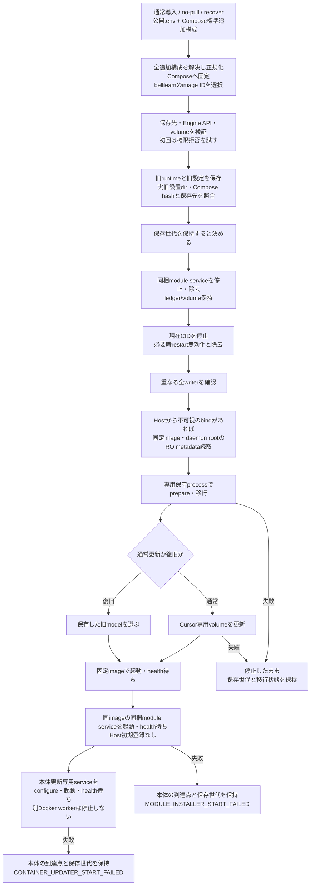
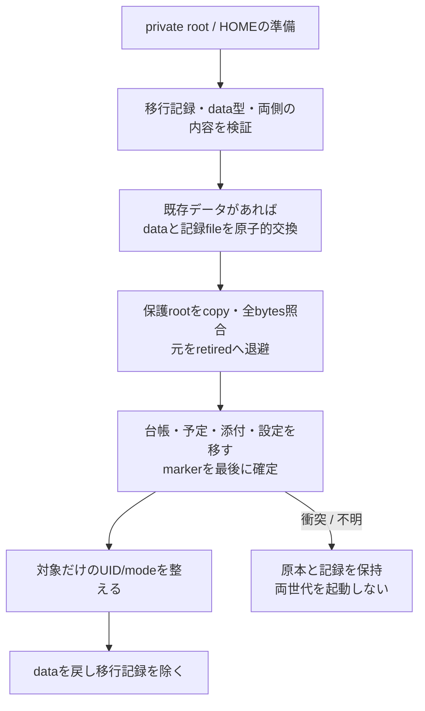
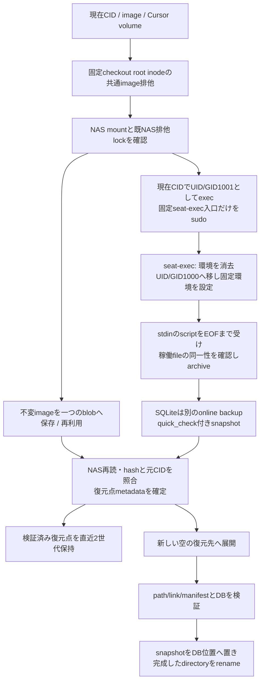
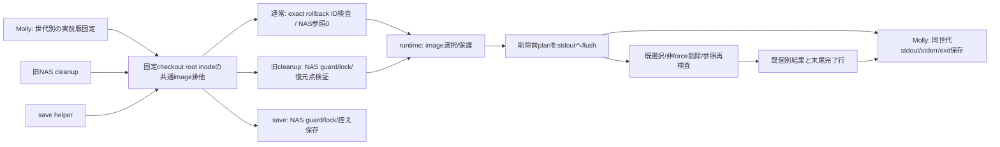

# installer・状態移行・backup/restore

責任者：エピネル。公開窓口は[runtime](README.md)の`update`。配布構成・採用imageと公開は[distribution](../distribution/README.md)、本番実行はトロニー、OSは各Host担当。既installerは以下の現行契約を保持する。アプリからの限定Host受付とworkerのsourceは[container更新](container-update.md)へ分離し、source実装と実Host導入を区別する。

H1対応の保存要求では、旧CID停止/再起動防止・writer検査・private準備後にoffline checkpointを行い、通常bootstrap前に復元を採用する。[H1接続候補](resume.md)を参照。保持非対応の旧/tmp初回と通常リセット更新を区別し、正式版へ供給済みとはしない。

## installerは停止前の準備と、停止後の保守を分ける

| 機能 | 実関数/入口 | 失敗時に残るもの |
| --- | --- | --- |
| 設定固定 | `distribution/server/install.sh` | imageのIDを固定しimage内の保守/Cursor scriptを抽出。normal/maintenanceの同世代JSONはprivate。後から.envやtagが変わっても途中で選び直さない |
| 初回storage | installerのpermission probe/volume照合 | UID1000の実読取拒否が成立するHostはlocal bind volume、拒否されない共有folderはEngine内volume。既volumeのname/driver/labels/optionsが違えば停止 |
| 旧model回収 | `capture_previous` | 実旧CIDのlabels/working directory/hashで旧normalを証明する。新旧設置dirが異なっても保存先が一致すれば保持できる。証明不能や必須保存先不一致は旧本体を停止せず拒否 |
| recover | installer `--recover` | 保存した旧model/旧imageが存在することを停止前に確認。現在データを旧配置へ戻す場合もあり、古いbackupへ巻き戻す操作ではない |
| writer確認 | `assert-state-writers-stopped.sh → stateWriterPlan/Volumes/Sources/assertStateWritersStopped` | 全containerの稼働/restart policyとRW mount、volume実体、canonical pathを比較。Hostユーザーからobserved bind/deviceが不可視なら、同固定imageの短命metadata readerでdaemon rootをRO mountし、全pathをそのroot内で再解決する。絶対symlinkもdaemon root内で辿り、既存observedの欠測/danglingは拒否、plannedだけ未作成末尾を許す。capabilityはDAC_READ_SEARCHだけ、networkなし・rootfs RO・no-new-privileges。Host chmod/sudo/daemon設定変更は要求しない。通常のHost解決が可能なら既経路を使う。Docker socketはreaderへ渡さず、env/資格内容を証拠へ複製しない |
| writerの限界 | `participates/volumePaths` | stoppedContainerのunless-stoppedだけを特例扱い。未知driver/metadata/aliasは成功へしない。snapshotだけでは保守中の新writerを防げないためlock/data sealと組合せる |
| maintenance | `compose.state-maintenance.json` | networkなし、固定entry、private rootの排他flock、runtimeとprivate volumeだけ。root処理はこのオフライン保守が所有 |
| Cursor更新 | `update-cursor.sh → cursor-update-entrypoint.sh` | normalized project/volume名で使い捨てcontainer。空envの固定入口から公式update。BellTeam本体の環境や資格fileを読み出さない |
| cleanup | installerのtrap | 一時staging/probeを除く。停止を試みる段階以後は保存世代を消さない。自動的に別imageを起こすrollbackはない |

同梱moduleのモデル生成・状態所有・能力分離は[同梱プログラム](module-installer.md)が正本。normalのsocket親は同project named volumeのRO、専用serviceだけ同private volumeをRWで使う。通常の保守前に当該serviceを停止・除去し、保守後は通常本体のhealth成立から専用serviceのhealthを待つ。古いimageに同梱entryが無い場合は固定codeを表示し、本体導入を維持する。既Host overlayを明示採用しているmodelはそのsocketを保持する。

本体更新専用serviceは[箱同梱の本体更新](container-update-bundled.md)へ接続する。通常起動後の最終normalと実CID/image/source/storageをconfigureで束縛する。失敗はCONTAINER_UPDATER_START_FAILEDで非0、実行中の独立workerは停止しない。画面更新でnormalが専用root volume内へ移った場合、後続公開installerは実volume/世代を照合してRO取得し、既hash/保存先検査へ渡す。

追加設定はCompose標準の`compose.override.yaml`または`COMPOSE_FILE`で指定する。env・mount・port・運用設定・追加serviceはComposeが解決し、利用者の入力fileをinstallerが上書きしない。image抽出は`bellteam`だけを対象にし、追加serviceのimageを保守/Cursorへ渡さない。解決済normalには通常service群を保持し、追加設定をroot専用module serviceへ転送しない。data/homeの同親配置、private state・Cursor・AI stateの所有とwriter検査は既契約を維持する。管理済みprofileは明示RO mountの信頼資材であり、要求body/envだけでdeveloper許可を生成しない。保存normalは秘密を含み得るためprivateに保持する。

通常の本体更新は実行中AI/PTY/親メモリを停止して新実行世代を作る。会話・設定・予定・台帳session・署名adoptionとdata/home/Cursor/Throughlineを同保存先で引き継ぎ、旧AI原volumeと旧normalは削除・上書き・cleanup回収しない。通常resetの新AI volumeを同nativeの復元成功とは扱わない。同梱updaterの本体交換は旧本体と同一のAI volumeを照合して保持し、初期化しない。停止前の照合不一致は従来resetへ進み結果行を出す（[箱同梱の本体更新 slice 3](container-update-bundled.md#same-backing-aiterm-state-on-a-bundled-body-swap-z-c-slice-3-2026-11-08)）。元accepted/unknownや未保存ACKの結果を新親から補完せず、旧本文/applyを再送しない。必要な保存復元を明示要求する既H1とは分ける。

起動の`compose up --wait`は最大300秒で打ち切る。bodyのhealthcheck起動猶予（start_period）も同じ300秒なので、起動中のbodyはこの期限より前にunhealthyにならない（[B-2](container-update-bundled.md#body-readiness-deadline-and-installer-restore-on-recovery-b-2-2026-11-08)）。有限上限であり、起動時間の保証ではない。unhealthy・container終了・期限超過の非0はそのまま返し、保存世代を保持する。通常更新とrecoverに共通で、後発healthyによって元installerの失敗を成功へ書き換えない。

## 状態移行の三つの責任

上図はto-serverの順序。to-legacyは個別file移行後に保護rootを戻す。根の再配置、fileの配置、所有権の変更を同じcopy関数へまとめない。

| 責務 | 実関数 | データと不変条件 |
| --- | --- | --- |
| 準備と再開 | `prepareServerStateRuntime/migrateServerState/readTransaction` | private rootのdevice/inode、方向/id/時刻を検証。data=fileなら同記録とhidden directoryが必要。settled状態は不用な所有権再設定を省く |
| 使用中に見せない | `checkExchange/exchange` | 同filesystemでdirectoryとfileを交換する機能を先に確認。交換後inode対応を確認。途中失敗は記録を手で消して解除しない |
| 保護root移動 | `relocateServerRoots/copyTree/equalTrees` | state/rooms/owner/logs/settings/APNsだけ。別filesystemはcopy→bytes一致→公開→元retired。既存非空の内容不一致は上書きせず拒否。既知の古いsocketはcopyしない |
| file移行 | `transferServerState/moveFile/moveTree` | bot.json/schedule.json/assets、subscription/onboarding/AI停止/bridge/BugHub参照。全profile/schedule検証後に元を除く。AI停止は専用schema検証 |
| 移行済み更新 | `transferServerState`の`already-transferred` | to-serverで初期化済み、旧配置に移行対象fileがなければ`.deleting`を保持して通常起動へ進む。削除の完了はBotRegistryが所有。実移行とto-legacyは未完削除を拒否する |
| durableな公開 | `regular/equalFiles/syncAncestors/removeUnchangedSource/marker` | O_NOFOLLOW、inode/link/size/mtime、完成copyのsync→rename→元の不変確認→unlink。初期化markerは最後。異常終了後は同transactionの未公開tempだけを整理 |
| 所有権 | `prepareServerStateOwnership` | 保護rootだけを事前列挙しlink/特殊fileを拒否→開いたFDで本人性再検証→chown/chmod。seat project/HOME/記憶DBを一括chownしない |
| 終了 | `migrateServerState`末尾 | 所有権/残temp確認後にdataを戻しtransactionを除く。retiredは移行時点の原本で、その後の新しい会話のbackupではない |

## 稼働中の控えと、新しい場所への復元

`save-deploy-restore-point.py`の控えは**imageとCursor volume**。本体全state/HOMEの完全backupと呼ばない。`mount_guard`は所定NASがなければlocalへfallbackしない。`archive`はpartialへ帯域制限付き保存→再読hash→rename、producer異常ならpartial削除。`image_blob/checked_image_blob`は既保存のimage本人性を確認して再利用。`validated_points/prune_points`は控えの構成と参照を検証してから古い二世代外を除く。失敗世代はfailed.jsonを残す。

Cursorのreaderは本体の環境を継承する`docker exec`をUID/GID1001で開始し、既存の固定`bellteam-seat-exec`が環境を消してからUID/GID1000へ移す。本体環境を持った席UIDのPythonや`env -i`を先に起動しない。producerにはstdinのarchive scriptと固定引数だけを渡し、同じCIDのCursor volumeを従来の席権限で読む。固定入口/sudo規則のない旧imageでは保存を失敗させ、直接席execへ戻らない。これは本体UID1001から席UID1000への既存境界であり、席の既存sudo権限全体を閉じる変更ではない。通常deploy-image.shはこの保存scriptを呼ばず、本番入口やHost内部nightlyの修理とは別経路である。

`archive-live-volume.py.create`は一般fileの変化を拒否し、SQLiteのrawは観測bytesとしてだけ保存、復元用DBはread-only接続のbackup APIから作る。DBごとに120秒とquick_checkを持つ。Throughlineの既知atomic JSONだけrename交替を許し記録する。全volumeが同一瞬間のsnapshotという意味ではない。

`restore`は既存destinationを拒否。manifest/重複member/相対path/type/SQLite family/hardlink/symlink祖先を検証し、仮directoryへ展開。生のSQLite/WAL群は復元に使わず、再検証したsnapshotを置く。symlinkは配置検証後に作り、最後に完成directoryをrenameする。復元したdirectoryを本番mountへ切替える操作はこの関数にない。

実装：[installer](../../../../distribution/server/install.sh)、[state transfer](../../../../src/server-state-transfer.mjs)、[writers](../../../../src/server-state-writers.mjs)、[ownership](../../../../src/server-state-ownership.mjs)、[volume archive](../../../../scripts/archive-live-volume.py)、[restore point](../../../../scripts/save-deploy-restore-point.py)。移行/復旧/CI/Host操作の再実行はしていない。実導入の受入範囲は各版の既存記録を参照する。

## image cleanup helperの出力接点

`cleanup-deploy-images.py`の選択/削除はruntime、通常deployからの呼出し・世代別stdout/stderr/exitの原本結合はMolly。既stdoutをNDJSONとして扱い、既完了行/個々のDocker結果は保持する。追加の`bellteam.deploy-image-cleanup.plan.v1`を削除前にflushし、rollback/保護全image集合/稼働・停止container参照/対象IDを固定する。planは選択の証拠で削除成功ではなく、途中例外でも完了行を補完しない。callerは非0/欠測をunknown/failedのまま保存する。

通常deployは`--rollback-image sha256:<64hex>`でcallerが世代別previous-runtime/previous-normalの一致から固定した実前版image IDを渡す。helperはそのIDの存在/実inspect本人性を先に確認し、欠測でもNAS最新へfallbackしない。通常modeはNASへアクセスしない。UID0の通常callerはroot_squash/0700のNAS writer1000契約では祖先を辿れず、旧NAS検査を無条件に使うとplan前に失敗するため、実前版を直接渡すmodeから依存を分離した。引数無しの旧NAS restore-point modeは従来どおりexact NAS mount/既NAS lock/検証済み復元点を必須とし、localへfallbackしない。

全cleanup modeとsave helperは、最初に`image_lock`でscriptのある固定checkout root directory inodeへ非待機の排他flockを取り、終了まで保持する。新lock fileを作らず、同repo直下の異なるdeploy世代も同じ排他へ届く。旧NAS modeとsaveはその後に従来NAS lockも取るため取得順は共通。競合は削除/backupより前に失敗し、例外でもFDを閉じる。Mollyの通常callerは`/home/kite/BellTeam`固定で、このrootをrename/交換しない。別checkoutから同じDocker daemonを操作する並行運用はこの接続の対象外。実前版の証拠選択と新呼出しをhelperが他人の環境から探索しない。

保存済06:37実績はunknownのまま。新Host照会/cleanup再走/配備をこのsource修理から発行しない。
