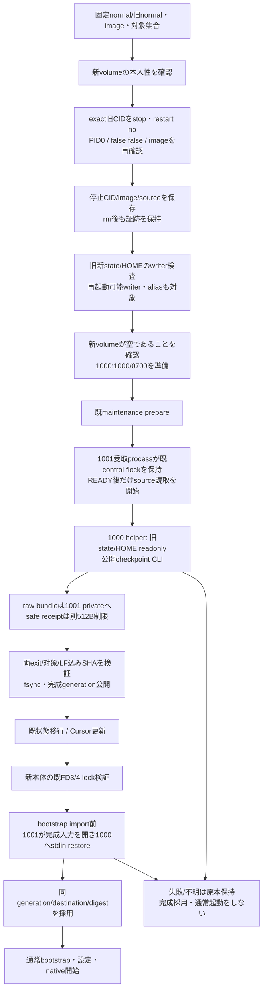

# Aiterm H1 offline保存と起動前復元

runtime接続候補。製品6658c67の未公開CLI/stream契約を使用する。正式0.63.2や現961の能力ではなく、製品最終Astra・実Docker/UID/mount・本番の受入は未成立。製品内部は[Aiterm正本](../aiterm/README.md)、mount/bin/contextは[配布の正本](../distribution/h1-offline.md)へ辿る。

## 初回と保存更新を分ける

H1対応imageの初回は、固定base `/srv/bellteam-aiterm` に専用external local volumeを配置し、空・local/optionsなし・project/role labelを確認して1000:1000/0700へ準備する。旧/tmpや未提供CLIの初回から保持できるとはしない。通常の既許可リセット更新は保存要求無しで行え、保持必須ならH1未対応を停止前に拒否する。

通常normalのvolume名は`BELLTEAM_AITERM_STATE_VOLUME`から固定する。同名/同backingの旧sourceと新destinationへ保存更新しない。rootのdev/inode/prefixは製品が永続Codex rolloutについて検証し、runtimeがbundleを加工して通さない。

## 停止・保存・採用の順序

installerへの保存対象入力`BELLTEAM_RESUME_TARGETS_FILE`は、固定した製品session/launchのJSON配列（各`session_id,launch_id`のみ、64KiB以内、一意）。Bot名から現在launchを推測しない。入力無しは保持更新を要求しない。元sourceのCLI能力/normalがなければ保持要求を拒否する。新しい配送IDやqueueは作らない。

`resume-install-plan`は旧新model/元CID/image/対象を束縛し、新normalへ既保存世代名`BELLTEAM_RESUME_GENERATION`と解決済みvolume名を付ける。checkpoint helperは共通`/app/compose.aiterm-checkpoint.yaml`、installer helperは`/app/install-resume-state.sh`。公開/内部の分岐で別実装へfallbackしない。

writer-planは新旧resume volumeをactive container無しでも保持し、local driver/backing/Host aliasを検証する。既`stoppedContainer`のunless-stopped例外と、rm済みCIDの歴史証跡を混同しない。snapshot検査だけで将来の管理外writerを止めたとは言わない。供給管理下の停止/再起動防止と、保存stream中の既control lockを組み合わせる。管理外Host直接書込まで検証済みとはしない。

## byte protocolと非公開保存

checkpointはstdout bundle/stderr receipt、restoreはstdin bundle/stdout receipt。bundleは末尾LFを含む16MiBまで、safe six-field receiptはLF込み512Bまで。署名対象は受信raw bytesで、JSONをparse/stringifyしてbundleを再生成しない。汎用runnerの合算上限は変更しない。

1001は`state/resume-checkpoints/<既保存世代>`を0700、fileを0600で作る。原子的な非上書き公開とfsync/親directory syncを使い、別bytes・symlink・hardlink・不正mode/ownerを拒否する。checkpoint CLIのsavedと、こちらの永続保存完了は別。stageは未採用、製品/受取の両exitとreceipt/digest確認後だけtargetを完成公開し、全対象完了後にgenerationを公開する。完成後のpending copyは除く。生bundleや資格を通常logへ出さない。

受取processは既maintenance modelをUID1001・固定flock/Node入口で呼び、既caps/NNPの構成を変更しない。checkpoint helperは別UID1000でstate/HOMEのみreadonly、Config.Envやprivate stateを渡さない。installerは子PIDを保持して取消時に回収する。実Dockerのsignal/UID/mount動的受入は別工程。

## 固定baseとbootの一回性

本体の信頼済み固定baseを、C入口のclearenv/UID変更後に明示する。configured経路ではenv.sh後にも固定値を検証し、別値/unsetでMCPやtarget launchを始めない。製品scopeを解決する前に適用し、登録のstate-root/socketは製品から得る。harness登録はrelay有無を含め固定baseを持ち、Codex/Cursorの任意継承と区別する。他のsession/launch/temp値とH1非対象の既契約は保持する。任意shell全体の隔離を保証するものではない。

supervisorは既起動lockを保持したままrestoreをawaitする。H1中のsignalは子へ取消を送りstdio終了まで親を残す。復元対象/volume/生成計画SHAのstarted記録を先に公開し、全restore成功後だけadoptedを公開する。採用後は通常stateが変化していても旧bundleを再投入しない。採用記録の不一致・喪失/未完は停止し、unless-stoppedを再実行の許可と見なさない。同digestの明示再開は既startup admission下の`adoptResumeGeneration(...,{retry:true})`でのみ行う。これはvalidな保存原本での再開で、runtime公開のlink直後crashでhardlinkが残った場合はfail closedにし、private保存の修復前に再開しない。専用の復旧操作UIは今回追加しない。

## sourceと直接確認

実装は`resume-policy/pipe/storage/boot/install-plan/runtime-resume/run-resume-store`、既seat-command/run-seat-command/bot-environment/harness-config、writer-planとinstaller。追加の私有Aiterm metadata writer、online seal、keeperはない。

直接fixtureは`resume-runtime`、`resume-install`、固定製品distを渡す`resume-cli-integration`。境界は既server-state-writers/installer-unified、seat/環境/登録、application-runtime、配布archive/context。新製品6658c67との隔離CLI接続と製品crash/strict反例を確認するが、旧c688の有限成功を新安全性へ流用しない。最終Astra・実vendor・実Docker/1001動的受入・本番/公開は未確認/保留。
