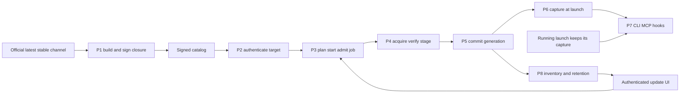
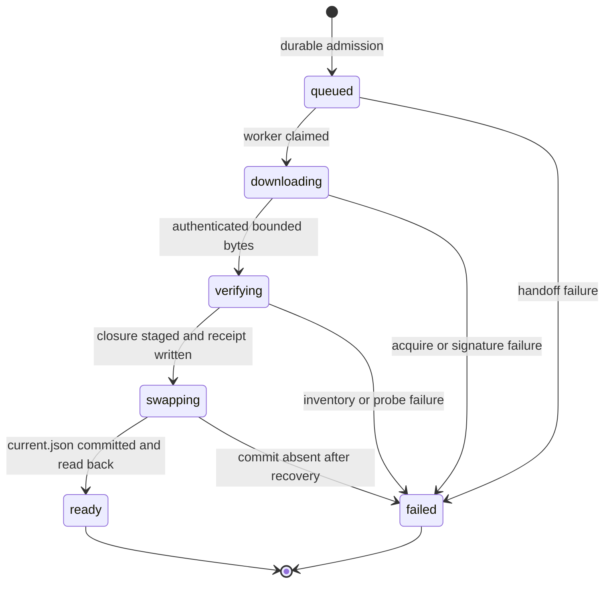

# Runtime package updates without stopping the body (Z-b2)

Owner: Molly (bot-39be7047), body/runtime owner since 2026-11-08. Adopted design: Epinel's `shared-runtime-hot-update-design-20261107.md` (bot-0b867848/docs), adopted by Trony 2026-11-08 04:2x JST with one correction: **no runtime rollback feature** (no rollback plan path, no rollback tests, no rollback UI wording; always-latest, fix-forward). Keeping older generations on disk while live launches still reference them is launch retention, not rollback.

This file is the canonical implementation diagram. The design document stays the record of rationale; where they differ, this file wins.

## Targets

Four fixed component IDs. Nothing else is a runtime target; no npm specifier, URL, shell or path crosses the public boundary.

| componentId | Package (closed map) | Entries resolved by P6 |
| --- | --- | --- |
| `runtime-aiterm-mcp` | `aiterm-mcp` | `bin/aiterm-mcp`, `dist` = `lib/node_modules/aiterm-mcp/dist` |
| `runtime-codex` | `@openai/codex` | `bin/codex` |
| `runtime-claude-code` | `@anthropic-ai/claude-code` | `bin/claude` |
| `runtime-throughline` | `throughline` | `bin/throughline` |

`builtin` paths (the image's `/usr/local` prefix) are what P6 returns while no selection has ever been established on this installation. Once `current.json` exists, the builtin prefix is never used again for managed launches.

## Functions

| ID | Function: input → output | Owner |
| --- | --- | --- |
| P1 | Upstream latest stable → complete npm prefix closure per target, manifest, signed archive | Centi + supply owners (publish-runtime workflow) |
| P2 | Existing catalog verifier → authenticated runtime release rows (componentId in the four IDs) | distribution (catalog schema), runtime (acceptance) |
| P3 | Authenticated UI plan/start → admitted `kind:"runtime"` job, HTTP202 | Molly (common API + updater job) |
| P4 | Target release → verified archive → staged closure under `packages/<id>/<archiveSha>` + receipt | Molly (`scripts/runtime_update.py`, run by module-installer) |
| P5 | Staged closure + expected generation → new generation file + atomic `current.json` | Molly (same script; sole selection writer) |
| P6 | Launch intent → captured generation and absolute paths | Molly (`src/runtime-selection.mjs`); callers Kiro (execution launch) / Elegg (Aiterm) |
| P7 | Captured paths → real CLI / MCP / hooks | Kiro, Elegg, Throughline owner (consumers) |
| P8 | Selection + jobs + live references → inventory rows, retention | Molly (projection), UI owners (display) |

P5 changes future launches only. P6 never moves a running launch to a new generation.

## Stores (DFD)

Root: `RUNTIME_ROOT` = `/srv/bellteam/shared/tools/bellteam-runtime` inside the body (read-only mount) and inside module-installer (read-write mount), backed by the dedicated Compose volume `<project>-runtime-code`. Not server-state, not aiterm-state, not HOME.

| Store | Path / shape | Writer → readers |
| --- | --- | --- |
| D1 catalog | existing accepted catalog | updater → P2/P4 |
| D2 code | `packages/<componentId>/<archiveSha256>/` = npm prefix (`bin/`, `lib/node_modules/…`) + `manifest.json` + `receipt.json`; dirs 0755, files read-only | P4 once (stage dir + rename) → P6/P7 |
| D3 selection | `generations/<generationSha256>.json` `{schema:"bellteam.runtime-generation.v1",components:{<id>:{archiveSha256,sourceCommit,upstreamVersion}},jobId}` (all four IDs, a missing ID = builtin); `current.json` `{schema:"bellteam.runtime-selection.v1",generation}` | P5 only: temp + fsync + rename + dir fsync → P6/P8 |
| D4 jobs | existing `state/jobs/<UUID>.json` with `kind:"runtime"`, `target.moduleId` = runtime componentId; plus selection intent `{jobId,expected,target}` | updater → P3/P8 |
| D5 live references | Launch → captured generation. Lives in body-writable state, not the read-only runtime mount; shape fixed with Kiro/Elegg in slice C. Until then nothing under D2/D3 is deleted automatically | P6 callers → P8 retention |
| D6 package state | CLI HOME/auth, Aiterm state, Throughline DB | upstream/seat owners; never touched by Z-b2 |

| Flow | Data |
| --- | --- |
| F1 | P1 → D1: archive + Sigstore bundle + catalog row `{componentId,sourceCommit,versionId=archiveSha256,platform,artifact,compatibility,changes}` |
| F2 | UI → P3 → D4: componentId, catalogSha256, versionId, idempotencyKey; `impact.containerRestart:false` |
| F3 | D1 + D4 → P4 → D2: verified bytes, safe extraction (no absolute/escaping links, no devices/set-ID), file inventory digests |
| F4 | D2 + D3 → P5 → D3: replace exactly one component in the expected vector; expected ≠ actual → `RUNTIME_SELECTION_CHANGED` |
| F5 | D3 → P6 → caller: `{generation, components:{<id>:{origin:"release"\|"builtin", prefix, bin, dist?}}}` |
| F6 | D3 + D4 + D5 → P8 → UI: current/published per runtime row + `runtimeApplication:{generationId,policy:"next_launch",retainedGenerations:[{generationId,referenceCount}]}` |
| F7 | D5 → P8 cleanup: remove only unselected, unreferenced closures; never D6 |

## Job state (no rollback)

A new update is a new job. A previous generation is never re-selected by a plan; a bad release is fixed by publishing a newer one. Recovery after worker loss in `swapping`: if `current.json` names the job's target generation, persist `ready`; otherwise `failed` with `RUNTIME_SELECTION_COMMIT_FAILED`. Failure codes: `RUNTIME_ARTIFACT_INVALID`, `RUNTIME_ABI_INCOMPATIBLE`, `RUNTIME_PROBE_FAILED`, `RUNTIME_SELECTION_CHANGED`, `RUNTIME_SELECTION_COMMIT_FAILED`, `RUNTIME_BINDING_UNAVAILABLE`.

## Guards and exits

| Guard | Protects | Exit |
| --- | --- | --- |
| Selection lock (flock on `selection.lock`) | overwriting another job's newer selection | released when the commit returns or raises |
| Immutable `packages/<id>/<sha>` | overwriting code a running launch executes | none needed; new code gets a new directory |
| Reference retention | deleting code a live launch still loads | reference removed at actual close; before slice C there is no deletion at all |
| Catalog expiry/revocation | unauthorized new code | existing signed refresh |

## Updater job and supply contract (slice B)

| Item | Contract |
| --- | --- |
| Runtime catalog | Separate asset `runtime-catalog.json` + `runtime-catalog.json.sigstore.json` in the same `updates-<stamp>` release, signed by the same `publish-update-catalog.yml` publisher: `{schema:"bellteam.runtime-catalog.v1",catalogSha256:<main catalog.json sha>,releases:[row…]}` (≤16 rows). The main `catalog.json` never carries runtime rows, so released installers read it unchanged. Checked by `update_catalog.validate_runtime_catalog`, `verify-update-catalog.py --runtime`, `accept_runtime_catalog` (must name the just-accepted main catalog) and stored at `catalog/runtime/<catalogSha>.json`. Freshness and revocation are the main catalog's. Absent or invalid → runtime targets unavailable; the main refresh still succeeds. |
| Runtime row | `componentId` in the four IDs; `versionId` = archive SHA-256; `artifact` = the module archive shape (`archive`/`bundle` URL `…/updates-<stamp>/<componentId>-<sourceCommit>-linux-<arch>.tar.gz` + `.sigstore.json`, `signerCommit`); `compatibility` exactly `{runtimeProtocol:1,nodeMajor:26,libc:"glibc"}`. |
| Archive | tar.gz; first member `manifest.json` `{schema:"bellteam.runtime.artifact.v1",component,package,upstreamVersion,sourceCommit,platform:{os,arch,libc,nodeMajor},files:[{path,type:"file",bytes,sha256,mode:292\|365}\|{path,type:"symlink",target}]}`, then `prefix/…` (npm global prefix). Links are relative leaves inside `prefix/`. |
| Signature | `scripts/verify-runtime.py` + `config/runtime-verification.json`: `gh attestation verify` bound to `.github/workflows/publish-runtime.yml` on `refs/heads/main`, source and signer digests from the row. |
| Job | `kind:"runtime"`, `target.moduleId` = componentId, pointer `state/runtime-current.json`; any non-terminal container/module/runtime operation refuses a new start (`HOST_UPDATE_IN_PROGRESS`), and the termination bridge refuses a body swap while one is running (`HOST_UPDATE_BUSY`). Plan impact `containerRestart:false`. |
| Worker | bundled module-installer only (`ModuleUpdater.install_runtime`): downloading → verifying (signature, stage) → swapping (commit) → ready set by the worker. Host-socket installs answer `HOST_RUNTIME_UPDATE_UNSUPPORTED`. Worker lost in swapping: ready only if the current generation's `jobId` is this job, else `HOST_UPDATE_WORKER_LOST`. |
| Volume | `<project>-runtime-code`, added by `module-update-compose.mjs`: body read-only at `RUNTIME_ROOT`, module-installer read-write at the same path, never in the termination helper. |
| Body contract | `update-center-contract.mjs` job kind accepts `runtime`. Web/app readers accept it only with slice D; until then no UI path plans a runtime target. |

**Released installers are unaffected by construction:** they read only `catalog.json`, which keeps its closed component set. Old installers never fetch `runtime-catalog.json`, so they can still plan the container row that brings the enabling image; no publication order is required.

## Delivery slices

| Slice | Content | Owner |
| --- | --- | --- |
| A | This diagram; D2/D3 store, P4 staging/verification and P5 commit (`scripts/runtime_update.py`); P6 resolver (`src/runtime-selection.mjs`); tests | Molly |
| B | `kind:"runtime"` job in the updater dispatch (plan/start/recovery), catalog component set, verifier, `runtime-code` volume in compose (installer rw, body ro) — contract above | Molly; catalog schema contact distribution |
| C | Consumers call P6 instead of `AITERM_DIST`/`CODEX_BINARY`/PATH; launch references D5 | Kiro (execution), Elegg (Aiterm), Throughline owner |
| D | Inventory rows + `runtimeApplication`; UI wording "次回起動から適用。実行中の席は現在の版を継続" | Molly projection; Admi / app owners display |
| E | publish-runtime workflow, signed closures, catalog rows; enabling image | Centi + supply |

The enabling image is a normal body swap under the usual Owner approval and Bell support. It is not held for Z-c.
