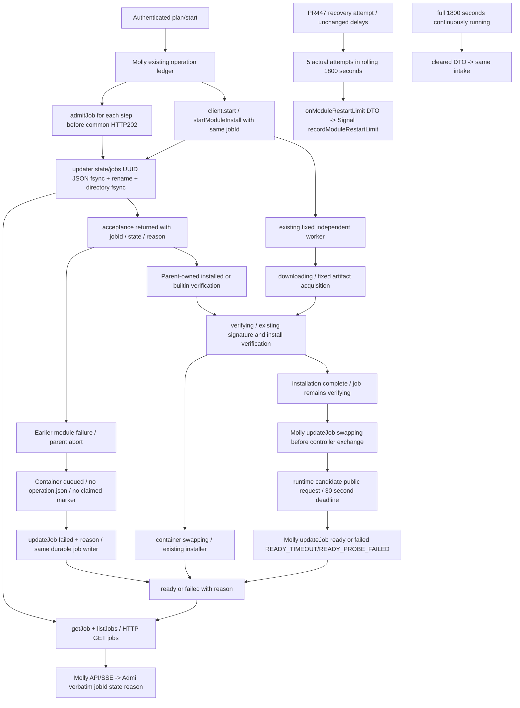

# Durable updater jobs and child readiness

Runtime owner: Epinel. Root contract: module-job-ledger-contract-20261107 (2026-11-07). This is the exact runtime public contract, written before source. Shape remains child-process modules and existing updater services; no deployment or privilege change.

## Functions and ownership

| Function | Input -> output | Owner / persistence |
| --- | --- | --- |
| Admission | admitJob target/key/UUID, then optional signed plan/start -> stored job and existing operation view | runtime; existing updater state volume |
| Job store | jobId -> one bounded JSON file; atomic same-filesystem temp/fsync/rename/directory-fsync | runtime; state/jobs/<jobId>.json |
| Installation | queued -> downloading -> verifying; container then swapping -> ready/failed | runtime fixed worker |
| Unstarted container abort | queued container + no operation.json/claimed marker + parent failed reason -> durable failed record only | runtime admission; parent abort caller |
| Module activation | verified installation -> parent reports swapping -> controller real public-interface probe -> parent reports ready/failed | controller runtime, reporting/HTTP/SSE Molly |
| Read | getJob/listJobs or socket HTTP GET /jobs/<UUID>, GET /jobs -> stored records | runtime client; no inference |
| Restart observation | actual recovery candidate launch attempts + latest exit -> one limit problem, quiet window -> clear | runtime emits; Signal stores/GET; Molly assembles |

## IDs, fields, endpoints

- jobId = the existing installer requestId (UUID v4). No third ID is generated. A common parent operationId/requestId can differ; Molly stores the backend jobId returned by start. planId remains the preview identifier; plan does not launch a job.
- start accepts the existing fields and optional idempotencyKey (1..128 printable ASCII characters). If omitted it equals requestId. Same retained key and same plan returns the same jobId without launch; different plan conflicts. Both container and module clients pass the key unchanged. A duplicate requestId with a different key conflicts.
- Stored exact record: {schema:"bellteam.update-job.v1",jobId,idempotencyKey,kind:"container"|"module",target:{catalogSha256,moduleId,versionId},state,reason,transitions:[{state,atNs}],updatedAtNs}. moduleId is "container" or the existing module ID. atNs/updatedAtNs are decimal strings (nanoseconds; JavaScript never rounds them). reason is null outside failed; failed has {code,message}, bounded fixed code/message without request bodies, environment or secrets.
- States: queued, downloading, verifying, swapping, ready, failed. ready/failed are terminal. Success path is ordered; any nonterminal can fail. Repeated same state is idempotent; conflicting terminal transitions reject. No unknown state. Module installation's old phase=completed is only placement completion: job stays verifying until Molly reports actual exchange/probe outcome. Cleanup failure stays in existing cleanup fields and does not undo verified readiness.
- Existing start/get operation view adds jobId, state, reason and job (the full stored record). Existing requestId/planId/phase/execution/verification/cleanup fields remain for existing consumers. They do not substitute for job.state.
- Body client methods: job(jobId) -> record; jobs(limit=16) -> {jobs:[record,...]} (newest first; 1..16); updateJob({jobId,state,reason:null|{code,message}}) -> record. getJob/listJobs/updateJob are fixed NDJSON operations on the existing socket. HTTP GET /jobs/<UUID> and GET /jobs provide the same stored JSON on that socket, under the same SO_PEERCRED rule.
- updateJob additionally permits failed ONLY for a container record still queued with no operation.json and no claimed marker, checked under the existing ledger lock. This closes a pre-admitted container step when an earlier module fails; it launches nothing and permits no container downloading/verifying/swapping/ready transitions. Once an installer operation exists or a claim exists, the worker retains completion ownership. Module behavior follows: Installer-backed records require successful installation before swapping/ready/failed. Parent-owned installed/builtin steps without an installer operation allow downloading/verifying/swapping/ready/failed as detailed below. Molly calls swapping before controller.replace; ready only after that Promise includes the real probe; failure uses READY_TIMEOUT/READY_PROBE_FAILED or a fixed activation error code. No replay, rollback or business call is issued by this endpoint.
- UNREADABLE is an error, never a state: {code:"UNREADABLE",status:503,outcome:"not_accepted",path,reason}. path is a fixed updater-owned record path; reason is an OS error name or bounded parser/validation code. Client transport/protocol failure also uses UNREADABLE with socket path and fixed reason, and never invents failed/ready. Missing job returns HOST_UPDATE_NOT_FOUND/404. Actual launcher/worker/install failures persist failed with concrete reason. Existing HOST_*_UNKNOWN codes in this path become concrete *_FAILED reasons or UNREADABLE. Old historical operation files are not replayed or rewritten to fabricate receipts.
- Retention: latest 256 terminal job records plus all nonterminal records. Active jobs are never removed. Idempotency keys are scoped to retained records, not an unbounded promise. Pruning removes known terminal job JSON and its terminal updater operation directory/logs; legacy operation evidence without a new job record, payloads and plans are preserved. This bounds new per-job evidence as well as the public ledger. Current/previous pointers may name expired jobs and then return404; they never prevent a new request. List reads are bounded to 16 records so the 64KiB frame remains valid.
- Daemon/worker loss is failed with HOST_UPDATE_WORKER_LOST after identity proves loss; an unbound queued admission has a 30-second handoff deadline measured from installer start, not earlier step pre-admission and then fails HOST_UPDATE_HANDOFF_FAILED. Readers never infer success. This exits stale admission automatically without replay.

## Admission before common HTTP202 (installed/builtin and multi-step)

The body additionally exposes admitJob({jobId,idempotencyKey,kind,target}) -> stored record through the fixed admitJob operation. Same exact target/key returns the existing job; conflicting bindings reject. target has {catalogSha256,moduleId,versionId}; catalogSha256 may be null for local/builtin steps; versionId may be "builtin". This operation writes only the job record, never launches or supplies privileged code. Parent admits each planned step with its existing backend UUID BEFORE returning common HTTP202, binds all returned records as jobs[] to the existing parent operation, then starts asynchronous execution. If one admission fails, no202; retain successful admissions and report failure, never fabricate atomic acceptance. Same retained keys make a retry reuse those jobs.

For an installer step, subsequent start/startModuleInstall uses that same jobId/requestId and idempotencyKey; the updater verifies its target against the existing signed plan before launching once. No duplicate job is made. For an already-installed/builtin step, Molly calls updateJob downloading (resolve installed selection), verifying before existing prepareRelease/compatibility, swapping before replace, and ready after runtime probe. Failure at any stage reports failed/reason. Such jobs have no installer operation file; reader returns the stored record and does not invent a worker. Parent executor owns completing these admitted steps, including its own restart reconciliation; no time-based fake result is inferred for a parent-owned step. Installer-backed module jobs still require successful installation before parent swapping/ready. A multi-step operation exposes separate stored jobs[] and never invents a single aggregate state. If an earlier module fails, the parent reports its saved abort reason through the container client updateJob({jobId,state:"failed",reason}) for the unstarted queued container step. A later start rejects that terminal job; no work is launched or replayed. Retrying a failed-abort write uses job(jobId) to read the saved result; the container mutation allowance itself remains queued-only.

## Candidate readiness

Usage/conversation wrappers accept probeCandidate(channel), supplied by Molly with the existing captured authority and a lease for the candidate generation. It must call channel.request directly (not an available-gated controller facade), release authority only at actual completion, and issue only the documented read. Parent admission has resumed but availability is not yet published. Diagnostics/members/notifications/execution/memory/gateway use their existing read ports directly. A shared runtime helper runs one read-only public call on the actual candidate under 30 seconds, after initialize/READY and once its channel can accept reads, before reporting available/committing successful activation. It verifies the response through the existing channel validators. HTTP gateway uses GET / on its newly bound loopback port. IPC modules use existing public reads (diagnostics list; usage onboarding.status; members owner.read; notifications status; conversation rooms.list with the trusted owner actor). Memory uses its ordinary runtime read entry; execution uses its public projection. No business send/write is replayed. Deadline -> READY_TIMEOUT; rejection/malformed result -> READY_PROBE_FAILED. Candidate failure enters the existing PR447 lifecycle actor; no rollback. The failed swap job remains failed even if later autonomous recovery succeeds.

## Restart-limit intake

Runtime controller callback onModuleRestartLimit(dto), wired by Molly to diagnostics.recordModuleRestartLimit(dto), or through existing runtime reporter.observeRestartLimit(dto). Signal owns that new public facade/dispatcher method and persistence.

Active DTO exact fields: {kind:"module_restart_limit",moduleId,count,windowSeconds:1800,lastExit:{code,signal},lastReason}. moduleId in web-gateway, notifications, members, memory, usage, diagnostics, conversation, execution. count is safe integer >=5 (actual recovery candidate launch attempts within rolling 1800s); at most one active emit until a full quiet window clears it. lastExit always has code (signed 32-bit integer or null) and signal (known POSIX signal string or null); both null means no OS exit observed (memory/execution/lifecycle failure), never a fabricated exit. lastReason enum process_exit, ready_timeout, ready_probe_failed, recovery_failed. Clear DTO exact fields {kind:"module_restart_limit",moduleId,cleared:true}; issued only after 1800s continuously healthy, never during backoff/closed. Reporter keeps latest pending DTO per module while diagnostics unavailable. PR447 delays 1/2/4/8/16/30 seconds and unlimited attempts remain unchanged.

## Read-only privilege finding (2026-11-07 05:3x JST)

Source confirms child reachability: fixed C launchers enforce UID/GID1001 but do not unshare mounts/network or change credentials. Both updater socket volumes are mounted into the parent container; AF_UNIX permission0660/group1001 and Handler SO_PEERCRED uid1001 allow the child just like the parent. Read-only bind does not prevent connect. This is source reachability, not an injected production request. Named protection for a proposed fix is privilege escalation: reject child-origin requests by validating peer process identity against the actual parent server (namespace-aware PID/start identity); keep a durable read path if needed. Exact mechanism must be agreed through Root/Molly/Host contract before code. No socket/mount/UID policy change in this diff.

### Readiness failure selection and restart observation details

For a READY_TIMEOUT/READY_PROBE_FAILED candidate, persist/select the requested generation for lifecycle recovery and skip the old rollback branch; the failed job stays failed. Existing writer retirement remains authoritative: a resumed candidate is quiesced and exited through the current lifecycle path, never killed as a shortcut. Probes run once per new candidate (not on every retained-child resume). Other historical exchange error handling is preserved. Shared helper records latest observed exit/reason, increments at actual candidate launch entry during the recovery callback (never on repeated state notifications, retained-child resume or retirement-only retries), caps retained timestamps at five because only the threshold/count sample is required; the emitted count is the five observed attempts that crossed the threshold. Quiet timer is independent of backoff timer and is cancelled on lost/close.
