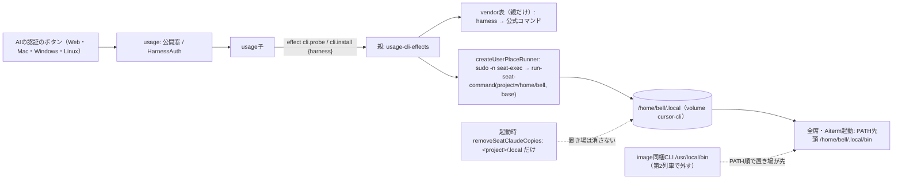
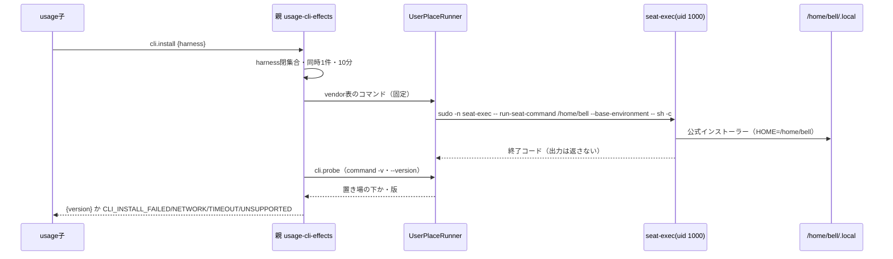

# 利用者が入れたAI CLIの置き場と、公式インストーラーの実行（a451、2026-11-19）

責任者：モリー（runtime）。利用設定（使う側・ボタン）はミカ（usage）、席が起動時にCLIが無い時の扱いはキロ（execution）。

オーナーの決定（2026-11-19）：箱のimageはどのAI CLI（Claude Code・Codex・Grok・Cursor）も含まない。利用者が自分で入れる。入れるボタンはAIの認証に置き、入れるのは各社の公式の最新版。この文書は**第1の列車**（imageはまだCLIを同梱したまま）の契約で、imageからCLIを外すのは第2の列車（a451-image-without-cli）。

## 事実（main b2fcee02）

- 置き場は既にある：`/home/bell/.local`（compose の named volume `cursor-cli`）。更新（本体・部品）で置き換わらず、コンテナのPATHの先頭（`/home/bell/.local/bin:/usr/local/bin:/usr/bin:/bin`）にある。rootfsは読み取り専用。imageの`~/.local`の中身は、volumeを**初めて作る時だけ**写る種。
- 席のPATHは `<project>/.local/bin : <project>/node_modules/.bin : コンテナのPATH`（`baseBotEnvironment`）。席のnpm導入先は席ごとの `<project>/.local`、`DISABLE_AUTOUPDATER=1`。
- 席の短命処理は `createSeatProcessRunner(project, {environment:'base'})` → `sudo -n bellteam-seat-exec -- node run-seat-command.mjs <project> --base-environment -- <command>`。特権入口 `scripts/seat-exec.c` はuid/gid 1000へ落とし、HOME=/home/bell・固定PATH・`DISABLE_AUTOUPDATER=1`を置いて `exec` するだけで、`project`を検証しない。

## 契約

1. **置き場**：`/home/bell/.local`（利用者の置き場）。各社のCLIは1つだけ、全席が使う。更新で消えず、置き換えられない。
2. **書き手**：インストール操作だけ（usageが依頼し、親が実行する）。席は入れない（`DISABLE_AUTOUPDATER=1`のまま、席のnpm導入先は席ごとのまま）。「最新版を入れる」が唯一の更新。
3. **席ごとの写しの掃除**：起動時の `removeSeatClaudeCopies` は `<bot.project>/.local` の中のClaude Codeの写しだけを消す。置き場の中を指す対象は消さない（解決後に `/home/bell/.local` の下なら拒否）。
4. **実行**：親が `createUserPlaceRunner()` を持つ。席の短命処理と同じ入口で、`project` を `BELLTEAM_HOME`（`/home/bell`）にして `base` 環境で動かす。結果の環境は置き場そのもの（PATH先頭 `/home/bell/.local/bin`、`npm_config_prefix=/home/bell/.local`、`npm_config_cache=/home/bell/.cache/npm`）。特権入口は変えない。
5. **窓口（親のeffect、usage子が呼ぶ）**：`cli.probe {harness}`、`cli.install {harness}`。harnessは `claude|codex|grok|cursor` の閉集合。installerの表（vendorごとの公式コマンド）は**親だけ**が持ち、子は名前しか送らない（子が文字列やURLを送ると、席の利用者の権限で任意の実行になるため）。
6. **決して**しない：トークンを預かる・中継する、インストーラーを包む・改変する・版を固定する、出力や経路を子へ返す。

## 機能図

## データの流れ

## cli.probe / cli.install

| 窓口 | 入力 | 出力 | 注 |
| --- | --- | --- | --- |
| `cli.probe` | `{harness}` | `{installed, version|null, source:'user'|'image'|null}` | 置き場の環境で `command -v`、次に `<cli> --version`（10秒、ネットワークなし）。解決した場所が `/home/bell/.local` の下なら`user`、そうでなければ`image`。経路や生の出力は返さない。 |
| `cli.install` | `{harness}` | `{version}` かコード | 10分。親が同時に1件だけ受ける。出力は返さない。成功後に親が再probeして版を返す。 |

vendor表（親だけ）：`claude` / `codex` は `npm install --global --prefix /home/bell/.local @anthropic-ai/claude-code@latest` / `@openai/codex@latest`。`grok` はx.aiの公式installスクリプトを実行し、できた `~/.grok/bin/grok` を `~/.local/bin/grok` へ写す。`cursor` はcursor.comの公式installスクリプト（`~/.local/bin/cursor-agent`）。vendorの変更はこの表の1行。

## コードを呼ぶ側と、CLIを自分で呼ぶ同梱の道具

席・要約・モデル一覧・認証・案内役はAitermが起動する。ほかにCLIを呼ぶ物：`src/rtk-hooks.mjs`（`codex app-server`）、executionの背景要約、host側の `scripts/deploy-host.sh` の版確認、Throughline（リバリンに確認）。CLIが無い時の扱い（失敗にせず、AIの認証を案内して待つ）はキロの a451-launch-not-installed。

## 版の順序

親（本体）が先、usage子は後。親がeffectを知らない時、子のeffectは拒否され、ミカの側が `CLI_INSTALL_UNSUPPORTED` にする（module-ipc.md の a399 の規則）。
