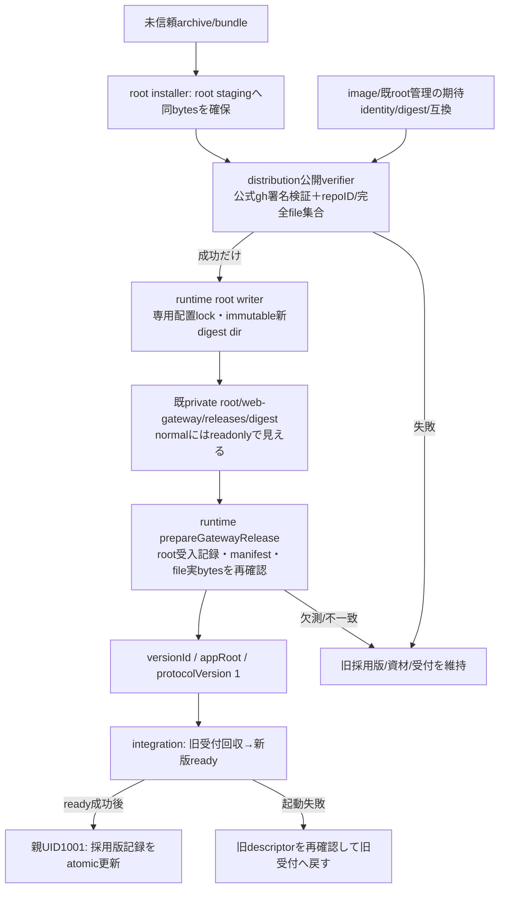

# Web受付だけの固定資材配置と起動descriptor

runtime正本。HTTP交換制御は[integration](../integration/README.md)、資材/発行元認証と完全file集合の供給は[distribution](../distribution/README.md)。この段階はsource・図・fixtureの契約で、正式attestation・root配置・実Host/本番の成立ではない。

## 置き場とwriter

| 対象 | 配置と権限 | writer |
| --- | --- | --- |
| 未信頼受取 | installerが指定されたarchive/bundleをroot stagingへsnapshot。受取場所から直接起動しない | 外部通常installer、root固定helper |
| 完成資材 | helper内`/srv/bellteam-private/web-gateway/releases/<archiveSHA256>/`、normal内`/run/bellteam-maintenance/web-gateway/releases/<archiveSHA256>/` | rootだけ。dir0555/file0444、link/特殊file無し。完成dirの上書き無し |
| 受入記録 | 同版dirの`installation.json`、root-owned通常file。`manifest.json` raw SHA、archive SHA、sourceCommit、repoID、署名検証方式を束縛 | 公式verifierの成功後だけroot固定helperが最後に公開 |
| 採用版 | `/srv/bellteam/state/web-gateway-release.json`、1001/0600 | 同一親の交換制御だけ。既writeAtomicでready後に記録 |
| socket/PID | 既private0700一時dir/socketと親の子process参照 | 既親process |

新しいshared/tools可書込領域やHOST mountは増やさず、既root:1001/0750のprivate rootとreadonly mountを使う。資材は`state`の兄弟へ置き、既prepareServerStateOwnershipの再帰chown対象に入れない。公開/内部とも既normalのreadonly control mountから参照できる。配布候補の専用bind案をこの既mountへ縮める差異をセンチと確認する。

通常installerでの初回配置は既root maintenanceの固定codeから行える。今回の独立交換はroot事前配置済み版間に限定する。以後の稼働中資材追加を実装する場合はweb-gateway専用配置lockを使い、既private root全体の排他flockを取らない。通常本体がprivate rootのshared lockを保持するため、既maintenanceの全体lockを単純流用しない。固定helper入口の配布接続はセンチ所有、root処理は資材staging/verify/publishだけで任意command/root scriptを実行しない。今回はその実Host入口や権限を導入しない。

## 公開窓口

`prepareGatewayRelease(versionId, {signal} = {}) -> Promise<{versionId, appRoot, protocolVersion:1}>`。外部入力versionIdはarchive SHA256の64桁小文字hexだけ。pathは固定storeから構成し、任意path/UID/command/環境を入力にしない。appRootは版dirの`payload`、固定entryは`src/http-gateway-entry.mjs`。Nodeはimageのprocess.execPathを使う。

受入記録は`bellteam.web-gateway.installation.v1`、component=web-gateway、archiveSha256=versionId、manifestSha256、sourceCommit、verification={method:github-oidc-attestation,repositoryId:1404510084}。これは配布root verifier成功のdurableな結果で、未検証bundleの自己申告やBotのboolを採用しない。署名検証と原子的root publicationはroot writerの責任。runtime readerはこの記録を自分で作らず、全祖先/record/manifest/fileのroot所有・非可変mode・非link、manifest SHAとfiles完全集合/bytes/SHAを照合する。

manifestは配布の`bellteam.web-gateway.artifact.v1`、component、sourceCommit、entry=payload/src/http-gateway-entry.mjs、runtime={os:linux,arch:amd64|arm64,nodeMajor:26,parentProtocol:1}、files=[{path,bytes,sha256}]。OS/arch/Node major/親契約は受取資材の自己申告を採用せず、現在親の固定値と比較する。src/webとprod依存をpayload内へ固定し親/appの依存fallback無し。実署名供給が無い今は正常系root installationを作っていない。

このAPIは準備/読取のみで、停止・採用記録変更・起動を行わない。採用記録は`{schema:"bellteam.web-gateway.adoption.v1",currentVersionId,previousVersionId}`で、成功した版と直前版を持ち、再起動時はcurrentをprepareし直す。previousVersionId=nullだけが直前の内蔵/appを意味し、任意pathは記録しない。記録無しの初回だけroot-owned image内蔵/appが既入口。current不明/破損を勝手に/appへfallbackしない。旧sourceを含め、稼働中/現採用/直前版の資材を削除しない。自動世代pruneは今回追加しない。

## 失敗・戻し

prepareが欠測/信頼/互換/bytesで拒否したら旧子を止めない。旧子終了を確認できない場合は新子を起こさない。5秒drainで旧子を強制回収した場合も、旧要求の結果は不明のままで本文を再送しない。新版ready前の失敗は前descriptorで旧受付を戻し、restore成功までは採用版を更新しない。旧版も失敗なら受付停止と両例外を返し、業務親/Aitermを閉じない。親closeと重なれば新版起動/旧版戻しを抑止する。

ready後の採用記録書込が失敗したら成功返却しない。新子を回収して旧版を再起動し、旧採用記録は保持する。回収/旧版再起動も失敗なら実状態を返し、成功を推測しない。交換中の親crashではcurrentの採用記録を再検証して一つだけ起動する。schema/state writerの移行はWeb受付に無く、履歴snapshotを巻き戻さない。

実装readerは`src/web-gateway-release.mjs`、直接fixtureは`test/web-gateway-release.test.mjs`。新しいroot配置helper/公式gh署名供給/Rootの採用記録接続はこのsource契約の次の具体工程。fixtureはmanifest互換/越境/欠測・拒否だけを示し、署名成功や実root配置の受入へ拡張しない。
