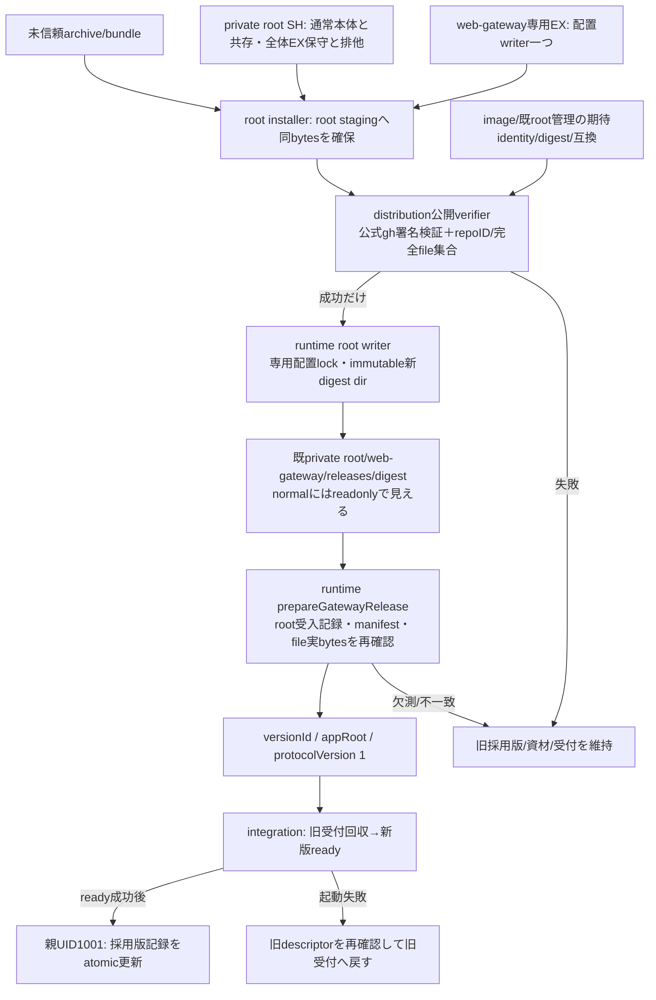
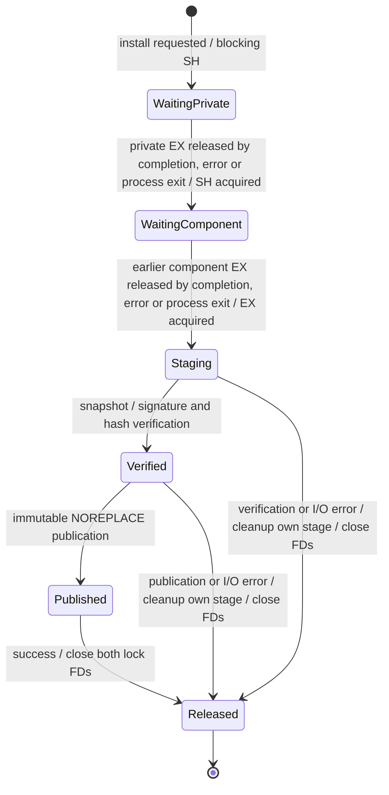
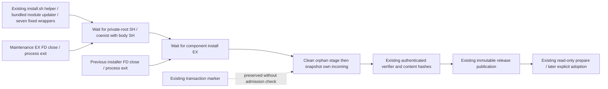

# Web受付だけの固定資材配置と起動descriptor

runtime正本。HTTP交換制御は[integration](../integration/README.md)、内蔵版選択/採用状態の固有境界は[Web](../web/gateway-builtin.md)、資材/発行元認証と完全file集合の供給は[distribution](../distribution/README.md)。この段階はsource・図・隔離fixtureの契約で、正式attestation・実root配置・実Host/本番の成立ではない。

## Installer wait and maintenance-marker correction (2026-11-08)

Trony assigned this bounded correction to Admi; the surrounding public installer/reader remains runtime-owned. `scripts/install-web-gateway-release.py:install` is the shared fixed writer for Web and the seven component wrappers. Public arguments, verifier/hash checks, immutable publication and caller interfaces are unchanged.

| Function / retained serialization | Named protection | Self-exit and next step |
| --- | --- | --- |
| Blocking SH on the private-root inode | Prevent concurrent maintenance overwriting the private tree while installation stages or publishes code | Real maintenance EX owner closes/releases its FD on completion/error, or the kernel closes it on process exit; pending SH acquires automatically and continues. Normal body SH coexists. Existing root identity validation stays intact. |
| Blocking EX on component `.install.lock` | Prevent a second installer deleting the first installer's live staging or racing publication to an existing target | Earlier component writer exits its context on success/error or the process exits; FD close releases EX, and the next installer acquires automatically before stale-stage cleanup. No immediate busy failure, polling, deadline or retry. |
| Remove `.transaction.json` admission check | A marker alone names no protection beyond actual lock ownership and may remain after a prior transaction | Installation ignores and preserves the marker; no external cleanup is required to proceed. |

The same helper bytes serve `install-{notifications,members,memory,usage,diagnostics,execution,conversation}-release.py` and `module-update-service.py`; only their shared wait behavior changes. Tests of those callers inherit the shared writer contract; direct wrapper lock fixtures now expect queued success. This script is fixed image code included by the server packager, absent from the Web module archive and the Host root-code bundle. Normal Web module update cannot activate the correction: it needs a subsequent formal image/body/helper supply (and the relevant installer companion binding), under its owners' existing operational conditions.

## 置き場とwriter

| 対象 | 配置と権限 | writer |
| --- | --- | --- |
| 未信頼受取 | installerが指定されたarchive/bundleをroot stagingへsnapshot。受取場所から直接起動しない | 外部通常installer、root固定helper |
| 完成資材 | helper内`/srv/bellteam-private/web-gateway/releases/<archiveSHA256>/`、normal内`/run/bellteam-maintenance/web-gateway/releases/<archiveSHA256>/` | rootだけ。dir0555/file0444、link/特殊file無し。完成dirの上書き無し |
| 受入記録 | 同版dirの`installation.json`、root-owned通常file。`manifest.json` raw SHA、archive SHA、sourceCommit、repoID、署名検証方式を束縛 | 公式verifierの成功後だけroot固定helperが最後に公開 |
| 採用版 | `/srv/bellteam/state/web-gateway-release.json`、1001/0600 | 同一親の交換制御だけ。既writeAtomicでready後に記録 |
| socket/PID | 既private0700一時dir/socketと親の子process参照 | 既親process |

新しいshared/tools可書込領域やHOST mountは増やさず、既root:1001/0750のprivate rootとreadonly mountを使う。資材は`state`の兄弟へ置き、既prepareServerStateOwnershipの再帰chown対象に入れない。公開/内部とも既normalのreadonly control mountから参照できる。配布候補の専用bind案をこの既mountへ縮める差異をセンチと確認する。

通常installerの専用modeは既install.sh内に収め、第三shellの手動取得を前提にしない。保存normal・実CIDのimage/mount本人性を検証し、既固定imageからWeb配置専用helperを起動する。停止・pull・image変更・任意command/pathをしない。helperは未信頼incomingをreadonly、既private volumeだけをRWに持ち、空env/固定Python codeでid/source/signerの64/40/40hexだけを受ける。archive/bundleの入力pathは固定incoming root/id内。承認済みsource/signer値をrootoperatorが明示して渡し、manifest/bundleから期待値を作らない。

The fixed helper waits for the private-root SH lock, then waits for the component .install.lock EX lock. It coexists with normal-body SH holders, queues behind a real whole-maintenance EX holder, and queues behind an earlier installer for that component. A .transaction.json marker alone never refuses installation and is neither read nor changed. The component store changes only under its exclusive lock; state/adoption records remain untouched. The existing fixed installer entrypoint does not add root sudo or a Docker socket to the normal body.

incoming archive/bundleを開いたFDからroot stagingへsnapshotしてfsync、承認済みexpectationをroot-owned通常fileとして生成。固定公式verifierのexit0/receipt整合後にだけ新しい非公開版dirへ安全な通常fileを書き、全bytes/hashを再照合してdir0555/file0444へ固定する。installation.jsonを最後に書き、renameat2 NOREPLACEで完成版を一度だけ公開し親dirをsyncする。既版は空でも上書きしない。失敗時は当操作stagingだけを除去し、既版/採用stateは保持。強制killの残stagingは次の専用EX取得後に本人性を確認して整理する。署名供給や実root配置の成立をこのsourceから推定しない。

## 公開窓口

`prepareGatewayRelease(versionId, {signal} = {}) -> Promise<{versionId, appRoot, protocolVersion:1}>`。外部入力versionIdはarchive SHA256の64桁小文字hexだけ。pathは固定storeから構成し、任意path/UID/command/環境を入力にしない。appRootは版dirの`payload`、固定entryは`src/http-gateway-entry.mjs`。Nodeはimageのprocess.execPathを使う。

受入記録は`bellteam.web-gateway.installation.v1`、component=web-gateway、archiveSha256=versionId、manifestSha256、sourceCommit、verification={method:github-oidc-attestation,repositoryId:1404510084}。これは配布root verifier成功のdurableな結果で、未検証bundleの自己申告やBotのboolを採用しない。署名検証と原子的root publicationはroot writerの責任。runtime readerはこの記録を自分で作らず、全祖先/record/manifest/fileのroot所有・非可変mode・非link、manifest SHAとfiles完全集合/bytes/SHAを照合する。

manifestは配布の`bellteam.web-gateway.artifact.v1`、component、sourceCommit、entry=payload/src/http-gateway-entry.mjs、runtime={os:linux,arch:amd64|arm64,nodeMajor:26,parentProtocol:1}、files=[{path,bytes,sha256}]。OS/arch/Node major/親契約は受取資材の自己申告を採用せず、現在親の固定値と比較する。src/webとprod依存をpayload内へ固定し親/appの依存fallback無し。実署名供給が無い今は正常系root installationを作っていない。

このAPIは準備/読取のみで、停止・採用記録変更・起動を行わない。採用記録は`{schema:"bellteam.web-gateway.adoption.v1",currentVersionId,previousVersionId}`で、成功した版と直前版を持ち、再起動時はSHAのcurrent/previousをprepareし直す。currentVersionId=nullは内蔵版の明示採用、previousVersionId=nullは直前の内蔵版を意味し、任意pathは記録しない。明示current null又は記録無しの初回は親起動時の固定appRootを使う。欠落/不明/破損したcurrentを勝手に内蔵版へfallbackしない。内蔵版選択は[Web固有境界](../web/gateway-builtin.md)で、readerのSHA64契約は変更しない。旧sourceを含め、稼働中/現採用/直前版の資材を削除しない。自動世代pruneは今回追加しない。

## 失敗・戻し

prepareが欠測/信頼/互換/bytesで拒否したら旧子を止めない。旧子終了を確認できない場合は新子を起こさない。5秒drainで旧子を強制回収した場合も、旧要求の結果は不明のままで本文を再送しない。新版ready前の失敗は前descriptorで旧受付を戻し、restore成功までは採用版を更新しない。旧版も失敗なら受付停止と両例外を返し、業務親/Aitermを閉じない。親closeと重なれば新版起動/旧版戻しを抑止する。

ready後の採用記録書込が失敗したら成功返却しない。新子を回収して旧版を再起動し、旧採用記録は保持する。回収/旧版再起動も失敗なら実状態を返し、成功を推測しない。交換中の親crashではcurrentの採用記録を再検証して一つだけ起動する。schema/state writerの移行はWeb受付に無く、履歴snapshotを巻き戻さない。

実装readerは`src/web-gateway-release.mjs`、直接fixtureは`test/web-gateway-release.test.mjs`。root配置helper/installer sourceは今回実装し、公式ghの実署名供給/実root配置/Root採用記録接続の成立は各具体結果で確認する。fixtureはmanifest互換/越境/欠測・拒否だけを示し、署名成功や実root配置の受入へ拡張しない。

## installerの固定呼出し

`sh install.sh --install-web-gateway <同設置の保存世代> <archiveSHA64> <承認済sourceSHA40> <承認済signerSHA40>`。同設置直下の`.bellteam-compose.*`/normal.jsonを使う。実CIDがrunning/非restarting/read-onlyで、同image/projectとdata/HOME/private各mount本人性が一致することを固定imageのplanで検証する。失敗はhelper起動前に拒否し、normal stop/update/rm/up/pullを発行しない。

operatorは承認済み配布情報からsource/signerを指定し、`runtime/web-gateway-incoming/<archiveSHA64>/{archive.tar.gz,bundle.json}`へ受取を置く。この場所は未信頼。incomingの期待JSON/任意path/任意commandはroothelper入力にしない。検証済固定コードは`src/web-gateway-install-plan.mjs`、`scripts/install-web-gateway-release.py`と配布固定verifierのみ。helper modelはincomingだけRO、privateだけRW、user0/cap_drop ALL/既CHOWN,DAC_OVERRIDE,FOWNER/NNP/network none/read-only/tmpfsを固定する。

helper entryは空envの固定`python3 -I /app/scripts/install-web-gateway-release.py`、引数は64/40/40hexだけ。公式verifierは固定`/usr/bin/python3 /app/scripts/verify-web-gateway.py ARCHIVE BUNDLE EXPECTATION`へroot staging pathのみ渡す。期待値はrootwriterが明示引数からroot-owned400の通常fileへ作る。archive512MiB/bundle16MiB/manifest8MiB、展開総量512MiB/file20000を上限とする。専用helperを含むimageの初回導入後は、将来の新資材配置ごとに箱を止め直す必要を作らない。実Hostでの権限/配置/同時lock受入は別結果。

rootwriter隔離fixtureはcurrent UIDへ所有者検査を差替え、verifier成功receiptを契約mockとして渡す。rootのDAC_OVERRIDEもこのfixture内だけで模擬し、NOREPLACE syscall/lock/filebytes/mode/cleanupは実一時fileで確認する。これは実root/署名成功の採用ではない。別fixtureで通常installer入口から停止を発行しない固定helper選択・CID/image/mount不一致拒否を確認する。

Docker観測ではMounts.Sourceはvolume rootで、subpathはHostConfig.Mounts.VolumeOptions.Subpathにある。installer planは両観測のvolume名/RO/NoCopy/明示subpathと既normalを合わせ、Sourceへsubpathを足した推測をしない。実装根拠は[Moby mount Path](https://github.com/moby/moby/blob/master/daemon/volume/mounts/mounts.go)とcontainer GetMountPoints（取得blob c48f0be08227600b31cc28459ef566fef7f26b2d）を参照。

異常終了時は[module-processの自動再生成](module-process.md#子だけの自動再生成)と同じtimerを使い、固有の採用版・初期化・意図停止・実終端を保持する。

Web常駐子の`createHttpGatewayProcess`は`onModuleChildExit?`を受け、既ChildProcess close後・稼働成功済みの異常終了だけを[共通観測](module-process.md#子終了診断のcallback)へ渡す。意図close/交換を除き、既同port再起動を維持する。
