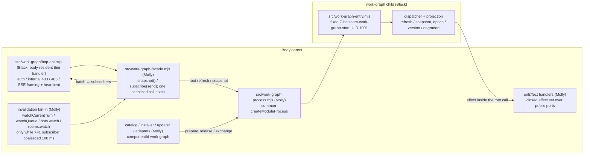

# work-graph as an independently updated module child

Owner of this page: Molly (parent side). Child entry, protocol, channel factories, hub/projection and the signed asset: Ark Ranger Black ([work-graph](../work-graph/README.md)). Ruling: Trony 2026-11-08 JST, Owner order. 相関図 runs as a normal module child like the existing eight, so it updates without stopping the body. The in-body `createWorkGraphApi` mount (#645) is removed. The public routes are unchanged.

## Function map

## Data flow

| Step | From → to | Data | Owner of the data |
| --- | --- | --- | --- |
| 1 | Owner client → http-api | `GET /api/work-graph`, `GET /api/work-graph/events` (common authorizer; internal server 403 `WORK_GRAPH_OWNER_REQUIRED`; non-GET 405) | none |
| 2 | http-api → facade.snapshot() → child root `refresh` then `snapshot` (same chain) | the refresh batch, if any, goes to current subscribers; then the stored `bellteam.work-graph.v1` snapshot, JSON body as is | child memory |
| 3 | http-api → facade.subscribe(send) | first subscriber starts the watchers; last unsubscribe stops them and clears the timers | facade memory |
| 4 | watchers → facade → child root `refresh` | coalesced 100 ms, serialized. Result `{batch\|null, nextRefreshMs\|null}`; batch → every subscriber as `event: change`, `id: <epoch>:<version>`; one timer from nextRefreshMs | child memory |
| 5 | child → parent effect (only inside a root call) | `members.list {}` → `{members:[{id,name,color,avatarVersion,deleting}]}` (bots.listForClient); `turns.read {botIds ≤200}` → `{turns:{[id]:{state,turnId,startedAt,summary,summaryStatus}}}` or `{unsupported:true}` on EXECUTION_REQUEST_INVALID (`state` = `transport.runningState(id)` when `working`/`idle`, the lattice nudge judgement incl. a notify=result command wait (Owner, a54), else `transport.currentTurn(id,{startedAt:true}).state`; `turnId`/`startedAt` from currentTurn; `summary`/`summaryStatus` from `readCurrentWork(transport, bots.get(id))`, the same DTO as GET /api/bots `currentWork`, summary ≤160 or null); `queue.read {}` → `{items:[{status,context,contextId,groupId,from,target,requestSummary,image,steered,startedAt,seat?}]}` (transport.queueItems({}); `seat:{kind,forkId}` forwarded only when execution's row has it — a running read-only fork, [work-graph W4](../work-graph/README.md); absent = main seat); `room.messages {roomId}` → `{items:[{id,routing:{responders,status}}]}` (messagePage('rooms', roomId, ?limit=50)) | members / execution / conversation (read only) |

The parent writes no work-graph state. The child holds only memory, and keeps one writer lock `/srv/bellteam/state/work-graph.lock` (the common fixed-C rule). It writes no state file. Adoption record: `state/work-graph-release.json` (the common `bellteam.<component>.adoption.v1`). A new child means a new epoch, and clients reconnect.

## Seam (agreed with Black 2026-11-08)

- Child (Black): `src/work-graph-protocol.mjs` (`WORK_GRAPH_PROTOCOL_VERSION=1`, `WORK_GRAPH_STATE_COMPATIBILITY={state:'none'}`, `assertWorkGraphStateCompatibility`, root `refresh`/`snapshot`, the four effect validators, control validators, `validateWorkGraphReady`), `src/work-graph-ipc.mjs` (`createWorkGraphParentChannel(child, {generation, onEffect})`, `createWorkGraphChildChannel({dispatcher})`), `src/work-graph-dispatcher.mjs`, `src/work-graph-entry.mjs`, `scripts/probe-work-graph-runtime.mjs`, `scripts/package-work-graph.py` and the signed asset.
- Parent (Molly): the files below. The parent channel validates every effect request before `onEffect(method, params)` and every root result.
- Compatibility in the catalog: `{ nodeMajor: 26, parentProtocol: 1, stateSchema: null, containerUpdate: null, stateCompatibility: {state:'none'} }`.
- Effect rows carry exactly the agreed keys and types (`startedAt` of a turn is an ISO string or null); the parent normalizes them, and the child's parent channel rejects anything else. The work-graph channel has no `drainIncoming`: its effects run only inside root calls, which the common controller already drains.
- A new effect method is a parent change and ships with a body image. Any other change to the graph logic ships only in the child asset.

## Parent changes (this slice)

| Area | Files |
| --- | --- |
| Fixed start | `scripts/work-graph-start.c` (module-start.c, MODULE_NAME `work-graph`), Dockerfile compile/install, publish-server-image path filter + start check, package-server list |
| Process | `src/work-graph-process.mjs`; `module-process.mjs` / `module-locks.mjs` / `module-release.mjs` closed sets gain `work-graph` |
| Assembly | `src/work-graph-facade.mjs`, `src/work-graph-locks.mjs`; `application-services` / `bootstrap`: create the process, onEffect handlers and the facade; `http-server.mjs`: `createWorkGraphApi({ facade, internal })` replaces the in-body hub mount |
| Update | `update-module-catalog.mjs`, `update-module-adapters.mjs`, `update-center.mjs`, `update-center-contract.mjs` (`updateComponents` entry), `scripts/update_catalog.py`, `scripts/container-update-host.py` (MODULES + validator), `scripts/install-work-graph-release.py`, `src/work-graph-install-plan.mjs`, `scripts/verify-work-graph.py`, `config/work-graph-verification.json`, `module_artifact_package.py` / `module_artifact_verifier.py`. The `config/update-catalog.json` record is added at supply time, after the signed asset is published |

Released clients read `componentId` as a string and fall back to the id / a generic icon, so the new `updateComponents` row needs no client release.

## Failure handling

| Failure | Behavior | Self-exit |
| --- | --- | --- |
| Child not available (start, exchange, crash) | facade rejects; http-api returns 503 `WORK_GRAPH_UNAVAILABLE`; open SSE responses end; clients reconnect | Shared `module-child-restart` lifecycle (1→30 s backoff, no limit) |
| Child exits while SSE open | Responses end; on the new child the next client gets a fresh epoch snapshot | Same lifecycle; no replay |
| Parent port read fails | Effect returns the error; the child keeps last good data and lists the source in `degraded` | Next invalidation retries |
| Incompatible adopted release | Common prepareRelease refusal, same as the other modules | Common adoption path |

No new guard. The route never waits on anything except the child request itself.
