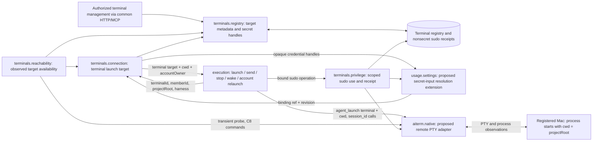
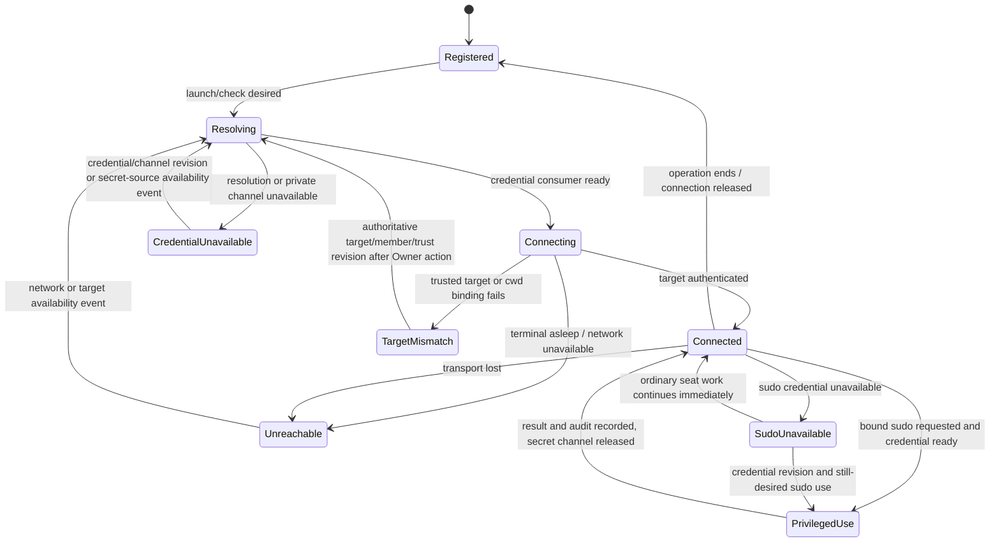
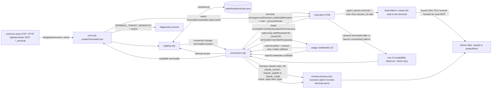
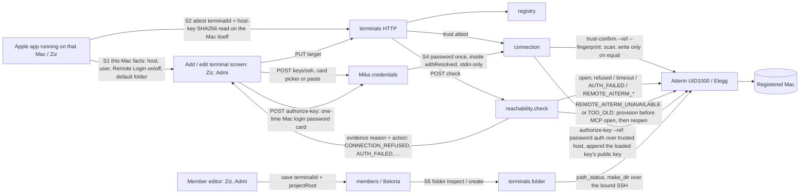
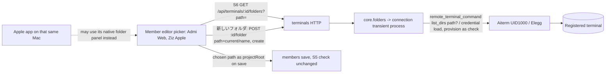

# Terminals

Owner: Crust (bot-9741b319). Assigned by the Owner on 2026-11-09 at 13:44 JST.

**P0 contracts adopted by Trony; P1 implemented on the ONE launch path** (registry + launch target + reachability + C8 maintenance, see [P1 implementation](#p1-implementation-2026-11-09-one-launch-path)). Aiterm launches every seat, local or terminal; terminals hands execution the terminal target. The first supported path is **macOS + Claude Code**; Windows, Linux and other CLIs follow later.

Canonical connections: [module.json](module.json), [overall function map](../../feature-map.md), [overall data flow](../../data-flow.md#proposed-remote-terminal-seats-p0), [ownership rules](../../module-ownership.md). Request: Trony's `remote-seat-plan-20261109.md`, F-SEAT-HOST. This module owns terminal registration, SSH/sudo secret references, host trust records, reachability, sudo-use receipts, C8 Claude Code upkeep and the **terminal target execution passes to Aiterm**. Execution owns the seat lifecycle and delivery; Aiterm owns the SSH connection and native PTY transport. A transport carries data; it is never a relay AI seat.

## Function diagram



`uses` names existing provider envelopes, not already implemented remote methods. The secret resolver is a proposed extension under usage.settings, where submitted-secret consumption is documented today; Mika and Trony must settle its exact typed method. Elegg must settle the remote adapter under aiterm.native. Incoming dependencies from execution, UI/common entry and members are proposed below; their owners add their own `uses` as they implement the adopted contracts. Their descriptors are unchanged in this PR.

## Owned state and public projections

Proposed durable store: `<stateRoot>/terminals.json`, one terminals-owned writer, with ordinary atomic-save behavior. A failed save returns its real error and preserves the prior registry; it is never reported as successful. This is a new terminal store, not a second member registry.

| Field / state | Meaning and owner |
| --- | --- |
| `terminalId` | Stable registry key, assigned by terminals; no separate remote-seat ID scheme |
| `host`, `user`, `port`, `os` | Explicit SSH target; port 1..65535, OS initially `macos`. Host/user are structured fields, never shell fragments |
| `accountOwner` | Target account domain: product Owner or that terminal's owner; set with registration, never inferred from a host name. Other people's machines cannot receive the product Owner's Claude credentials |
| `sshKeyRef`, optional `sudoKeyRef` | Opaque handles issued by Mika's secret input. Mika retains the underlying `op://<vault id>/<item id>/<field>` or stored-value reference. Terminals never stores the resolved value or parses/resolves `op://` itself |
| Trusted SSH host identity and target revision | Nonsecret known-host identity for the registered host; target/key-reference changes invalidate cached connections. Registration/bootstrap of that identity is part of C3 below; a scan alone is not trusted identity |
| Last reachability observation | In-memory `{terminalId, observedAt, reachable, reason}`; a past success is not current readiness or CLI startup proof |
| Live connection resources | Owned by terminals; underlying remote PTY/native resources owned by Aiterm. Execution holds an opaque scoped reference, never an SSH key or a mutable registry object |
| Sudo-use receipts | `<stateRoot>/terminal-sudo.jsonl`: terminal/member/seat identity, operation correlation, requested/started/completed timestamps, outcome. No secret, stdin, environment or arbitrary command/output body. Record every use, including failure; record audit failure separately without pretending no use occurred |

General list/get projections contain target metadata, configured/missing credential indicators and reachability observations. Secret handles are only available to authorized registry/resolver consumers; no key value, raw 1Password reference, account token or transport secret appears in public JSON, screen text, transcripts, diagnostics or git. Deleting a terminal removes its metadata and closes its connections; Mika owns credential-reference disposal. Members referencing a removed terminal retain their member data and pending input; the interface reports the missing binding instead of silently selecting another target.

Members owns `terminalId` and absolute `projectRoot` on each member. Execution owns session identity, effective account slot, limits, actual turns and active-seat references. Mika owns secret source selection/resolution and reference revisions. Conversation owns saved messages/history; memory owns personal/shared memory and knowledge. Terminals writes none of those private stores.

## Proposed public interface (`provides`)

These names define P0 responsibilities, not implemented route or wire names. All calls carry the existing authenticated caller context; a JSON member/seat claim is not authority.

| Port | Input -> result | Limits and side effects |
| --- | --- | --- |
| `registry` | List/get; register/update explicit target fields and opaque key handles; remove by terminalId -> saved nonsecret target projection or real save/validation error | API/MCP first in P1; Web/Apple UI in P2. Existing member fields without terminalId keep the local path. No probing or SSH connection as a side effect of a read |
| `reachability` | `check(terminalId)` -> dated reachable/unreachable observation with a fixed nonsecret reason | Uses connection's same SSH target, trust and credential path. A successful check authenticates the target, then releases the probe resources; it does not launch Claude. Offline, asleep and unreachable are availability observations, not proof that a seat vanished |
| `connection` | `target({terminalId, memberId, projectRoot, harness})` -> terminal target + cwd + accountOwner, or a classified not-started error | Superseded by the ONE launch path ruling (see P1): validate current target revision, trust, credential binding and absolute cwd; execution passes the target to Aiterm's own launch, which starts the process with cwd already set and binds later calls by session. A nonexistent/inaccessible directory cannot fall back to home or a later `cd` |
| `privilege` | Bound connection + member/seat identity + requested sudo operation -> actual result and nonsecret use receipt | Resolve optional sudo key only for this use, with no approval wait. No key supplied means ordinary SSH-user execution; never silently fall back to root or another credential. Optional sudo does not gate ordinary seat launch |

`seatBinding` is execution's existing native seat/session identity and launch context, augmented with terminalId/projectRoot binding, not a new terminal-generated identity. Native handles and authorization stay opaque inside their owners. If the module runs as a child, common effects retain those resources and only typed references cross IPC; no Promise/callback/credential is serialized into a business DTO. Terminals' internal source/protocol and tests will be owned here; common mounting/controller and artifact supply remain Molly/Centi contracts, following the [work-graph precedent](../work-graph/README.md#process-placement-trony-ruling-2026-11-08). P0 does not prescribe another long-lived service or install helper.

## Data flow

| ID | From -> to | Payload and return / persistence |
| --- | --- | --- |
| T01 | Authorized app -> common entry -> terminals.registry | Explicit target + Mika-issued credential handles -> saved metadata/indicators; no secret values through registry JSON |
| T02 | App secret input -> Mika | 1Password reference first when connected; stored secret-input value remains optional fallback. Same choice applies to SSH, sudo and account login. Mika returns an opaque handle and change notification |
| T03 | Members -> execution -> terminals.connection | Member ID, terminalId, absolute projectRoot, existing seat identity, selected slot/account domain. Members supplies launch instructions directly to execution; terminals does not generate them |
| T04 | Terminals -> Mika -> private consumer | Handle + target/member/purpose context -> resolved SSH/sudo value for only the bound consumer. Mika may use server `op` or terminal-local `op` under its own contract; terminals never runs `op` |
| T05 | Terminals -> execution -> Aiterm -> registered terminal | Terminal target (binding ref, structured SSH target, trust and credential revisions) -> Aiterm's authenticated connection at launch; errors expose fixed categories, not raw secret-bearing output |
| T06 | Execution -> Aiterm launch with terminal target -> Claude | Start with cwd = projectRoot, folder's own rules, launch-time BellTeam instructions, MCP connection/identity and selected target-owner account slot. No generated AGENTS/CLAUDE/MCP configuration writes to the user's repository or home |
| T07 | Remote seat -> SSH reverse forward -> container-loopback seat MCP -> existing providers | Authenticated existing seat identity -> messages, scoped memory/knowledge and proposed member-scoped docs operations; replies return directly to that seat. No relay seat |
| T08 | Aiterm remote capture -> execution -> conversation/current-work | Terminal output/transcript and native turn references -> existing history append/current-work paths, bound to member + seat + turn + delivery where present. History persistence ACK and current-work projection remain distinct; no second terminals history writer |
| T09 | Availability observer -> execution -> existing pending delivery | Reconnection/ready event -> resume delivery of original saved IDs. Message acceptance remains durable while the machine sleeps; terminals introduces no new delivery queue |
| T10 | Seat sudo request -> terminals.privilege -> Mika/Aiterm -> receipt | Target-scoped sudo use, no approval wait -> every-use audit and actual result. Credentials use non-echoing private input and are absent from PTY capture |

Resolved values exist only during the private consumer operation, never in argv, general environment dumps, command echo, launch recipes, persistent PTY metadata or retry logs. Elegg/Mika must define a private channel that is excluded from PTY capture before credentials are injected. Drop references and close that channel after use/error/disconnect; each new connection resolves current handles again. An unclassified native error is not safe to print verbatim. Already-present SSH keys in P1 use Mika's resolved credential capability; terminals does not open an arbitrary secret file supplied in a public request.

## State and required protections



| Protection | Explicit protected asset and scope | Automatic exit; no sticky manual unlock |
| --- | --- | --- |
| Secret exposure | SSH/sudo/account values cannot enter registry, public API, transcript, logging or wrong-account target. Private resolution/transport capability required only for that credential-bearing operation | Destroy transient channel on completion/error; a valid credential/channel revision or secret-source availability event (for example, 1Password becoming reachable again) re-evaluates the still-desired connection. Ordinary app/message acceptance continues. Secret values are never used as a denial-state key |
| Wrong target | Registered SSH host/user/port, trusted host identity, member's terminal/folder and seat binding. Prevent sending input or credentials to a different target; no silent target substitution or home-directory fallback | Surface the mismatch to the Owner in plain words with a concrete corrective action that creates a target/member/trust revision (for example, confirm the new host key). That revision invalidates the old binding and automatically re-resolves a still-desired launch against the current authoritative fields; never stall silently. No blind host-key acceptance, fallback directory or persistent "unknown" lock |
| Privilege escalation | SSH identity and target-owner account boundary; only explicitly requested sudo uses the optional sudo reference. Product Owner Claude tokens never go to a non-Owner machine | Ordinary unprivileged work continues immediately. A corrected credential/account-domain revision re-evaluates the desired authorized operation; neither sudo nor an Owner approval is a prerequisite for ordinary launch |

These are narrow protections requested in the plan. Terminal absence does not reject a saved message. Existing receipt drain retains delivery intent; a non-AI connection/availability observer emits recovery and re-arms after disconnect/restart, without waking an AI on every check. A lost/ambiguous native command result is recorded and reconciled/re-applied by existing execution rules, never made a terminal lock. The observer cadence and wake mechanism belong to C2/C3; no periodic AI polling or new durable queue is proposed.

## Cross contracts adopted by Trony

| ID / owner | Required contract and concrete decision |
| --- | --- |
| C1 Belorta / members | Add terminalId/projectRoot to create/edit and registry projections; validate the absolute folder for its target OS. Keep local members compatible. Deliver common/Owner/member rules, AGENTS.local content and short-term handoff as launch context. Preserve the user's folder/home rules byte-for-byte; no generated instruction/config file there. Members owns field/instruction revisions and notices that trigger execution rebind |
| C2 Kiro / execution | Use terminals.connection for remote start/stop/wake/reconnect/control and retain seat identity/binding across observation and MCP. Start directly in projectRoot. Preserve original pending delivery while asleep; availability resumes the existing drain. Extend existing per-model 1st/2nd account selection to the **terminal owner's** account domain: fresh seat on switch, same terminal/folder, old seat retained under existing policy. No product Owner token on another person's terminal; member terminal/folder changes require a fresh bound launch |
| C3 Elegg / Aiterm | Define remote SSH/PTY adapter requests/results under native: structured target + trusted host binding, private credential injection excluded from capture, exact initial cwd, launch instructions/MCP options in memory, launch/read/send/observe/stop and connection-loss/ready events. No nested relay AI; all connection/reconnection originates in terminals. Define how first trusted SSH identity is obtained and revised without trusting an unauthenticated scan, and how terminal-local credentials/op can be consumed privately |
| C4 Molly / common + runtime | LAN-reachable authenticated MCP endpoint and launch-time configuration; bind existing full seat identity to member/terminal/folder using trusted caller context, rather than treating a supplied header as proof. Reuse existing account-seat name resolution. Remote seat receives only its ordinary member authority. Own stable facade/effect composition, controller/exchange mount and connection observation plumbing; settle the no-home/no-repo configuration channel with Elegg |
| C5 Mika / secret input | One input accepts op:// or stored value for every slot, including account login; 1Password displayed first when connected, fallback retained. Mika alone validates/resolves and owns source/handle/revision, availability notifications, private value lifetime and failure categories. Terminal consumers receive only the resolved value/capability and never its source. Resolve on server or terminal-local op as appropriate without giving terminals another secret store |
| C6 Belorta / lead; Biscuit / memory | Keep canonical Bot docs and AGENTS.local under BellTeam's existing member project, memory/knowledge in existing server stores and handoff in the existing context provider. Remote member accesses its docs through a proposed member-scoped MCP file interface (Molly mount, members file owner), memory through existing scoped memory MCP, handoff at launch. Launch context names these locations/access methods. No full home/project sync, no second remote memory DB, no instruction files in the user's repo/home. Exact docs read/write/list methods and access boundary require their owners' diagrams |
| C7 Kiro / lead; Elegg / native, N102 / conversation history, Rivalin / Throughline | Kiro coordinates Elegg, N102 and Rivalin to capture terminal-side transcript/completion/limit events at source, stream or resume-read from an existing native cursor, bind to existing seat/turn/delivery references and feed existing history writer/current-work projection. Reconnect catches up without replaying a delivered business input or duplicating history. Terminal stores no history copy. Exact cursor/ACK and handoff capture need the provider/consumer diagrams; current observer support does not prove remote transcript support |
| C8 Crust / lead; Elegg / transport; Centi / product test | Crust owns terminal maintenance through terminals.connection, with Elegg providing transport and Centi owning product testing. Terminal Claude Code must track the official latest release, without version pinning. Propose native setup/update before a fresh launch and the existing non-AI maintenance path, never replacing a running CLI. Report actual installed/update outcome; update-network failure preserves the installed executable and pending work rather than becoming a new launch guard. Define installation ownership/path preserving user CLI/config. The container's DISABLE_AUTOUPDATER convention alone cannot keep a remote CLI current |
| C9 Admi/Web, Ziz/Apple, Centi/product test | P2 registry screen and member terminal/folder plus key-reference input via Mika. C1-C5 power P1 API/MCP first: Owner Mac, no sudo, existing key. Rebuild Ziz as a remote seat after all four Owner completion conditions are met, including remote account switching. P3 validates remote slot switch, sudo every-use recording and non-Owner credential isolation, then public LAN installation/add-member test. Windows/Linux and other CLIs stay subsequent scope |

All four Owner rulings are carried above: asleep input retained; terminal owner's Claude account on non-Owner terminals; sudo available without approval wait with every use recorded; Mac + Claude first. C1-C9 are adopted P0 contracts; their remote methods remain unimplemented. This document changes no peer's ownership or existing deployment restrictions.

## Scope of verification and later acceptance

### P1 implementation (2026-11-09, ONE launch path)

Trony ruling (Owner, 2026-11-09 16:1x JST): one launch path from the start. Aiterm's existing `agent_launch` (and `claude_agent` / `codex_agent` / `grok_agent`) takes an optional `terminal` target + `cwd` (Elegg, accepted shape below); execution (Kiro) uses that same call for every seat, and send/wait/transcript go through Aiterm by `session_id` like any local seat. terminals no longer wraps a live session: no `open`/`close`/bound `native`/`wait`. Remote seat MCP rides Elegg's SSH reverse forward (R12, terminal `127.0.0.1:P` stable per terminal) to Molly's container-loopback ingress.

Settled peer contracts: Kiro #765 (execution uses `connection.target` + `watch`), Elegg aiterm-mcp remote-terminal.md (binding ref, `serve` tools, launch `terminal` argument), Mika #772 (native credential union `{nativeKeyRef, revision}`), Molly #767 (in-parent mount), Belorta #768 (member terminalId/projectRoot).



| Port (`provides`) | P1 method | Result / classified failure |
| --- | --- | --- |
| mount | `createTerminalsCore({stateRoot, credentials, report, seatProject?})`, exported from `src/bootstrap.mjs` | `{registry, reachability, connection, maintenance, watch, close}`; `credentials` may be null until Mika's facade lands (targets are then `CREDENTIAL_UNAVAILABLE`). An extra `seatCredentials` option from the mount is ignored (no secret passes through terminals any more) |
| `registry` | `list()`, `get(id)` (null if absent), `put(input)`, `remove(id)`; `ingressUrl` removed (Molly #793: seat MCP target is the container origin Aiterm rewrites; a legacy stored value is dropped on read, an input value is rejected) | Nonsecret projection with `maintenance` (last C8 outcome or null, in memory); errors `{code, status, message}`: `INVALID_TERMINAL` 400, `TERMINAL_NOT_FOUND` 404, `TERMINAL_EXISTS` 409, `HOST_KEY_FINGERPRINT_MISMATCH` 409, `INVALID_TERMINAL_STORE` 500. Messages name the field, its expected form and the next action, and never echo the submitted value |
| `registry` | `put({..., confirmHostKey: 'SHA256:...'})` | Owner's "confirm the new host key": Aiterm's `trust-confirm` scans once and writes only on an equal fingerprint, then the new trust revision is stored. Without it, a new record binds the trust Aiterm already holds (P1 pre-enrolled known_hosts) |
| `connection` | `target({terminalId, memberId, projectRoot, harness})` | `{terminal: {ref, target: {host, user, port}, trustRevision, credentialRevision}, cwd: projectRoot, accountOwner: 'owner' / 'terminal-owner'}`. Execution passes `terminal` + `cwd` unchanged to Aiterm's launch and applies the Owner's 1st/2nd slot login only when `accountOwner === 'owner'`. Or `{code, effect:'not_started', reason?, action?}` with code `TERMINAL_UNAVAILABLE` / `CREDENTIAL_UNAVAILABLE` / `TARGET_MISMATCH` |
| `connection` | `observe(terminalId)` (no result) | Execution calls it when Aiterm's launch, after a successful `target`, answers a connectivity code (`UNREACHABLE`, `SEAT_FORWARD_UNAVAILABLE`, `HOST_TRUST_STALE`, `CREDENTIAL_*`, `TERMINAL_UNAVAILABLE`). Arms the same non-AI observer as a failed `target` (same backoff, idempotent while armed, `TERMINAL_NOT_FOUND` ends it, inert after dispose); its exit is the `available` event. `HOST_KEY_MISMATCH` / `TARGET_MISMATCH` wait for the registry-change edge instead |
| `connection` | `onAvailable(listener)` -> unsubscribe | `listener({terminalId})` when the terminal is usable again (core republishes it on `watch`) |
| `reachability` | `check(terminalId)` | `{terminalId, observedAt, reachable, reason, action?}`; opens and closes one transient remote process, never launches |
| `maintenance` (C8) | `last(terminalId)` | `{terminalId, observedAt, before, after, outcome:'current'/'updated'/'failed'}` |
| watch | `watch(listener)` | `{terminalId, reachable, observedAt}` for execution's pending drain and Molly's surfaces |

Aiterm launch argument (Elegg accepted, next aiterm-mcp release): `terminal` is strict (unknown keys, missing fields or a target differing from the binding -> `TERMINAL_INVALID` / `TARGET_MISMATCH`, never a local fallback); `cwd` is required with it (absolute path on that terminal, else `CWD_UNAVAILABLE` before any session); first scope `harness: claude-code` (others `TERMINAL_HARNESS_UNSUPPORTED`). Revisions are checked at launch; later calls bind by `session_id`.

Rules the code enforces:

- Native mapping (check and C8 processes): `HOST_TRUST_MISSING` / `HOST_TRUST_STALE` / `HOST_KEY_MISMATCH` / `HOST_KEY_FINGERPRINT_MISMATCH` -> `TARGET_MISMATCH`; `CREDENTIAL_UNUSABLE` / `CREDENTIAL_REVISION_STALE` / `AUTH_FAILED` / `CREDENTIAL_NOT_LOADED` / `CREDENTIAL_REQUIRED` -> `CREDENTIAL_UNAVAILABLE` (aiterm-mcp 0.67.0: a handle key must be loaded by `credential-load` on stdin before an open; for a secret-backed launch, execution (#814) calls the parent ingress.seatCredential.loadTerminalKey port (#813) with metadata only; the parent resolves inside Mika's expectedRevision-bound callback and sends the key only on stdin. Terminals resolves its own check/C8 key through Mika's callback, rechecking generation/dispose immediately before that load); `UNREACHABLE` / `REMOTE_AITERM_*` / `CONNECTION_LOST` / anything unclassified -> `TERMINAL_UNAVAILABLE`. Only the code, Elegg's plain `action` and the host appear; raw native text is dropped. Every `TARGET_MISMATCH` from `target` is recorded through `report` with its action so the Owner sees it.
- Missing `hostTrust`, a non-absolute `projectRoot` or a missing `memberId` -> `TARGET_MISMATCH` before any process starts. `accountOwner` is returned from the registry, not asserted by the caller.
- Aiterm holds credential and trust in UID1000. For native keys, Mika's callback gives only `{nativeKeyRef, revision}`; the binding ref and revisions are public metadata. Secret-backed targets carry only `{handle, revision}`; execution (#814) calls the parent `loadTerminalKey` port (#813), which resolves inside Mika's revision-bound callback and sends key bytes only on credential-load stdin. A raw key string in a target is refused as `CREDENTIAL_UNAVAILABLE`; each `target` resolves again.
- `HOST_TRUST_STALE`: terminals re-reads Aiterm's status and stores the new trust revision; that registry change emits `available` and execution re-targets.
- Exits (no sticky state): a failed `target` for availability or credential records the terminal as wanted. Mika's `{available:true}` event for its handle, a registry change, or a successful observer `check` emits `available`. The observer is an in-process timer that runs `check` only while some wanted terminal is not yet usable (30 s, doubling to 5 min), stops on success or removal, and never wakes an AI.
- Staleness and lifecycle (`target` and `check` alike):

```mermaid
stateDiagram-v2
  [*] --> Reading: target / check (captures terminal generation before the registry read)
  Reading --> Resolving: record read, generation unchanged, not disposed
  Resolving --> Connecting: Mika binding resolved, generation unchanged, not disposed
  Connecting --> Running: process connected, generation unchanged, not disposed (C8 commands or probe)
  Running --> Closing: commands done
  Running --> Discarding: registry change or dispose; checked before each C8 command, so no later command starts
  Reading --> Discarded: registry change or dispose during the await
  Resolving --> Discarded: registry change or dispose during the await
  Connecting --> Discarding: registry change or dispose while connect was pending
  Discarding --> Discarded: session closed (awaited), no command runs, no C8 record written
  Closing --> [*]: session closed (awaited); target returned only if still current
  Discarded --> [*]: TERMINAL_UNAVAILABLE not_started / check reachable:false (registry change already emitted available)
```



  `dispose()` (core `close()`) stops the observer, marks the core disposed and waits for every in-flight `target` / `check` through its discard-close. After dispose nothing starts, no C8 command or record write begins, and the observer cannot be re-armed.
- C8: on `target` with `harness:'claude-code'`, before returning: `claude_version`, then `claude_update` (or the official `claude_install` when no CLI answers), then `claude_version`, over one transient process. Concurrent launches on one terminal share the run. The outcome is kept for `maintenance.last`. A failed update never vetoes the target, the installed CLI stays, running CLIs are untouched, and no version is pinned. An unreachable terminal is reported as `TERMINAL_UNAVAILABLE` (the launch could not start either).
- Known limit (inherited, P3): the Owner's 2nd-slot login is supplied by execution at launch; terminals no longer reads any login.

- Misuse resistance (Owner 2026-11-09 「AIが使い方を間違えないように」): the MCP tool descriptions (`src/terminals-mcp.mjs`, member `terminalId`/`projectRoot` in `src/members/profiles-mcp.mjs`) state each field's meaning and form, that keys are given only as a 1Password reference or through the secret input card (never in an argument or message), that `projectRoot` is an absolute path on that terminal, and what each error means with its next action. The registry rejects malformed input with a message naming the field, its expected form and the next action, never echoing the value; a ref field holding something key-like (`-----BEGIN`, `op://`, `ssh-ed25519` ...) is refused with the secret-input instruction.

Test double for execution: `test/helpers/terminals-native-double.mjs` (`fakeConnection` with `target`/`onAvailable`, plus `fakeNative` / `fakeSecrets` for the ports terminals consumes).

#### Key setting from the app (Trony ruling 2026-11-09)

Gap found by Admi: Owner HTTP had no key route, `bind_terminal_key` takes an Aiterm-held UUID the Owner never sees, Mika's `credentials.bind` had no live caller, and `target` accepted only a native key. Adopted route, owner terminals (HTTP + registry):

```mermaid
sequenceDiagram
  participant App as Owner app (Admi / Ziz)
  participant T as terminals HTTP + registry
  participant M as Mika credentials
  participant E as execution (Kiro)
  participant P as parent application services (Molly)
  participant A as Aiterm UID1000 (Elegg)
  App->>T: POST /api/terminals/:id/keys/ssh|sudo
  T->>A: ssh, no binding yet: register --host --user --port (keyless; native terminals reuse the native binding ref)
  T->>M: requestTerminalKey({terminalId, purpose, label}) (Owner origin, botId null)
  M-->>T: {secretRequest: {id, label, inputOptions}}
  T->>T: store sshKeyRequest / sudoKeyRequest (projection sshKeyPending / sudoKeyPending)
  T-->>App: {secretRequest: {id, label, inputOptions}}
  App->>M: existing secret dialog -> POST /api/secret-requests/:id/submit (1Password reference first)
  M->>M: bind(requestId, {terminalId, purpose}) -> handle
  M-->>T: watchCredentials {terminalId, purpose, handle, revision, available, reason, requestId}
  T->>T: only when requestId is the pending request: store sshKeyRef / sudoKeyRef + keySource 'secret', clear the request (registry change -> available)
  Note over T,M: start: for a pending request, credentials.current({terminalId, purpose}) recovers a missed event
  App->>T: DELETE /api/terminals/:id/keys/ssh|sudo
  T->>M: unbind(handle, {terminalId, purpose}) then clear ref, source and request
  Note over T,E: target carries only binding and credential metadata
  E->>P: ingress.seatCredential.loadTerminalKey({terminalId, memberId, ref, handle, revision})
  P->>M: withResolved(handle, {terminalId, memberId, purpose: terminal.ssh, expectedRevision: revision})
  M-->>P: key inside the revision-bound callback only
  P->>A: credential-load through seat runner stdin
  A->>A: per-terminal private ssh-agent
```

Pending-key lifecycle (per terminal and kind). Every read-then-write on one terminal (put, remove, key request/apply/remove) runs in one per-terminal order, and each key write is conditional inside the registry writer:

```mermaid
stateDiagram-v2
  [*] --> NoKey
  NoKey --> Pending: POST keys/kind -> request id R stored (conditional on unchanged host/user/port; else 409 TERMINAL_CHANGED)
  Configured --> Pending: POST again (key stays until the new card binds)
  Pending --> Pending: POST again -> new id R2 replaces R (a late R is ignored)
  Pending --> Configured: event or current() with requestId == pending R -> ref + keySource secret, request cleared
  Pending --> NoKey: DELETE -> unbind(ref or null = scope cancel of pending cards) + clear; a late R is ignored
  Configured --> NoKey: DELETE -> Mika unbind, then clear ref/source/request
  Pending --> Retarget: host/user/port changed -> request, bindingRef and hostTrust cleared; late R ignored
  Configured --> Retarget: host/user/port changed -> bindingRef and hostTrust cleared; a native ssh key (Aiterm binding to the old target) is cleared and unbound, a card key stays
  Retarget --> Pending: POST keys/ssh -> new keyless Aiterm binding for the new target, then confirmHostKey
```



`confirmHostKey` together with a target change is refused (confirm the new target after its binding exists). A trust rebind from the observer is conditional on the record revision it read. `core.close()` stops taking events, then joins startup reconciliation and every in-flight key operation before the mount closes the credential provider. Key kinds are only the own keys `ssh` / `sudo`; events apply only with `requestId` equal to the pending request (Mika adds `requestId` to the event and `current`).

| Item | Contract |
| --- | --- |
| Registry fields | `sshKeyRef` / `sudoKeyRef` (Mika handles), `keySource` / `sudoKeySource`: `terminal-native` (Owner terminals, Aiterm-held key registered through Mika's registerNative; the default for a ref without a source) or `secret` (set through the secret card). op vs stored is never recorded. `bindingRef`: Aiterm's public binding (target + known_hosts + trust). `sshKeyRequest` / `sudoKeyRequest`: the pending secret request. All of these except the refs are internal: `put` refuses them from a caller. A native key bound through `bind_terminal_key` clears `keySource` and a pending ssh request. Projection: `sshKeyConfigured`, `sudoKeyConfigured`, `keySource`, `sudoKeySource`, `sshKeyPending`, `sudoKeyPending`; never a handle, key, password or op:// reference |
| `target` | `terminal-native`: `{ref: nativeKeyRef, target, trustRevision, credentialRevision}` as today. `secret`: `{ref: bindingRef, target, trustRevision, credential: {handle, revision}}` (no credentialRevision). `sudoCredential: {handle, revision}` when a sudo key is set. The target carries metadata only. For a secret key, execution (Kiro #814) calls the parent `ingress.seatCredential.loadTerminalKey` port (#813) before launch; the parent resolves the handle inside Mika's `withResolved` callback at `expectedRevision` and sends key bytes only on the seat runner stdin to Aiterm `credential-load` (aiterm-mcp 0.67.0). Execution never receives or resolves key bytes. |
| Check / C8 | Same target data through `remote_terminal_open`; its `target` is exactly `{host, user, port}` (Aiterm's input is strict: an extra key such as `os` fails SDK validation, 2026-11-10 macbook). An uncoded tool error is `REMOTE_TERMINAL_CALL_FAILED` (-> `TERMINAL_UNAVAILABLE`), never `REMOTE_AITERM_UNAVAILABLE`, so it starts no provision. Before its own open terminals loads a handle key the same way: Mika's `withResolved` callback (context `expectedRevision` = the handle revision in the target, Mika's contract as Molly #813 uses it; a changed revision loads nothing) pipes the value to `aiterm-remote-terminal credential-load --ref --terminal-id --handle --revision --purpose ssh-key` on stdin (never argv, never kept); a failed load is `CREDENTIAL_UNAVAILABLE`, exited by Mika's availability event |
| HTTP (Owner) | `POST /api/terminals/:id/keys/{ssh,sudo}` -> `{secretRequest}`; a non-empty body is `400 KEY_IN_REQUEST_REFUSED` (the key goes only into the card). `DELETE` -> `{terminal}`. Errors: `INVALID_KEY_KIND` 400 (use ssh or sudo), `TERMINAL_NOT_FOUND` 404, `CREDENTIAL_UNAVAILABLE` 503 (secret input not mounted), `TERMINAL_UNAVAILABLE` 503 (Aiterm could not create the binding) |
| Mika contract | `credentials.requestTerminalKey({terminalId, purpose, label})`, `watchCredentials` event `{terminalId, purpose, handle, revision, available, reason, requestId}`, `current({terminalId, purpose})` -> `{handle, revision, available, requestId}`, `unbind(handle | null, {terminalId, purpose})` (null = scope cancel), `credential(handle, context)`. Purposes `terminal.ssh` / `terminal.sudo` (Mika aliases of ssh-key / sudo-key) |
| Exits | A submitted key emits a registry change -> `available`. DELETE leaves the terminal registered; `target` then answers `CREDENTIAL_UNAVAILABLE` reason `SSH_KEY_UNSET` with action "set the SSH key of terminal X" until a new key is set |

#### Self-service registration and assignment (Trony request 2026-11-10, design)

Gap found on Apple 1.0.6 (122) and Web (Ziz `owner-steps.md`): a normal user cannot finish without internal knowledge. (1) Remote Login must already be on, unstated. (2) The chosen key's public key must already be in the Mac's `~/.ssh/authorized_keys`. (3) Host trust needs `ssh-keygen -lf` typed in Terminal. (4) The member folder must already exist, unchecked. Found while drawing this: (5) the Mac must already have Aiterm's remote side (`aiterm-mcp` and its runtime), else `REMOTE_AITERM_UNAVAILABLE`; (6) a folder under Desktop/Documents/Downloads is refused to SSH processes by macOS privacy (TCC) unless Remote Login's "full disk access for remote users" is on.

Rule: the Owner finishes with only what the screens offer. No Terminal command, no key file or `op://` knowledge, no hidden precondition. Wrong-target protection stays (Aiterm writes trust only when its own scan equals a fingerprint obtained over an authenticated channel); the person no longer carries the fingerprint by hand. No secret value appears on a screen, in chat or in a terminals field. Key choice stays as ruled (K-R3VC55): pick from 1Password (Mika #836) or paste; no generated key, no pairing command.



Screen flow (one path for Apple and Web; the Apple app on that Mac fills and confirms what it can):

1. 端末を追加. On that Mac's Apple app, 「このMacを追加」 fills host (primary LAN IPv4), user, port 22, 自分の端末. If Remote Login is off (loopback port 22 refused), the screen says so and offers 「共有設定を開く」 (`x-apple.systempreferences:com.apple.Sharing-Settings.extension`). On Web/iPhone the form states the precondition in one line with the same words.
2. 保存. The Mac app attests its host key at once (S2). Registered elsewhere, the terminal detail says 「このMacでBellTeamアプリを開くと、自動で確かめます」 and the Mac app offers 「このMacを確かめる」 (one press) for a terminal whose host is one of its own addresses. The manual fingerprint sheet stays only under 「ほかの方法」 for a Mac without the app.
3. SSH鍵 → 設定する → 1Passwordの鍵から選ぶ (or paste). Then つながるか確かめる runs automatically.
4. Check result in plain words with one button. Reasons are evidence, not diagnoses, so the screen offers the likely fix without asserting the cause: `CONNECTION_REFUSED` → 「Macのリモートログインがオンか確かめてください」 + 共有設定を開く (Mac app); `AUTH_FAILED` → 「この鍵がまだMacに入っていないかもしれません」 + 「このMacにこの鍵を入れる」 → one-time card 「このMacのログインパスワード（1回だけ使い、保存しません）」; Aiterm missing/old → provisioned automatically, no button; `UNREACHABLE` → 「Macが起きていて、同じネットワークにあるか」.
5. Member editor → 動かす場所 = terminal. フォルダ is prefilled `/Users/<user>/BellTeam/<member slug>` and changed only through the folder picker (S6 below); typing a path is a hidden fallback. On save, a missing folder returns `FOLDER_MISSING` with 「このフォルダを作って保存」; a permission-refused folder (TCC is one possible cause) returns `FOLDER_NOT_PERMITTED` with 「Macがこのフォルダを開かせてくれません。Desktop/書類/ダウンロードの外を選ぶか、リモートログインの『フルディスクアクセス』をオンにしてください」.

| Flow | From -> to | Payload / protection |
| --- | --- | --- |
| S1 | Apple app on the Mac -> its own form | Local facts only (IPv4 list, `NSUserName`, loopback TCP 22). Nothing secret. Editable; the server stores only what is saved |
| S2 | Apple app on the Mac -> `POST /api/terminals/:id/trust {fingerprint}` (Owner session) -> connection -> Aiterm `trust-confirm` | `SHA256:` of the Mac's ed25519 host key, read on the Mac itself (sandbox read of `/etc/ssh/ssh_host_ed25519_key.pub` or a loopback SSH handshake to 127.0.0.1:22, Ziz's choice). Same authority as today's manual sheet. Aiterm scans from the server and writes only on equality, so another machine answering that address gets `HOST_KEY_FINGERPRINT_MISMATCH` (「このアドレスで答えているのは、このMacではありません」) |
| S3 | check -> Aiterm open / `provision` | Open signature unchanged. Evidence codes passed through as reasons: `CONNECTION_REFUSED` (new, distinct from `UNREACHABLE` timeout), `AUTH_FAILED`. `REMOTE_AITERM_UNAVAILABLE` / `TOO_OLD` -> `aiterm-remote-terminal provision --ref R`: a trusted, key-authenticated SSH bootstrap before any MCP open that installs a product-owned user-local runtime (macOS arm64/x86_64: Node + Aiterm + tmux with libraries; no Homebrew/npm/sudo on the Mac), staged and smoke-tested before activation, running seats and the previous install preserved -> `{schema:"aiterm.remote-provision.v1", ref, result:"PROVISIONED"/"ALREADY_CURRENT", version}`, then one reopen |
| S4 | App -> `POST /api/terminals/:id/keys/ssh/authorize` -> Mika one-shot request -> terminals `withResolved` once -> Aiterm `authorize-key --ref` stdin | Requires current trust (refused with `HOST_TRUST_MISSING` before any password is asked) and a loaded key. Aiterm reads the password as raw UTF-8 stdin until EOF, uses one password-only attempt against the trusted host (strict binding known_hosts; no keyboard-interactive fallback), appends the public key of the key it holds for that ref when absent (`~/.ssh` 0700, `authorized_keys` 0600) -> `{schema:"aiterm.remote-key-authorization.v1", ref, result:"AUTHORIZED"/"ALREADY_AUTHORIZED"}`; failures exit 2 with `aiterm.remote-binding-error.v1` codes, including `PASSWORD_REJECTED` / `PASSWORD_AUTH_DISABLED` and distinct trust/key/network/write codes. The password is never stored, never in argv or logs; Mika discards it after the single consume |
| S5 | Members save -> `terminals.folder({terminalId, path, create?})` -> Aiterm `path_status` / `make_dir` | Absolute path on that terminal. Aiterm `remote_terminal_command({op:"path_status"|"make_dir", path})` (absolute only; make_dir = mkdir -p then fresh status) -> `{op, exists, directory, writable}`; EPERM/EACCES (an inaccessible parent included) -> `FOLDER_NOT_PERMITTED`, never "missing". terminals maps to `FOLDER_MISSING` (false/false) / `FOLDER_NOT_DIRECTORY` (true/false) / `FOLDER_NOT_PERMITTED` / `TERMINAL_UNAVAILABLE`. `create` runs only on the Owner's press. An unreachable terminal does not block the save: members saves and marks the folder unchecked; launch keeps `CWD_UNAVAILABLE` as the final guard |

S2 route (step 3, first part; Ziz builds against it): `POST /api/terminals/:id/trust {fingerprint: "SHA256:<43 base64>"}` (Owner session; any other body field is refused).

| Result | Meaning / screen action |
| --- | --- |
| 200 `{terminal}` | Trusted. When the terminal has no Aiterm binding yet (no key set), terminals first creates and saves the keyless binding for this target (a failed scan is retried on it; the later key setting reuses it) |
| 400 `INVALID_TERMINAL` | Not a `SHA256:` fingerprint, or extra fields |
| 404 `TERMINAL_NOT_FOUND` | No such terminal |
| 404 (no JSON `code`) | Older body without this route: keep the manual sheet |
| 409 `HOST_KEY_FINGERPRINT_MISMATCH` | Aiterm's own scan of host:port did not present this key: another machine answers that address. Nothing is written |
| 409 `TERMINAL_CHANGED` | host/user/port changed meanwhile; attest again |
| 503 `TERMINAL_UNAVAILABLE` | Aiterm could not bind or scan now (Mac asleep/unreachable once Aiterm reports an empty scan as `UNREACHABLE`); retry later |

No MCP tool: only the app on that Mac can read the fingerprint, so an AI has nothing truthful to pass. `trust-confirm` exit 2 is read as its one JSON line and only `code` is kept (`UNREACHABLE` / `REMOTE_AITERM_UNAVAILABLE` -> 503, anything else -> 409); the existing `PUT confirmHostKey` shares this mapping.

Step 3 terminals contracts (rest; built against Elegg's accepted contract and Mika #855, runnable once Elegg's release is live):

```mermaid
sequenceDiagram
  participant App as App (Ziz / Admi)
  participant T as terminals HTTP + core
  participant M as Mika credentials
  participant A as Aiterm UID1000
  App->>T: POST /api/terminals/:id/keys/ssh/authorize (empty body)
  T->>T: needs hostTrust (else 409 HOST_TRUST_MISSING, no card) and an SSH key (else 409 SSH_KEY_UNSET)
  T->>M: requestTerminalKey({terminalId, purpose: terminal.login, label})
  T-->>App: {secretRequest} (pending login request kept in memory with the binding ref and generation)
  App->>M: existing secret dialog submit (paste only)
  M-->>T: watchCredentials {purpose: terminal.login, handle, requestId}
  T->>T: only the pending requestId, same generation; else unbind(handle) and drop
  T->>A: card key: credential-load (as check does)
  T->>M: withResolved(handle, {terminalId, memberId: null, purpose: terminal.login}) once
  M-->>T: password inside the callback (Mika revokes the handle first)
  T->>A: authorize-key --ref R, password on stdin
  A-->>T: AUTHORIZED / ALREADY_AUTHORIZED, or exit 2 code
  T->>T: keyAuthorization {requestId, outcome, observedAt} on the projection; success emits available
  App->>T: GET terminal until keyAuthorizationPending is false, then POST check
```

| Port / route | Contract |
| --- | --- |
| `POST /api/terminals/:id/keys/ssh/authorize` -> `core.keys.authorize(id)` | Body must be empty (`KEY_IN_REQUEST_REFUSED` otherwise). 200 `{secretRequest}`; 404 `TERMINAL_NOT_FOUND`; 409 `HOST_TRUST_MISSING` (action: 「このMacを確かめる」 first; no password is asked); 409 `SSH_KEY_UNSET`; 503 `CREDENTIAL_UNAVAILABLE`. A new POST replaces the pending request (Mika drops the old value). Projection: `keyAuthorizationPending` (true from the POST until the outcome is recorded; a repeated event is not consumed twice), `keyAuthorization: {requestId, outcome, observedAt}` (memory only; outcome `AUTHORIZED` / `ALREADY_AUTHORIZED` only from a valid Aiterm receipt (`schema: aiterm.remote-key-authorization.v1`, `ref` equal to the binding used, `result` one of those two); an exit 0 with any other or unreadable output is `AUTHORIZATION_UNCONFIRMED` (try again; the password was consumed) / `PASSWORD_REJECTED` / `PASSWORD_AUTH_DISABLED` / `TERMINAL_CHANGED` / `TERMINAL_UNAVAILABLE` / `CREDENTIAL_UNAVAILABLE` / Aiterm's other code). After a restart the pending request is gone and Mika's login handle is revoked: the app asks again |
| `POST /api/terminals/:id/folder {path, create?: true}` -> `core.folder({terminalId, path, create})` | `path` absolute, no trailing `/`, no `..` (400 `INVALID_PATH`). 200 `{terminalId, path, observedAt, exists, directory, writable, reason}`; `reason` null when usable, else `FOLDER_MISSING` / `FOLDER_NOT_DIRECTORY` / `FOLDER_NOT_WRITABLE` / `FOLDER_NOT_PERMITTED` / `TERMINAL_NOT_FOUND` / the check's reasons (`TERMINAL_UNAVAILABLE`, `CONNECTION_REFUSED`, `AUTH_FAILED`, ...) with `action`. Availability is a reason, never an HTTP error, so members can save an unchecked folder. `create` runs `make_dir` then reports fresh status. Same transient process as check (credential load, provision) |
| check reasons and actions | `CONNECTION_REFUSED` (new) -> `TERMINAL_UNAVAILABLE` with reason kept. Every terminals-owned `action` and secret-card `label` is Japanese, because the Owner reads it as is (for example `CONNECTION_REFUSED`: 「Macの「システム設定 > 一般 > 共有」で「リモートログイン」がオンか確かめてから…」, `AUTH_FAILED`: 「この鍵がまだMacに入っていないかもしれません…」, labels 「端末 <id> のSSH鍵 / sudoパスワード / Macのログインパスワード」). The same reason/action reach `target` failures |
| provision | In every transient process (check, folder, C8 before a launch): an open answering `REMOTE_AITERM_UNAVAILABLE` / `REMOTE_AITERM_TOO_OLD` runs `aiterm-remote-terminal provision --ref R` once (key already loaded), then reopens once. A failed provision keeps the original reason; the next check retries |

No MCP tool for authorize or folder: the password goes only into the card, and members calls `folder` itself on save.

Guards added and their exits: `CONNECTION_REFUSED` (protects nothing; availability) exits on the next check once the Mac accepts SSH. `AUTH_FAILED` (credential to wrong target) exits on `AUTHORIZED` / `ALREADY_AUTHORIZED` or a new key. Authorize without trust (secret exposure: a password to an unverified host) exits on S2 trust. `FOLDER_*` (wrong folder) exits on a created/changed folder revision. No new sticky state.

Owner split and order:

| # | Owner | Part | Depends on |
| --- | --- | --- | --- |
| 1 | Crust | This design (README + overall DFD RT18-RT21) | — |
| 2a | Elegg | Accepted counter-contract (`/srv/bellteam/bots/bot-c2adbe04/docs/aiterm-self-service-contract-20261110.md`): `CONNECTION_REFUSED`; `authorize-key --ref`; `path_status` / `make_dir`; pre-MCP `provision --ref` with a self-contained macOS runtime (replaces today's `brew install tmux` setup); `trust-confirm` answers `UNREACHABLE` on an empty scan | 1 |
| 2b | Mika | Accepted, PR #855: `requestTerminalKey({terminalId, purpose:'terminal.login', label})`, paste only; value held only in usage memory; `withResolved` revokes the handle first and consumes once (a second call gets `SECRET_REQUEST_CLOSED` / `SECRET_CREDENTIAL_REVOKED` before any value); `PASSWORD_REJECTED` or a usage restart needs a new request | 1 |
| 2c | Ziz | Feasible, no new dependency: S1 (getifaddrs IPv4, `NSUserName`, loopback 22 probe) and S2 by a loopback SSH handshake that stops after key exchange and verifies the ed25519 signature over H (the sandbox denies reading `/etc/ssh`). A failed signature posts nothing and falls back to the manual sheet. Builds against the S2 route | 1, S2 route |
| 3 | Crust | terminals: `POST :id/trust` (#856), `POST :id/keys/ssh/authorize`, `folder` port + HTTP, reason/action mapping, provisioning in transient processes | 2a, 2b |
| 4 | Belorta | Member save calls `terminals.folder`; default folder; `FOLDER_*` passthrough | 3 |
| 5 | Admi (Web), Ziz (Apple) | Screens: precondition line, reason actions, authorize button + card, trust auto-attest / 「このMacを確かめる」, folder prefill + create | 3, 4 (2c for Apple) |
| 6 | Trony / Centi | Body cut, product acceptance on a Mac with Remote Login off and an unauthorized key, then the Owner's real run | 5 |

Kiro (execution) and Molly (mount) need no change: launch already refuses a missing cwd, routes live in `http-terminals-api.mjs` / `terminals-mcp.mjs`. Skipped on purpose: Bonjour discovery of Macs, TOFU trust for Macs without the app (manual sheet stays as the fallback).

#### Folder picker (S6, Owner request 2026-11-10 09:4x JST, design)

Owner: 「リモートフォルダ指定を、テキスト入力させるのやめてくれ。」 The member editor's フォルダ for a terminal is chosen on screen from that terminal's real folders, not typed. One public route for every client; screens own the picker.



| Route / port | Contract |
| --- | --- |
| `GET /api/terminals/:id/folders[?path=<abs>]` -> `core.folders({terminalId, path})` | `path` omitted = the terminal user's home. Else absolute, no trailing `/` (except `/`), no `..`; at most one `path` query (400 `INVALID_PATH`). Always 200 otherwise, like `folder`: `{terminalId, observedAt, home, path, parent, entries: [{name, path}], truncated, reason, action}`. `reason` null = listed: `entries` are the subfolders only (a symlink to a folder counts; names starting with `.` left out), ordered by name, at most 500 (`truncated: true` past that); `parent` = dirname, null at `/`. Otherwise `entries: []` and `reason` = `FOLDER_MISSING` / `FOLDER_NOT_DIRECTORY` / `FOLDER_NOT_PERMITTED` (that folder), `TERMINAL_NOT_FOUND`, or the check's availability reasons (`TERMINAL_UNAVAILABLE`, `UNREACHABLE`, `CONNECTION_REFUSED`, `AUTH_FAILED`, `HOST_TRUST_MISSING`, `CREDENTIAL_UNAVAILABLE`, ...) with the same `action` (one full Japanese sentence; absent for reasons terminals has no fix for, then the screen shows only its own sentence); `home` null when unknown. Read only; same transient process as `folder` |
| Aiterm (Elegg, released in aiterm-mcp 0.70.0) | `remote_terminal_command({op: "list_dirs", path?})` -> `{op, home, path, exists, directory, entries: [{name}] \| null, truncated}`; `home` = the SSH user's home; a missing folder or a file answers `exists` / `directory` false with `entries: null` (-> `FOLDER_MISSING` / `FOLDER_NOT_DIRECTORY`), never an empty list; permission refusals -> `FOLDER_NOT_PERMITTED` as for `path_status`. Needs 0.70.0 on both sides: a terminal on an older Aiterm answers `REMOTE_AITERM_TOO_OLD`, which runs the existing `provision` once (server >= 0.69.0) and reopens |
| Create | Existing `POST /api/terminals/:id/folder {path: <current>/<name>, create: true}`, then list `<current>` again and select the new folder. The picker refuses an empty name, `/`, `.`, `..` and more than 255 bytes before sending |

Screen rules (Admi Web, Ziz Apple; Windows later):

1. フォルダ shows the chosen path read-only with 「フォルダを選ぶ」. Typed input only under 「ほかの方法 > パスを入力」.
2. The picker opens at the terminal user's home: current path on top, 「上へ」 (hidden at `/`), one row per subfolder (tap opens it), 「このフォルダにする」, 「新しいフォルダ」 (name field + 作る).
3. A `reason` shows its `action` as one plain sentence with 「もう一度」; offline / unreachable says the terminal is not reachable now (no empty list that looks like "no folders"). `FOLDER_NOT_PERMITTED` on a row's folder (for example macOS privacy on Desktop/書類/ダウンロード) shows the same sentence as S5.
4. The Apple app on that same Mac may use its native folder panel for 「このMac」 (same paths).
5. Acceptance: 360 px shots of the picker: list, subfolder, create, offline.

No new guard or state: listing writes nothing; an unreachable terminal is a reason with an exit on the next press. Save keeps S5 (`folder` check, `CWD_UNAVAILABLE` at launch).

| # | Owner | Part | Depends on |
| --- | --- | --- | --- |
| 1 | Crust | This design (README S6 + overall DFD RT22) | — |
| 2 | Elegg | `list_dirs` in the next Aiterm release: DONE in aiterm-mcp 0.70.0 (terminal side too, via provision) | 1 |
| 3 | Crust | `GET :id/folders` + `core.folders` + double, tests | 1, 2 contract |
| 4 | Admi (Web), Ziz (Apple) | Picker per the screen rules, 360 px shots | 3 (double first) |
| 5 | Trony / Centi / Molly | Body cut + Aiterm release on the server, Owner run | 2, 3, 4 |

#### Registry

`src/terminals/registry.mjs:createTerminalRegistry({stateRoot, onChange?})` owns `<stateRoot>/terminals.json` using the existing `writeAtomic` helper. `terminalId` is either supplied as a lowercase slug at registration (for example `owner-macbook`, matching Mika's handle context) or generated. Methods: `list()`, `get(terminalId)`, `register(record)`, `update(terminalId, patch)`, `remove(terminalId)`. An internal `target(terminalId)` returns a cloned target with credential handles to the connection core only. The public get/list/mutation return excludes handles and exposes configured indicators. Records contain terminalId, host, user, port (default22), os (`macos`), accountOwner (`owner` or `terminal-owner`), optional sshKeyRef (opaque UUID; a terminal is registered first and its key bound later through Molly's `bind_terminal_key`, until then `target` is `CREDENTIAL_UNAVAILABLE` reason `SSH_KEY_UNSET`), optional sudoKeyRef, hostTrust (`{provider, revision}` public nonsecret trust-provider reference), and increasing revision. A missing hostTrust is a target requiring trust enrollment, not implicit trust. No arbitrary private path or raw op:// belongs in this DTO.

Register/update validate exact fields and types before saving; unknown terminal returns null on read and a classified missing error on update. No implicit target substitution. Mutations serialize, load the current store, atomically save a copied next state, then publish one nonsecret change event; save failure preserves prior state and produces no success event. Re-reading on each operation allows corrected source state to recover without a sticky initialization failure. Remove is idempotent and emits only when a record was actually removed. The connection core subscribes to authoritative registry changes to close stale resources/re-evaluate desired bindings; registry never reads secret files, probes a terminal or launches a seat.

Diagram delta: management -> registry validation -> existing atomic JSON writer -> D10 metadata -> nonsecret change -> connection invalidation. Internal target read -> connection -> Mika's private resolved callback -> native adapter. `hostTrust` is a provider reference, while actual trusted host keys/capabilities remain process-local. P1 native and secret signatures will be bound to their owners' returned contracts before their implementation.

P0 checks only descriptor/public-port references, generated function-map consistency, local links and correspondence between this diagram and the overall proposed DFD. No runtime tests, key resolution, terminal connection, sudo, account login or deployment are part of this docs PR.

Implementation must cover terminal registry round-trip and write failure; private-channel/credential redaction; trusted host and exact cwd binding; sleep/reconnect using the same pending receipt; initial folder + BellTeam rule loading; direct MCP seat identity; target-owner 1st/2nd relaunch; sudo-use receipt; and transcript/history/current-work recovery. Each owner tests only its changed boundary once; inherit peer verification. The product completion is the Owner's four conditions, followed by Ziz's rebuild, not merely successful SSH or this P0 PR.
