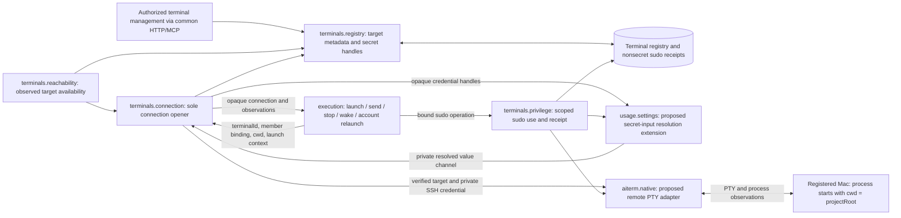
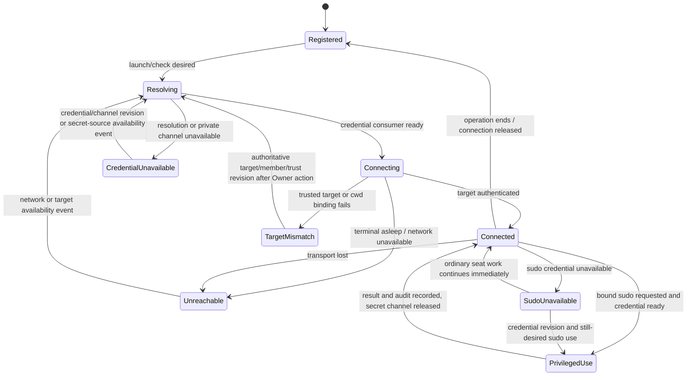
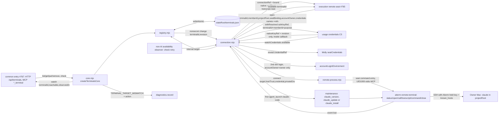

# Terminals

Owner: Crust (bot-9741b319). Assigned by the Owner on 2026-11-09 at 13:44 JST.

**P0 contracts adopted by Trony; P1 core implemented** (registry + connection + C8 maintenance, see [P1 implementation](#p1-implementation-2026-11-09)). Not yet wired: Mika's resolver, Elegg's remote native adapter and Molly's common mount; the core takes them as injected ports. The first supported path is **macOS + Claude Code**; Windows, Linux and other CLIs follow later.

Canonical connections: [module.json](module.json), [overall function map](../../feature-map.md), [overall data flow](../../data-flow.md#proposed-remote-terminal-seats-p0), [ownership rules](../../module-ownership.md). Request: Trony's `remote-seat-plan-20261109.md`, F-SEAT-HOST. This module owns terminal registration, SSH/sudo secret references, reachability and the **only entry that opens or reopens a terminal connection**. Execution owns the seat lifecycle and delivery; Aiterm owns native PTY transport. A transport carries data; it is never a relay AI seat.

## Function diagram

`uses` names existing provider envelopes, not already implemented remote methods. The secret resolver is a proposed extension under usage.settings, where submitted-secret consumption is documented today; Mika and Trony must settle its exact typed method. Elegg must settle the remote adapter under aiterm.native. Incoming dependencies from execution, UI/common entry and members are proposed below; their owners add their own `uses` as they implement the adopted contracts. Their descriptors are unchanged in this PR.

## Owned state and public projections

Proposed durable store: `<stateRoot>/terminals.json`, one terminals-owned writer, with ordinary atomic-save behavior. A failed save returns its real error and preserves the prior registry; it is never reported as successful. This is a new terminal store, not a second member registry.

| Field / state | Meaning and owner |
| --- | --- |
| `terminalId` | Stable registry key, assigned by terminals; no separate remote-seat ID scheme |
| `host`, `user`, `port`, `os` | Explicit SSH target; port 1..65535, OS initially `macos`. Host/user are structured fields, never shell fragments |
| `accountOwner` | Target account domain: product Owner or that terminal's owner; set with registration, never inferred from a host name. Other people's machines cannot receive the product Owner's Claude credentials |
| `sshKeyRef`, optional `sudoKeyRef` | Opaque handles issued by Mika's secret input. Mika retains the underlying `op://<vault id>/<item id>/<field>` or stored-value reference. Terminals never stores the resolved value or parses/resolves `op://` itself |
| Trusted SSH host identity and target revision | Nonsecret known-host identity for the registered host; target/key-reference changes invalidate cached connections. Registration/bootstrap of that identity is part of C3 below; a scan alone is not trusted identity |
| Last reachability observation | In-memory `{terminalId, observedAt, reachable, reason}`; a past success is not current readiness or CLI startup proof |
| Live connection resources | Owned by terminals; underlying remote PTY/native resources owned by Aiterm. Execution holds an opaque scoped reference, never an SSH key or a mutable registry object |
| Sudo-use receipts | `<stateRoot>/terminal-sudo.jsonl`: terminal/member/seat identity, operation correlation, requested/started/completed timestamps, outcome. No secret, stdin, environment or arbitrary command/output body. Record every use, including failure; record audit failure separately without pretending no use occurred |

General list/get projections contain target metadata, configured/missing credential indicators and reachability observations. Secret handles are only available to authorized registry/resolver consumers; no key value, raw 1Password reference, account token or transport secret appears in public JSON, screen text, transcripts, diagnostics or git. Deleting a terminal removes its metadata and closes its connections; Mika owns credential-reference disposal. Members referencing a removed terminal retain their member data and pending input; the interface reports the missing binding instead of silently selecting another target.

Members owns `terminalId` and absolute `projectRoot` on each member. Execution owns session identity, effective account slot, limits, actual turns and active-seat references. Mika owns secret source selection/resolution and reference revisions. Conversation owns saved messages/history; memory owns personal/shared memory and knowledge. Terminals writes none of those private stores.

## Proposed public interface (`provides`)

These names define P0 responsibilities, not implemented route or wire names. All calls carry the existing authenticated caller context; a JSON member/seat claim is not authority.

| Port | Input -> result | Limits and side effects |
| --- | --- | --- |
| `registry` | List/get; register/update explicit target fields and opaque key handles; remove by terminalId -> saved nonsecret target projection or real save/validation error | API/MCP first in P1; Web/Apple UI in P2. Existing member fields without terminalId keep the local path. No probing or SSH connection as a side effect of a read |
| `reachability` | `check(terminalId)` -> dated reachable/unreachable observation with a fixed nonsecret reason | Uses connection's same SSH target, trust and credential path. A successful check authenticates the target, then releases the probe resources; it does not launch Claude. Offline, asleep and unreachable are availability observations, not proof that a seat vanished |
| `connection` | `open({terminalId, memberId, projectRoot, seatBinding, accountOwner})` -> opaque target-bound connection or a classified observation/error; close/release -> actual resource outcome | Validate current target revision, SSH identity, account domain and initial cwd. Execution then supplies its native launch plan through the bound connection; Aiterm starts the process with cwd already set. A nonexistent/inaccessible directory cannot fall back to home or a later `cd`. Read/send/observe/control use that same bound channel; every reconnect re-enters this port |
| `privilege` | Bound connection + member/seat identity + requested sudo operation -> actual result and nonsecret use receipt | Resolve optional sudo key only for this use, with no approval wait. No key supplied means ordinary SSH-user execution; never silently fall back to root or another credential. Optional sudo does not gate ordinary seat launch |

`seatBinding` is execution's existing native seat/session identity and launch context, augmented with terminalId/projectRoot binding, not a new terminal-generated identity. Native handles and authorization stay opaque inside their owners. If the module runs as a child, common effects retain those resources and only typed references cross IPC; no Promise/callback/credential is serialized into a business DTO. Terminals' internal source/protocol and tests will be owned here; common mounting/controller and artifact supply remain Molly/Centi contracts, following the [work-graph precedent](../work-graph/README.md#process-placement-trony-ruling-2026-11-08). P0 does not prescribe another long-lived service or install helper.

## Data flow

| ID | From -> to | Payload and return / persistence |
| --- | --- | --- |
| T01 | Authorized app -> common entry -> terminals.registry | Explicit target + Mika-issued credential handles -> saved metadata/indicators; no secret values through registry JSON |
| T02 | App secret input -> Mika | 1Password reference first when connected; stored secret-input value remains optional fallback. Same choice applies to SSH, sudo and account login. Mika returns an opaque handle and change notification |
| T03 | Members -> execution -> terminals.connection | Member ID, terminalId, absolute projectRoot, existing seat identity, selected slot/account domain. Members supplies launch instructions directly to execution; terminals does not generate them |
| T04 | Terminals -> Mika -> private consumer | Handle + target/member/purpose context -> resolved SSH/sudo value for only the bound consumer. Mika may use server `op` or terminal-local `op` under its own contract; terminals never runs `op` |
| T05 | Terminals -> Aiterm -> registered terminal | Structured SSH target, trusted host identity and private credential channel -> authenticated connection; errors expose fixed categories, not raw secret-bearing output |
| T06 | Execution -> bound Aiterm channel -> Claude | Start with cwd = projectRoot, folder's own rules, launch-time BellTeam instructions, MCP connection/identity and selected target-owner account slot. No generated AGENTS/CLAUDE/MCP configuration writes to the user's repository or home |
| T07 | Remote seat -> LAN common MCP -> existing providers | Authenticated existing seat identity -> messages, scoped memory/knowledge and proposed member-scoped docs operations; replies return directly to that seat. No relay seat |
| T08 | Aiterm remote capture -> execution -> conversation/current-work | Terminal output/transcript and native turn references -> existing history append/current-work paths, bound to member + seat + turn + delivery where present. History persistence ACK and current-work projection remain distinct; no second terminals history writer |
| T09 | Availability observer -> execution -> existing pending delivery | Reconnection/ready event -> resume delivery of original saved IDs. Message acceptance remains durable while the machine sleeps; terminals introduces no new delivery queue |
| T10 | Seat sudo request -> terminals.privilege -> Mika/Aiterm -> receipt | Target-scoped sudo use, no approval wait -> every-use audit and actual result. Credentials use non-echoing private input and are absent from PTY capture |

Resolved values exist only during the private consumer operation, never in argv, general environment dumps, command echo, launch recipes, persistent PTY metadata or retry logs. Elegg/Mika must define a private channel that is excluded from PTY capture before credentials are injected. Drop references and close that channel after use/error/disconnect; each new connection resolves current handles again. An unclassified native error is not safe to print verbatim. Already-present SSH keys in P1 use Mika's resolved credential capability; terminals does not open an arbitrary secret file supplied in a public request.

## State and required protections

| Protection | Explicit protected asset and scope | Automatic exit; no sticky manual unlock |
| --- | --- | --- |
| Secret exposure | SSH/sudo/account values cannot enter registry, public API, transcript, logging or wrong-account target. Private resolution/transport capability required only for that credential-bearing operation | Destroy transient channel on completion/error; a valid credential/channel revision or secret-source availability event (for example, 1Password becoming reachable again) re-evaluates the still-desired connection. Ordinary app/message acceptance continues. Secret values are never used as a denial-state key |
| Wrong target | Registered SSH host/user/port, trusted host identity, member's terminal/folder and seat binding. Prevent sending input or credentials to a different target; no silent target substitution or home-directory fallback | Surface the mismatch to the Owner in plain words with a concrete corrective action that creates a target/member/trust revision (for example, confirm the new host key). That revision invalidates the old binding and automatically re-resolves a still-desired launch against the current authoritative fields; never stall silently. No blind host-key acceptance, fallback directory or persistent "unknown" lock |
| Privilege escalation | SSH identity and target-owner account boundary; only explicitly requested sudo uses the optional sudo reference. Product Owner Claude tokens never go to a non-Owner machine | Ordinary unprivileged work continues immediately. A corrected credential/account-domain revision re-evaluates the desired authorized operation; neither sudo nor an Owner approval is a prerequisite for ordinary launch |

These are narrow protections requested in the plan. Terminal absence does not reject a saved message. Existing receipt drain retains delivery intent; a non-AI connection/availability observer emits recovery and re-arms after disconnect/restart, without waking an AI on every check. A lost/ambiguous native command result is recorded and reconciled/re-applied by existing execution rules, never made a terminal lock. The observer cadence and wake mechanism belong to C2/C3; no periodic AI polling or new durable queue is proposed.

## Cross contracts adopted by Trony

| ID / owner | Required contract and concrete decision |
| --- | --- |
| C1 Belorta / members | Add terminalId/projectRoot to create/edit and registry projections; validate the absolute folder for its target OS. Keep local members compatible. Deliver common/Owner/member rules, AGENTS.local content and short-term handoff as launch context. Preserve the user's folder/home rules byte-for-byte; no generated instruction/config file there. Members owns field/instruction revisions and notices that trigger execution rebind |
| C2 Kiro / execution | Use terminals.connection for remote start/stop/wake/reconnect/control and retain seat identity/binding across observation and MCP. Start directly in projectRoot. Preserve original pending delivery while asleep; availability resumes the existing drain. Extend existing per-model 1st/2nd account selection to the **terminal owner's** account domain: fresh seat on switch, same terminal/folder, old seat retained under existing policy. No product Owner token on another person's terminal; member terminal/folder changes require a fresh bound launch |
| C3 Elegg / Aiterm | Define remote SSH/PTY adapter requests/results under native: structured target + trusted host binding, private credential injection excluded from capture, exact initial cwd, launch instructions/MCP options in memory, launch/read/send/observe/stop and connection-loss/ready events. No nested relay AI; all connection/reconnection originates in terminals. Define how first trusted SSH identity is obtained and revised without trusting an unauthenticated scan, and how terminal-local credentials/op can be consumed privately |
| C4 Molly / common + runtime | LAN-reachable authenticated MCP endpoint and launch-time configuration; bind existing full seat identity to member/terminal/folder using trusted caller context, rather than treating a supplied header as proof. Reuse existing account-seat name resolution. Remote seat receives only its ordinary member authority. Own stable facade/effect composition, controller/exchange mount and connection observation plumbing; settle the no-home/no-repo configuration channel with Elegg |
| C5 Mika / secret input | One input accepts op:// or stored value for every slot, including account login; 1Password displayed first when connected, fallback retained. Mika alone validates/resolves and owns source/handle/revision, availability notifications, private value lifetime and failure categories. Terminal consumers receive only the resolved value/capability and never its source. Resolve on server or terminal-local op as appropriate without giving terminals another secret store |
| C6 Belorta / lead; Biscuit / memory | Keep canonical Bot docs and AGENTS.local under BellTeam's existing member project, memory/knowledge in existing server stores and handoff in the existing context provider. Remote member accesses its docs through a proposed member-scoped MCP file interface (Molly mount, members file owner), memory through existing scoped memory MCP, handoff at launch. Launch context names these locations/access methods. No full home/project sync, no second remote memory DB, no instruction files in the user's repo/home. Exact docs read/write/list methods and access boundary require their owners' diagrams |
| C7 Kiro / lead; Elegg / native, N102 / conversation history, Rivalin / Throughline | Kiro coordinates Elegg, N102 and Rivalin to capture terminal-side transcript/completion/limit events at source, stream or resume-read from an existing native cursor, bind to existing seat/turn/delivery references and feed existing history writer/current-work projection. Reconnect catches up without replaying a delivered business input or duplicating history. Terminal stores no history copy. Exact cursor/ACK and handoff capture need the provider/consumer diagrams; current observer support does not prove remote transcript support |
| C8 Crust / lead; Elegg / transport; Centi / product test | Crust owns terminal maintenance through terminals.connection, with Elegg providing transport and Centi owning product testing. Terminal Claude Code must track the official latest release, without version pinning. Propose native setup/update before a fresh launch and the existing non-AI maintenance path, never replacing a running CLI. Report actual installed/update outcome; update-network failure preserves the installed executable and pending work rather than becoming a new launch guard. Define installation ownership/path preserving user CLI/config. The container's DISABLE_AUTOUPDATER convention alone cannot keep a remote CLI current |
| C9 Admi/Web, Ziz/Apple, Centi/product test | P2 registry screen and member terminal/folder plus key-reference input via Mika. C1-C5 power P1 API/MCP first: Owner Mac, no sudo, existing key. Rebuild Ziz as a remote seat after all four Owner completion conditions are met, including remote account switching. P3 validates remote slot switch, sudo every-use recording and non-Owner credential isolation, then public LAN installation/add-member test. Windows/Linux and other CLIs stay subsequent scope |

All four Owner rulings are carried above: asleep input retained; terminal owner's Claude account on non-Owner terminals; sudo available without approval wait with every use recorded; Mac + Claude first. C1-C9 are adopted P0 contracts; their remote methods remain unimplemented. This document changes no peer's ownership or existing deployment restrictions.

## Scope of verification and later acceptance

### P1 implementation (2026-11-09)

Settled peer contracts: Kiro #765 (execution remote-seat), Elegg aiterm-mcp `feat/remote-terminal-c3` remote-terminal.md f7022539 (native-held credential), Mika `feat/secret-onepassword-20261109` (native credential union), Molly #767 (in-parent mount), Belorta #768 (member terminalId/projectRoot).

| Port (`provides`) | P1 method | Result / classified failure |
| --- | --- | --- |
| mount | `createTerminalsCore({stateRoot, credentials, seatCredentials, report, seatProject?})`, exported from `src/bootstrap.mjs` | `{registry, reachability, connection, maintenance, watch, close}`; `credentials` may be null until Mika's facade lands (opens are then `CREDENTIAL_UNAVAILABLE`) |
| `registry` | `list()`, `get(id)` (null if absent), `put(input)`, `remove(id)` | Nonsecret projection with `ingressUrl`; errors `{code, status}`: `INVALID_TERMINAL` 400, `TERMINAL_NOT_FOUND` 404, `TERMINAL_EXISTS` 409, `HOST_KEY_FINGERPRINT_MISMATCH` 409, `INVALID_TERMINAL_STORE` 500 |
| `registry` | `put({..., confirmHostKey: 'SHA256:...'})` | Owner's "confirm the new host key": Aiterm's `trust-confirm` scans once and writes only on an equal fingerprint, then the new trust revision is stored. Without it, a new record binds the trust Aiterm already holds (P1 pre-enrolled known_hosts) |
| `connection` | `open({terminalId, memberId, projectRoot, seatBinding:{botId, sessionName}, accountOwner, credentials?})` | `{connectionRef, native}`; or `{code, effect:'not_started', reason?, action?}` with code `TERMINAL_UNAVAILABLE` / `CREDENTIAL_UNAVAILABLE` / `TARGET_MISMATCH` |
| `connection` | `native.callTool(name, args, {private?, timeoutMs?})`, `native.transcript.read({sessionName, cursor, maxBytes?})` | Raw MCP result of the remote Aiterm tool, identical to local. `agent_launch` must carry `cwd === projectRoot` and `session_name === seatBinding.sessionName` or it is `TARGET_MISMATCH` without reaching the terminal. `CWD_UNAVAILABLE` / `CONNECTION_LOST` from the remote pass through |
| `connection` | `close(connectionRef)`; `onAvailable(listener)` -> unsubscribe | Idempotent release; `listener({terminalId})` when the terminal is usable again |
| `reachability` | `check(terminalId)` | `{terminalId, observedAt, reachable, reason, action?}`; opens and closes the remote process, never launches |
| `maintenance` (C8) | `last(terminalId)` | `{terminalId, observedAt, before, after, outcome:'current'/'updated'/'failed'}` |
| watch | `watch(listener)` | `{terminalId, reachable, observedAt}` for Molly's surfaces |

`credentials` on `open` (Kiro): `{BELLTEAM_MCP_TOKEN: credentialRef, CLAUDE_CODE_OAUTH_TOKEN?: {harness:'claude', slot}}`. Terminals resolves them into `privateEnv` (Molly `seatCredentials.reveal`; the slot login through the existing `accountLoginEnvironment`, only when the registry `accountOwner` is `owner`). Any other name, or a login for a non-Owner terminal, is `CREDENTIAL_UNAVAILABLE` and the Owner's token is never read. Values go only to Elegg's `privateEnv` over SSH stdin.

Rules the code enforces:

- Native mapping: `HOST_TRUST_MISSING` / `HOST_TRUST_STALE` / `HOST_KEY_MISMATCH` / `HOST_KEY_FINGERPRINT_MISMATCH` -> `TARGET_MISMATCH`; `CREDENTIAL_UNUSABLE` / `CREDENTIAL_REVISION_STALE` / `AUTH_FAILED` -> `CREDENTIAL_UNAVAILABLE`; `UNREACHABLE` / `REMOTE_AITERM_*` / `CONNECTION_LOST` / anything unclassified -> `TERMINAL_UNAVAILABLE`. Only the code, Elegg's plain `action` and the host appear; raw native text is dropped. Every `TARGET_MISMATCH` at open is recorded through `report` with its action so the Owner sees it.
- Missing `hostTrust`, `accountOwner` different from the registry, or a non-absolute `projectRoot` -> `TARGET_MISMATCH` before any process starts.
- Credential and trust are Aiterm-held (UID1000). Mika's callback gives only `{nativeKeyRef, revision}` (a string value is reserved for a future key value and is refused by the P1 process adapter). Terminals keeps no copy; every open resolves again.
- `HOST_TRUST_STALE`: terminals re-reads Aiterm's status and stores the new trust revision; that registry change emits `available` and execution re-opens.
- Exits (no sticky state): a failed open for availability or credential records the terminal as wanted. Mika's `{available:true}` event for its handle, a registry change, or a successful observer `check` emits `available`. The observer is an in-process timer that runs `check` only while some wanted terminal is not yet usable (30 s, doubling to 5 min), stops on success or removal, and never wakes an AI. A `lost` event from the remote process marks the terminal wanted again.
- A registry change closes that terminal's live connections (old revision) before emitting `available`.
- C8: on the first `agent_launch` with `harness:'claude-code'` per connection, before forwarding it: `claude_version`, then `claude_update` (or the official `claude_install` when no CLI answers), then `claude_version`. The outcome is kept for `maintenance.last`. A failed update never blocks the launch, the installed CLI stays, running CLIs are untouched, and no version is pinned.

Test double for execution: `test/helpers/terminals-native-double.mjs` (`fakeConnection`, plus `fakeNative` / `fakeSecrets` for the ports terminals consumes).

#### Registry

`src/terminals/registry.mjs:createTerminalRegistry({stateRoot, onChange?})` owns `<stateRoot>/terminals.json` using the existing `writeAtomic` helper. `terminalId` is either supplied as a lowercase slug at registration (for example `owner-macbook`, matching Mika's handle context) or generated. Methods: `list()`, `get(terminalId)`, `register(record)`, `update(terminalId, patch)`, `remove(terminalId)`. An internal `target(terminalId)` returns a cloned target with credential handles to the connection core only. The public get/list/mutation return excludes handles and exposes configured indicators. Records contain terminalId, host, user, port (default22), os (`macos`), accountOwner (`owner` or `terminal-owner`), sshKeyRef (opaque UUID), optional sudoKeyRef, hostTrust (`{provider, revision}` public nonsecret trust-provider reference), and increasing revision. A missing hostTrust is a target requiring trust enrollment, not implicit trust. No arbitrary private path or raw op:// belongs in this DTO.

Register/update validate exact fields and types before saving; unknown terminal returns null on read and a classified missing error on update. No implicit target substitution. Mutations serialize, load the current store, atomically save a copied next state, then publish one nonsecret change event; save failure preserves prior state and produces no success event. Re-reading on each operation allows corrected source state to recover without a sticky initialization failure. Remove is idempotent and emits only when a record was actually removed. The connection core subscribes to authoritative registry changes to close stale resources/re-evaluate desired bindings; registry never reads secret files, probes a terminal or launches a seat.

Diagram delta: management -> registry validation -> existing atomic JSON writer -> D10 metadata -> nonsecret change -> connection invalidation. Internal target read -> connection -> Mika's private resolved callback -> native adapter. `hostTrust` is a provider reference, while actual trusted host keys/capabilities remain process-local. P1 native and secret signatures will be bound to their owners' returned contracts before their implementation.

P0 checks only descriptor/public-port references, generated function-map consistency, local links and correspondence between this diagram and the overall proposed DFD. No runtime tests, key resolution, terminal connection, sudo, account login or deployment are part of this docs PR.

Implementation must cover terminal registry round-trip and write failure; private-channel/credential redaction; trusted host and exact cwd binding; sleep/reconnect using the same pending receipt; initial folder + BellTeam rule loading; direct MCP seat identity; target-owner 1st/2nd relaunch; sudo-use receipt; and transcript/history/current-work recovery. Each owner tests only its changed boundary once; inherit peer verification. The product completion is the Owner's four conditions, followed by Ziz's rebuild, not merely successful SSH or this P0 PR.
