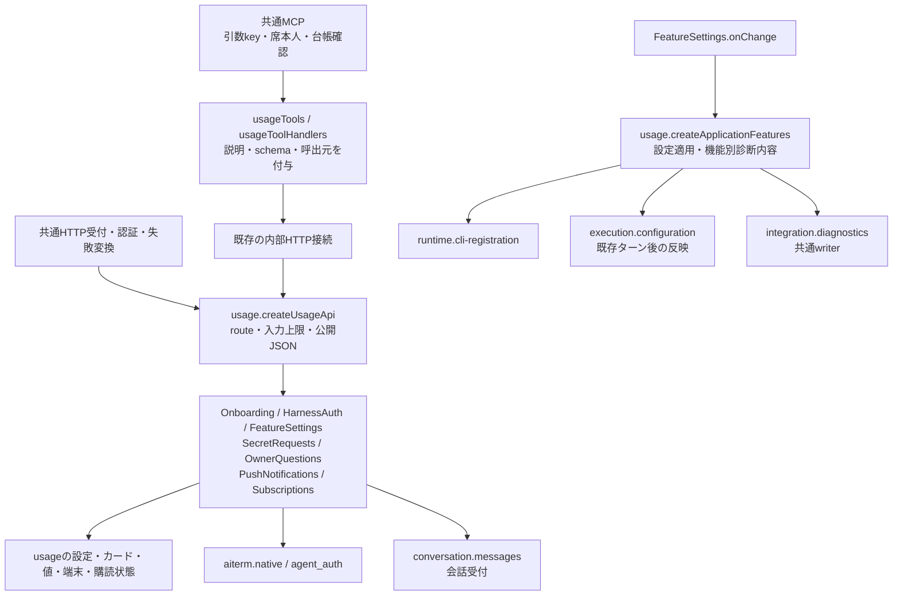

# 利用設定・通知

責任者：ミカ。

初期設定、認証案内、任意機能設定、質問/秘密入力、端末通知、購読。本体の案内と設定を持つ。

接続の正本は[module.json](module.json)。全体の[機能図](../../feature-map.md)と[担当・変更手順](../../module-ownership.md)から、呼出元と依存先を辿る。

Rabbit認証consumerの未配布候補は[認証runとOwner案内の契約](olrw-auth.md)。Rootからの固定参照注入専用で、通常HTTP/MCPの認証権限は拡張しない。

## 機能内の正本

[処理と保存順序](flows.md)に秘密入力・質問・認証・設定適用・通知/購読の図と実関数を置く。旧support-detailsの所有章は参照リンクへ置換した。共通診断writerは[統合の詳細](../../support-details.md#診断観測集約調査注記を分ける)を参照する。

## 公開入出力

| 窓口 | 入力・既caller | 出力・失敗の意味 |
| --- | --- | --- |
| auth | Web/Appleのsetup/harness-auth HTTP、席MCP complete_setup → 内部HTTP。Onboarding/HarnessAuthへ委譲 | 公開段階・auth_ui・typed失敗。内部のsetup/harness・setup/auth/inputとharness-auth変更は拒否し、setup/start・completeは維持。Aitermの本人性やvendor認証内部を所有しない |
| settings | GET/PATCH settings、get_settings/update_settings → FeatureSettings | 公開値は秘密を伏せる。内部は本人の提出済みsecretRequestIdだけ。保存後の適用失敗はFEATURE_APPLY_FAILEDで保存値と公開エラーが残る |
| notify | Messenger/RoomMessengerのdirect/roomとカード作成のsecret/question callback、notifications端末HTTP | 本文/秘密値なしの通知。通知失敗を会話保存失敗へ変換しない。端末表示完了は保証しない |
| 質問/秘密 | ask_owner/request_secret/get_secret_request/cancel_secret_requestとowner-questions/secret-requests HTTP | 作成は内部、提出/回答は公開。Bot取下げは本人のpending依頼。秘密はsubmitted + notification failedを返し、質問はanswered保存後の会話受付例外をそのまま共通HTTPエラー変換へ渡す |
| 購読 | Appleのsubscription GET/verify/refresh/setup-test | 外部検証/保存結果、期限と購読状態。動作確認はexecution.turnを使用。WebのAI利用可否を購読で止めない |

HTTP handlerは未一致の時だけfalseを返す。既存のstatus/JSON・prefix判定・method拒否・本文byte上限・秘密値のHTTPS/Content-Type/cross-site確認を保持する。共通HTTPの認証前処理、制御系の台帳refresh前の早期返却、秘密専用エラーと一般500の変換順は変更しない。

## 所有データ

| 所有者 | 正本・メモリ状態 |
| --- | --- |
| Onboarding | 通常shared/onboarding.json、seatRuntimeではstate/onboarding.json。案内段階・authSession |
| HarnessAuth | sessions/receipts Map。資格情報本体は公式CLI |
| FeatureSettings | shared/tools/bellteam-settings/settings.json、適用errorsとpending Promise |
| SecretRequests | state/secret-requests/*.json、state/secret-values/<toolId>/secrets/<id>（0600、新規作成）、busy、表示索引 |
| OwnerQuestions | state/owner-questions/*.json、busy、表示索引。通知例外でも回答済み状態は残る |
| PushNotifications | state/push-devices.json、provider/inflight/設定エラー。旧APNs設定の読取りを保持 |
| Subscriptions | 通常shared/subscription.json、seatRuntimeではstate/subscription.json。検証結果/期限/保存失敗 |

秘密値と依頼状態は単一transactionではない。値ファイル作成後の状態保存失敗は「値が無い」と判断しない。保存先・永続形式・再送方針は今回変更しない。

## 他担当との境界

台帳はmembers.registry、会話受付とroom資格の正本はconversation、設定登録の機構はruntime.cli-registration、席の設定適用と動作確認はexecution.configuration/turn、公式認証はaiterm.nativeを使用する。機能別の診断内容をusageからintegration.diagnosticsへ渡し、共通writerは変更しない。module.jsonに既存の診断・実行依存を追加したのは、従来コードが既に使っていた接点の記載漏れを補うため。

Webはアドミ、Apple画面はベル、native認証はエレグ。usage内部の修理でこれらの内部データ/実装を書き換えない。公開契約の変更時は両担当と入出力を合わせる。

## 実装・caller・検証範囲

- src/usage/http-api.mjsが担当HTTP、src/usage/application-features.mjsが設定適用、src/usage/mcp-tools.mjsが担当説明/schema/dispatchを所有する。module.jsonの既serviceもusage所有のまま。
- 共有http-application-api.mjsはusage handlerの接続、application-features.mjsは互換export、mcp-tools.mjsは公開登録/呼出だけ。直接callerはhttp-server.mjs、application-runtime.mjs、seat-mcp.mjs。application-services.mjsは同一serviceの生成とcallback接続を持つ。
- HTTP/MCP内部のusage機能変更は上記所有sourceと担当試験で更新できる。初回共有差分はトロニーが統合する。共通HTTPエラー変換/診断writerと他機能の移管は今回の分離範囲に含めない。
- 限定検証はusage-module、onboarding-http、auth-flow、harness-auth、secret-requests、owner-questions、feature-settings、push-notifications、subscriptions、application-runtime、http-feature-routing、mcp-tools、seat-mcp。外部の実認証/APNs/購入、本番/一般配布の反映は行わない。
- fixture・設定形式・既export・HTTP/MCPの公開payloadは不変。新試験は公開module経由で保存成功と通知/適用失敗、後続の明示操作と独立利用を確認する。図は所有位置と実関数の接続を更新し、状態遷移は保持した。

2026-11-02の分離差分で上記14ファイルの120試験が全件成功した。基準341535dとの比較で公開MCP定義全体・HTTP処理本文・設定適用本文の同一性を確認。20moduleから全体図を再生成し、担当図と旧索引のローカル29リンクを確認した。本番/一般配布は保留のまま。
