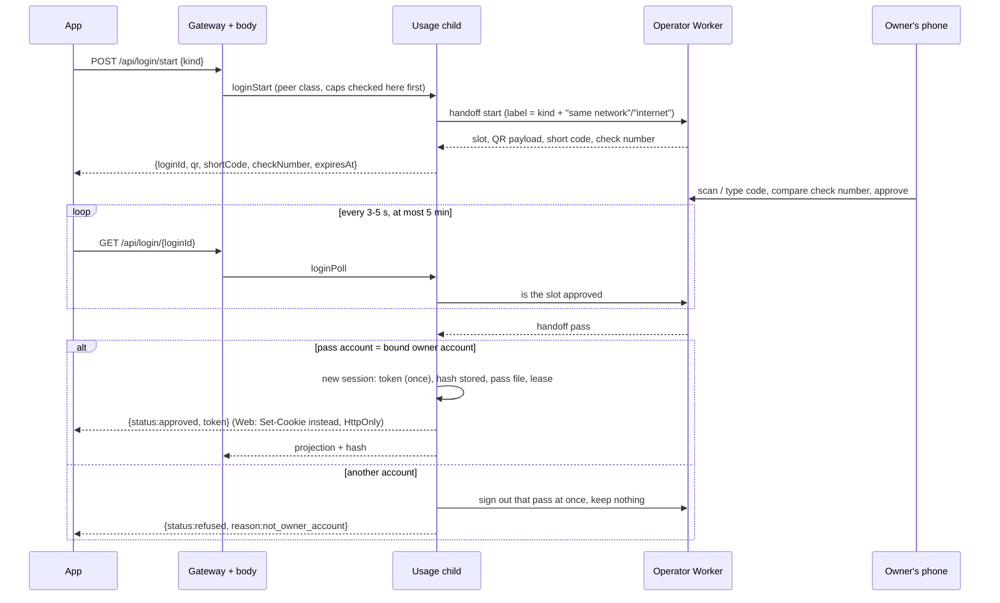

# App sessions on the user's server (shape 2) — DRAFT for review

2026-11-21 JST, Mika (task a484-shape2-session-read). Status: design read against `main ed3d78fe`; nothing is built. Counterpart: Mint's `login-billing/rulings/bellteam.md` section 3 (the server is a phone-logged-in device; an app with no session gets a QR/short code from the server; the owner approves on the phone; the server keeps the pass and gives the app its own session). Owner decision D1 = B (2026-11-21 21:41 JST): built and released with the contract check. Today's trust: [usage flows](flows.md) (`authMode`, Owner判定 SEC-049; no session exists) and the client-by-client table in Mika's a483 facts page.

## 1. Function split (who does what)

| Role | Holds | Does |
| --- | --- | --- |
| App (Web, iPhone/Mac, Windows, Linux, Android) | server address + one opaque **session token** (256-bit random). Never a pass | shows the code/QR the server gives, polls, keeps the token, sends it on every request |
| Public gateway (`http-gateway.mjs`, own process) | nothing | names the TCP peer; today authorizes static files through `/api/session`; **new:** serves static files with no session (public code, no data) |
| Body public server (`authorize` in `application-features.mjs`) | projection of valid sessions: set of `sha256(token)` with state | hot path, no network: token → hash → in the set → Owner; else 401 |
| Usage child (sole writer) | `owner.json` (owner account id), `app-sessions.json` (id, token hash, kind, label, created, lastUsed, leaseUntil, state), one pass file per session (0600, atomic replace), pending logins (memory) | login start/poll/cancel, binds the owner, issues/ends sessions, asks the Worker per session on a lease, publishes the projection |
| Operator Worker | handoff slots, refused pass ids | as Mint's section 3; never talks to apps |
| Internal listener (seats) | unchanged | unchanged (Bots are not app sessions) |

## 2. Login (data flow)

## 3. Session state

```mermaid
stateDiagram-v2
  [*] --> active: approved by the owner's account
  active --> active: use (lastUsed); lease ask OK (background, at most every 10 min per session)
  active --> ended: app logout (server signs the pass out)
  active --> ended: pass_refused / pass_expired on a lease ask (phone stop, stop all others, 14 days)
  active --> ended: 14 days without use (server clock)
  active --> active: operator unreachable: last answer holds
  ended --> [*]: record and pass file deleted; token hash leaves the projection; open SSE of that session closed
```

## 4. Answers to the five asks

| Ask | Design |
| --- | --- |
| What the app holds | server address + session token. Not a pass, never talks to the operator |
| Where | Apple: Keychain (shared access group for the share extension; replaces the `CF_Authorization` cookie item). Windows: DPAPI-protected file in `%LOCALAPPDATA%\BellTeam`. Android: Keystore-backed encrypted preferences. Linux: libsecret, else 0600 file in `~/.local/share/BellTeam`. Web: cookie `bellteam_session`, HttpOnly, SameSite=Strict, Secure on https; the page never sees the token. Native sends `Authorization: Bearer`; the server accepts both carriers. The CF cookie copy code (`AccessCookies`, WKWebView/WebView2/CookieManager login sheets) goes away |
| How it ends | section 3. A stop from the phone reaches the server at the next lease ask (at most 10 minutes), not instantly |
| What a request with no session may do | `GET /healthz`; `GET /api/session` (`{authenticated:false, login:'session', …}`); `POST /api/login/start`, `GET /api/login/{id}`, `POST /api/login/{id}/cancel`; static files. Everything else 401 (including `/api/updates`, which answers 403 today). Caps before any Worker call: at most 4 pending logins in total, one start per peer per 10 s, bodies ≤ 1 KB, poll ≤ 1 per 2 s per login, unknown ids 404 |
| Owner binding at first login | the first successful handoff of the server binds its account id to `owner.json`; a later pass of another account is refused and signed out at once. Reset only from the host console (section 5, items 1-2) |
| One pass per session, asked on use | one `createWebClient` + pass file per session. "On use" = a background lease: a request after `leaseUntil` is served on the last answer and triggers one ask; an open SSE counts as use and renews by timer. The ask is never inside a request |

## 5. What does not hold in section 3 as written (sent to Mint and Tronie)

1. **Standalone and offline.** Login depends on the operator, so the open server image (Mint section 1: works free with no operator; Owner rule products.standalone), a LAN server without internet, developer-mode servers (D3) and host-side callers that rely on local trust (`src/usage/submitted-secret-rabbit-client.mjs` posts the owner API from the host at `127.0.0.9:18891`) cannot log in. Needs an operator-free approver: a **console-issued session** (host root runs a command that prints a one-time code or writes a token file). It is the same session record with another approver; no library part.
2. **Trust on first use.** The server's own first login needs a screen with no session. `distribution/server/compose.yaml` publishes `0.0.0.0:18891` by default, so the first stranger to start the handoff would bind the server to their account (also on an updated server that has no owner yet). Fix: the first binding requires a setup code printed to the server's console/log and kept hashed.
3. **"Asks the Worker when the session is used"** cannot be per request (tens per page, SSE). It is a per-session background lease (10 minutes, matching the Worker's cache). The cost: a phone stop takes up to 10 minutes. Offline: Mint says the last answer holds without bound; I would keep that, ended by the 14-day idle rule.
4. **Local trust has to leave the public listener entirely, not only "when not local".** The owner test uses the gateway's `x-bellteam-peer`, and with Docker's published port the peer can be the bridge gateway (a private address), so an outside client may look local. A session is required for every request on the public listener, including loopback and `docker exec`. Seats keep the internal listener. Callers of the public port as local owner (item 1) move to console sessions.
5. **Release order can lock the Owner out.** A body that requires sessions with an old usage child has nothing that issues them. The body enforces only when the usage child declares the capability (ready/`stateCompatibility`), a durable "enforced" marker is written at first enforcement, and the body never fails open after it. Apps ship first and probe `/api/session` for `login:'session'`; an old app on a new server shows the Access sheet, which cannot help.
6. **Cloudflare precedence.** When Access stays on, its JWT is no longer an owner proof; the session is required in addition. `authMode:'cloudflare'` stops meaning "log in with Access". `cloudflare.publicUrl` stays only for the Web Push origin.
7. **Plain HTTP on the LAN** is the main install path (`http://ip:18891`): the token travels in clear text and the cookie cannot be Secure. It protects against a stranger, not against a sniffer on the same LAN; DNS rebinding and a hostile web page are closed (they carry no token). Worth saying to the Owner, whose motive is leak security.
8. **The unauthenticated login start is an amplifier** toward the Worker and a slot-exhaustion lever. The caps in section 4 are the server's job; Mint's per-caller limit at the Worker (5c) still sees one caller, the server.
9. **The approval label must be server-made.** A client-chosen label would let a stranger's request look like "Windows app". The label is an enumerated kind plus "same network" or "internet" (no address is sent to the operator); the full address stays in the server's own log.
10. **Pass files are readable by seats** (they can sudo; accepted by the Owner 2026-11-15 for owner access). A leaked pass can only do what a handoff pass can (ask entitlement, push relay), so 0600 is not a boundary against seats. Say it, do not hide it.

## 6. Order of work (diagram first, then code)

1. This page and `flows.md` accepted; Mint's contract note on items 1-2 and 5.
2. Body: tolerant projection row + `authorize` by token hash behind the capability gate; gateway static without session. Apps: session screen with legacy probe. Usage child: session store, login endpoints, lease. Enforcement last.
3. Independent security review (Maxwell) of this page before step 2 starts.
