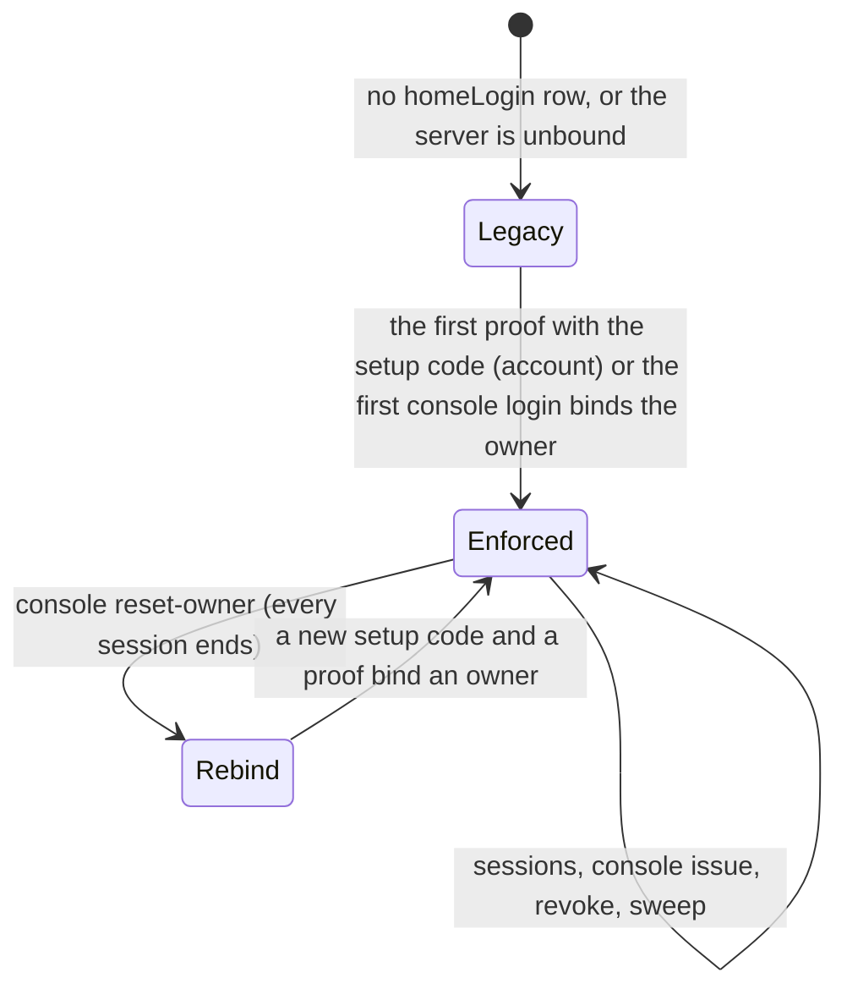
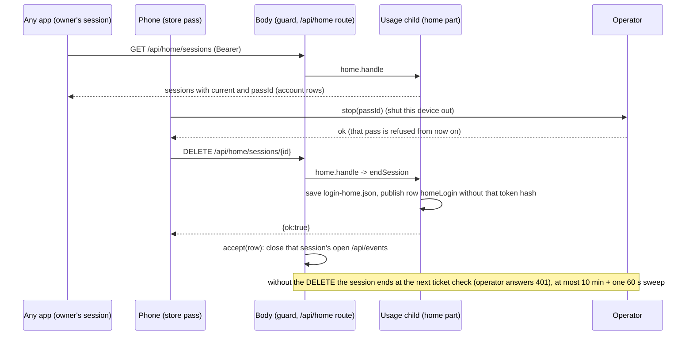
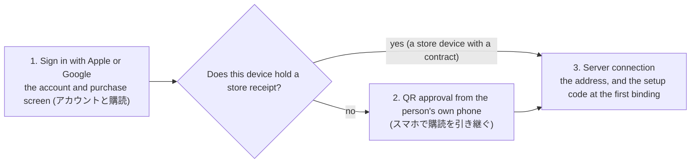

# App sessions on the user's server — the login-billing home part mounted (reading 3)

2026-11-22 JST, Mika (a485-lb-server). Status: **replaces the earlier draft** (login start/poll, second hand, network class, web cookie, Origin rule, lease, "add an app"; PR #2206 history keeps it). Under the Owner's reading 3 every device signs in itself with Apple or Google, the browser version is abolished (main #2239), and the mechanism is the library's **home part** (login-billing 0.18.8, accepted by Mint 2026-11-23 (it replaces 0.18.5; contracts 1.28-1.30, selfhosted-form 1.0.3); `docs/home-wire-v1.md` in that repo). BellTeam mounts it; it does not re-implement it. Section 7d–7f (first-run order, who may use BellTeam, wording) are unchanged and current.

## 1. Function split (who does what)

| Role | Holds | Does |
| --- | --- | --- |
| App (iPhone/Mac, Windows, Linux, Android) | server address + one opaque session token, kept through the library's `HomeConnection` (audience = the origin it connects to) | `GET /api/home/session` probe, signs in at the operator (Apple/Google), `login/nonce` then `login/prove` (with the setup code at the first binding), re-proves every 7 days, sends `Authorization: Bearer`, ends its own session with `DELETE sessions/{id}`. Never holds a pass of the server, never talks to the operator through the server |
| Public gateway (`http-gateway.mjs`) | nothing | names the TCP peer (`x-bellteam-peer`), forwards `authorization` and the peer; unchanged |
| Body public server (`http-server.mjs`, `application-features.mjs` `authorize`) | projection row `homeLogin` (set of `sha256(token)`, `bound`, `enforced`, per-session entitlement state), durable marker `state/login-enforced` | **Legacy**: today's path. **Enforced**: the vendored stateless `guard` on `Authorization: Bearer`, no network, no storage. Routes `/api/home/*` to the usage child. Drives the sweep timer, prints the setup code, hosts the console socket |
| Usage child (sole writer) | the library home part and its one document `shared/login-home.json` (0600, atomic): owner (account key or `console`), enforced, registered addresses, nonce secret, sessions (token hash, ticket, entitlements, last use) | `home.handle` (the wire), `home.sweep` (ticket checks every 10 min for a session in use, 14-day idle end), `home.setupCode`, `home.console`; publishes the `homeLogin` row after every change |
| Console (`bellteam-console`, run by the host user with `docker exec`) | nothing | `setup-code`, `issue` (a one-time code), `list`, `revoke <id>`, `reset-owner`, `addresses` (list / add / remove). A unix socket hosted by the body; each command is one `home.console` call. Never HTTP. The only operator-free way in; every server has it |
| Operator Worker | accounts, passes, tickets | `prove/take` and `ticket/check`, called by the home part only, anonymously, never following a redirect (Bready) |
| Internal listener (seats) | unchanged | unchanged (Bots are not app sessions) |

## 2. Login (data flow)

```mermaid
sequenceDiagram
  participant App
  participant B as Body (public server)
  participant U as Usage child (home part)
  participant W as Operator Worker
  participant H as Host user (console)
  Note over B,U: unbound: the body asks home.setupCode and prints it to its own stderr (docker logs); again when the last one is older than 9 min
  H->>App: reads the setup code from the server console (first binding only)
  App->>B: POST /api/home/login/nonce
  B->>U: home.handle (path, bearer header, body, peer)
  U-->>App: {nonce} (stateless, 120 s)
  App->>W: sign in with Apple/Google, ProveStart(audience, nonce, ticketFor)
  W-->>App: proof code
  App->>B: POST /api/home/login/prove {code, audience, nonce, kind, setupCode?, ticketFor}
  B->>U: home.handle
  U->>W: prove/take (anonymous, audience = the address the app used)
  W-->>U: {k, passId, ticket, entitlements}
  alt unbound server and right setup code
    U->>U: register audience, bind owner = account k, enforced = true
  else bound and k is the owner
    U->>U: new session
  else another account
    U-->>App: 403 NOT_OWNER_ACCOUNT
  end
  U->>U: save login-home.json, publish row homeLogin
  U-->>App: {token (once), sessionId, state, entitlements}
```

A request after login: the app sends `Authorization: Bearer <token>`; in Enforced the body's guard maps `sha256(token)` to a session in the published set (no call to the child). Anything else is 401. The console path: `bellteam-console issue` prints a code, `POST /api/home/login/console {code}` returns a console session (no pass, no operator); on an unbound server it binds `console` as the owner.

### 2a. Server login mode



`Legacy` is today's path unchanged (local mode or Cloudflare Access); it is left only by the binding, the owner's own act. The body writes `state/login-enforced` the first time the row says `enforced:true` and never removes it, so a restart, a usage rollback or a reset never returns to Legacy. A body that finds the marker but no usable row (a usage child without the part, not yet loaded, or down) answers **503 `SESSION_STORE_UNAVAILABLE`** and never opens; apps keep their tokens (only a definite 401 deletes one). In `Rebind` every request but the `/api/home/login/*` ones is 401. In Enforced a Cloudflare Access JWT is no longer an owner proof; Access may stay in front as a network gate. `cloudflare.publicUrl` is unchanged for the other features.

## 3. Session state

A session admits an app and decides nothing about the contract: the gate is `subscription.entitlementState` (7e), which in Enforced is the **session's own** state from the home part (`active` | `none` | `unknown`; a console session is `none`; "cannot judge" keeps the last answer, `cannotJudgeMs: 'no limit'`, the Owner's ruling) overlaid by the body from the row, never taken from the request.

```mermaid
stateDiagram-v2
  [*] --> active: proof accepted (owner's account)
  active --> active: use (sweep: used/streaming); ticket check ok (at most every 10 min per session in use)
  active --> ended: DELETE sessions/{own id} (sign-out)
  active --> ended: ticket check answers 401 (that device stopped, stop-all-others, past its 14 days)
  active --> ended: 14 days without use (server clock)
  active --> active: operator not reachable: the last answer holds, never turned into none by an outage
  ended --> [*]: record deleted; token hash leaves the set; the body closes that session's open /api/events
```



## 4. Public surface and answers

| Ask | Design |
| --- | --- |
| What the app holds | server address + session token (Apple Keychain, Windows DPAPI file, Android Keystore-backed preferences, Linux 0600 file / libsecret later) |
| What a request with no session may do | `GET /healthz`; `GET /api/session` (unchanged: `{authenticated, authMode}`); `GET /api/home/session` (probe: `{capability: "login-billing-home/1", bound, enforced, session?}`); `POST /api/home/login/nonce`, `/login/prove`, `/login/console`. In Legacy everything else is today's path; in Enforced it is 401. An old server answers 404 to `/api/home/session`: the app then uses today's path |
| What a request with a session may add | `POST /api/home/session/prove` (re-prove, never capped), `GET /api/home/sessions`, `DELETE /api/home/sessions/{id}`, `GET/POST /api/home/addresses` (an owner's account session may add the address it is connected through; a console session any), `DELETE /api/home/addresses` (console) |
| Caps | the library's per-peer limits (nonce 30, prove 10 when the operator would be asked, console 10 per minute) and a 16 KB body. Behind one proxy every stranger shares the owner's peer; the proof is checked cheaply before it counts, and a re-prove is never capped (SEC-070 shape; open question for Mint/Airi whether `limits.prove` should be higher) |
| Owner binding | only with the setup code (printed by the body to the container log), or by the first console login. A right setup code is **spent by the first proof that presents it**, whatever the operator then answers; a proof that did not bind answers with the event `setup.needed`, and the body prints a new code at once. Reset only from the host console (`reset-owner`, then a new setup code) |
| Pass | none on the server: no pass file, no Worker secret. The Worker is asked only through `prove/take` and `ticket/check` with the ticket the proof returned |
| Events | none added: the second hand, requests and "add an app" are gone, and no app names an event it needs. A session that ends closes its own open `/api/events` |

### 4a. The device list and the stop — one API for every client (a529m, Mint ruling 2026-11-23, selfhosted-form 1.0.3)

The list of every device in the user's server is the home part's **sessions**: one row per device login ("every device, one by one"). The phone's list 承認した端末 is only that phone's own approvals and is not this list. No new route: the three operations below are the library wire already mounted under `/api/home`; the client libraries (`HomeConnection`) need no change. This section is the contract the four platform screens (Windows, Android, Linux, Apple) build on.

**Function diagram**

| Operation (user's words) | Route (Bearer = any session, account or console) | Answer | Effect and time |
| --- | --- | --- | --- |
| Show every device | `GET /api/home/sessions` | `{sessions:[{id, kind, appKind, passId?, state, created, lastUse, current}]}` | Read only. `kind` is `account` or `console`; `appKind` is what the app sent as `kind` when it signed in (`apple`, `windows`, `linux`, `android`); `passId` only on an `account` row (never on a console row, and absent on a row saved before library 0.18.5); `state` is `active`, `none` or `unknown` (the session's entitlement word, 7e); `created`/`lastUse` are ISO times; `current` is true on the caller's own row. No name, address, token, K or ticket |
| End here, now | `DELETE /api/home/sessions/{id}` (any listed id; the caller's own id is the sign-out) | `200 {ok:true}`; `404 SESSION_NOT_FOUND` when it is already gone | That session ends **at once**: its token hash leaves the published set (the guard answers 401 for it from the next request), and the body closes its open `/api/events`. The device is not shut out: it can sign in again while its pass lives |
| Shut this device out | the caller (a store device of the owner, e.g. the phone) calls the library `stop(passId)` with the row's `passId`, **then** `DELETE /api/home/sessions/{id}` | `stop` answers at the operator; the DELETE as above | `stop(passId)` makes the operator refuse that login's pass, so the device cannot sign in again and its session would also end at the next ticket check (at most 10 minutes per session, inside the 60 s sweep: observed 6 min 30 s on the 2026-11-23 run); the DELETE makes the stop felt at once. A console row has no `passId`: it can only be ended |
| An app that is stopped or signs out | `DELETE /api/home/sessions/{own id}` | as above | The app calls it itself (the library `endHomeSession()`); 2xx, 401 and 404 delete the app's record, any other failure keeps it for a retry |

Who may do what: any session of the owner's account may list and end any listed session (the owner's own devices); a console session may too. A request with no valid session is `401 UNAUTHORIZED` (the app keeps nothing but may delete its token), a server that cannot judge answers `503 SESSION_STORE_UNAVAILABLE` and the app keeps its token. `LOGIN_RATE_LIMITED`, `FORBIDDEN` and the rest of the wire's error table stay as in section 5.

**Data flow**



**State of one listed session** (extends section 3)

```mermaid
stateDiagram-v2
  [*] --> listed: proof accepted (a row with passId)
  listed --> ended: DELETE sessions/{id} (end here, now; the app's own stop or sign-out)
  listed --> ended: the operator refused its pass (stop passId), seen at the next ticket check (at most 10 min + one sweep)
  listed --> ended: 14 days without use
  ended --> [*]: the row leaves the list; a later DELETE of the id answers 404 SESSION_NOT_FOUND
```

The self-exit of every wait here is time: a session whose pass was refused leaves by itself at the next ticket check, and the DELETE only shortens it. Nothing in this API needs a body or usage release beyond library 0.18.5 itself; the platform screens only call the routes above.

## 5. Wire (library wire v1 mounted under `/api/home`)

Paths, bodies, answers and error codes are exactly `docs/home-wire-v1.md` of the library (the single source; not copied here): `GET session`, `POST login/nonce`, `POST login/prove`, `POST login/console`, `POST session/prove`, `GET sessions`, `DELETE sessions/{id}`, `GET|POST|DELETE addresses`. App kinds the server accepts: `apple`, `windows`, `linux`, `android`. Errors are `{error: CODE}`: `LOGIN_INPUT_INVALID` 400, `NONCE_INVALID` 400, `UNAUTHORIZED` 401, `AUDIENCE_UNKNOWN` 403, `SETUP_CODE_REQUIRED` 403, `LOGIN_CODE_INVALID` 403, `PROOF_REFUSED` 403, `NOT_OWNER_ACCOUNT` 403, `FORBIDDEN` 403 (a valid session refused an action: the app keeps its token), `SESSION_NOT_FOUND` 404, `LOGIN_RATE_LIMITED` 429, `LOGIN_OPERATOR_UNREACHABLE` 503, `SESSION_STORE_UNAVAILABLE` 503. "Cannot judge" is 503, never 401: only a definite 401 deletes the stored token. The app's audience is the origin of the address it connects to; the server never takes its own address from a request, and an address not in the list (an unbound server registers the first with the right setup code) is `AUDIENCE_UNKNOWN`.

## 6. Order of work and release

1. This page, `flows.md`, `README.md`, `module.json`, `data-flow.md` and `business-artifacts.md` (same diff as the code).
2. Body first, tolerant (a reader before the writer): the `homeLogin` row (optional, an old child publishes none and stays Legacy), the guard, the marker, `/api/home/*`, the `entitlementState` overlay, the sweep timer, the setup-code print, the console socket. Then the usage child (the part, its methods, the row). Then the console script and the image.
3. Release order: apps first (they probe `/api/home/session`), body, usage. Enforcement only by the owner's first binding, never by a flag. The vendored library files are the accepted release `0.18.8` (`login-billing-home-0.18.8.mjs` sha256 `2f60b1b44e508b136065a5257ee3d0df393e6eef0ba84072e7e9cf8b4837bee9`, `login-billing-home-guard-0.18.8.mjs` sha256 `9dead298a5be6c8b233b2954a6eeb9e0ccb5310c8701b8c3a7727cd320f443ed`); against `0.18.5` (which added `passId` to the session list, 4a) they differ only by the version line in the header: the server part has no change (0.18.6-0.18.8 are client parts and contracts 1.29/1.30).
4. Push tickets (a485-push-tickets): `ticketFor` = lowercase hex SHA-256 of the device token. The device records do **not** keep the ticket. The usage child reads `{ticketFor: ticket}` of its account sessions (`home.pushTickets`); the body sends that map whole to the notifications child (`tickets` on the IPC, optional) after every proof and on every 60 s tick; the child holds it in memory and joins it with a device by `sha256(token)` at send time. A device with a ticket is sent with it (APNs `{ticket, device, payload, id}`, FCM `proof:{ticket}`); a device without one keeps today's shape (`signedTransaction` / `proof`), so an older relay or a not-yet-bound server is unchanged. A rotation (re-prove) or an ended session changes the map at the next push; an older notifications child refuses the method and keeps the old shape.
5. Host callers: none. The rabbit secret client that used a console session token was retired with the submitted-secret consumer (a508); `bellteam-console` stays the host's own tool.

## 7. (Superseded) Earlier wire of sections 7a–7c

The login start/poll, second hand, requests, `deny`, "add an app" code and the session list of the earlier draft are not built; section 5 is the wire. Only 7d–7f below remain current.

### 7d. Which task covers which screen

Each app row builds, on this section: the sign-in screens of 7f (probe, sign-in, wait, setup-code field, QR handoff; no console-code field in an official app), the setup-code binding screen (a setup code goes with `start`; it is shown on the server console, not in an app), the requests screen (approve / deny), "add an app" (code display) and the session list with revoke. Token storage is the app's: Windows DPAPI file, Linux 0600 file (libsecret later), Android Keystore-backed preferences, Apple Keychain (shared access group), Web the cookie.

**First-run order, the same on every app (Tronie's ruling, 2026-11-22).** The first screen of an app is sign-in and the account, never the server address. Neon found that the Android release app showed アカウントと購読 only after a server was connected, so a person with only an Android phone could never buy. The order is:



1. **Sign-in and the account screen.** Apple or Google sign-in (7f), then アカウントと購読 where the person can buy or see 購読中です。 No server is needed for this step.
2. **QR approval**, only when the device has no store receipt: the handoff block of 7f; the person's own phone approves.
3. **Server connection**, last: the address of the person's own server and, at the first binding only, the setup code (printed on the server console). The step is entered from the account screen by one button, **サーバーにつなぐ**, shown once a contract exists (購読中です。); every app labels it with that word.

An app with no server saved therefore opens on step 1 (or on the paywall of 7e when the server says `none`), not on the server address screen; the account screen is reachable before and after a server is connected.

### 7e. Who may use BellTeam without paying (Owner decision 2026-11-22 00:3x JST, via Tronie; one wording for every app)

**The browser version is abolished. Official BellTeam is the native apps only (iPhone, iPad, Mac, Windows, Linux, Android), and all of them are paid. Free use means building the open-source code yourself.** (This replaces the earlier line "the free way is the Web version", Owner fact via Mint 2026-11-21, which is withdrawn.)

**The gate is the server's own entitlement, shown by each native app** (Tronie's ruling, unchanged): after login every native app reads `GET /api/subscription` → `subscription.entitlementState` (`active` | `none` | `unknown`; the field is optional, an older server has none). Only on `none` does the app show the paywall instead of the app; on `active`, `unknown` or no field it shows the app. `none` is set once the server holds its own pass and the operator says there is no contract (the library mount); a console-bound server with no pass is `none`. There is no per-app purchase gate on Windows or Linux, Android does not need Play Billing back for gating (it buys only when it is a store device, which feeds the same server pass), and no trustworthy `kind` is needed. Accepted limit: a modified client could skip its own gate; the data is the user's own and the operator-side paid features (the push relay) stay gated by the server's pass. A build of the open-source code is not an official app and carries no gate of the foundation's making.

**Official apps have no console-code entry** (Tronie's ruling, 2026-11-22). The only path into an official app is Apple or Google sign-in, then the phone's QR approval when the device has no store receipt, then the setup code at the first binding. Console-issued sessions stay a server feature, for host-local tools (for example the rabbit secret client) and for clients people build from the published source; no official app shows a field for them, and the "add an app" code and screen are not in an official app either. The paywall below is the only text of this section that a person without a contract sees besides the login screens of 7f.

### 7f. One wording table for the login screens (Mika owns it; every app uses these sentences)

Under reading 3 (design-reading3.md draft 0.2 sections 2 to 4) every device signs in itself, so the screens are: the sign-in entry, the wait for the browser, "return not received", the account refusal, the setup-code field, the handoff QR for a device with no store receipt, the phone's approval, the paywall, and the errors. The sentences for the sign-in and the QR screens are Anis's proposal (2026-11-22), adopted as written; the phone's own approval texts, the paywall and the server errors are Mika's. Until Mint's contract is fixed nothing here is final; the screens that fall away (the requests approve/deny, "add an app", the console-code entry, the session list built on section 7c) have no sentence and are not in an official app.

| Screen | Text (Japanese, as shown) |
| --- | --- |
| Sign-in entry, title | BellTeamにサインイン |
| Sign-in entry, buttons (only what the device can use) | Appleでサインイン / Googleでサインイン |
| Sign-in entry, note under the buttons. **Windows and Linux only** (system-browser sign-in). Android (Credential Manager sheet) and Apple (native Sign in with Apple sheet) show no note; a cross-provider sign-in on a phone that does open the browser is not offered a note until Tronie says | ブラウザーが開きます。サインインが終わると、このアプリに戻ります。 |
| Waiting for the browser (button: やめる). Only where the system browser was opened (Windows, Linux) | ブラウザーでサインインしています… |
| Return not received | サインインの結果がこのアプリに届きませんでした。このパソコン自身のブラウザーで、もう一度サインインしてください。 |
| Account is not the server owner | このサーバーの持ち主のアカウントではないため、ログインできませんでした。 |
| Setup-code field (only at the first binding of an unbound server), label | セットアップコード |
| Setup-code field, hint | このサーバーのコンソールに出ているコードを入れてください。最初の1回だけ使います。 |
| Handoff QR (device with no store receipt), title | スマホで購読を引き継ぐ |
| Handoff QR, lead | 購読しているスマホのBellTeamで、このQRを読み取ってください。読み取れない時は、下のコードを入れてください。 |
| Handoff QR, labels | コード / 確認番号 |
| Handoff QR, check line | スマホに出る確認番号が同じか、見比べてください。 |
| Handoff QR, waiting | スマホの承認を待っています… |
| Handoff, already entitled (never a failure) | すでに使えます。 |
| Phone's approval screen | この端末にあなたの契約を渡します。確認番号が、相手の端末の画面と同じときだけ承認してください。 |
| Phone's approval, no live contract | 先に購読してください。 |
| Phone's approval, other account | このコードは、別のアカウントのものです。 |
| Paywall, instead of the app, when `entitlementState` is `none` (buttons: 再確認 / 接続先を変更) | このアプリは購読が必要です。無料で使うには、公開されているソースコードから自分でビルドしたものを使ってください。 |
| Account and subscription page (every app that has one; Neon's words, ruled 2026-11-22): title | アカウントと購読 |
| Account page, badge and state sentence (the Mac wording) | 有効 / 未設定 ・ 購読中です。 / 購読していません。 |
| Account page, signed out | サインインしていません。 |
| Account page, sign-in button (only what the device can use) | Appleでサインイン / Googleでサインイン |
| Account page, the account row | Appleでサインイン中 / Googleでサインイン中 / ブラウザーでサインイン中（ブラウザーでサインインした端末） |
| Account page, a web-signed device with no contract: why it cannot buy (replaces 「この端末では購入できません。」) | ブラウザーでサインインした端末では、ここで購入できません。購読しているスマホから引き継いでください。 |
| Account page, buy button (Tronie's ruling: the period comes with the price, both from the store's offer, never hard-coded; the price is the paid phase of the offer, so a free trial never shows ¥0) | 購入（{期間}{価格}） e.g. 購入（月額¥980）. Period: 1か月 = 月額, 1年 = 年額, 1週 = 週額, 3か月・6か月 = 3か月ごと・6か月ごと; an unknown period shows the price alone |
| Account page, start the handoff / cancel / after cancelling | スマホで引き継ぐ / やめる / 引き継ぎをやめました。 |
| Account page, a purchase of another account | 別のアカウントで購入したものがあります。このアカウントでは購読になりません。 |
| Account page, buttons | 再確認 / ほかの端末をすべて止める / サインアウト |
| Stop all others, the reason (with the provider of this device) | このアカウントでログインしている、ほかのすべての端末を止めます。この端末は使い続けられます。{Apple / Google}でもう一度サインインします。 |
| Stop all others, the confirm buttons (not 「やめる」: it sounds like 「止める」) | 止める / キャンセル |
| Account page, subscription connection not set | 購読の接続先がまだ決まっていません。 |
| Account page, errors | この商品はまだ読み込めていません。もう一度お試しください。 / サインインし直してください。 / うまくいきませんでした（コード） |
| Account page, the button to the server step (shown once a contract exists; the first-run order of 7d) | サーバーにつなぐ |
| Server address not registered | このサーバーは、この接続先を登録していません。サーバーのコンソールで追加するか、すでに入っているアプリから「いまの接続先を追加」してください。 |
| Server not ready (cannot judge) | サーバーの準備中です。 |

## 8. What the mount is made of (facts the code follows)

1. **Vendored, no npm.** The usage artifact is a closed inventory with Node built-ins only. The library's one-file ESM bundle (`home.mjs`) is stored as `src/usage/vendor/login-billing-home.mjs` and the guard (`home-guard.mjs`, 697 bytes) as `src/vendor/login-billing-home-guard.mjs` (the body runs it too), each with its release, version and sha256 in the header comment, both listed in `BUSINESS_FILES['usage']` (the guard also ships with the body image).
2. **No new `ready` key, no new state-compatibility value.** The capability is the presence of the `homeLogin` projection row. `login-home.json` is a new optional file; a rolled-back usage never reads it, and the body's marker keeps the server from opening.
3. **The child has no timer and no stderr to the log.** The sweep, the setup-code print and the console are body-driven system calls (`home.sweep`, `home.setupCode`, `home.console`); the child's answer carries the code, the body prints it.
4. **The child sees no header or peer.** `home.handle` takes the bearer header only (not the whole header set), the body, the path and `x-bellteam-peer`; nothing else crosses.
5. **Pending nonces are stateless, setup and console codes are in memory.** A usage exchange drops the last setup/console code; the body asks for a new setup code on its next tick, and the host runs `bellteam-console setup-code` or `issue` again.
6. **Per-session entitlement is a body overlay.** `subscriptions.current` takes no session; the body reads `states[sessionId]` from the row for the session the guard named.
