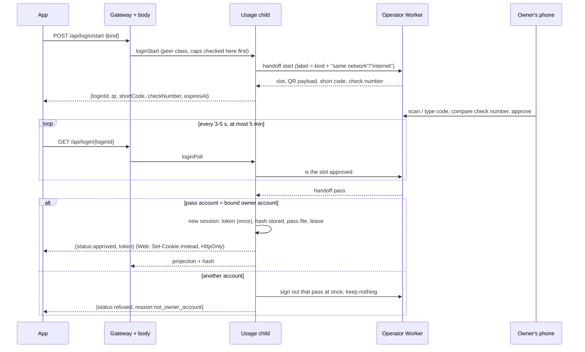
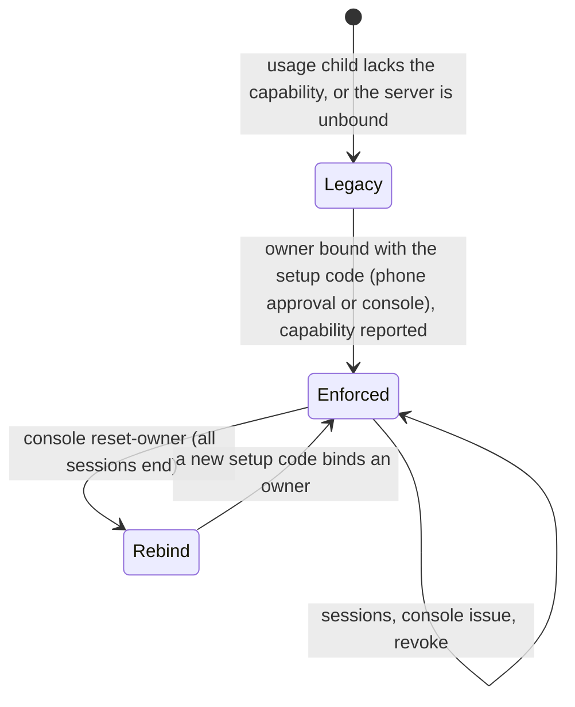

# App sessions on the user's server (shape 2) — DRAFT for review

2026-11-21 JST, Mika (task a484-shape2-session-read). Status: design read against `main ed3d78fe`; nothing is built. Tronie's rulings of 2026-11-21 (console issue, setup code, enforcement gate) are folded in (section 5). Counterpart: Mint's `login-billing/rulings/bellteam.md` section 3 (the server is a phone-logged-in device; an app with no session gets a QR/short code from the server; the owner approves on the phone; the server keeps the pass and gives the app its own session). Owner decision D1 = B (2026-11-21 21:41 JST): built and released with the contract check. Today's trust: [usage flows](flows.md) (`authMode`, Owner判定 SEC-049; no session exists) and the client-by-client table in Mika's a483 facts page.

## 1. Function split (who does what)

| Role | Holds | Does |
| --- | --- | --- |
| App (Web, iPhone/Mac, Windows, Linux, Android) | server address + one opaque **session token** (256-bit random). Never a pass | shows the code/QR the server gives, polls, keeps the token, sends it on every request |
| Public gateway (`http-gateway.mjs`, own process) | nothing | names the TCP peer; today authorizes static files through `/api/session`; **new:** serves static files with no session (public code, no data) |
| Body public server (`authorize` in `application-features.mjs`) | projection of valid sessions: set of `sha256(token)` with state | hot path, no network: token → hash → in the set → Owner; else 401 |
| Usage child (sole writer) | `owner.json` (owner account id), `app-sessions.json` (id, token hash, kind, label, created, lastUsed, leaseUntil, state), one pass file per session (0600, atomic replace), pending logins (memory) | login start/poll/cancel, binds the owner, issues/ends sessions, asks the Worker per session on a lease, publishes the projection |
| Console (`bellteam-console`, run by the host user with `docker exec`) | nothing; talks to the usage child on a private socket in the child's runtime directory (mode 0600) | `setup-code` (print a new one-time setup code), `issue` (print a one-time login code for an app, or `--token` a session token for a host script), `list`, `revoke <id>`, `reset-owner`. The only operator-free way in; every server has it |
| Operator Worker | handoff slots, refused pass ids | as Mint's section 3; never talks to apps |
| Internal listener (seats) | unchanged | unchanged (Bots are not app sessions) |

## 2. Login (data flow)



### 2a. Console path (no operator) and the first binding

```mermaid
sequenceDiagram
  participant H as Host user
  participant C as bellteam-console
  participant U as Usage child
  participant App
  H->>C: docker exec bellteam bellteam-console issue [--token]
  C->>U: private socket: issue (kind console)
  U-->>C: one-time code (10 min, single use; only its hash is stored)
  C-->>H: printed in this terminal, never written to a file or the log
  H->>App: types the code in "use a code from the server console"
  App->>U: POST /api/login/console {code}  (5 wrong tries per minute, then wait)
  U-->>App: session token (kind console, no pass, no operator)
```

The first binding of an unbound server uses a **setup code**: printed once to the container log (visible from the host with `docker logs`, and by the installer) at each start while the server is unbound, only its hash kept, so a stranger on the network cannot start or complete it. The binding is done either by a phone approval (the setup code goes with `POST /api/login/start`, checked before any Worker call) or by the console (`POST /api/login/console {code}` with a setup code), and records the owner as `account` (phone) or `console` (no operator).

## 2b. Server login mode



`Legacy` is today's path unchanged (local mode or Access); it is left only by the binding, which is the owner's own act (first-run screen of a new install, or "log this server in" in Settings of an app that is already in). `Enforced` is written to a durable marker; the body never returns to `Legacy` on its own, not after a restart, a usage rollback or a reset (a body that finds the marker but a usage child without the capability answers 401 and says so on `/api/session`, never opens). In `Rebind` every request but the login endpoints is 401.

A session admits an app and decides nothing about the contract (Mint, 2026-11-21): paid features follow the server's own pass, or developer mode, never the session. A console session (no pass) therefore gives the same paid features as a phone session; both end the same way a server-level "no contract" shows today.

## 3. Session state

```mermaid
stateDiagram-v2
  [*] --> active: approved by the owner's account
  active --> active: use (lastUsed); lease ask OK (background, at most every 10 min per session)
  active --> ended: app logout (server signs the pass out)
  active --> ended: pass_refused / pass_expired / pass_invalid on a lease ask: ends at that ask and the server signs the pass out (Mint, confirmed)
  active --> ended: 14 days without use (server clock); a console session has no pass, so this and `revoke` are its only ends
  active --> active: operator not reachable (no answer at all): last answer holds; a refusal is never carried on it
  ended --> [*]: record and pass file deleted; token hash leaves the projection; open SSE of that session closed
```



## 4. Answers to the five asks

| Ask | Design |
| --- | --- |
| What the app holds | server address + session token. Not a pass, never talks to the operator |
| Where | Apple: Keychain (shared access group for the share extension; replaces the `CF_Authorization` cookie item). Windows: DPAPI-protected file in `%LOCALAPPDATA%\BellTeam`. Android: Keystore-backed encrypted preferences. Linux: libsecret, else 0600 file in `~/.local/share/BellTeam`. Web: cookie `bellteam_session`, HttpOnly, SameSite=Strict, Secure on https; the page never sees the token. Native sends `Authorization: Bearer`; the server accepts both carriers. The CF cookie copy code (`AccessCookies`, WKWebView/WebView2/CookieManager login sheets) goes away |
| How it ends | section 3. A stop from the phone reaches the server at the next lease ask (at most 10 minutes), not instantly |
| What a request with no session may do | `GET /healthz`; `GET /api/session` (`{authenticated, authMode, login:{capability, bound, enforced}}`; an old server has no `login` key, which is how an app tells); `POST /api/login/start`, `GET /api/login/{id}`, `POST /api/login/{id}/cancel`, `POST /api/login/console`; static files. In `Legacy` everything else is today's path. Everything else 401 (including `/api/updates`, which answers 403 today, once `Enforced`). Caps before any Worker call: at most 4 pending logins in total, one start per peer per 10 s, bodies ≤ 1 KB, poll ≤ 1 per 2 s per login, unknown ids 404 |
| Owner binding at first login | only with the setup code (section 2a). The first successful handoff binds its account id to `owner.json`, or the console binds `console`; a later pass of another account is refused and signed out at once. Reset only from the host console (`reset-owner`, then a new setup code) |
| One pass per session, asked on use | one `createWebClient` + pass file per session. "On use" = a background lease: a request after `leaseUntil` is served on the last answer and triggers one ask; an open SSE counts as use and renews by timer. The ask is never inside a request |

## 5. Where section 3 did not hold, and how each point is settled

Tronie's rulings (2026-11-21): rows 1, 2 and 5 below. The rest are settled here by Mika; Mint to confirm the ones that touch her contract (3, 6).

| # | Point (what does not hold as written) | Settled as |
| --- | --- | --- |
| 1 | Login depended on the operator: the open image, a LAN without internet, developer servers and host callers (`src/usage/submitted-secret-rabbit-client.mjs` posts the owner API from the host at `127.0.0.9:18891`) could not log in | **Ruled yes.** The console path (2a) exists on every server. The rabbit client takes a `--token` console session kept in a 0600 file of its host user (a later change in that client, mine). D3 (developer mode) stays the Owner's separate question |
| 2 | Trust on first use on a default `0.0.0.0:18891` | **Ruled yes.** Setup code, host-visible only (2a). Until bound the server is as open as today, no worse; the binding is the owner's act |
| 3 | "Asks the Worker when the session is used" cannot be per request | per-session background lease, 10 minutes (the Worker's cache); a phone stop takes up to 10 minutes; offline the last answer holds, ended by the 14-day idle rule. Console sessions have no lease |
| 4 | "Not local" is not enough: the peer can look local behind Docker's published port | in `Enforced` every request on the public listener needs a session, loopback and `docker exec` included. Seats keep the internal listener. In `Legacy` nothing changes |
| 5 | Release order can lock the Owner out | **Ruled.** Apps first (they probe `login` in `/api/session`; an app with no `login` key uses today's path); the server enforces only when the usage child reports the capability and the owner has bound (2b). The switch day removes the e-mail login by Access becoming optional, not by a flag flip |
| 6 | Cloudflare precedence | in `Enforced`, an Access JWT is no longer an owner proof; the session is required in addition, and Access is an optional outer layer. `cloudflare.publicUrl` stays only for the Web Push origin |
| 7 | Plain HTTP on the LAN (`http://ip:18891`, the main install path): the token is readable by a sniffer on the same LAN; the cookie cannot be Secure | a stated limit, to tell the Owner: it stops strangers, DNS rebinding and hostile pages (none carries a token), not a sniffer on the LAN. Over https it is full strength |
| 8 | Unauthenticated login start amplifies toward the Worker and exhausts slots | caps before any Worker call: 4 pending logins in total, one start per peer per 10 s, bodies ≤ 1 KB, poll ≤ 1 per 2 s per login, unknown ids 404; while unbound, the setup code is checked first; console: 5 wrong codes per minute |
| 9 | A client-chosen label would make a stranger's request look like "Windows app" | label = enumerated kind + "same network" / "internet"; no address goes to the operator; the full address stays in the server's own log |
| 10 | Pass files are readable by seats (they can sudo; owner access accepted 2026-11-15) | said, not hidden: 0600 is no boundary against seats. A leaked handoff pass can only ask entitlement and use the push relay. A seat can also run the console, which is the same accepted exposure as a seat being the owner today |

## 6. Order of work (diagram first, then code)

1. This page and `flows.md` accepted (Airi's independent review first, a484-shape2-airi-review); Mint's confirmation of rows 3 and 6.
2. Usage child: session store, console + socket, login endpoints, lease, capability in ready. Body: tolerant projection row (reader first, as a479), `authorize` by token hash behind the gate, gateway static without session, console binary in the image. Apps: code screen and the "use a console code" field with the legacy probe. The Enforced switch last.
3. Independent security review (Maxwell) of this page before step 2 starts.
