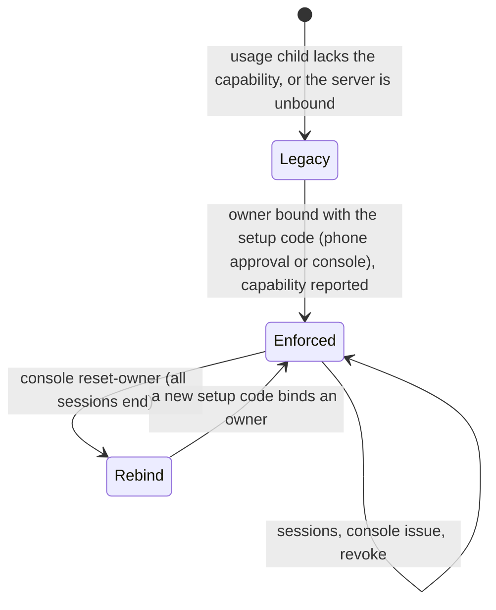

# App sessions on the user's server (shape 2) — DRAFT for review

2026-11-21 JST, Mika (tasks a484, a484b, a484c). Status: design read against `main ed3d78fe`; nothing is built. Folded in: Tronie's rulings (console issue, setup code, enforcement gate), Mint's confirmations (lease, Access, no contract per session), Airi's review of `87d13a33` and Tronie's rulings on it (section 5). Counterpart: Mint's `login-billing/rulings/bellteam.md` section 3 (the server is a phone-logged-in device; an app with no session asks the server for a login; the owner approves on the phone; the server keeps the pass and gives the app its own session). Owner decision D1 = B (2026-11-21 21:41 JST): built and released with the contract check. Today's trust: [usage flows](flows.md) (`authMode`, Owner判定 SEC-049; no session exists) and the client-by-client table in Mika's a483 facts page.

## 1. Function split (who does what)

| Role | Holds | Does |
| --- | --- | --- |
| App (Web, iPhone/Mac, Windows, Linux, Android) | server address + one opaque **session token** (256-bit random, returned once). Never a pass | starts a login, shows what the server gives, polls, keeps the token, sends it on every request; an app that already has a session also shows login requests and its session list (revoke) |
| Public gateway (`http-gateway.mjs`, own process) | nothing | names the TCP peer; **new:** serves static files with no session (public code, no data), forwards the peer and the proxy headers it saw |
| Body public server (`authorize` in `application-features.mjs`) | projection of valid sessions: set of `sha256(token)` with state | hot path, no network: token → hash → in the set → Owner; else 401. Applies the Origin rule (2d) to cookie-carried requests |
| Usage child (sole writer) | `owner.json` (owner account id or `console`), `app-sessions.json` (id, token hash, kind, label, network class, created, lastUsed, leaseUntil, state), one pass file per session (0600, atomic replace), pending logins (memory) | login start/poll/cancel, network class, second hand, binds the owner, issues/ends sessions, asks the Worker per session on a lease, publishes the projection, announces new logins and sessions |
| Console (`bellteam-console`, run by the host user with `docker exec`) | nothing; talks to the usage child on a private socket in the child's runtime directory (mode 0600) | `setup-code`, `issue` (one-time login code for an app, or `--token` a session token for a host script), `approve <loginId>` (second hand), `list`, `revoke <id>`, `reset-owner`. Does not go through HTTP, so no flood on the HTTP endpoints can lock the owner out of it. The only operator-free way in; every server has it |
| Operator Worker | handoff slots, refused pass ids | as Mint's section 3; never talks to apps; **never called for a login that still waits for its second hand** |
| Internal listener (seats) | unchanged | unchanged (Bots are not app sessions) |

## 2. Login (data flow)

```mermaid
sequenceDiagram
  participant App as New app
  participant GW as Gateway + body
  participant U as Usage child
  participant E as Existing app (has a session) or console
  participant W as Operator Worker
  participant P as Owner's phone
  App->>GW: POST /api/login/start {kind}
  GW->>U: loginStart (peer, proxy headers)
  U->>U: network class (2c), pool caps (4)
  alt class is lan, or the owner switch "phone-only from outside" is on
    Note over U: no second hand
  else unknown network (the default for anything not provably on the LAN)
    U-->>App: {loginId, status: waiting_second_hand}
    U-->>E: event login.requested {loginId, kind, network class, time}
    E->>U: approve (existing session: POST /api/login/{id}/approve; console: approve <id>)
    Note over U: or the owner types a console code in the new app (2a): session at once, no phone
  end
  U->>W: handoff start (label = kind only)
  W-->>U: slot, QR payload, short code, check number
  U-->>App: {status: waiting_phone, qr, shortCode, checkNumber, expiresAt}
  P->>W: scan / type code, compare check number, approve
  loop every 3-5 s, at most 5 min
    App->>GW: GET /api/login/{loginId}
    GW->>U: loginPoll
    U->>W: is the slot approved
  end
  W-->>U: handoff pass
  alt pass account = bound owner account
    U->>U: new session: token (once), hash stored, pass file, lease
    U-->>App: {status: approved, token} (Web: Set-Cookie instead, HttpOnly); later polls say delivered, no token
    U-->>E: event session.created {id, kind, network class} (revoke in the apps' session list)
  else another account
    U->>W: sign out that pass at once, keep nothing
    U-->>App: {status: refused, reason: not_owner_account}
  end
```

### 2a. Console path (no operator) and the first binding

```mermaid
sequenceDiagram
  participant H as Host user
  participant C as bellteam-console
  participant U as Usage child
  participant App
  H->>C: docker exec bellteam bellteam-console issue [--token]
  C->>U: private socket: issue (kind console)
  U-->>C: one-time code (10 min, single use; only its hash is stored)
  C-->>H: printed in this terminal, never written to a file or the log
  H->>App: types the code in "use a code from the server console"
  App->>U: POST /api/login/console {code}
  U-->>App: session token (kind console, no pass, no operator)
```

The first binding of an unbound server uses a **setup code**: printed once to the container log (visible from the host with `docker logs`, and by the installer) at each start while the server is unbound, only its hash kept, so a stranger on the network cannot start or complete it. The binding is done either by a phone approval (the setup code goes with `POST /api/login/start`, checked before any Worker call; no second hand, the code is the second hand) or by the console (`POST /api/login/console {code}` with a setup code), and records the owner as `account` (phone) or `console` (no operator).

Codes: setup code and console code are **64 random bits or more** (13 Crockford base32 characters, shown 4-4-5), single use, 10 minutes. Try cap on the code endpoints (`/api/login/start` with a setup code, `/api/login/console`): **no tight total cap**, because behind a proxy every stranger is one peer and any low cap would let a stranger keep the owner out of the code endpoints (SEC-070). With 64 random bits online guessing is out of reach, so the endpoints only shed load, and **the code is checked first**: a stateless constant-time lookup of the code's hash, before any rate cap. A correct code is therefore never refused, whatever a stranger sends; only wrong-code answers are shed (429 once more than 600 wrong codes per minute arrive in total), so a stranger holding the shedding at 10 requests a second never blocks a valid console, setup or "add an app" code. The console does not go through HTTP either. `loginId` is 128 random bits or more, so a poll cannot be guessed. The token is returned once.

### 2a'. "Add an app" from an existing session (SEC-070)

An app that already holds a session can issue a one-time login code for a new app: `POST /api/login/code` with the session, answered with the same kind of code as the console's (64 bits, 10 minutes, single use, only its hash stored). It is counted in the **owner pool** and entered in the new app through `/api/login/console`, so a remote owner behind a proxy (where every stranger shares the owner's peer) can add an app without queueing behind strangers, and the owner pool is not reachable only from the host console. The new session is **never console-kind** (SEC-070/H1). It is `origin: 'added'`: it records `issuedBy` (the issuing session's id) and **shares the issuer's pass and lease** (it has no pass file of its own; the issuer's lease ask covers it). So the phone's stop and stop-all-others end it with the issuer, and ending the issuer by any means (revoke, pass refused, 14 days idle) ends everything it issued, transitively: a stolen session token cannot mint sessions that outlive its own revoke or the owner's recovery. When the issuer is a console-kind session (no pass), what it mints has no pass either and still ends with it. Console-kind sessions exist only for codes printed by the host console. It is announced and listed like any other, and the "add an app" screen says so.

### 2b. Server login mode



`Legacy` is today's path unchanged (local mode or Access); it is left only by the binding, which is the owner's own act (first-run screen of a new install, or "log this server in" in Settings of an app that is already in). `Enforced` is written to a durable marker; the body never returns to `Legacy` on its own, not after a restart, a usage rollback or a reset (a body that finds the marker but a usage child without the capability answers 503 `SESSION_STORE_UNAVAILABLE` and says so on `/api/session`, never opens, and apps keep their tokens, section 7a). In `Rebind` every request but the login endpoints is 401.

### 2c. Network class of a login (what the label may say)

The server only states what it can prove. The class comes from the TCP peer the gateway names, never from client text:

| Class | When | Effect |
| --- | --- | --- |
| `lan` | the peer is a private or link-local address, is **not** the container's default gateway (the NAT or userland-proxy hop that hides the real peer), and the request has no forwarding header (`X-Forwarded-For`, `Forwarded`, `CF-Connecting-IP`, `Via`) | phone-only approval, as Tronie ruled for the same-network first login |
| `unknown` | everything else: a public address, the gateway address, loopback, any forwarding header, a Cloudflare Tunnel or Caddy in front | second hand needed (section 2) |

The install guide for putting a proxy in front (Caddy, nginx, cloudflared) must say the proxy has to add `X-Forwarded-For` or `Forwarded` (all three do by default): a proxy on a private address that adds none would make strangers `lan`. A "named trusted proxy" that states the real peer (an owner-listed proxy address and header) can later turn `unknown` into a known class; the first build has none, so everything behind a proxy is `unknown`. Nothing in the phone's approval screen says "same network" for `unknown`. The label sent to the operator is the enumerated kind only; the class and the peer address stay in the server's own session list and events.

### 2d. Origin rule for the web cookie (S3)

A request that carries the session as the cookie (not as `Authorization: Bearer`) is accepted only if: a write (anything but GET/HEAD/OPTIONS) has an `Origin` whose **host[:port]** equals the request's `Host` header or the host[:port] of the saved `cloudflare.publicUrl` (the scheme is not compared: behind a TLS-terminating proxy the server sees http while the browser sends https), a `Content-Type` of `application/json` (SEC-052 stays), and no `Sec-Fetch-Site` other than `same-origin`; a cookie request with no `Origin` may only GET/HEAD (and a GET changes nothing). This is what closes same-site pages that SameSite=Strict lets through (another subdomain, another port on the same LAN address). Bearer-carried requests are not ambient and skip the Origin rule.

## 3. Session state

A session admits an app and decides nothing about the contract (Mint, 2026-11-21): paid features follow the server's own pass, or developer mode, never the session. A console session (no pass) therefore gives the same paid features as a phone session; both end the same way a server-level "no contract" shows today.

```mermaid
stateDiagram-v2
  [*] --> active: approved by the owner's account (and the second hand where needed)
  active --> active: use (lastUsed); lease ask OK (background, at most every 10 min per session)
  active --> ended: app logout (server signs the pass out)
  active --> ended: pass_refused / pass_expired / pass_invalid on a lease ask: ends at that ask and the server signs the pass out (Mint, confirmed)
  active --> ended: 14 days without use (server clock); a console session has no pass, so this and `revoke` are its only ends
  active --> ended: its issuer ended (an `added` session; cascade, transitively)
  active --> active: operator not reachable (no answer at all): last answer holds; a refusal is never carried on it
  ended --> [*]: record and pass file deleted; token hash leaves the projection; open SSE of that session closed
```



## 4. Answers to the five asks and the unauthenticated surface

| Ask | Design |
| --- | --- |
| What the app holds | server address + session token. Not a pass, never talks to the operator |
| Where | Apple: Keychain (shared access group for the share extension; replaces the `CF_Authorization` cookie item). Windows: DPAPI-protected file in `%LOCALAPPDATA%\BellTeam`. Android: Keystore-backed encrypted preferences. Linux: libsecret, else 0600 file in `~/.local/share/BellTeam`. Web: cookie `bellteam_session`, HttpOnly, SameSite=Strict, Secure on https; the page never sees the token. Native sends `Authorization: Bearer`; the server accepts both carriers. The CF cookie copy code (`AccessCookies`, WKWebView/WebView2/CookieManager login sheets) goes away |
| How it ends | section 3. A stop from the phone reaches the server at the next lease ask (at most 10 minutes), not instantly; console `revoke` and the apps' session list revoke at once |
| What a request with no session may do | `GET /healthz`; `GET /api/session` (`{authenticated, authMode, login:{capability, bound, enforced}}`; an old server has no `login` key, which is how an app tells); `POST /api/login/start`, `GET /api/login/{id}`, `POST /api/login/{id}/cancel`, `POST /api/login/console`; static files. In `Legacy` everything else is today's path; once `Enforced` everything else is 401 (including `/api/updates`, which answers 403 today) |
| What a request **with** a session may add | `GET /api/login/requests` and `POST /api/login/{id}/approve` (the second hand; the screen says 「自分で始めたログインだけ許可してください」), `POST /api/login/code` (add an app, 2a'), `GET /api/sessions` (every session, phone-approved and console, with kind, network class, created, last used) and `DELETE /api/sessions/{id}`; events `login.requested` and `session.created` on the existing event stream, so every new login is announced in the owner's apps with a revoke button |
| Owner binding at first login | only with the setup code (section 2a). The first successful handoff binds its account id to `owner.json`, or the console binds `console`; a later pass of another account is refused and signed out at once. Reset only from the host console (`reset-owner`, then a new setup code) |
| One pass per session, asked on use | one `createWebClient` + pass file per session. "On use" = a background lease: a request after `leaseUntil` is served on the last answer and triggers one ask; an open SSE counts as use and renews by timer. The ask is never inside a request |
| Caps on the unauthenticated surface | `login/start` from a stranger: 1 start per peer per 10 s, at most 2 pending per peer, at most 16 pending in total for strangers; bodies ≤ 1 KB; poll ≤ 1 per 2 s per login; unknown ids 404. A login that waits for its second hand has no Worker slot. Logins the owner starts (console `issue`, an existing session's approve or "add an app" code, a console code) are counted in a separate pool of 8 and never wait behind strangers; the code endpoints check the code before any cap and shed only wrong-code answers (2a). A test for each of the two points runs behind one proxy peer: strangers fill the stranger pool and spam wrong codes while an existing session's "add an app" code still logs a new app in |

## 5. Where section 3 did not hold, and how each point is settled

Tronie's rulings (2026-11-21): rows 1, 2, 5, and S1-S3 (rows 11-13). Mint confirmed rows 3 and 6. The rest are settled here by Mika.

| # | Point | Settled as |
| --- | --- | --- |
| 1 | Login depended on the operator: the open image, a LAN without internet, developer servers and host callers (`src/usage/submitted-secret-rabbit-client.mjs` posts the owner API from the host at `127.0.0.9:18891`) could not log in | **Ruled yes.** The console path (2a) exists on every server. The rabbit client takes a `--token` console session kept in a 0600 file of its host user (a later change in that client, mine). D3 (developer mode) stays the Owner's separate question |
| 2 | Trust on first use on a default `0.0.0.0:18891` | **Ruled yes.** Setup code, host-visible only (2a). Until bound the server is as open as today, no worse; the binding is the owner's act, so the first-run screen of a new install and Settings of an app already in push it |
| 3 | "Asks the Worker when the session is used" cannot be per request | per-session background lease, 10 minutes (the Worker's cache); a phone stop takes up to 10 minutes; a refusal ends at that ask; offline the last answer holds, ended by the 14-day idle rule (never, if the holder keeps using it; the Owner's trade-off, not capped here). Console sessions have no lease |
| 4 | "Not local" is not enough: the peer can look local behind Docker's published port | in `Enforced` every request on the public listener needs a session, loopback and `docker exec` included. Seats keep the internal listener. In `Legacy` nothing changes |
| 5 | Release order can lock the Owner out | **Ruled.** Apps first (they probe `login` in `/api/session`; an app with no `login` key uses today's path); the server enforces only when the usage child reports the capability and the owner has bound (2b). The switch day removes the e-mail login by Access becoming optional, not by a flag flip |
| 6 | Cloudflare precedence | confirmed by Mint: in `Enforced`, an Access JWT is no longer an owner proof; the session is required in addition, and Access stays usable as an outer network gate (it also sits in front of every `unknown` login). `cloudflare.publicUrl` stays for the Web Push origin and the Origin rule |
| 7 | Plain HTTP on the LAN (`http://ip:18891`, the main install path) | a stated limit, to tell the Owner: it stops strangers, DNS rebinding and hostile pages (none carries a token), not a sniffer on the same LAN, and **a sniffed token is a lasting owner credential** until revoked or 14 days unused. Over https it is full strength |
| 8 | Unauthenticated login start amplifies toward the Worker and exhausts slots | the Worker is not called for a login waiting for its second hand; caps in section 4 (per peer, larger total, separate owner pool, S2) |
| 9 | A client-chosen label would make a stranger's request look like "Windows app" | label sent to the operator = enumerated kind only; the network class is the server's own finding (2c) and appears only in the server's session list and events |
| 10 | Pass files are readable by seats (they can sudo; owner access accepted 2026-11-15) | said, not hidden: 0600 is no boundary against seats. A leaked handoff pass can only ask entitlement and use the push relay. A seat can also run the console, the same accepted exposure as a seat being the owner today |
| 11 | **S1** One relayed approval gives a stranger an owner session; "same network" is not knowable behind a proxy | (a) the class is `lan` only when provable, else `unknown` (2c); (b) a login from `unknown` needs a second hand, an existing app's approval or the console (section 2), and the per-server owner switch **"allow phone-only approval from outside"** exists, **off by default** (it is a usage setting, added with the build; same-network first login stays phone-only); (c) every `login.requested` and `session.created` is announced in the owner's existing apps with revoke; (d) Access stays usable as the outer gate. A stranger never receives a real QR, because the Worker is not called before the second hand |
| 12 | **S2** (SEC-070) A stranger can hold every pending slot, and behind a proxy a low cap on the code endpoints keeps the owner out | per-peer caps, a larger stranger pool, an owner-started pool outside it reachable from the console **and from an existing session** ("add an app", 2a'), and no cap that can refuse a valid code: the code is checked first and only wrong-code answers are shed (section 4, 2a). H1 (Airi): a session made by "add an app" is `added`, shares its issuer's pass and lease and ends with its issuer (2a', 3); tests: strangers hold the shedding while a valid "add an app" and console code still log in; revoking, pass refusal or idle of the issuer ends what it issued, transitively |
| 13 | **S3** The web cookie relied on SameSite=Strict alone | Origin rule + Content-Type check for cookie-carried requests (2d) |
| 14 | Specs Airi asked for | code length and try cap (2a), `loginId` ≥ 128 bits, token once (2a), **console sessions are not in the phone's device list**: the apps' session list (`GET /api/sessions`) is the place that shows them, and the Owner is told so |

## 6. Order of work (diagram first, then code)

1. This page and `flows.md` accepted after the re-check (Airi, Maxwell); the build rows (a485-lb-server, -worker, -apple, -android-linux, -windows, -web) start from it.
2. Usage child: session store, console + socket, login endpoints, network class, lease, the owner switch, capability in ready. Body: tolerant projection row (reader first, as a479), `authorize` by token hash behind the gate with the Origin rule, gateway static without session and the proxy headers passed on, console binary in the image. Apps: login screens (waiting for second hand, phone, console code), requests and sessions list with revoke, and the legacy probe. The Enforced switch last.

## 7. Wire contract (draft; the five app builds read this section)

All bodies are JSON (UTF-8). Errors are `{error: CODE}` with the HTTP status, as the rest of the server. Times are ISO-8601 UTC strings with milliseconds (`2026-11-21T13:05:00.000Z`). `kind` is one of `web`, `apple` (iPhone, iPad, Mac), `windows`, `linux`, `android`; any other value is 400 `LOGIN_INPUT_INVALID`. `carrier` is `bearer` (default; the token comes in the body) or `cookie` (Web: the server sets the HttpOnly cookie and the body has no token).

### 7a. Session probe

`GET /api/session` answers 200 whenever the server can judge a session: `{authenticated: boolean, authMode: 'local'|'cloudflare', login?: {capability: boolean, bound: boolean, enforced: boolean}, sessionId?: string}`. `login` is absent on a server that predates this contract (the app then uses today's path); `sessionId` is present when the request is authenticated by a session. Every other endpoint answers **401 `UNAUTHORIZED`** to a missing, unknown, ended or expired token; an app treats a 401 on a stored token, and `authenticated:false` from the probe, the same: delete the stored token and show the connect screen. **Only a definite 401 deletes the token.** When the server cannot judge a session right now (an `Enforced` marker with a usage child that lacks the capability after a rollback, a body that has not yet loaded the session projection at start, or the usage child being down) the probe and every other endpoint answer **503 `SESSION_STORE_UNAVAILABLE`** (the probe body also carries `login: {capability: false, bound: true, enforced: true}`); the app keeps its token, says the server is not ready (「サーバーの準備中です」) and retries with backoff (1, 2, 4 … 30 s). This keeps a rollback or a restart from logging every app out for good. A session ended while the event stream is open closes the stream (the next request is 401).

### 7b. Login (no session needed)

| Call | Request | Answer |
| --- | --- | --- |
| `POST /api/login/start` | `{kind, carrier?, setupCode?}`. `setupCode` only while the server is unbound | 200 `{loginId, status, expiresAt, pollAfterMs, secondHand?, phone?}` |
| `GET /api/login/{loginId}` | none | 200 `{loginId, status, expiresAt, pollAfterMs, secondHand?, phone?, token?, reason?}` |
| `POST /api/login/{loginId}/cancel` | `{}` | 200 `{loginId, status: 'cancelled'}` |
| `POST /api/login/console` | `{code, kind, carrier?}` (a console code, or an "add an app" code, or a setup code on an unbound server) | 200 `{status: 'approved', sessionId, token?}` |

- `loginId`: string, 128 random bits, base64url (22 characters).
- `status`: `waiting_second_hand` (an existing app or the console must approve first; `secondHand` is `{ways: ['existing_app', 'console_code']}`), `waiting_phone` (`phone` is present), `approved`, `delivered`, `refused` (`reason`: `not_owner_account`, `second_hand_denied`, `phone_denied`), `expired`, `cancelled`.
- `phone`: `{shortCode: string, checkNumber: string, qr: string, qrSvg?: string}`. `shortCode` and `checkNumber` are strings exactly as the library returns them (keep leading zeros, show as given). `qr` is the payload string a phone camera reads; `qrSvg` is a ready SVG document of that payload rendered by the library (changed from `qrPng` by Mint's contract draft 0.1; no PNG is promised). An app may show it as an image (never inline-executed), or show only the short code and check number, which is enough: the phone can type the code instead of scanning. The shortCode and checkNumber are the required display; `qrSvg` is optional.
- `approved`: the first poll after approval carries `token` (string, 256 bits, base64url) exactly once with `carrier: bearer`; later polls say `delivered` with no token. With `carrier: cookie` the same poll sets the cookie and has no `token`. An app that loses the response must start a new login.
- `expired` and `cancelled`: the login is over; the app shows 「ログインの時間が切れました」 (or 「取り消しました」) and a button that starts a new login. An unknown or ended `loginId` answers 404 `LOGIN_NOT_FOUND` (the app treats it like `expired`). There is no 410.
- Poll interval: the server asks for `pollAfterMs` (3000); the app polls at that interval, the server refuses more than 1 poll per 2 s per login with 429 `LOGIN_RATE_LIMITED` and a `Retry-After` (seconds) header, and the app waits that long. (The "3-5 s" of the sequence diagram is the same thing: 3 s.)
- Errors: 400 `LOGIN_INPUT_INVALID`; 403 `SETUP_CODE_REQUIRED` (unbound server, `setupCode` missing or wrong); 403 `LOGIN_CODE_INVALID` (wrong or used console code; constant time, same answer for every reason); 404 `LOGIN_NOT_FOUND`; 409 `LOGIN_NOT_WAITING`; 429 `LOGIN_RATE_LIMITED`; 503 `LOGIN_OPERATOR_UNREACHABLE` (the Worker cannot be reached when a phone login must start; the app says so and offers the console code).

### 7c. With a session

| Call | Answer |
| --- | --- |
| `GET /api/login/requests` | 200 `{requests: [{loginId, kind, networkClass: 'lan'\|'unknown', requestedAt, expiresAt}]}`, oldest first, only logins in `waiting_second_hand` |
| `POST /api/login/{loginId}/approve` (`{}`) | 200 `{loginId, status: 'waiting_phone'}`; 404 `LOGIN_NOT_FOUND`; 409 `LOGIN_NOT_WAITING` |
| `POST /api/login/{loginId}/deny` (`{}`) | 200 `{loginId, status: 'refused'}` (the new app sees `second_hand_denied`) |
| `POST /api/login/code` (`{}`) | 200 `{code: string, expiresAt}`: 13 characters grouped 4-4-5, shown once, 10 minutes, single use; 429 `LOGIN_RATE_LIMITED` when 4 are outstanding |
| `GET /api/sessions` | 200 `{sessions: [{id, kind, origin: 'phone'\|'console'\|'added', networkClass: 'lan'\|'unknown', createdAt, lastUsedAt, issuedBy?: string, current: boolean}]}`, newest first (`issuedBy` = the issuing session's id for `added`); `id` is a public id, never the token |
| `DELETE /api/sessions/{id}` | 200 `{id, status: 'ended'}`; 404 `SESSION_NOT_FOUND`. Ending the `current` one is the sign-out: the app then deletes its stored token (`sessionId` from the probe, or the `current` entry, tells it which one is its own). There is no `POST /api/logout` |

Events on the existing stream (`GET /api/events`, same `{type, …}` envelope as the `settings` events), sent to every open session: `{type: 'login.requested', loginId, kind, networkClass, requestedAt}`, `{type: 'session.created', id, kind, origin, networkClass, createdAt, issuedBy?}`, `{type: 'session.ended', id}`. An app shows the first two as a notice with 許可 / 拒否 and 取り消す.

### 7d. Which task covers which screen

Each app row builds, on this section: the sign-in screens of 7f (probe, sign-in, wait, setup-code field, QR handoff; no console-code field in an official app), the setup-code binding screen (a setup code goes with `start`; it is shown on the server console, not in an app), the requests screen (approve / deny), "add an app" (code display) and the session list with revoke. Token storage is the app's: Windows DPAPI file, Linux 0600 file (libsecret later), Android Keystore-backed preferences, Apple Keychain (shared access group), Web the cookie.

### 7e. Who may use BellTeam without paying (Owner decision 2026-11-22 00:3x JST, via Tronie; one wording for every app)

**The browser version is abolished. Official BellTeam is the native apps only (iPhone, iPad, Mac, Windows, Linux, Android), and all of them are paid. Free use means building the open-source code yourself.** (This replaces the earlier line "the free way is the Web version", Owner fact via Mint 2026-11-21, which is withdrawn.)

**The gate is the server's own entitlement, shown by each native app** (Tronie's ruling, unchanged): after login every native app reads `GET /api/subscription` → `subscription.entitlementState` (`active` | `none` | `unknown`; the field is optional, an older server has none). Only on `none` does the app show the paywall instead of the app; on `active`, `unknown` or no field it shows the app. `none` is set once the server holds its own pass and the operator says there is no contract (the library mount); a console-bound server with no pass is `none`. There is no per-app purchase gate on Windows or Linux, Android does not need Play Billing back for gating (it buys only when it is a store device, which feeds the same server pass), and no trustworthy `kind` is needed. Accepted limit: a modified client could skip its own gate; the data is the user's own and the operator-side paid features (the push relay) stay gated by the server's pass. A build of the open-source code is not an official app and carries no gate of the foundation's making.

**Official apps have no console-code entry** (Tronie's ruling, 2026-11-22). The only path into an official app is Apple or Google sign-in, then the phone's QR approval when the device has no store receipt, then the setup code at the first binding. Console-issued sessions stay a server feature, for host-local tools (for example the rabbit secret client) and for clients people build from the published source; no official app shows a field for them, and the "add an app" code and screen are not in an official app either. The paywall below is the only text of this section that a person without a contract sees besides the login screens of 7f.

### 7f. One wording table for the login screens (Mika owns it; every app uses these sentences)

Under reading 3 (design-reading3.md draft 0.2 sections 2 to 4) every device signs in itself, so the screens are: the sign-in entry, the wait for the browser, "return not received", the account refusal, the setup-code field, the handoff QR for a device with no store receipt, the phone's approval, the paywall, and the errors. The sentences for the sign-in and the QR screens are Anis's proposal (2026-11-22), adopted as written; the phone's own approval texts, the paywall and the server errors are Mika's. Until Mint's contract is fixed nothing here is final; the screens that fall away (the requests approve/deny, "add an app", the console-code entry, the session list built on section 7c) have no sentence and are not in an official app.

| Screen | Text (Japanese, as shown) |
| --- | --- |
| Sign-in entry, title | BellTeamにサインイン |
| Sign-in entry, buttons (only what the device can use) | Appleでサインイン / Googleでサインイン |
| Sign-in entry, note under the buttons. **Windows and Linux only** (system-browser sign-in). Android (Credential Manager sheet) and Apple (native Sign in with Apple sheet) show no note; a cross-provider sign-in on a phone that does open the browser is not offered a note until Tronie says | ブラウザーが開きます。サインインが終わると、このアプリに戻ります。 |
| Waiting for the browser (button: やめる). Only where the system browser was opened (Windows, Linux) | ブラウザーでサインインしています… |
| Return not received | サインインの結果がこのアプリに届きませんでした。このパソコン自身のブラウザーで、もう一度サインインしてください。 |
| Account is not the server owner | このサーバーの持ち主のアカウントではないため、ログインできませんでした。 |
| Setup-code field (only at the first binding of an unbound server), label | セットアップコード |
| Setup-code field, hint | このサーバーのコンソールに出ているコードを入れてください。最初の1回だけ使います。 |
| Handoff QR (device with no store receipt), title | スマホで購読を引き継ぐ |
| Handoff QR, lead | 購読しているスマホのBellTeamで、このQRを読み取ってください。読み取れない時は、下のコードを入れてください。 |
| Handoff QR, labels | コード / 確認番号 |
| Handoff QR, check line | スマホに出る確認番号が同じか、見比べてください。 |
| Handoff QR, waiting | スマホの承認を待っています… |
| Handoff, already entitled (never a failure) | すでに使えます。 |
| Phone's approval screen | この端末にあなたの契約を渡します。確認番号が、相手の端末の画面と同じときだけ承認してください。 |
| Phone's approval, no live contract | 先に購読してください。 |
| Phone's approval, other account | このコードは、別のアカウントのものです。 |
| Paywall, instead of the app, when `entitlementState` is `none` (buttons: 再確認 / 接続先を変更) | このアプリは購読が必要です。無料で使うには、公開されているソースコードから自分でビルドしたものを使ってください。 |
| Account and subscription page (phone apps; Neon's words, adopted): title | アカウントと購読 |
| Account page, signed out | サインインしていません。 |
| Account page, sign-in button (Android: Google) / signed-in line | Googleでサインイン / Googleでサインイン中 |
| Account page, a device that cannot buy | この端末では購入できません。 |
| Account page, a purchase of another account | 別のアカウントで購入したものがあります。このアカウントでは購読になりません。 |
| Account page, buttons | 再確認 / ほかの端末をすべて止める / サインアウト |
| Account page, subscription connection not set | 購読の接続先がまだ決まっていません。 |
| Account page, errors | この商品はまだ読み込めていません。もう一度お試しください。 / サインインし直してください。 / うまくいきませんでした（コード） |
| Server address not registered | このサーバーは、この接続先を登録していません。サーバーのコンソールで追加するか、すでに入っているアプリから「いまの接続先を追加」してください。 |
| Server not ready (cannot judge) | サーバーの準備中です。 |

## 8. What reading the code showed for the mount (2026-11-21, for the library contract and the build)

Read against `main ed3d78fe` and the library 0.7.2 package. The mechanism moves into the library (Mint's t3h); these are facts about the BellTeam side it has to be mounted on.

1. **A capability cannot ride in `stateCompatibility`.** The update catalog compares `release.compatibility.stateCompatibility` with the body's own `USAGE_STATE_COMPATIBILITY` by deep equality (`update-module-catalog.mjs`), and `module_artifact_package.py` pins it, so changing it changes which signed usage releases are accepted. The capability goes in an optional field of the child's `ready` message (`capabilities`), which the parent reads tolerantly. Note the current parent checks `ready` with an exact key list, so an old body would refuse a new child's `ready`; a body rollback after the child upgrade is protected only by the Enforced marker (2b).
2. **The usage child cannot publish or call an effect from a timer** (`USAGE_CONTEXT_UNAVAILABLE` outside a request). The lease ask, the 14-day idle expiry and the announcement of `login.requested` therefore run inside a **system root call driven by the body on a timer** (`sessions.sweep`, like the credential refresh), where the child asks the operator, ends sessions and publishes the projection row.
3. **The child cannot print the setup code to the container log**: the module process discards the child's stdout and keeps only masked stderr in `logs/module-stderr/usage.log`, while `docker logs` shows the body's stderr. The body prints the code, so the child asks for it through a new effect.
4. **Pending logins and unspent codes are in the child's memory** and are dropped on a usage exchange (the volatile handoff accepts exactly its current keys). The app already treats 404 `LOGIN_NOT_FOUND` as expired; the contract says so, or the library persists them.
5. **Network class is decided from the raw request in the gateway**, not from the forwarded copy: `endToEndHeaders` removes every header named in a `Connection:` header, so a stranger sending `Connection: X-Forwarded-For` through a proxy that does not strip it would hide the forwarding header and look `lan`. The gateway classifies on `request.headers`, passes the verdict in a header it owns (added to `PEER_HEADERS` so a client copy is dropped), and reads `/proc/net/route` for the default gateway the way `socketPeer` reads `/proc/net/tcp`.
6. **The QR is rendered by the library** (`qrSvg(payload)` returns an SVG string; the package also exports the browser web entry), not by an encoder in this repo (there is none). The wire field is therefore an SVG string unless the contract adds a PNG; an app may also encode `qr` itself, and `shortCode` with `checkNumber` is always enough. The cookie `Secure` flag needs `X-Forwarded-Proto` or the scheme of `cloudflare.publicUrl`, because the body sees http behind a TLS proxy.
