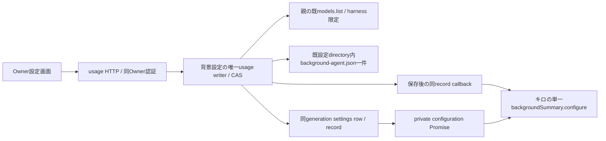

# 全体の背景要約agent設定

所有ミカ。Rootの単一背景agent契約に接続する設定取得/保存/検証だけを持つ。主agentの要約記述・実行/結果writer・各Botプロフィールは変更しない。

公開GET /api/settingsは既settings6項目を保ち、backgroundAgent:{revision:null|UUID-v4,selection:null|{harness,model,reasoningEffort}}を追加する。Owner PATCH /api/settings/backgroundAgentはexpectedRevision/harness/model/reasoningEffort厳密4key。変更時新UUID、同値不変、競合409、model個別efforts検証、モデル一覧障害は保存0。空effortはmodelがefforts無しの時だけCLI既定を表す。モデル/資格の代替はしない。

shared/tools/bellteam-settings/background-agent.jsonはschema/revision/selectionの閉record、0600/既atomic writerを用いる。既settings.jsonの6feature形式を変更しない。初期missingは未設定、破損は専用不足として保持し上書きしない。破損や背景実行の不足で親の主業務を停止しない。read-only restoreからファイル新規作成・AI起動を行わない。

usageのsettings rowに任意backgroundAgent又は固定backgroundAgentErrorを私有投影する。旧rowは既6項目読取を維持し、新設定private getterは未供給503。保存後callback失敗でも保存値/新revisionを保持する。保存済み変更は既settings SSEで再GETへ案内する。キロは起動/結果保存前のfresh revision照合・旧process完了まで次起動0を所有する。

閉methodsはsettings.backgroundAgent（非秘密read）/settings.updateBackgroundAgent（Ownerのみ）。閉親effectsはbackgroundAgent.models({harness})→当該model id/efforts、backgroundAgent.changed({configuration:record})→null実completion。同root request/actor/generationへ束縛し、任意native methodやpathを渡さない。親のmodels一実体・servicesReady後のconfigure・private getter注入はモリー。新parent/usageと閉validatorを一組で供給し、P2/state2一致だけで旧moduleの新接点対応を主張しない。

要約未設定はnull/nullで起動0、設定保存200は要約生成や一覧反映の成功と区別する。資格不足・実行非対応と自動生成のcurrentWork投影はキロ正本を参照する。UI三項目/候補の保持・保存失敗時のGET・revision競合をWeb/Apple/Windowsが同じ契約で扱う。
