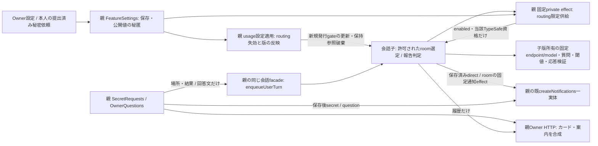

# 会話子へのusage限定接点

[usage正本](README.md) / [会話正本](../conversation/README.md)。Root横断契約v1（24345B、SHA256 `133222cf6a22889d181630765e5f3a015c09eab8e27f4f4a9482c32cb26deade`）第2・3・7章を入力とする。親の設定・カードwriterは維持し、会話の実writerだけを子へ移す。

## 認証と失効

readyで資格取得・Jev発行0。未設定/無効でも会話readyを妨げず、manual targetsを保持する。供給は現在の許可された呼出しに限定し、全settings/env/他資格/任意header/URLを渡さない。設定変更は既usageの版/epochへ束縛し、無効化後の新規発行を拒否する。子の保持資格はメモリ限定、返却/SSE/診断/diskへ反射しない。既発行のunknownから再送しない。同UIDの寿命分離でありOS資格隔離の完成ではない。

base4e01の接点は `conversation-services.mjs` のautomaticRouting/enabledとchooseResponder/judge、`FeatureSettings.update` の保存→memory更新→onChange、`usage/application-features.mjs` の設定適用。`FeatureSettings.routingEpoch` は親インスタンス内の単調な番号。routing保存成功後、onChangeより前に一つ進め、他機能の保存/入力拒否/保存失敗では進めない。適用失敗でも保存済みepochを戻さない。ファイル形式・公開list/configurationの返却は不変。親再起動時の0は新しいchannel世代へだけ束縛し、世代を越す許可として使わない。

Jev本体は `room-routing.mjs:chooseRoomResponder` と `turn-reports.mjs:judgeOwnerReport`、N102所有。N102との接続確認で次を固定した。親登録operationとsender/世代/現在の許可の検証はMollyのeffect入口が行い、その後だけusage dispatcherを呼ぶ。子から任意に呼べるHTTP/MCPを追加しない。

`src/usage/conversation-effects.mjs:createConversationUsage({settings,notifications})` は `dispatch(method,params)` と `routingState()` を返す。routingStateは `FeatureSettings.routingState()` の `{enabled,epoch}` だけで、資格を取得しない。factory構築時も資格取得/外部call無し。

| effect | 閉入力 | 返却/既機能への復元 |
| --- | --- | --- |
| usage.routing.read | `{}` | `{enabled,epoch,apiKey:string|null}`。enabled時の当該一資格だけ。無効/未設定はnull |
| usage.notify.direct | `{deliveryId,from,target}` | `schema:'bellteam.direct-message.v1',delivery_id,from,target` へ復元→同notifications.direct。`{accepted:true}`はcallbackへの引渡しだけ |
| usage.notify.room | `{id,sender:{id,name},room:{id,name}}` | 同metadataだけでnotifications.roomへ復元。`{accepted:true}`は通知表示完了を意味しない |

設定適用は同じ会話controllerの `routing.changed {enabled,epoch}` をACK `{applied:true,epoch}` まで待つ。資格は載せない。子はchanged時に新発行gate/保持参照を更新し、遅着した旧epochのread結果も破棄する。既発行のunknownを再送しない。制御機構はEpi、子実装はN102、親assemblyはMollyが持つ。

## 通知・カードの所有

通知は本文を渡さず、既 `usage/notifications.mjs` のdirect/room filterと名前射影を保持する。新規secret/questionは親カード作成のonRequestだけ。同期void callbackの失敗とIPC rejectionを通知側で回収し、会話保存成功を失敗へ変えない。再送と新しい永続queueを追加しない。

`application-services.mjs` のSecretRequests.notifyは `secretCompletionMessage` からenqueueUserTurnへ場所と結果だけを渡す。OwnerQuestions.notifyは `ownerAnswerMessage` から回答を渡す。秘密値ファイルはusageに残り、子の履歴・cache・SSEへ値を複製しない。カード索引/ownerSecretGuideは親HTTP合成だけ。submitted+notification failed、answered保存後の会話受付例外は既契約を保つ。

旧Linux OLRW取消の範囲を再開しない。Web Pushの2d39入力は別Root裁定で、本工程を待たせない。全体のdrain/継続権/reader/state/署名資材はそれぞれの本人正本を参照し、本書へ第二実装を置かない。
