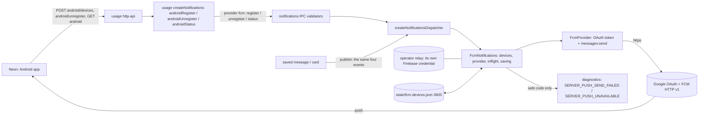
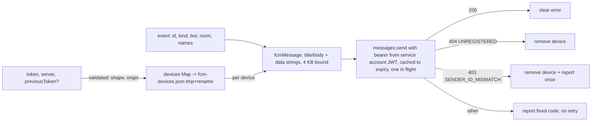

# Android notifications through FCM (a378, Mika; 2026-11-17)

Owner rule 2026-11-17: one spec on every platform. The Apple apps get closed-app notifications through APNs ([push-notifications](../../../push-notifications.md), [notification-process](notification-process.md)). The Android app (Neon, `dev.kitepon.bellbot`) gets the same events and the same wording through Firebase Cloud Messaging (FCM) beside APNs. Owner of this contract: Mika (server). Client: Neon (bot-208dcbab). Firebase project, Android app and the server credential: Sielo (a379).

## Decisions

| Question | Decision | Why |
| --- | --- | --- |
| Where | The notification child (`createNotificationsDispatcher`) gets a third provider next to `apns` and `webPush`: class `FcmNotifications` in `src/fcm-notifications.mjs`; pure validators in `src/usage/fcm-schema.mjs`. | Same structure as Web push; one process, one drain, one diagnostics writer. |
| Events | The four closed-app events (direct reply, room message, secret request, owner question) and the update notice. Titles and bodies come from the one `notificationEvent` mapping the APNs path already uses. | "Same events, same wording": there is no second place that words a notification. |
| Update notice | Sent over FCM like APNs (a381): the same `{type:'update', id}` event, the same title and body, data `{server, kind:'update', messageId}`; the app opens its Update screen. No saved receipt rows for Android. | One spec. The receipts ledger (`update-push-attempts`) is an APNs diagnostic (environment, apns-id) whose reader is the Apple status call; nobody reads an Android row, so none is built (add a row type if a reader appears). Same failure rules: one try, no retry, UNREGISTERED removes the device. |
| Message kind | FCM HTTP v1 `notification` + `data`, `android.priority` HIGH. The system shows title and body while the app is closed; the app needs no code to show it. | Reliable under Doze and OEM limits; mirrors iOS, where title and body appear even if the extension cannot run. Sender avatars are not part of v1 (iOS gets them from its extension); a later additive field can carry them. |
| Registration | Separate routes under `/api/notifications/android/…`, a separate state file. | Apple routes and `push-devices.json` stay byte-identical, so an older usage/notification child ignores Android entirely and rollback cannot turn Android rows into `PUSH_STATE_INVALID`. |
| On/off | Follows the existing notification feature setting (`apns.enabled`). When the Owner turns notifications off, Android sends stop too. | One spec. The setting reaches the child already; no new parent field. |
| Relay | When the notification setting has a relay URL, Android sends through the operator relay like APNs (a381): `POST /v1/notifications/fcm/send`. Without a relay URL the server sends nothing (2026-11-27: no direct credential on a server; see the section below). | A user's own server has no Firebase project; the operator's credential sends, gated by the same cross-store subscription rule (below). |

## Function diagram



## Data flow



## Operator relay for Android (a381)

**a540 (Owner 2026-11-23, contract 1.36): billing is checked by the apps only.** The server keeps no proof of payment and sends none; the relay (Bready, #2424) asks for none and checks no money. A registration carries only `{token, server, previousToken?}`; a `proof` that an older server's record or call still holds is neither checked nor kept. Rows of this section that speak of a proof, a ticket or a verdict describe the form before a540 and are withdrawn.

```mermaid
flowchart LR
  Neon[Neon registers] --> Http[usage http-api]
  Subs[no proof of payment exists on the server (a540)] -.-> Http
  Http -->|token, server| Fcm[FcmNotifications device row: token, server]
  Fcm -->|relay URL set: FcmRelayProvider| Relay[operator relay /v1/notifications/fcm/send]
  Relay -->|closed message check, then post| Google[(FCM with the operator credential)]
  Fcm -->|no relay URL: FcmProvider| Google
```

| Piece | Contract |
| --- | --- |
| Registration (a540) | `POST /api/notifications/android/devices` is `{token, server, previousToken?}`; the server adds nothing. A client-sent `proof` is still refused (`PUSH_DEVICE_INVALID`). Every app start registers again. |
| Child provider | `configure({enabled, relayUrl})`: relay URL set -> `FcmRelayProvider` (needs `GET /v1/notifications/status` to say `android:true`, else `FCM_RELAY_UNSUPPORTED`); empty -> no provider (configured:false, no error, nothing is read). A relay outage is the cause APNs already reports, so FCM shows it on its status only. A device without a proof gets `SUBSCRIPTION_REQUIRED` at send (one diagnostic), like an Apple device without a transaction. |
| Relay request (a540) | `{device:{token,server}, id (<=64), message}`: no `proof`, no `ticket`. `message` is exactly the closed shape below. |
| Relay request, the closed message | `message` is exactly `{token, data, notification:{title,body}, android:{priority:'HIGH', ttl:'86400s', notification:{channel_id:'bellteam_messages', tag}}}`; `token` and `data.server` must equal `device`, `data` keys are letters-only strings, whole message at most 4,000 bytes. Anything else: 400. |
| Relay answer | No verdict is asked for (a540); one post. 200 `{accepted:true}`; FCM `UNREGISTERED` -> 410 `FCM_UNREGISTERED` (the child removes the device); other failures 502 with the fixed code. No credential on the relay: 503 `PUSH_NOT_CONFIGURED`. |
| Relay status | `GET /v1/notifications/status` adds `android:true` only when the relay has a Firebase credential (`BELLTEAM_FCM_DIRECTORY`, same `config.json` format as `shared/tools/fcm`); otherwise the response is unchanged. Apple routes and bodies are untouched. |

Protection named: secret exposure (the proof and the operator's key stay private), privilege escalation (the relay only forwards the closed message to the device's own token after the Worker confirms entitlement; it cannot be used to send arbitrary text to arbitrary tokens), wrong target (`data.server` and `token` must match the device). Self-exit: the app registers again at every start; a missing proof or unentitled account is fixed by buying or restoring in any store, then the next start refreshes the row.

## Server configuration (2026-11-27: relay only)

A user's server holds no Firebase credential and reads no `shared/tools/fcm` (an old `config.json` there is ignored). Android notifications work only through the operator relay: the notification setting's relay URL, and a relay whose status says `android:true`. The relay's own credential is `BELLTEAM_FCM_DIRECTORY/config.json` = `{ "serviceAccount": { "file": "firebase-service-account.json" } }` (the Firebase key JSON beside it, mode 0600, never in Git or the image; no 1Password reference form). The token endpoint is the fixed `https://oauth2.googleapis.com/token`; `token_uri` and any URL in the file are ignored. A relay config that is broken reports `FCM_CONFIG_INVALID`, `FCM_KEY_UNAVAILABLE` (file unreadable) or `FCM_KEY_INVALID` when the relay starts. Without a relay URL `GET /api/notifications/android` says `configured:false` and registration answers `PUSH_NOT_CONFIGURED`.

## Client contract for Neon

All routes need the same authentication as the Apple routes. `server` is the origin (scheme, host, port) of the BellTeam server the app is connected to, exactly as the Apple app sends it.

| Route | Body | Result |
| --- | --- | --- |
| `POST /api/notifications/android/devices` | `{token, server, previousToken?}`; `token` = the FCM registration token, `[A-Za-z0-9_:-]{32,4096}`; body at most 8,192 bytes | `{registered:true}` after the device row is saved. Replaces `previousToken` when given. 400 `PUSH_DEVICE_INVALID`, 503 `PUSH_NOT_CONFIGURED` (no Firebase credential on this server). |
| `POST /api/notifications/android/unregister` | `{token}` (4,096 bytes) | `{registered:false}`. Call on logout and when the connection target changes. |
| `GET /api/notifications/android` | none | `{configured:boolean, error?:{code,message}}`. `configured:false` means do not expect pushes from this server. |

Register at every app start and whenever `FirebaseMessagingService.onNewToken` fires, like the iOS app: the server drops tokens FCM refuses, and the next start brings the device back.

FCM message the server sends (HTTP v1):

```json
{ "message": {
  "token": "<registration token>",
  "notification": { "title": "<same title as APNs>", "body": "<same body as APNs>" },
  "data": { "server": "https://…", "kind": "reply|secret_request|owner_question|update", "messageId": "…",
            "botId": "…", "senderId": "…", "senderName": "…",
            "roomId": "…", "roomName": "…", "requestId": "…" },
  "android": { "priority": "HIGH", "ttl": "86400s",
               "notification": { "channel_id": "bellteam_messages", "tag": "<messageId>" } } } }
```

- `data` values are strings. `roomId` / `roomName` exist only for room messages (`roomId` also for a secret request that belongs to a room); `requestId` exists only for `secret_request` and equals `messageId`. A missing key means null, the same fields as the APNs `bellteam` object.
- Update notice: `kind:'update'`, data only `server` and `messageId` (the 64-hex candidate id), title `BellTeam`, body `更新があります。Updateで確認してください。`. Neon opens its Update screen (same rule as iOS: only for the current connection, no automatic update).
- Titles and bodies: Bot name for a direct reply or card (`返信が届きました。` / `秘密情報の入力が必要です。` / `選んでほしいことがあります。`), `<name> · <room>` and `ルームに新しいメッセージが届きました。` for a room.
- Tap: Android starts the launcher activity with `data` as intent extras. Neon routes with `kind`, `botId`, `roomId`, `requestId` exactly as iOS routes `bellteam`, and ignores a message whose `server` is not the current connection.
- Foreground: `onMessageReceived` runs; Neon decides, with the same rule as iOS (no banner for the conversation being viewed).
- Neon creates the notification channel `bellteam_messages` (high importance). If it does not exist, Android uses its fallback channel and the message still shows.
- `tag` = `messageId`: a repeated send of one message replaces it instead of stacking (the APNs collapse id).

## State and protection

| State / transition | Meaning and self-exit |
| --- | --- |
| no relay URL -> configured | each apply checks the relay (`GET /v1/notifications/status` with `android:true`). Self-exit: set the relay URL, or the relay gets its credential, then the next apply. |
| configured -> off | The notification setting is off, or no key. `publish` does nothing; registrations are kept. |
| register | Row saved (`state/fcm-devices.json`, schema `bellteam.fcm-devices.v1`, 0600, tmp + rename, serialized) before `{registered:true}`. |
| send fails | A fixed code `FCM_*` is recorded once as `SERVER_PUSH_SEND_FAILED`; no automatic retry (same as APNs). `UNREGISTERED` removes the row silently; `SENDER_ID_MISMATCH` (the token belongs to another Firebase project: wrong server credential or another app) removes it and is reported once. The app registers again at its next start. |
| relay / state unusable | `error` on `GET /api/notifications/android` with a fixed code and a plain message: `FCM_RELAY_UNSUPPORTED`, `PUSH_RELAY_*`; `FCM_STATE_INVALID` when `fcm-devices.json` is unreadable (never replaced by an empty list). Exactly one report per cause (`SERVER_PUSH_UNAVAILABLE`). |

Protection named: secret exposure (the service account private key and the OAuth token live only in the child's memory; never in DTOs, status, diagnostics or logs; the token URL is fixed), wrong target (`SENDER_ID_MISMATCH`), data loss (atomic device file; an unreadable file is an error, not an empty list). No guard stops APNs or Web push.

Compatibility: `state/push-devices.json` and every existing route are unchanged. The IPC adds `provider:'fcm'` for `register` / `unregister` / `status` only; an older notification child answers `PUSH_IPC_ARGUMENTS` (not accepted), so Android registration fails closed while Apple keeps working. Publish needs no IPC change: the child fans every event out to the providers it has. `secretEncoding` and other state interpretation are unchanged.

## Open items

- (withdrawn by a540: no proof source)
- Sender avatar on Android.
- Android rows in the update receipts (see Decisions).
- The Firebase service account key itself: Sielo (a379). Until it is placed, `configured:false` is the correct answer.
