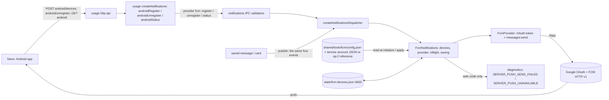
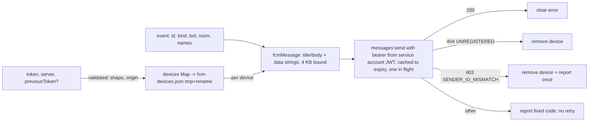

# Android notifications through FCM (a378, Mika; 2026-11-17)

Owner rule 2026-11-17: one spec on every platform. The Apple apps get closed-app notifications through APNs ([push-notifications](../../../push-notifications.md), [notification-process](notification-process.md)). The Android app (Neon, `dev.kitepon.bellbot`) gets the same events and the same wording through Firebase Cloud Messaging (FCM) beside APNs. Owner of this contract: Mika (server). Client: Neon (bot-208dcbab). Firebase project, Android app and the server credential: Sielo (a379).

## Decisions

| Question | Decision | Why |
| --- | --- | --- |
| Where | The notification child (`createNotificationsDispatcher`) gets a third provider next to `apns` and `webPush`: class `FcmNotifications` in `src/fcm-notifications.mjs`; pure validators in `src/usage/fcm-schema.mjs`. | Same structure as Web push; one process, one drain, one diagnostics writer. |
| Events | The four closed-app events only: direct reply, room message, secret request, owner question. Titles and bodies come from the one `notificationEvent` mapping the APNs path already uses. | "Same events, same wording": there is no second place that words a notification. |
| Update notice | Not sent over FCM in v1. | The update notice and its saved attempt receipts are Apple-specific (APNs receipts, `update-push.md`); Android apps update through the store. Revisit when Neon has an Update screen. |
| Message kind | FCM HTTP v1 `notification` + `data`, `android.priority` HIGH. The system shows title and body while the app is closed; the app needs no code to show it. | Reliable under Doze and OEM limits; mirrors iOS, where title and body appear even if the extension cannot run. Sender avatars are not part of v1 (iOS gets them from its extension); a later additive field can carry them. |
| Registration | Separate routes under `/api/notifications/android/…`, a separate state file. | Apple routes and `push-devices.json` stay byte-identical, so an older usage/notification child ignores Android entirely and rollback cannot turn Android rows into `PUSH_STATE_INVALID`. |
| On/off | Follows the existing notification feature setting (`apns.enabled`). When the Owner turns notifications off, Android sends stop too. | One spec. The setting reaches the child already; no new parent field. |
| Relay | Direct only. The operator relay (`services/notifications/relay.mjs`) is Apple-only. | No Android entitlement exists to gate a relay (Google Play billing is not built). Open item below. |

## Function diagram



## Data flow



## Server configuration (distributor)

`/srv/bellteam/shared/tools/fcm/config.json`, next to `apns/`:

```json
{ "serviceAccount": { "file": "firebase-service-account.json" } }
```

or `{ "serviceAccount": { "reference": "op://<vault id>/<item id>/<field>" } }` (1Password, same reader and Settings token as the APNs key reference). The JSON is the Firebase service account key (`type: service_account`, `project_id`, `client_email`, `private_key`). The file sits beside `config.json`, mode 0600, never in Git or the image. The token endpoint is the fixed `https://oauth2.googleapis.com/token`; `token_uri` and any URL in the file are ignored, so a changed file cannot redirect the key. No `config.json`: Android notifications are off and `GET /api/notifications/android` says `configured:false`. A broken config or key never stops the notification child: it reports one of the fixed codes below and APNs/Web push continue.

## Client contract for Neon

All routes need the same authentication as the Apple routes. `server` is the origin (scheme, host, port) of the BellTeam server the app is connected to, exactly as the Apple app sends it.

| Route | Body | Result |
| --- | --- | --- |
| `POST /api/notifications/android/devices` | `{token, server, previousToken?}`; `token` = the FCM registration token, `[A-Za-z0-9_:-]{32,4096}`; body at most 8,192 bytes | `{registered:true}` after the device row is saved. Replaces `previousToken` when given. 400 `PUSH_DEVICE_INVALID`, 503 `PUSH_NOT_CONFIGURED` (no Firebase credential on this server). |
| `POST /api/notifications/android/unregister` | `{token}` (4,096 bytes) | `{registered:false}`. Call on logout and when the connection target changes. |
| `GET /api/notifications/android` | none | `{configured:boolean, error?:{code,message}}`. `configured:false` means do not expect pushes from this server. |

Register at every app start and whenever `FirebaseMessagingService.onNewToken` fires, like the iOS app: the server drops tokens FCM refuses, and the next start brings the device back.

FCM message the server sends (HTTP v1):

```json
{ "message": {
  "token": "<registration token>",
  "notification": { "title": "<same title as APNs>", "body": "<same body as APNs>" },
  "data": { "server": "https://…", "kind": "reply|secret_request|owner_question", "messageId": "…",
            "botId": "…", "senderId": "…", "senderName": "…",
            "roomId": "…", "roomName": "…", "requestId": "…" },
  "android": { "priority": "HIGH", "ttl": "86400s",
               "notification": { "channel_id": "bellteam_messages", "tag": "<messageId>" } } } }
```

- `data` values are strings. `roomId` / `roomName` exist only for room messages (`roomId` also for a secret request that belongs to a room); `requestId` exists only for `secret_request` and equals `messageId`. A missing key means null, the same fields as the APNs `bellteam` object.
- Titles and bodies: Bot name for a direct reply or card (`返信が届きました。` / `秘密情報の入力が必要です。` / `選んでほしいことがあります。`), `<name> · <room>` and `ルームに新しいメッセージが届きました。` for a room.
- Tap: Android starts the launcher activity with `data` as intent extras. Neon routes with `kind`, `botId`, `roomId`, `requestId` exactly as iOS routes `bellteam`, and ignores a message whose `server` is not the current connection.
- Foreground: `onMessageReceived` runs; Neon decides, with the same rule as iOS (no banner for the conversation being viewed).
- Neon creates the notification channel `bellteam_messages` (high importance). If it does not exist, Android uses its fallback channel and the message still shows.
- `tag` = `messageId`: a repeated send of one message replaces it instead of stacking (the APNs collapse id).

## State and protection

| State / transition | Meaning and self-exit |
| --- | --- |
| no config -> configured | `initialize` and each apply read `fcm/config.json`. A re-entered key applies at the next apply or restart. Self-exit: fix the file or reference. |
| configured -> off | The notification setting is off, or no key. `publish` does nothing; registrations are kept. |
| register | Row saved (`state/fcm-devices.json`, schema `bellteam.fcm-devices.v1`, 0600, tmp + rename, serialized) before `{registered:true}`. |
| send fails | A fixed code `FCM_*` is recorded once as `SERVER_PUSH_SEND_FAILED`; no automatic retry (same as APNs). `UNREGISTERED` removes the row silently; `SENDER_ID_MISMATCH` (the token belongs to another Firebase project: wrong server credential or another app) removes it and is reported once. The app registers again at its next start. |
| config / key unusable | `error` on `GET /api/notifications/android` with a fixed code and a plain message: `FCM_CONFIG_INVALID`, `FCM_KEY_REFERENCE_INVALID`, `FCM_KEY_UNAVAILABLE`, `FCM_KEY_INVALID`; `FCM_STATE_INVALID` when `fcm-devices.json` is unreadable (never replaced by an empty list). Exactly one report per cause (`SERVER_PUSH_UNAVAILABLE`). |

Protection named: secret exposure (the service account private key and the OAuth token live only in the child's memory; never in DTOs, status, diagnostics or logs; the token URL is fixed), wrong target (`SENDER_ID_MISMATCH`), data loss (atomic device file; an unreadable file is an error, not an empty list). No guard stops APNs or Web push.

Compatibility: `state/push-devices.json` and every existing route are unchanged. The IPC adds `provider:'fcm'` for `register` / `unregister` / `status` only; an older notification child answers `PUSH_IPC_ARGUMENTS` (not accepted), so Android registration fails closed while Apple keeps working. Publish needs no IPC change: the child fans every event out to the providers it has. `secretEncoding` and other state interpretation are unchanged.

## Open items (not in v1)

- Android entitlement and an FCM relay for instances without their own Firebase project: needs the Google Play billing design (Owner billing rule: Apple, Stripe and Google Play).
- Update notice over FCM (see Decisions).
- Sender avatar on Android.
- The Firebase service account key itself: Sielo (a379). Until it is placed, `configured:false` is the correct answer.
