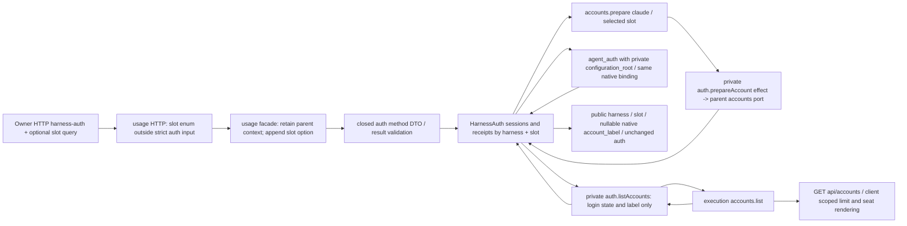

# Slot-aware official authentication

Owner: Mika. Base main f176b55d; execution's [account contract](../execution/harness-accounts.md) owns slots/limits/rules. This addition implements the existing Owner-authenticated harness-auth routes; Admi owns Web rendering. Molly composes the execution accounts port and public /api/accounts. L-2 source remains held.

## Function map / data flow

| Contact | Input / result | Contract |
| --- | --- | --- |
| Existing GET /api/harness-auth/claude | optional ?slot=1st or 2nd | no slot=1st; duplicate/invalid slot rejects before native. GET list without harness remains unchanged |
| Existing POST /api/harness-auth/claude/start,input,cancel | same optional query | existing Owner actor boundary and strict binding/prompt_digest/response body unchanged; slot is never inside that body |
| HarnessAuth status/start/cancel | (harness, options={slot?}); HTTP/facade retains existing context position and appends options | legacy callers keep their signature; standalone class also accepts options in its existing ignored context position |
| HarnessAuth input | (harness, input, options={slot?}); HTTP/facade appends options after existing context | input checks only selected slot's stored session/receipt; no root from client input |
| auth.prepareAccount private effect | {harness:claude,slot} -> {configurationRoot:absolute path} | only existing auth root methods, same requested harness/slot; parent accounts.prepare owns paths and returns {configurationRoot,history}; usage projects only configurationRoot into the private auth effect. Missing accounts or any non-compatibility preparation error becomes HARNESS_AUTH_ACCOUNTS_UNAVAILABLE/503 with `アカウントの保存場所を用意できませんでした。少し待ってから、もう一度お試しください。`; only 1st with missing accounts or coded HARNESS_AUTH_ACCOUNTS_UNAVAILABLE/EXECUTION_REQUEST_INVALID falls back to native default root. |
| auth.listAccounts private effect | {} -> {harnesses:[{harness:claude,slots:[{slot,loggedIn:boolean or null,label:string or null}]}]} | Claude auth.start/status/input only; project login metadata from public execution accounts.list, without roots/limits/seats/rules. Missing/older capability is an empty list; read failures do not block native auth. |
| agent_auth private call | existing arguments + configuration_root for prepared Claude slot | before each action prepare the selected slot; Aiterm E3 owns root validation and same-session root binding. Roots never appear in public response/SSE/log |
| Claude public snapshot | {harness,slot,account_label,auth} | auth retains its old keys. account_label is native string or null; cancel returns auth:null/label:null. Non-Claude public response stays unchanged |

The canonical key for 1st remains its existing harness string; Claude 2nd uses claude:2nd. These are a closed representation of the (harness,slot) tuple, not a new account identifier. Existing first-slot private handoffs remain readable. Extend owned session/receipt handoff validation for the second key and nullable label/slot metadata; no credential state is serialized. Exchange/rollback with an active second-slot session requires the receiving usage implementation to support that key; Molly owns compatible module supply ordering. The first-slot old format is kept.

Without an accounts port, default/1st continues the existing native default root; 2nd returns typed unavailable before native issuance, protecting an unintended login to the first root. Installing/injecting the execution port exits that unavailability. A real preparation failure rejects either slot with the normalized unavailable error and never falls back to another root. The coded EXECUTION_REQUEST_INVALID compatibility response also falls back only for 1st. Prepared roots still require an absolute path without NUL. Non-Claude 2nd is invalid; Codex slots are out of scope.

During an open Claude auth session, a blocked native receipt is presented as waiting when that slot still has credentials, retaining the existing login label and unchanged native auth_ui/binding/prompt. Credential evidence is accounts.list loggedIn=true or the last pre-start authenticated receipt; nullable/unavailable account metadata falls back to a private per-slot loggedIn boolean in receipts. An explicit loggedIn=false clears carried evidence once the previous receipt is no longer authenticated. Native authenticated completion keeps its new label and normal close; cancel clears session/receipt evidence. No credentials means blocked, and one slot never borrows evidence or labels from another. The optional private receipt loggedIn boolean survives existing volatile handoff and never enters the public DTO.

Each operation keeps selected-slot sessions separate. cancel/start for 2nd cannot terminate 1st. The existing input binding/native identity/prompt digest and unknown-result non-replay rules remain. A rejected validation/operation does not poison the serialized operation queue; later explicit status/cancel/start may proceed. No automatic auth retry or replay is added.

## Impact and minimal checks

Owned code: HarnessAuth; usage HTTP/facade/process schema/result/handoff; closed private effects schema and parent-effects dispatch (usage module source). Public /api/accounts and parent fallback/accounts injection are Molly-owned; native E3 and execution selection/limits stay with their owners. Add execution.accounts dependency to module.json and regenerate the overall function map. Product source and this function/DFD ship together.

Own checks cover synthetic per-slot root/action isolation, wrong-slot input rejection before native, unavailable default compatibility, query routing with strict body/context retained, closed effect/result/handoff compatibility and nullable native label. Existing native/execution/client checks are inherited; no real login, credentials, CLI settings, production or quota use.
