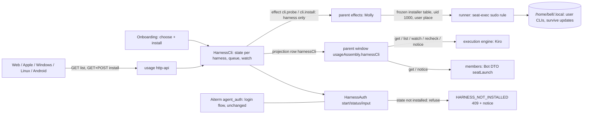
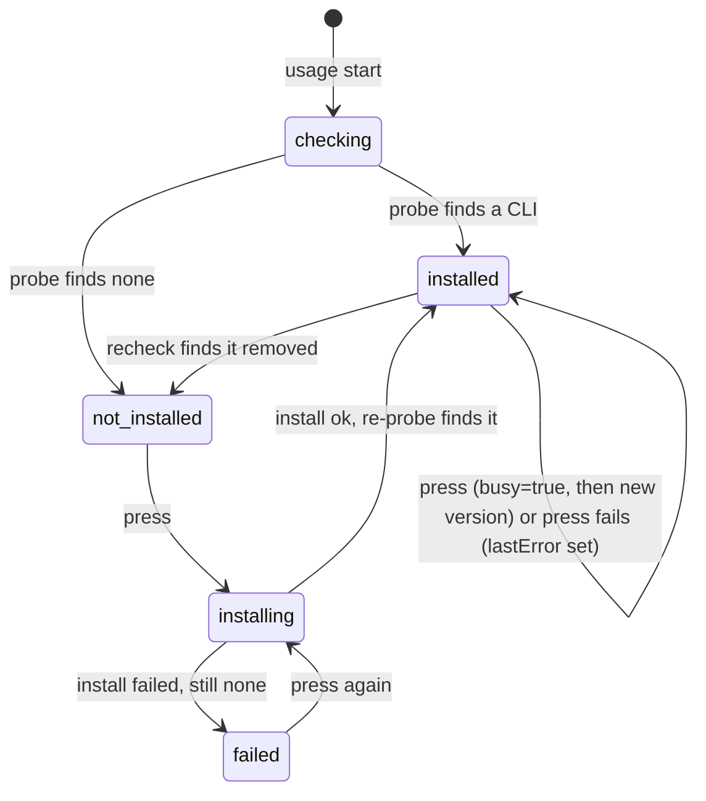

# AI CLI: which one is installed, and the "最新版を入れる" button (a451, Mika; 2026-11-19)

Owner ruling 2026-11-19 (via Trony): the BellTeam image carries no AI CLI (Claude Code, Codex, Grok, Cursor). The user installs the latest one with a button in AIの認証. Plan: `bot-7b140b27/docs/plan_no-bundled-cli-20261119.md`. Owner of this contract: Mika (usage). Runner and place: Molly (a451-cli-install-place). Execution reads: Kiro (a451-launch-not-installed). Screens: Admi (Web), Rapi (Apple), Anis (Windows), Neon (Linux / Android).

Login is unchanged: each CLI's own official flow through Aiterm; BellTeam stores and relays no token and never sees installer output.

## Decisions

| Question | Decision |
| --- | --- |
| Who owns the fact | usage (`HarnessCli`, `src/harness-cli.mjs`). Execution, members and the four apps read it; nobody else probes the filesystem. |
| How it is known | By asking the box: the usage child sends the parent two effects, `cli.probe {harness}` and `cli.install {harness}`; Molly's runner executes them as the seat user (uid 1000) in the user place. The child sends only the harness id. The installer commands are Molly's one frozen table; the child cannot name a URL or a command. |
| What "installed" means | A usable `<cli> --version` on the seat PATH, bundled or user-installed (`source`: `user` under `/home/bell/.local`, `image` still bundled). While the image bundles the CLIs (train 1) every existing install reads `installed`, so nothing stops. |
| Update | The same press is the update: it installs the vendor's official latest release unmodified into `/home/bell/.local`, which shadows the bundled copy by PATH order. Seats keep `DISABLE_AUTOUPDATER=1`, so this press is the only way a version changes. |
| A running or failed update of a CLI that works | The CLI stays `installed` (seats keep running); only the display shows the update and its error. |
| Persistence | None. The facts are on disk; usage re-reads them with the probe. `busy` and `lastError` are in memory and end with a restart. |
| One at a time | Presses are queued FIFO in usage and Molly's runner refuses a second concurrent install: only one installer runs. |
| Owner only | Installing software is an Owner action: owner HTTP only, never Bot or internal callers. |

## Function diagram



## Data flow and states



`state` is readiness. `installed` whenever a usable CLI exists, whatever an update does. `installing` and `failed` exist only while the CLI is absent. `busy` (an installer is running) and `lastError` (`{code,message}` of the last failed press) overlay any state. Execution treats only `installed` as ready; `checking`, `not_installed`, `installing`, `failed` all mean "wait". Self-exit of every non-ready state: press the button, or install it by hand, then `recheck`/the next probe; nothing is a lock.

Probe triggers: usage start (`checking` until it ends, a few seconds); after every press; `recheck(harness)`; and a lazy refresh when the list is read and the cache is older than 60 s (never blocks the read).

## Public contract: apps (HTTP, all additive)

Released clients ignore unknown fields, so every change is a new field or a new route.

`GET /api/harness-auth` (existing): each `harnesses[]` item gains

```json
"install": { "state": "installed", "version": "2.1.0", "source": "image", "busy": false,
             "lastError": null, "message": "…", "action": "install", "label": "最新版を入れる" }
```

- `state`: `checking | installed | not_installed | installing | failed`. `version`: string or null. `source`: `user | image | null`.
- `busy`: an installer is running for this AI. `lastError`: `{code, message}` or null, `code` in `CLI_INSTALL_FAILED | CLI_INSTALL_NETWORK | CLI_INSTALL_TIMEOUT | CLI_INSTALL_UNSUPPORTED`.
- `action`: `"install"` when a press is possible, `null` while `busy` or `checking`. `label`: always `最新版を入れる` or null (same words in every app; the press is the install and the update).
- `message` is the one plain sentence the app shows (fixed server-side so the four apps say the same):

| state / overlay | message |
| --- | --- |
| checking | 確認しています。 |
| not_installed | まだ入っていません。「最新版を入れる」で入れてください。 |
| installing | 入れています。数分かかることがあります。 |
| failed | 入れられませんでした。{reason}もう一度「最新版を入れる」を押してください。 |
| installed, source user | 入っています（バージョン {version}）。「最新版を入れる」で最新版にできます。 |
| installed, source image | 入っています（バージョン {version}）。BellTeamに最初から入っている物です。「最新版を入れる」で、最新版をあなたの領域へ入れてそちらを使います。 |
| installed and busy | 最新版を入れています。今の版はそのまま使えます。 |
| installed and lastError | 前回、最新版を入れられませんでした。{reason}今の版はそのまま使えます。 |

{reason}: NETWORK 「通信できませんでした。」, TIMEOUT 「時間内に終わりませんでした。」, UNSUPPORTED 「このBellTeamの本体は、入れる機能にまだ対応していません。BellTeamを更新してください。」, FAILED 「入れる途中で失敗しました。」.

New routes (owner only; Bot/internal callers get 403):

| Route | Result |
| --- | --- |
| `GET /api/harness-auth/:id/install` | `{harness, install}` (same object). Poll every few seconds while `busy`. |
| `POST /api/harness-auth/:id/install` | Empty body. Starts the press (queued if another AI is installing) and returns `{harness, install}` with `busy:true`; a press while `busy` returns the same object (no second installer). 400 `HARNESS_AUTH_HARNESS_INVALID` for an unknown id. |

Existing auth routes (`GET/POST /api/harness-auth/:id`, `/start`, `/input`, `/cancel`, with or without `?slot=`): while the AI's state is `not_installed`, `installing` or `failed`, `start` and `status` answer 409 `HARNESS_NOT_INSTALLED` with message = `notice(harness)` below, so a released client shows a plain sentence and never an Aiterm error. `cancel` stays harmless. Once `installed`, nothing changes.

Onboarding (the setup routes, existing: `GET /api/setup`, `POST /api/setup/harness` (choose), `/api/setup/auth/input`, `/api/setup/start`, `/api/setup/complete`): `harnesses[]` items and the snapshot gain the same `install` object (for the chosen AI at top level as `install`). `phase` keeps its three values. After `select` of an AI that is not installed, `phase` is `authenticate` and `auth` is `{status:'blocked', message: notice(...), …}` (the existing closed shape), so a released client shows the sentence and no wrong button. New: `POST /api/setup/install` (empty body, owner) installs the chosen AI and returns the snapshot; when it reports `installed` and the official login has not started, usage starts it (what `select` did before), so the next poll shows the login. Choose -> install -> login -> guide.

Screens (all four apps, same entrance; Mac is the reference): in AIの認証 each AI row shows `install.message` and a button `最新版を入れる` when `action` is `install`; the settings home 要対応 band counts an AI whose `install.state` is `not_installed` or `failed` (Tronie ruling 2026-11-19, Mac is the reference), NOT `installing` (it is moving by itself) and not `checking`; Claude counts once for both accounts, whichever its two slots show; the Bot editor shows an AI that is not installed plainly (`notice`). Login buttons stay as they are and are shown when `state` is `installed`.

## Public contract: server modules (parent window)

`usageAssembly.harnessCli`, parent side, answered from a copy the parent holds (usage pushes it as projection rows, so no round trip per read):

| Call | Result |
| --- | --- |
| `get(harness)` | `{harness, state, version, source, busy}` (sync) |
| `list()` | `{claude, codex, grok, cursor}`, each as above (sync) |
| `watch(listener)` | `listener({harness, state, version, source, busy})` on every change; returns an unsubscribe |
| `recheck(harness)` | async; forces a probe, returns the new `get` object (Kiro: after a launch ended not-started while `installed`) |
| `notice(harness)` | the one plain sentence for a member: not_installed 「<AI名>がまだ入っていません。AIの認証から入れてください」, installing 「<AI名>を入れています。終わるまでお待ちください」, failed 「<AI名>を入れられませんでした。AIの認証からもう一度入れてください」; `null` for `installed` and `checking` |

Execution (Kiro): reads `get` before a launch / summary / catalog run; only `installed` is ready; `checking` waits without a notice; the others wait and show `notice`; drains on `watch`; not filed to BugHub; code `HARNESS_NOT_INSTALLED`. Mounting the port into an engine is Molly's; an older body or usage means no window and execution behaves as today. Remote terminals run the CLI on the user's machine and are not covered.

## Runner contract (Molly, agreed 2026-11-19)

Two parent effects on the usage module channel, composed in `src/usage-cli-effects.mjs` (new, injected runner), harness in `claude|codex|grok|cursor`, nothing else crosses:

| Effect | Result |
| --- | --- |
| `cli.probe {harness}` | `{installed:boolean, version:string|null, source:'user'|'image'|null}`. `command -v` then `<cli> --version`, 10 s, no network, as uid 1000 with PATH `/home/bell/.local/bin` first; `user` when the resolved path is under `/home/bell/.local`, else `image`. Only booleans and the version leave, never paths or output. |
| `cli.install {harness}` | `{version}` or error code `CLI_INSTALL_FAILED | CLI_INSTALL_NETWORK | CLI_INSTALL_TIMEOUT | CLI_INSTALL_UNSUPPORTED`. 10 min, one at a time (the parent refuses a concurrent one), only the code leaves. The vendor's official latest installer, unmodified, into the user place: claude and codex `npm install --global --prefix /home/bell/.local <pkg>@latest` (`@anthropic-ai/claude-code`, `@openai/codex`); grok x.ai's install script then `~/.grok/bin/grok` copied to `~/.local/bin/grok`; cursor cursor.com's install script. |

A body that does not know an effect refuses it; usage maps that to `CLI_INSTALL_UNSUPPORTED` (install) or leaves the probe result `checking -> installed` for bundled CLIs (an old body cannot probe: usage then reports nothing new and the window stays absent). Ship order: body first, then usage. The shared Claude copy in `/home/bell/.local` is never touched by the per-Bot cleanup; a Bot's own `<project>/.local/bin` copy would shadow it (only Claude's is cleaned).

## Compatibility and trains

- Released clients: only additive fields and routes; a refused auth call is a 409 with a plain message; onboarding keeps `phase` and the `auth` shape.
- Train 1 (image still bundles the CLIs): place, effects, `HarnessCli`, routes, onboarding, screens. Existing installs read `installed` / `source:image`; each one moves its CLIs with the button (production Tronie, review server Rapi, lab Centi). Train 2: the image without CLIs; its update note says AI CLIs are no longer included and one press in AIの認証 restores each.
- Mixed versions: new usage with an old body cannot run `cli.*` (install answers `CLI_INSTALL_UNSUPPORTED`, the window is absent); new body with old usage changes nothing.

## Protection and checks

Protection named: arbitrary code execution as the seat user (the lower-trust child sends only the harness id; the installer table is frozen in the parent), secret exposure (installer output and tokens never cross; login unchanged), and overwriting state (installs only into `/home/bell/.local`, never the bundled copy). The refusal `HARNESS_NOT_INSTALLED` states a fact (the CLI cannot run) and exits by pressing the button. Checks (minimal, own interfaces): `HarnessCli` state machine with a fake runner, HTTP routes and owner-only, auth refusal, onboarding choose->install->login, window `get/list/watch/recheck/notice`, projection row validity. No real installer is run by tests.
