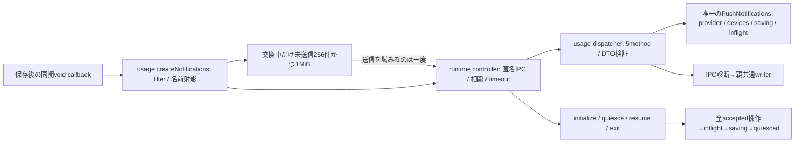
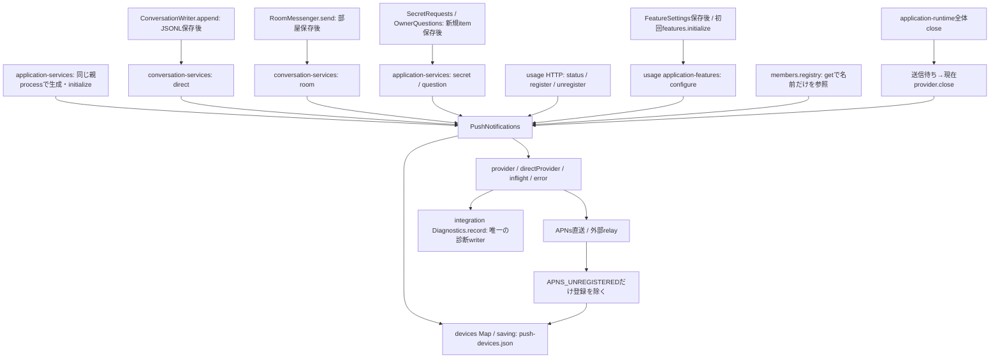
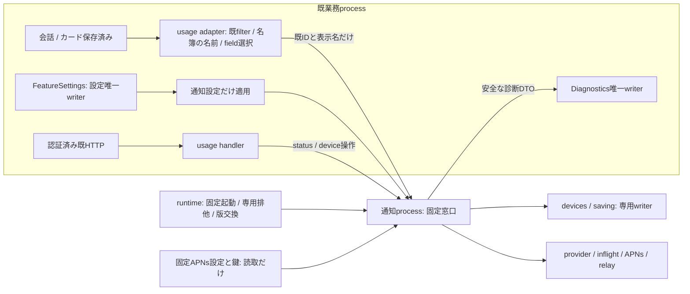
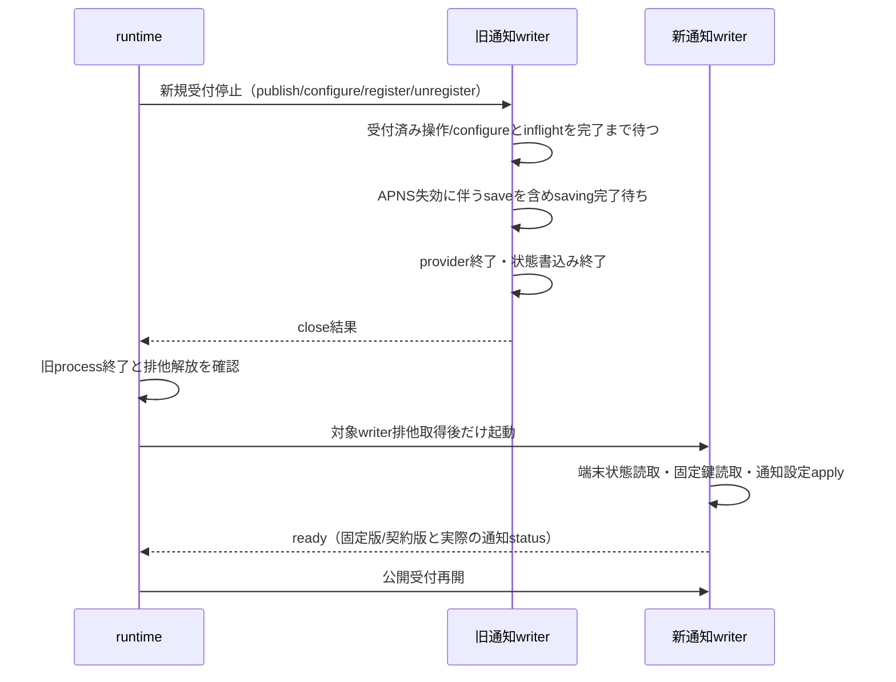

# 通知の独立process化：現行境界と契約への入力

2026-11-03 JST、ミカ。読取基準は通常main `03c952bf33b58b4eff322a8514f5448336c1a5be`。
本書は通知内部の正本。以下の現行境界と準備時の提案を保持し、実装では「固定契約v1の実装接点」を優先する。実装・実物受入の成立は別に記録する。
全体は[機能図](../../feature-map.md)、現行usageは[処理と保存順序](flows.md#通知と購読サーバー会話の成功とは別の機能)。
Root正本は自席 `docs/module-expansion-20261103.md`、runtime案はエピネル自席 `docs/notification-module-runtime-20261103.md`。

## 固定契約v1の実装接点

Root正本 `/srv/bellteam/bots/bot-7b140b27/docs/notification-update-contract-20261103.md` 全文を読み、準備待ちを終了した。state/pathは据置、UID1001協調writer、config存在accessは親に残す。通常quiesce60秒超過は旧子resume ACK後に受付を戻し、quiesced後だけclose5秒有限回収、新ready45秒。disabled/relay適用失敗はreadyとstatusを分け、state/鍵不正はfatal。下の旧提案との未確定差分はこの裁定で解消する。



- `src/usage/notifications.mjs:createNotifications({root,bots,diagnostics,configuration,prepareRelease,createProcess,onState})` はruntime factoryを注入してcontroller一実体を生成。initialize/close/status/configure/register/unregister/4通知とcontroller/initialStatusを返す。statusは非同期。初回features.initializeはinitialStatusで二重configureを避け、後の明示configureは既設定反映経路を保つ。
- 親bufferはplanned exchange中の未送信だけ、256件/1MiB。ACK不明・送信試行済みは再送0。overflowはPUSH_UPDATE_BUFFER_FULLの固定通知診断。停止・不正入力・IPC失敗を4callbackの外へthrow/rejectしない。
- `src/usage/notifications-dispatcher.mjs:createNotificationsDispatcher` はDTO検証/5method dispatchと4controlを持つ。親の名簿や設定全体を読まない。runtime ChildChannelはquiesce受信時に同期でgateを閉じ、accepted送信待ちを含むdispatchを待ってからusageのquiesceへ入る。resumeは並行して旧quiesce世代を取り消す。
- `src/notifications-entry.mjs` はruntimeのverifyNotificationsLocks/CreateChildChannelを使い、一度だけready。exit結果のIPC送信完了後のafterControlでchannel.close。親切断の最大60秒回収と固定lock/FDはruntimeが持つ。
- 通知provider/保存は既PushNotificationsを使用。state配列/端末形式の不正は固定PUSH_STATE_INVALIDで初期化失敗とし、空状態へ置換しない。APNs/relayの既exportと外部callerは保持する。
- 交換中の別設定保存によるFEATURE_APPLY_FAILEDは、後のready applyError=nullで消さない。共通onStateはapplyErrorがある時だけ設定errorへ投影し、clearは既明示設定applyが持つ。

## 現行の全callerと所有



| 接点 | 基準sourceと関数 | 現行入出力・順序 |
| --- | --- | --- |
| 構築/初期化 | `src/application-services.mjs:36` → `src/push-notifications.mjs:10,22` | root/bots/diagnosticsを共有。旧APNs設定を読んでdirectProviderを保持、端末fileをMapへ読む。起動時設定applyは後段 |
| status | `src/usage/http-api.mjs:63` → Push `:37` | GET `/api/notifications`。同期で `{configured,environments,error?}`。token/取引/鍵を返さない |
| configure | `src/usage/application-features.mjs:47,73` → Push `:42` | `{enabled,relayUrl}`。providerを外す→現inflight待ち→旧provider.close→OFF/直送復帰/relay status実照会。成功時status、失敗時診断後throw |
| register | usage HTTP `:65` → Push `:66` | `{token,environment,server,previousToken?,signedTransaction?}`、32,768 byte上限。検証・環境照合→旧token除去/Map更新→save→`{registered:true}` |
| unregister | usage HTTP `:67` / Push `publish:119` → `:77` | HTTPは `{token}`、4,096 byte上限。失効時はdeviceを渡す。削除/save後 `{registered:false}` |
| direct | `src/conversation-services.mjs:25`、`src/conversation-writer.mjs:25` → Push `:84` | 保存recordのschemaがdirect-message.v1、target=user、fromがuser/scheduler以外だけ。delivery_id/from、親bots.getのnameを使用。interim/status/Bot間連絡は通知しない |
| room | `src/conversation-services.mjs:58`、`src/room-messenger.mjs:80` → Push `:91` | 保存済み投稿のid/sender.id/name/room.id/nameだけ。user/schedulerを除く |
| secret | `src/application-services.mjs:91`、`src/secret-requests.mjs:55` → Push `:98` | 新規item保存後、一度のonRequest。id/botId/roomIdと名前だけ。submit/cancel完了のnotifyは会話への案内であり、別処理 |
| question | application-services `:97`、`src/owner-questions.mjs:53` → Push `:104` | 新規item保存後のonRequest。id/botIdと名前だけ。回答保存後notifyはBot会話への案内であり、別処理 |
| publish | Push `:110` | providerなしは送らない。端末snapshotごとsendを一度。返却はvoid、inflightを自分で保持。全端末配信/表示完了のACKはない |
| save | Push `:138` | saving Promiseでfile書込を直列化、0600 `.tmp`→rename。保存時点のMap全体を読む。失敗後も次saveは進む。fsync/rollbackは現行契約にない |
| close | `src/application-runtime.mjs:116` → Push `:148` | 現inflightだけ待って現在provider.close。新規受付停止、saving/configure/register待ち、writer排他解放の契約はない |
| diagnostics | Push `:131` → `src/diagnostics.mjs:79` | 固定通知code/moduleと英大文字等の原因符号だけ。共通writerはlogs/diagnostics.jsonを保存。通知はこのfileを書かない |

公開HTTPの認証とエラー変換は共通側に残る。`src/http-errors.mjs:18`はPUSH_DEVICE_INVALIDを400、PUSH_NOT_CONFIGURED/PUSH_ENVIRONMENT_UNAVAILABLEを503へ変換する。statusを非同期化する時はusage handlerのawaitが必要。

| 状態 | 現所有と独立後の移動単位 |
| --- | --- |
| `state/push-devices.json` と `.tmp` | 通知だけが書く。devices Mapとsavingを同じ子へ移す。親の新旧Push実体を同時に残さない |
| provider/directProvider/request/error/inflight | 通知だけが保持。APNsのkeys/token署名Promise/connections、relay URL/environmentsも子内。MapやPromiseを親へ投影しない |
| `shared/tools/apns/config.json` とconfigに列挙された `.p8` | 通知の固定読取範囲。APNs.createはteam/topic/key名・形式を検証。設定内容/鍵をDTO・診断・親envへ出さない |
| `shared/tools/bellteam-settings/settings.json` | FeatureSettingsのwriterを親へ残す。通知設定の保存と子への適用は別結果 |
| botsとroom、質問/秘密のitem/file | 元所有者に残す。通知は表示名と既IDだけを入力で受ける |
| `logs/diagnostics.json` | integrationの唯一writerを維持。子は最小診断DTOを送る |

## 最小DTO案：Rootの横断契約固定待ち

名前・transport・timeout値・版schemaはRoot/runtimeの確定契約に合わせる。本表は必要な情報を示す。新RPC基盤や任意method呼出しを先行実装しない。

| 操作 | 子へ渡す値の全候補 | 返却する必要値 |
| --- | --- | --- |
| status | なし | 現行 `{configured:boolean,environments:('development'\|'production')[],error?:{code,message}}`。process利用不能をconfigured=falseの成功に隠さない |
| configure | `{enabled:boolean,relayUrl:string}` | 現行status、または固定codeの失敗。保存済み設定は親が維持。設定全体/environment/秘密入力objectは渡さない |
| register | 現行device DTO、previousTokenとsignedTransactionは任意 | `{registered:true}`は保存完了後。token・署名付き取引を応答/診断へ反射しない |
| unregister | `{token:string}` | `{registered:false}`は保存完了後 |
| 通知イベント | 下記の限定union | 受付前拒否と受付済みを区別する最小ACK。受付は送信完了を意味しない。永続結果照会や配信台帳は足さない |
| ready/close | runtimeからの固定lifecycle接点のみ | readyはwriter取得/読取/設定apply後。closeは受付停止と全処理の区切り後。通常呼出しの任意公開methodにしない |
| 診断（子→親） | `{code:'SERVER_PUSH_SEND_FAILED'\|'SERVER_PUSH_UNAVAILABLE',module:'notifications',diagnostic_log:安全な符号}` | 親writerで保存が完了したか/失敗したか。送信を再発行する意味を持たない |

通知イベントは次だけとする案。type名は仮置きで、既message/request IDをそのまま使う。

```text
direct   {type:'direct',   id:delivery_id, botId:from, senderName}
room     {type:'room',     id:record.id, botId:sender.id, senderName, roomId, roomName}
secret   {type:'secret',   id:item.id, botId:item.botId, senderName, roomId:null|string}
question {type:'question', id:item.id, botId:item.botId, senderName}
```

親に残すusageアダプタで既filterを適用してから限定fieldを取り出す。direct/secret/questionは既bots.getの名前、欠落時は「メンバー」。roomは保存recordの名前snapshotを保つ。子へregistry読取RPCを追加しない。任意title/body/payloadや完全record/itemの受取りを増やさず、子が現行の固定文言と`notificationPayload`を作る。questionのroomIdは現行どおり付けない。

本文、label、question/options/answer、toolId、秘密値/path、ownerGuide URL、画像、tokensの一覧はイベントに含めない。serverは端末登録側にだけ必要。APNs-collapse-idやrelay idは既idを保持し、再送抑止の永続保証へ読み替えない。型/既callerのID形式・長さ/表示名の上限等のtrust boundary検証は固定契約のschemaで具体化する。



## 設定の起動順で必要な接点

`src/bootstrap.mjs:29,33`はservices構築前にFeatureSettings.initializeを呼ぶ。`src/feature-settings.mjs:80`の旧APNs設定有無確認はaccessだけで、鍵やJSON内容を読まない。このbooleanは空relayUrlでも直送設定を有効にできる判定に使われる。APNs providerの妥当性検証は後の通知initializeが行う。

この順を保つ最小案は、親に固定config pathの存在確認だけを残し、子へconfig内容や親envを渡さないこと。親からAPNs領域の参照を完全に除く権限契約なら、通知起動前の固定資材descriptorに「旧configが存在する」のbooleanを持たせ、FeatureSettingsへ注入する接点が必要。子status.configuredは設定apply後の意味なので、このbooleanの代用にならない。子から先に起動する案はbootstrap全体の順変更を伴う。どれを採るかRoot/runtimeが固定するまでは変更しない。

通知子へ必要な秘密はAPNs設定/列挙鍵と、registerで渡す当該端末の署名付き取引だけ。relay方式に購読検証用Apple秘密環境を渡す必要はない。検証は既外部通知relayが持つ。settingsの他機能secret、BELLTEAM_WEB_TOKEN、席の資格、process.env全体を渡さない。

## 停止・唯一writer・結果不明

現行のsavingはprocess内の順序制御で、process間排他ではない。`state`directoryへのrename権限を新旧二者へ残すと、fileだけ所有者を変えても唯一writerにならない。専用directory/固定file配置と旧path互換の選択、専用UID/mount/排他の具体値はruntime/配布担当へ渡す。現行`server-state-{ownership,writers,transfer}.mjs`もstateとAPNs領域を扱うため、通常保守時の全writer停止と通知だけの排他を両立させる。担当内で勝手に移設しない。



これは必要な停止順の提案。close ACKだけで旧writer終了を推測しない。ready前には業務要求を受けない。OFFまたはprovider設定失敗で通知だけ利用不能のreadyを許すか、子の起動失敗とするかはRootが確定する。破損した端末状態を空Mapに置換してreadyを返さない。期限までに区切れなければ交換失敗、旧writerが生きている間は新writerを起動しない。強制終了・他業務停止・自動再送を追加しない。

### runtime提案db16d36との照合

エピネル正本 `docs/architecture/modules/runtime/notifications-release.md`（本人checkout、commit `db16d36`）を読取った。子自身のprivate SH/通知専用EX、状態読取り前の取得とprocess生存中の保持、親全体state EX/FDを子へ流用しない案、旧child close/stdio回収後だけ次を起動する案は上の必要条件と整合する。

停止期限超過は要裁定。本書は既全体設計の「区切れなければ交換延期・旧受付へ戻す」を基にする。runtime案は対象子だけKILL→close後に交換を続ける。後者はregister保存中の結果不明/一部端末への送信可能性を残し、旧processへ戻して未受付へ変換できない。どちらでも自動再送0・新旧writer同時起動0を保つ。決定前に実装しない。

runtime案のUID1001固定は寿命/協調writerの分離を提供する。同UIDの他領域へのOS権限隔離は未提供と明記されている。専用UIDまで要求する旧全体設計との到達範囲もRootで明示する。provider利用不能readyと初回state read/write互換、旧APNs存在確認、HTTP statusのawait化を合わせて契約固定する。

| 失敗/切断点 | 必要な扱い |
| --- | --- |
| 子への未受付が確定 | 未受付として通知だけ利用不能。保存済み会話・カードを成功から戻さない |
| 子受付ACK取得 | メモリ受付済み。端末送信/表示成功や永続受付ではない |
| 親子要求送信後、ACK前に切断 | 受付・外部送信の有無が不明。自動再送しない。statusはprovider状態であり既idの送信履歴ではない |
| ACK後に子死亡 / APNs timeout / relay切断 | 一部端末へ届いた可能性を残す。新processへinflightや本文を再投影しない |
| register/unregisterの応答喪失 | 保存が済んだ可能性がある。成功/未変更を推測しない。新しい結果照会/自動再試行を足さない |
| register/unregister保存失敗 | 現行はMap更新後にthrow、メモリだけ変わり得る。成功ACKを返さず、rollbackしたと表示しない |
| 設定apply失敗/返却喪失 | 親の保存値は残る。既FEATURE_APPLY_FAILEDと設定通知を保つ。configureを自動再発行しない |
| 通知診断の保存失敗 | 固定符号だけstderr等へ残し、会話の再送理由にしない。外部送信完了と診断保存は別 |

親のonMessage/onRequestは現行同期voidで、保存後に呼ばれる。新adapterは非同期のIPC失敗を自分で回収し、通知停止/子死亡で会話append、room routing、秘密/質問createの既保存成功を失敗にしない。永続通知queueや無制限の親内滞留は作らない。受理容量と停止符号はRootの最小共通契約で決める。診断の親向け返却がdrainと相互待ちしないよう、通知close中も共通診断窓口を残す必要がある。

## 契約固定後の実装範囲と受入

- ミカ：通知内部のDTO検証/イベント組立て、provider/端末writer、限定親adapter、usage HTTPのawait、通知設定applyの接点と関係する図/試験。source分離だけを独立更新の完了にしない。
- モリー：application-services/conversation-services/runtimeの公開組立て・共通診断接続・必要な結合・通常main統合。N102の会話内部へ新しい待機を入れず、公開callbackの接続で分ける。
- エピネル：固定子起動・lifecycle/専用writer排他・版交換/ready/停止結果と通常保守排他への接続。センチ：固定資材の収録/署名・配置の受入。Root：公開契約/優先順位/本番。

維持するexportはPushNotifications/APNsProvider/NotificationRelayProvider/notificationPayload/validatePushDevice/APNS_IDLE_TIMEOUT_MS。`services/notifications/index.mjs:5`はAPNsProvider、同`relay.mjs:2`はvalidatePushDeviceの実caller。外部通知relayを通知子と取り違えず、移動時は互換exportを保つ。server-address/jose/http2等の既依存を使い、独自実装へ置換しない。

最小の直接受入は、DTOに本文/秘密/任意fieldが渡らないこと、既4イベントfilterとpayload一致、端末保存/reloadとpreviousToken、APNs失効保存、停止中の受付拒否とinflight/save完了、旧writer終了前の新writer拒否、ACK前後切断で再送0、通知停止中も実会話/カード保存とAI実行が続くこと。status/register/unregisterのHTTP互換、設定保存済み+apply失敗、共通診断失敗時の結果分離も変更境界だけ確認する。

既試験の読取対象はpush-notifications/notification-relay/feature-settings/application-runtime/usage-module/secret-requests/owner-questionsと、共通servicesを使うexecution-diagnostics-integration/goal-diagnostics-integration。source変更後に必要な試験だけ選び、全成功群の再走を要件にしない。独立完了には別process/唯一writer/通知だけ交換・旧版復帰/他業務保持と、固定資材・権限の実物受入が必要。本書作成段階でこれらは未実施。

今回の読取りで先行させる致命的バグは確定していない。close/saving等の欠落は独立化のための差分として記載し、既本番の障害再現と混同しない。独自RPC、コード変更、試験実行、配布、Host/本番、APNs/relay実送信は行っていない。
