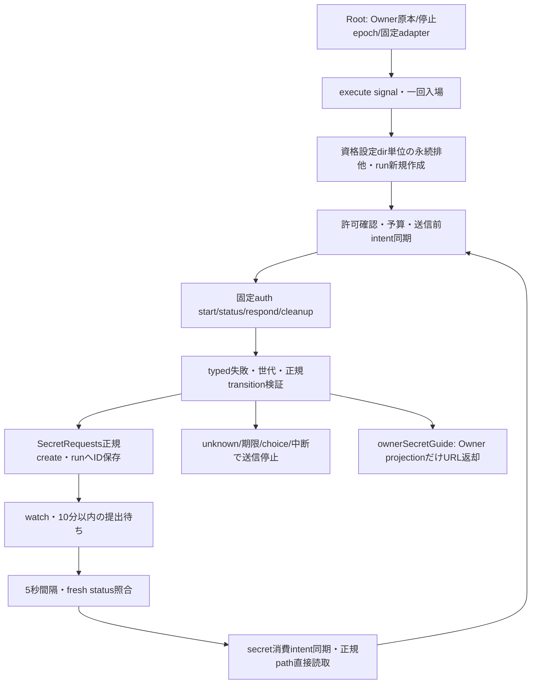

# Rabbit認証consumer候補

未配布候補。Root7a7a5a7から参照注入されるusageの追加窓口。native50588a9専用の合成受入であり、実認証/本番の許可ではない。

正本はrunDirectory（管理root/state/olrw-auth、管理UID1001/0700）。全runに一つのtarget.lock、runId.jsonl（0600）をusageだけが所有。journal各行をfsync、作成は親directoryも同期する。失敗/unknown/中断はlockを残し、再起動・別runも自動続行しない。成功cleanupと完了記録の同期後だけlock解除。同runのjournalは新規作成専用で再実行しない。保存先/期限を過ぎた記録の削除は自動化せず、統括の独立照合後に管理側で保持見直し。秘密値正本を削除/複製しない。

固定context: runId（英数_- 1..64）、requesterBotId、toolId、sessionId（予約済認証名）、expiresAt（ISO）、roomId（null又は固定room）、protectedHosted（元hosted名）。sessionId==protectedHostedは拒否。固定Rabbit/kite/claude-code/cwdはauth adapterが所有。contextは管理plan由来、自由HTTP/MCP入力ではない。

factory({secretRequests,runDirectory,context,assertAuthorized,auth}) → execute({signal}), close(), ownerSecretGuide({requestId,botId,roomId})。RootがassertAuthorized(action)の拒否throw/成功undefinedを保証。native操作名はstart/status/respond/cancel（cleanupからcancelへ許可照合）。guideはrespond許可を読取り確認し、native/秘密/正本の更新は行わない。

予算はstart1/respond1/cleanup1/status12・間隔5秒、run15分、request発行から提出10分。choiceは空でintervention_required。全期限は最小値、unknown/期限後native0。statusも作用なので毎回intentと許可を必要とする。提出待ちでnative pollをしない。各nativeは全体期限/close/abortで有限待機し、タイムアウト/中断後の返却は採用せずunknown。

native応答はMCP isError/structuredContentを受ける。operation-error(status/cancel)とresponse-errorを別検証しnot_issued/unknownを保持。normal receiptはharness/session/status/UIを検証し、transition.from==保存binding、to==公開binding、pane_pid/pane_started以外不変の場合だけ更新。transition直後は入力せず次statusで同binding/非null digestが得られてからrespondする。

operation-errorはnative505のstrictな6項目(schema/harness/session_id/action/code/effect)だけを受け、status又はcancelと実操作・対象を照合する。codeはAGENT_AUTH_OPERATION_NOT_ISSUEDとnot_issued、AGENT_AUTH_OPERATION_UNKNOWNとunknownの対応に限る。余分/不足fieldや矛盾はinvalid_receipt/unknownで停止する。response-errorの公開code string契約は維持する。既存図のtyped失敗検証内の修理で、状態所有・接続・公開窓口の変更はない。

Client48ee19cのRPC前固定Errorは、codeがAITERM_AUTH_CONNECTION_ARGUMENTS/AITERM_AUTH_CONNECTION_UNCONFIRMED/AITERM_AUTH_SERVER_VERSION_UNCONFIRMEDのいずれかでeffect=not_issuedの場合だけlocal_not_issued/not_issuedへ分ける。native typed receiptのnative_not_issuedとは別理由で、一般例外・通信断・未知code・矛盾effectはnative_unconfirmed/unknownを保つ。いずれも同許可の消費を戻さず、後続status/cleanup・再送をしない。既存図の送信前判定/失敗検証契約内で接続変更なし。

秘密カードには固定のlabel/messageだけ。URLはrunのみに保存。Owner guideは同request/bot/room/run、pending・正常・許可・期限内でだけ返す。HTTPS/userinfo無し、originはclaude.ai/console.anthropic.com/platform.claude.com完全一致。通常receiptはrunId/outcome/reasonだけでURL/raw UI/値/hash/path/例外を含まない。Root/N102/Admiの接続は別所有。module source以外のcaller/export/config/保存済データは変更しない。実callerの接続は未統合、試験fixtureだけがこの候補を呼ぶ。
