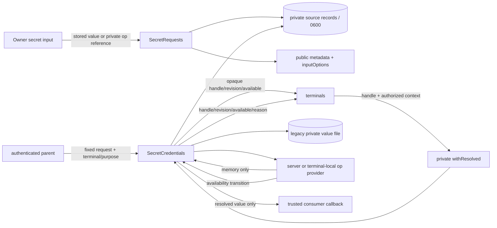
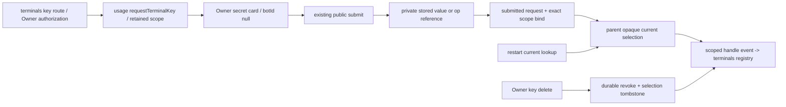
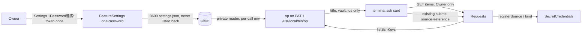

# Secret credentials and 1Password (C5)

Owner: Mika. Consumer: terminals (Crust), existing settings/auth consumers. Parent composition and authenticated capability capture: Molly. Web: Admi. 1Password deployment: Sakura.

## Function contract

| Component | Responsibility and public interface |
| --- | --- |
| SecretRequests | All request_secret slots accept legacy stored string or `{source:'onepassword',reference:'op://<vault id>/<item id>/<field>'}`. Public request metadata never contains reference/source/value. Pending input options prefer 1Password when connected, with stored input as fallback. |
| SecretCredentials | Own private request source records, opaque terminal-scoped handles, revisions, value resolution and availability. `bind(requestId,{terminalId,purpose})` returns `{handle,revision,available}`. The parent exports `usageAssembly.credentials = {requestTerminalKey,bind,current,unbind,credential,withResolved,replace,refresh,watch,watchRecovery}` and captures system authority internally. `credential(handle,context)` and `withResolved(handle,{terminalId,memberId,purpose},consume)` require a parent-authorized context; consumer callback receives only the value. `replace(handle,requestId,context)` increments revision. |
| OnePasswordSource | Fixed executable, argument-array `op read --no-newline` with captured stdout only. No shell, value argv, stderr/error forwarding, value cache or value file. `available`, `refresh()`, `watch(listener)`, `close()`; private refresh is invoked by a parent-owned helper after provider availability/recovery, never AI polling. Server op or a terminal-local provider uses the same private interface. |
| Private fixed providers | Parent registers provider capabilities under opaque private IDs. Configuration and key paths stay with secret input/provider owner, not terminal DTOs. No caller-supplied path/command. P1 existing Owner Mac key remains native-held for `owner-macbook` / `terminal.ssh`; authorized parent supplies only the native status/use capability described below. |
| Usage private IPC | System-only bind/resolve/credential/replace/refresh methods; facade captures value only inside trusted callback. No public HTTP/MCP value endpoint. Context DTO is validation data, never authority; authority is the parent-captured token. |

Terminal handles bind terminalId and purpose (`terminal.ssh` / `terminal.sudo`). The authenticated parent/terminal owner authorizes each memberId (bot-ID for seat operations; null for Owner maintenance), so a handle may serve multiple authorized members without copying a secret. Wrong terminal/purpose is rejected before any read. Generic request resolution validates requester/tool/submitted state before reading and keeps existing downstream authorization/one-shot claims.

## Data flow and private storage



Public request JSON and private source records are separate. Existing stored files retain UTF-8 exclusive 0600 semantics. 1Password sources persist only reference/provider metadata in `state/secret-sources`; resolved values remain in memory. Handles/bindings/revisions live in `state/secret-credentials`. Public metadata, projections, conversation, notifications, diagnostics and events contain neither values nor source identity; source records remain private. Private file reads retain owner/mode/link checks and a bounded size.

## State and protection

| State / transition | Meaning and self-exit |
| --- | --- |
| pending -> submitted | Source registration succeeds before submitted metadata and completion notification. A failed notification remains submitted. Existing source/file is never overwritten by repeated submission. |
| available -> unavailable | Provider/read failure emits availability=false and a fixed error. No alternative credential is chosen automatically: wrong-account/target protection. Stored input remains an explicit Owner choice. |
| unavailable -> available | Provider recovery helper or trusted refresh emits available=true for the same handle/revision, allowing consumer-owned pending work to retry. A failed read never permanently disables its handle. |
| revision n -> n+1 | Trusted replacement binds another submitted request to the same target, persists first, then emits revision event. Consumer decides reconnect; secret input does not replay an operation. |
| wrong target / malformed reference | Reject before secret read to prevent wrong-target use and secret exposure. Correct authorized context or corrected Owner submission can proceed immediately; no persistent lock. |

## Change and validation scope

Affected: SecretRequests submit/get and public metadata validation, private credential/source implementation, usage services/schema/results/facade, HTTP submit DTO, managed settings/auth consumers. Web input is implemented by Admi against the DTO above. Parent composition and terminal integration are Molly/Crust work through public interfaces.

Minimal synthetic checks cover stored/reference round trips without value persistence for op; reference/path trust boundaries; terminal/purpose matching and revision; availability recovery events; usage private IPC authorization/projection privacy; affected managed consumers. No real secret reads, SSH connections, logins or production deployment are part of these synthetic checks.

### Event transport and lifecycle

Usage IPC accepts projections only during a live parent operation. The child therefore has no autonomous provider/recovery timer. The parent owns provider availability triggers and a cancellable helper while recovery is pending, calls system-only `secrets.refresh`, and receives credential events during that live call. It stops the helper on body close and retains the same binding; quiesce rejection is transient and leaves recovery armed; it does not replay consumers. Standalone secret input may use its own bounded recovery helper. Initial connection probes do not publish before the initial snapshot.

V1 introduced private reference/provider records; Owner requests and revoked/tombstone interpretation below extend `secretEncoding` to `stored-or-private-reference-v2`. An old usage child cannot interpret this store, so update acceptance must require matching state compatibility. Existing legacy stored values remain readable by the new child; no value migration occurs.

### Native-held P1 SSH capability

Elegg's `aiterm.remote-binding.v1` keeps the SSH key and known_hosts in the UID1000 native service. The usage parent owns `NativeSecretCredentials` in `src/usage/native-secret-credentials.mjs`: it persists only opaque native reference, expected public target, terminal/purpose scope, numeric credential revision and last native public revision in `state/secret-native-credentials/*.json` (0600). This is not a second key store and the child does not read it. The parent composes the single credentials interface over native handles and child-managed value handles.

`credentials.setNativeProvider({status(ref)})` injects the fixed native service capability in the trusted parent composition. `credentials.registerNative({ref,target:{host,user,port}},{terminalId,purpose})` first checks `remote_terminal_status` target/ref and persists an opaque handle; it is not an HTTP/MCP operation. Only terminal.ssh is accepted for this capability. On resolution, status is checked again: matching scope/target + available credential yields `{nativeKeyRef:ref,revision:<native revision>}` to the callback. No file path, provider identity, key bytes or trust material enters the callback or terminal credential DTO. Availability/revision changes emit the existing event; changed native revision increments the durable numeric credential revision. A mismatched target never reaches the consumer and is recoverable by corrected native registration/status. A native call failure marks only that handle unavailable, with the same refresh-helper recovery as other bindings. Before any binding exists, source outage does not disable stored secret input.

The actual P1 reference is registered by Elegg after releasing the new native server. Source implementation and synthetic checks do not establish that registration or a working SSH connection.

Consumer `watchCredentials` is an alias for the parent facade `watch`. Native handles replace a private native binding `{ref,target}`, while child-managed value handles replace a submitted request ID; source changes are administered by secret input, and consumers only use the uniform credential/read callback surface.

### Source recovery without credential handles

The system-only `secrets.refresh` result is `{recoveryNeeded:boolean}`. It is true while the optional input provider is disconnected or an observed request resolution remains unavailable, including when no terminal handles exist. A separate private `credentialRecovery` projection and `credentials.watchRecovery` carry this same source-free flag on transitions. The parent helper arms for the flag OR unavailable handles, checks each refresh result, and stops the flag's retries after recovery. Successful refresh updates inputOptions on pending direct/room cards inside the live root operation. No source identity, value, reference or automatic consumer replay is added. The first refresh also announces restored handle availability so a restart while providers are unavailable still arms recovery.

## Owner terminal key settings

Trony's route contract: terminals owns `POST /api/terminals/:id/keys/{ssh|sudo}` and DELETE. It calls `credentials.requestTerminalKey({terminalId,purpose,label})` to create an Owner-origin request, with `botId:null`, fixed terminal-key tool and retained terminal/purpose. Internal canonical purposes remain terminal.ssh/terminal.sudo; ssh-key/sudo-key are normalized aliases. The request is returned to the terminal screen; it does not invent a Bot sender, enter a Bot/room timeline, notify a Bot or start an AI turn. Owner GET/submit uses the existing secret request routes; Bot reads of Owner requests remain forbidden.

Submission persists the value/reference and submitted state, then idempotently binds that exact retained scope. Bound events carry only terminalId, purpose, handle, numeric revision, available and reason. The parent captures system authority for create/bind/current/unbind; client-provided context is not authority. All handle inputs remain opaque; op versus stored identity stays private. Per Trony's separate registry ruling, terminals may distinguish transport provenance terminal-native versus secret; that is not a 1Password/stored source discriminator.

A parent-only opaque selection index in NativeSecretCredentials is the single current-selection writer for both child-managed and native handles (`state/secret-credential-selections`). Child bound/unbound projections update this index before facade publication; native registration updates it before its event. Availability/revision events update only an already-selected matching handle, never revive an older binding. `credentials.current(scope)` returns the selected DTO or null; the first lookup can reconstruct an absent selection from a retained child binding, while a persisted null tombstone prevents older handles from becoming current after deletion. No private ref/value/provider enters this index.

`credentials.unbind(handle,scope)` durably revokes the matching handle and clears only that selected handle. Revoked handles fail before any read; parent withResolved also checks its current-selection fence. Reason unbound removes parent recovery tracking; it is not an unavailable credential to retry. A corrected/new Owner request can bind a new handle normally. New schema interpretation is stored-or-private-reference-v2 because older children would ignore revocation/Owner scope. Existing stored/reference values are not copied or migrated.



Secret input resolves handles for the trusted parent ingestion callback; execution814 carries metadata only and invokes that parent port. The private UID1000 native consumer receives OpenSSH key bytes by stdin/EOF through the existing seat process runner, never value argv/env/files/PTY/MCP arguments. Its ingestion CLI is Elegg-owned. Sudo-key is a later explicit sudo authentication secret (normally UTF-8 password); ordinary SSH launch retains only its handle and does not resolve or use it.

Completion correlation: scoped events include requestId; current returns {handle,revision,available,requestId}|null. Native-origin requestId is null. Owner create/submit/delete are serialized: creating B cancels pending A in the same scope; unbind cancels pending scope cards. Terminals applies only the exact pending requestId together with its captured target revision; this prevents a deleted/replaced request from being applied late. Source binding validates the request's retained scope independently of the submit body.

Execution passes optional `expectedRevision` in the otherwise unchanged terminalId/memberId/purpose context when using a target's recorded credential revision. Resolution rejects a mismatched revision before issuing bytes; concurrent replacement/revocation is checked again before the callback. The callback result is returned. Existing callers omitting the expectation retain their legacy behavior; remote launch callers pass it.

DELETE without a handle: callers always invoke `credentials.unbind(currentHandle ?? null, scope)`. Null is a scope cancellation/deletion, not a handle: usage serializes against Owner submission, cancels pending scope cards, revokes any raced child binding, and persists a parent selection tombstone. It returns null. Non-null validates the handle/scope first and returns the revoked base DTO. Terminal-side target/pending revision guards remain required.

Submission recovery: if source persistence succeeded but binding failed, a still-current Owner request can retry binding without overwriting its retained value, and current lookup can repair the missing binding. New requests privately supersede earlier cards so repair cannot reselect an old card. Child binding order is persisted for deterministic fallback reconstruction; the parent index remains authoritative once present.
### Missing optional executable during startup

The fixed executable's filesystem path resolution is separate from secret-reference resolution. When no op executable is found (configured path or PATH), refresh returns false without an unhandled rejection; stored input and application startup remain available. This repair stays within the existing optional-source unavailable/recovery contract and changes no I/O, state or connection.

Parent publication order is schema/generation/revision validation, then durable selection update, then the credential event. A rejected stale projection cannot mutate the selection index before its revision check.

### Captured-intent and delivery fences

A parent read-then-write carries an opaque selection-writer capture. Restoring an absent selection and clearing after a delayed scope delete are conditional inside that writer: any newer bind, tombstone, or update invalidates the capture. Delete revokes only the native handle captured before the child await, so it cannot revoke a replacement installed meanwhile. Current fallback returns the authoritative selection when its conditional restore loses.

The trusted parent callback is the key-byte delivery boundary; execution814 carries metadata only and asks the parent ingestion port. Both native and child resolution recheck authoritative selection immediately when invoking that callback. The selection writer serializes the check and synchronous callback invocation without holding its queue over the callback's async result; source resolution delay cannot deliver an older selection after replacement/delete. A new request can proceed immediately with the current handle.

Owner terminal labels permit up to128 characters, covering the caller's fixed SSH/sudo prefix plus a valid63-character terminal ID without truncation. Retained terminal/purpose are unchanged; Bot-secret label limits stay as before.

A delayed null-delete passes its original opaque selection capture into native revocation itself, not only the final clear. The native writer atomically checks that capture before marking a row revoked. A same-handle replacement or revision update invalidates the earlier delete intent and survives it; the new revision remains available through the trusted parent callback.

### Newly introduced stores after read-only restore

Read-only initialization tolerates absent private source/credential directories and creates nothing during takeover. Once the resumed writer receives registerSource or saves a credential binding, that write operation creates its own directory recursively with 0700 before its existing exclusive/atomic 0600 write. This keeps older upgraded state usable without weakening read-only restore, changing values or overwriting existing files. The repaired range is the existing SecretCredentials source-registration/binding persistence contract; public I/O and v2 interpretation are unchanged.

### Server op supply and existing SSH key picker (2026-11-09)

Production cause: the server-side OnePasswordSource tried `/srv/bellteam/shared/tools/onepassword/bin/op` first. That path is the UID1000 bootstrap wrapper; the usage child (UID1001, env cleared by module-start to PATH/HOME/NODE_CHANNEL) cannot read its token and exits 3, so `whoami` failed and inputOptions.onePasswordAvailable stayed false. The child also never had a service account token. Box contract (Molly, #835): `/usr/local/bin/op` root:root 0755 in the body image, reached through the child's PATH; HOME `/run/bellteam-server` is a writable 0700 tmpfs used as op's config dir; the box stores or passes no token.

| Component | Change |
| --- | --- |
| OnePasswordSource | Resolves `command` (tests), else `OP_CLI_PATH`, else `op` on PATH. No shared-wrapper step. `setToken(fn)` installs a private token reader; each `op` call receives `OP_SERVICE_ACCOUNT_TOKEN` only in that call's env (never argv, logs, files or errors). `listSshKeys()` runs `op vault list` then `op item list --vault <id> --categories "SSH Key"` per readable vault and returns `[{title,vault,reference}]` where reference is `op://<vault id>/<item id>/private key?ssh-format=openssh`. No key is created; failures are the fixed SECRET_SOURCE_UNAVAILABLE. |
| SecretRequests | `onePasswordItems(id)` lists SSH Key items for a pending request; unavailable source → 503. (The reserved `onepassword-service-account` card of the first version was removed on 2026-11-09; the token now comes from Settings, see below.) |
| Usage IPC / HTTP | Owner-only `secrets.onePasswordItems {id}` → array of `{title,vault,reference}`. Owner HTTP `GET /api/secret-requests/:id/onepassword-items` → `{items}`; not served to internal (Bot) callers. Submit DTO is unchanged: `{source:'onepassword',reference}`. |
| Web secret card | For `purpose: terminal.ssh` with 1Password connected, the reference field is a select filled from the items route (title and vault shown); other purposes keep the reference text field. The key textarea carries `data-1p-ignore` so browser autofill does not insert a public key. |



Vault scope is the Owner's ruling (Trony 2026-11-09): the existing key is imported as an SSH Key item into a vault the service account already reads; access is not widened. Token state: no token → op unavailable → stored input remains (same self-exit: saving the Settings token, or op recovering, flips availability).

### Settings "1Password連携" token field (2026-11-09, Owner ask, Trony un-hold)

Owner: 「1passwordを使うユーザー向けに、それを入力する欄が必要なんじゃないの？アプリ側に。」 Product bar (Trony): an ordinary 1Password user finishes it from the screen alone, and the token is never shown back.

| Component | Contract |
| --- | --- |
| FeatureSettings | New feature `onePassword` (title 1Password連携), one secret field `token` (サービスアカウントのトークン, must start with `ops_`). Stored in the existing 0600 settings file. `list()` keeps secret values empty. The item carries a `guide` `{steps:[string], link:{label,url}}`: what a service account is, where it is made, which vault to allow (Personal/Private cannot be shared with a service account), paste once. Existing 6-feature files gain `onePassword` disabled on load (same late-feature migration as webPush), and `settingsFeatures` state compatibility adds `onePassword`. |
| Usage services | `OnePasswordSource.setToken` reads `configuration('onePassword')`: token only while enabled. Saving the feature refreshes availability, then sets the feature error: `ONEPASSWORD_TOKEN_REJECTED` (whoami failed: wrong/revoked token or no network) or `ONEPASSWORD_CLI_MISSING` (no op in this body), each with a plain next action. A later availability change re-syncs the error and publishes settings. The source exposes `reason` (`missing`/`rejected`/null) only for this mapping. A save never fails because 1Password is unreachable. While connected, the item carries `connection {vaults:[name], sshKeys:n}` from `OnePasswordSource.inventory()` (names and a count only), computed inside a live operation: save, initialize, or a trusted `secrets.refresh` that finds it missing. It is cleared when disconnected. |
| Parent | `settings.changed` for `onePassword` is accepted and has no parent-side apply (existing no-op branch). |
| Web Settings | The `onePassword` header carries a badge with an icon: 連携中 green / 未連携 grey / 失敗 red (plain error message below). The guide sits behind 「作り方を見る」, open until connected. When connected, one line shows the readable vaults and the SSH key count (zero keys gives a next action). The token field is followed by the primary action 「保存して連携を確かめる」. Saving with a pasted token turns it on. Dark mode uses the owner-dialog tokens. |
| Web SSH card | Plain wording: the request message is 「端末「…」で使うSSH鍵を登録してください。」, and the choices are 「1Passwordの鍵から選ぶ」 / 「鍵を貼り付けて保存する」. 1Password connected: the picker (#836). Not connected: the paste field shows a short guide (pasting an OpenSSH private key, or setting up 1Password連携 in Settings to pick from a list). |

```mermaid
flowchart LR
  Owner[Owner / user] -->|PATCH /api/settings/onePassword {enabled,values:{token}}| FS[FeatureSettings onePassword]
  FS -->|0600 settings.json| Store[(token)]
  FS -->|onChange| Svc[usage services]
  Svc -->|refreshAvailability| OP[op whoami, token in env only]
  OP -->|available / reason| Svc
  Svc -->|error code + plain message| FS
  Svc -->|inventory: vault names + SSH key count| FS
  FS -->|list: guide, status, error, connection, token empty| Screen[Settings badge 連携中/未連携/失敗]
  OP -->|available| Cards[pending SSH cards: picker]
```
