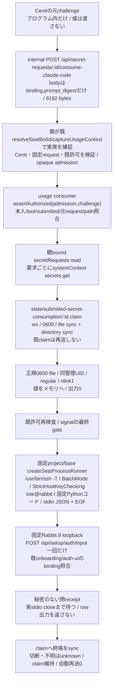

# 提出済み認証コードの一回消費

所有ミカ。2026-11-05。初期設定/認証案内/秘密入力の既auth窓口内の修理候補。親組立は[integration](../integration/README.md)、既固定runnerは[runtime](../runtime/execution.md)が所有する。新しいOS権限・SeatRuntime actionを追加しない。

## 親への公開契約

`createSubmittedSecretConsumer({secretRequests,runDirectory,context,assertAuthorized,consume})` を管理1001 graphだけで構築する。contextは固定 `requestId,requesterBotId,toolId,roomId`。秘密値/session/path/URL/commandをHTTP入力からcontextへ採用しない。runDirectoryは既管理state配下の固定絶対path。private0700・同管理UID・realpath一致を照合する。legacy getを使う場合も親でreadへ適合し、consumer内部は `await secretRequests.read(id)` だけを使う。

`execute({requestId,challenge,admission,signal?})` のchallengeはbindingとprompt_digestの閉2key。既auth-uiのbinding schemaと64hex digestだけを受ける。schema成立は元sessionへの認可ではない。`assertAuthorized(admission,challenge)` は親が捕捉した非serializable admissionの本人性、固定Centi/request、元challengeと既許可の一致・失効を再検査し、成功undefined/拒否throw。metadata読取前、claim前、値読取前、消費直前に検査する。親は内部serverのauthorize=true、任意actor header、body、systemContext発行自体を認可にしない。前段で既実seatの本人metadata読取が成立した後、管理metadataのsystemContextを要求ごとに発行する。旧tokenを使い回さない。

`consume(payload,{signal,assertBeforeIssue})` は親構築時の固定能力。payloadは既公開POSTのbinding/prompt_digest/response.authorization_codeをプログラム内だけで組む。consume実装は発行直前に同期gateを呼び、元Promiseの実終端まで待つ。失敗・不正receipt・取消はunknownとなり、claimを解除しない。`close()` は新作用を止め、実進行中のconsume終端まで待つ。新start/status/secret依頼/AI作用は無い。

管理側からCentiへ返す結果は `bellteam.submitted-secret-result.v1` のrequestId/outcome/reason/authStatusだけ。outcomeはissued/not_issued/unknown、authStatusはnull/authenticated/waiting/blocked/failed。issuedは入力POSTが正常な応答を返したことまでで、本人操作完了/認証status確認/既V実一件はCentiが別に所有する。claim作成後の失敗/取消/不明はunknownとし、同requestを再送しない。

## 固定Rabbit client

`createSubmittedSecretRabbitClient({project,run?})` は固定projectと既runnerだけを参照注入。通常はenvironment=baseのcreateSeatProcessRunnerを使いenv.shを読まない。固定argvは/usr/bin/ssh、-T、BatchMode=yes、StrictHostKeyChecking=yes、ConnectTimeout=10、user kite、alias rabbit、固定Pythonプログラム。payloadはargv/env/Python sourceへ埋めずstdin Bufferだけ。runnerはsignal/4096 byte上限/stdio closeを保持し、75秒で局所取消する。stdin Bufferはfinallyで消去する。

remoteは環境proxyとredirectを使わず、固定 http://127.0.0.9:18891/api/setup/auth/input へ60秒timeoutのPOST一回だけを送る。応答本文は32768 bytesに制限し、HTTP status・既claudeのauth statusだけを射影する。stderrにはpayload/header/raw応答を出さない。SSH切断・局所取消はremote HTTPの取消保証や未作用証明ではなくunknown。Node側でstdout/stderrをログ/通常receiptへ転記しない。

元非秘密argv/仕様はCenti本人のinstall-parent.py:88、production-preflight testedActor kite、consumer-contact.json。固定Python＋stdin JSONの完成済み旧sourceは無かったため、本候補で実装する。実SSH/known-host/到達を合成試験から成立扱いにしない。

## caller・差分と未成立の条件

usage/http-apiにinternal専用routeを追加し、親の `captureSubmittedSecretContext(request,id)` とconsumerの両方が無ければ503で作用0。publicは403、method/Content-Type/query/bodyの閉検証、既setup/auth/input internal403を維持する。通常MCPに値やchallengeの道具を追加しない。共通http-server/application-runtime/application-servicesへの参照注入と管理grant実callerはMollyが所有し、接続前は新routeを稼働復旧済みと扱わない。

sourceはauth-ui、usage/http-api、submitted-secret-consumer、submitted-secret-rabbit-client。通常秘密値/stateの保存形式、requestのstatus/notificationは不変。新claimはusage管理stateの唯一writerで、成功/失敗後も残す。削除/期限延長/再送解除を自動化しない。

検証は合成secretのmetadata/許可/一回性/競合/再起動/不明/保存拒否、固定runnerのstdin/argv/終端receiptと新routeの直接境界に限定する。実秘密、実SSH、既認証入力、新認証、Host/OS変更、本番反映は実行しない。作者結果は実行後に手順原本へ固定する。
