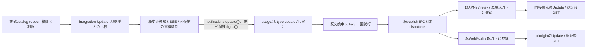
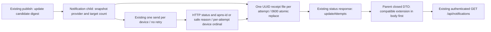

# 正式更新候補の端末通知

2026-11-04 JST。工程L。通知業務・wireの正本はミカ。共通候補判定と変更検知はモリー、Web受入口はアドミ、Apple/Windows受入口は各ベル。全体は[機能図](../../feature-map.md)、既通知は[通知process](notification-process.md)と[Web Push](web-push.md)、呼出元は[integration](../integration/README.md)、接続先は[Web](../web/web-push.md)と[Apple](../apple/README.md)。

## 接続と状態所有



既GET `/api/updates`のpublication/checkとcomparisonを共通側で判断し、通知へ版比較を複製しない。候補はcurrent/publishedが既知、comparison.state=update_available、publication.check.status=verified、正式catalog期限内。CI候補・同版・署名未検証・期限切れ・互換不一致・取得失敗は案内しない。実行能力や配布完了の保証は通知に含めず、画面の最新GETと固定plan確認へ従う。

共通inventoryのoptional `notificationCandidates:[{componentId,id:published.version}]`をモリーが所有し、空配列は候補0とする。Windowsなどのclientはこの射影だけを読み、版比較や検証結果から候補を再計算しない。既sourceからGET/updates SSE再同期時に判定可能。全client閉鎖中の正式catalog変化検知はモリーが既プログラムの接点を確認中で、未確認能力を成立へ補完しない。

通知は`update({id})`から既publishの別閉分岐`{type:'update',id}`へ渡す。idは既正式候補の64桁小文字sha256。任意body/title/URL/本文/secret/資格値/操作requestId/版objectを受けない。direct/room/secret/questionのfilter・DTO・失敗処理は維持する。通知子の起動/交換/資材互換は既runtime契約を使う。

## 閉payload

Webは次の5key完全一致。JSON上限3072byte、idは`/^[a-f0-9]{64}$/`。既v1の別分岐として未知kind・余剰key拒否を保つ。

```json
{"schema":"bellteam.web-push.v1","kind":"update","messageId":"aaaaaaaaaaaaaaaaaaaaaaaaaaaaaaaaaaaaaaaaaaaaaaaaaaaaaaaaaaaaaaaa","title":"BellTeam","body":"更新があります。Updateで確認してください。"}
```

Web内部routeは厳密`{kind:'update'}`。SWのtagだけにpayload.messageIdを使い、通知clickは既同origin rootのfocus/open→認証後`updateCenter.open()`へ接続する。通知からplan/startを発行しない。sessionStorageとURLの既通知保留を使い、通知URLへserverや資格を追加しない。

APNsの更新分岐は以下。bellteamは3key完全一致。serverは既端末登録値で、任意通知入力から作らない。

```json
{"aps":{"alert":{"title":"BellTeam","body":"更新があります。Updateで確認してください。"},"sound":"default","thread-id":"https://bellteam.example/updates"},"bellteam":{"server":"https://bellteam.example","kind":"update","messageId":"aaaaaaaaaaaaaaaaaaaaaaaaaaaaaaaaaaaaaaaaaaaaaaaaaaaaaaaaaaaaaaaa"}}
```

botId/roomId/sender/requestId/mutable-contentは付けず、通知拡張による会話avatar取得を求めない。Appleは現在認証済み接続先とserverの一致を確認してUpdateを開き既GETだけを行う。不一致時は既切替・認証導線へ保留し、自動切替/認証/更新実行をしない。Windowsは起動中の既SSE→GETの候補射影→既標準Toast/通知有効設定とclickを使う。Toast内部のkind/idと既接続先識別を厳密に扱い、同接続先UpdateのGETだけへ案内する。終了中Pushの既transportは無いため未提供。新WNS/WebPush受信/独自pollは追加しない。

## Saved APNs update-attempt receipts (2026-11-08)

Owner: Mika. Receipt storage and APNs response capture extend the selected notifications module. Existing authenticated Owner/admin `GET /api/notifications` remains the read path, with no new route or public write operation. **The parent `src/notifications-ipc.mjs` has a closed status validator: its compatible additive schema extension must ship in an authorized body release BEFORE the new notifications module.** Molly owns that parent contact; Trony owns body release authorization. Old status remains accepted. Do not deploy the extended module to an old parent or call this a module-only rollout. The status extension is not a delivery acknowledgement.



Data ownership: notifications alone owns `state/update-push-attempts/<attempt UUID>.json` and its private temporary file. Each logical receipt contains attempt UUID, candidate digest, JST attempt/sent times, target-device count and per-device ordinal/environment, APNs response status, UUID apns-id, outcome and safe error reason. `attemptedAt` is child receipt creation; per-device `sentAt` is the APNs provider's HTTP/2 request submission time, with the earliest observed send copied to the attempt. Preflight failures or an old relay with no timestamp keep sentAt null instead of claiming that a provider method invocation was a send. Device tokens/hashes, signed transactions, server addresses, payloads, credentials, raw HTTP bodies/headers and raw exception messages never enter receipts or public status. APNs response metadata is projected and validated before persistence/exposure.

State flow: pending receipt -> one attempt per snapshotted target -> completed receipt. No provider or zero targets yields a saved not-sent result. Each device is accepted only on observed APNs HTTP200; relay acceptance without an APNs receipt remains unknown. Network/timeout/error records retain any observed response metadata without retry. A pending receipt recovered after restart remains unknown, never resent. Receipt write errors are reported through the existing notification diagnostic and additive storage-error status, and do not prevent notification delivery or affect conversation/update state. New receipt UUIDs preserve existing evidence; malformed old receipt files are not overwritten or exposed.

The existing notifications writer lock and inflight drain cover receipt persistence. Close/quiesce waits accepted sends and their saved terminal receipt before module exchange. Existing device invalidation/diagnostics and update-thread `${server}/updates` remain unchanged. `src/update-push-attempts.mjs` owns receipt storage/projection; it is included in the notifications artifact's existing src closure.

`GET /api/notifications` optionally accepts `attemptId` (one UUID), `before` (history UUID cursor), and `deviceOffset` (nonnegative integer). Existing facade status forwards these options; default status arguments stay empty. `attemptId` and `before` are mutually exclusive. Optional `updateAttempts` is `{total,nextBefore,items}`: newest five attempts by default, twenty device results per item, with each item's `deviceOffset,nextDeviceOffset`. A selected `attemptId` plus offset reads all device pages; `before` reads older saved attempts. Omitted history on a new installation preserves the old status. These fixed page sizes keep initialize/ready/status below the existing 64KiB IPC frame. No tokens, device hashes or raw provider response fields are forwarded. Stored records remain complete and have no automatic deletion. Unknown/invalid query values are rejected as bad input. Parent status validation keeps validating known baseline fields while accepting and passing through additive status/receipt fields, per Trony's ruling; child receipt projection remains secret-free.

Verification scope: local HTTP/2 APNs success/rejection/timeout metadata, update attempt persistence and restoration, no-provider/zero-target cases, safe projection/privacy, concurrent attempts/drain, saved pending recovery without retry, and the existing authenticated status/IPC read contact. Existing Web/native/candidate selection/distribution successful suites are inherited.

## 許可・重複・失敗

既provider ON/OFF、OS/browser通知許可、端末/購読登録と解除をそのまま使う。自動permission要求・自動登録・購読資格の変更はない。同候補には同digestを使い、既APNs collapse-id/relay idとWeb tagでまとめる。これは配送済みの永続保証ではない。共通側はcomponent別最新idの有限map（最大9）を保持し、起動時現在候補を各1回、新digestだけ通知する。候補無し/一時取得失敗で既idを消して再通知しない。再起動後の同候補通知は起こり得る。新しい永続queue・AI監視・通知再試行は作らない。

交換中の未送信だけ既256件/1MiBへ入り、一回試行したidはACK不明でも再送しない。通知利用不能/overflow/配送失敗は既固定診断へ、既APNs失効/Web404・410だけ対象登録を失効する。更新の状態/会話保存を通知成功へ連動させない。2xxはprovider受付であり端末表示の証明ではない。

## 実装・供給と有限検証

ミカの変更範囲は`src/usage/notifications.mjs`、`notifications-dispatcher.mjs`、`src/push-notifications.mjs`、`src/web-push-notifications.mjs`と必要な直接試験・本図。共通callback登録/候補検知はモリー、Web資材はアドミ、nativeは各ベルが同じ公開契約へ接続する。

DTO正否/固定payloadと秘匿/既許可OFF/人工APNs-Web両providerとdrain/送信失敗・ACK不明の再送0だけを局所確認する。比較選別/変更検知はモリー、SW click/認証保留/POST0はアドミと各ベルの担当結果を継承する。既成功群/実資格/外部通知/本番/署名nativeは再走しない。

2026-11-04初回供給目標：通知source19:00 JST、Web18:50 JST（契約確定後25分）、共通接続source19:15 JST、Windows起動中source20:00 JST、Apple H同source21:30 JST・1.0.5(103)内部配布22:30 JST頃（main採用次第）。通常main・正式image/署名・本番は各所有者の後工程であり、通知source完成へ補完しない。H/I/Jは本件を待ち条件にしない。
