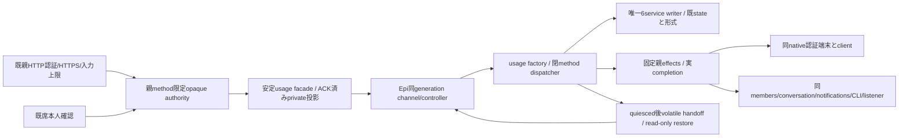
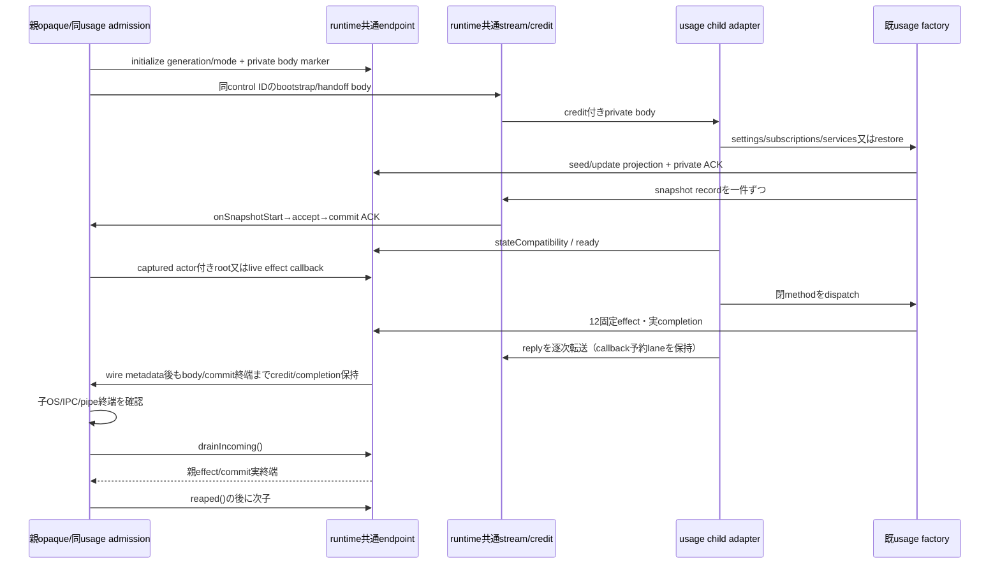

# 設定・初期設定・認証・質問・秘密・購読の単体更新

所有ミカ。[usage](README.md)/[保存順序](flows.md)が既業務契約の正本。本図は親内で動いていた残る6serviceを単独交換する接点を定める。base bf5d84bcでは親writerであり、新factoryを追加しただけでは通常assemblyや実物受入済みにはならない。

## 公開接点

factory `createUsageServices` は親固定rootと既公開依存だけを受ける。初期settingsと残serviceを段階初期化する。`request(method, params, actor)` は閉methodと型付きparam、channelが検証後に注入したactorだけを受ける。URL/path/env/任意method/functionを業務requestに通さない。HTTP/MCPのroute/status/JSON/秘密専用エラー変換は既callerの契約を保つ。

安定親facadeの同期configuration/list/get/timelineはprivate projectionであり、認可を確定しない。Owner権限は同親capture/authorizeActorのopaque同一性・method・Bot束縛で確認し、要求終端と実callback終端を結ぶ。bodyや子からOwner/system権限を作らない。秘密値/TypeSafe資格/購読transaction/auth promptはprivate通信だけで、公開snapshot・SSE・診断に投影しない。

## writerと引渡し

settings/onboarding/secret requests+values/questions/subscriptionは既path/JSON/0600と秘密値wxのまま一processだけが持つ。カード索引は正本から再構成する。settings errors、HarnessAuth sessions/receipts、Onboarding.authはquiesced後のprivate memory handoffに含め、native認証端末は親同clientで保持する。Map/Promise/EventEmitterや全envを汎用serializeしない。pending/busyと親effectの実終端を待つ前のexportを拒否する。

restoreは保存状態をread-onlyで読む。欠測/破損を初期stateやenvへfallbackしない。復元readyからauth開始/外部購読検証/設定apply/案内配送は発行しない。新writerを始める前に旧writer OS終端/排他をEpiが確認する。旧resumeと新ready/採用の機構はruntime正本に従う。unknown後の再送0。

## 保存後の意味

FeatureSettings.updateは保存→onChange実completionをawaitし、失敗でも保存値を保持する。APNs/Web設定は同snapshot、feature別sticky errorを保持する。secret提出は値作成→submitted保存→会話callback→sent/failed保存、質問はanswered保存後のcallback失敗を公開エラーへ渡す。callbackは旧live要求の終端まで通し、新業務入場はquiesce中に拒否する。

## 初期組立てと担当

settings先行initializeから始め、subscriptions/members→notifications/transport/conversation/assets→onboarding/cards→features applyの現順序をMollyが接続する。親native/job/receipt・公開socket/SSE・共通認証・他module controllerを交換で作り直さない。usage業務はミカ、runtime機構はEpi、共通assemblyはMolly、署名/同source実物はCenti。全体再起動は単体交換の代用にしない。

## 固定関数と初期化順序

`createUsageServices({root,bots,rooms,effect,onProjection,bridgeHeadersPath,environment,seatRuntime,subscription})`が一組を生成する。root/bridgeHeadersPathはruntimeの固定bootstrap値で、業務paramsにはない。environmentは初回settings importの既5変数（TypeSafe/callBridge URL/Cloudflare team+audience/BugHub）だけを親が選択する。native envや資格全部は渡さない。

1. `initializeSettings({restore})`→private settings record。Mollyの既bootstrapへ接続。
2. `initializeSubscriptions({restore})`→private subscription record。members起動より前の現順序へ。
3. members/notifications/transport/conversation/assetsを親で構築後、`initialize({restore,handoff})`。membersのmetadataをfresh読取してonboarding/cardsを初期化する。2を未実行なら内部で一度だけ行う。
4. `snapshot()`の同期Iterableを一件ずつprivate channelへ送り、`createUsageProjection.begin(generation)`→accept→全件ACK後commit。公開snapshotへ流用しない。
5. `request(method,params,actor)`。method/actorは`process-schema.mjs`、actorをparent-captured authorityから注入するのはEpi channelだけ。

`createUsageAuthority`のcapture(method,actor)→opaque、authorizeActor(method,opaque)→actor、release(opaque)は親だけに置く。`createUsageFacade({request,projection,toolsDirectory})`のrequestは(method,params,context)。settings.updateのcontextはoptions.usageContext、他の書込み/fresh readは末尾引数。HTTPの秘密/質問GETはgetの投影でなくread(id,context)をawaitする。同期get/watch/toolsDirectoryは既OLRW consumerの参照として保持し、OLRW再実行/自動復旧を追加しない。

## 固定親effect（methodとresult）

全effectは同じroot要求/actor/generationに束縛し、任意の親methodへ転送しない。結果のないeffectはnull ACK、例外は固定code/status/effectだけをruntimeが返す。実処理と派生callbackの終端まで親opaqueをreleaseしない。factory側もAsyncLocalStorageで同要求のeffect実completionを待つ。

| method | params | 成功result/親が保持するもの |
| --- | --- | --- |
| settings.changed | id, configuration, epoch | null。既onChange/listener/CLI/通知applyの実completionをawait。configurationは当該featureだけprivate |
| auth.call | harness(native enum), action、必要session/relogin/binding/digest/response | `{structuredContent,isError?}`だけ。content/log/envは渡さず、同parent client/authOptionsと固定projectからcwdを解決 |
| onboarding.prepareStartup | botId, text | null。親はlive contextと正規projectFilesでappend。任意pathなし |
| onboarding.startConversation | botId, message | null。既recordUser:falseの同messenger受付をawait |
| secret.created / question.created | item（保存済みmetadataだけ） | null。既notifications facadeへ渡す。秘密値を含めない |
| secret.completed / question.answered | botId, message | null。同messenger.enqueueUserTurnの実受付。秘密は場所と結果だけ |
| subscription.setupTest | botId | reply:string。親はfresh member/idleを確認し、同transport.setupTestを実行 |
| members.read | {} | `{id,name,harness}`だけの配列。parentの同members fresh口。profile本文/path/画像なし |
| onboarding.ensureGuide | harness | 同3fieldのbot-guide一件。親はGUIDE_BOT_IDだけ既create/update |
| rooms.read | {} | `{id,memberIds}`だけの配列。既room fresh読取、本文/pathなし |

`createUsageRegistryPorts({effect,initialMembers})`でこれらのmetadataから既bots/rooms公開形を作る。初期ガイド以外のcreate/updateと未知fieldは拒否する。これがnative/clientや会話graphを二重構築することはない。

## 設定の保存世代と遅着error

private settings recordは`{type:'settings',revision,list,configurations,epochs}`。epochsは6featureごとの保存世代で、当該保存成功→onChangeの前に増加し、同recordを先に送ってから`settings.changed`へ渡す。これは未採用会話95a7のroutingEpochの成立を主張するものではない。共通integrationで会話sourceが入る場合は既routingStateとの一writer接続を保つ。

`settings.setError`はsystem専用`{id,epoch,error:{code}}`。古いepochは409、nullclearは拒否し、保存済みerrorは明示updateだけで消す。親apply callbackは受け取ったepochを保持して返し、送信時の最新epochに付け替えない。初回applyはsettings private projectionのepoch=0を捕捉する。

quiesceは新requestを閉じ、処理中と同root effectの実終端まで待つ。親onChange中の遅着設定errorはEpiがlive root/effect相関を確認した後、`callback('settings.setError',params,system)`へ通す。pendingが無い/すでにquiescedのcallbackは拒否する。単なるcallback自己申告を根拠にしない。60秒不成立時のresumeにより古いquiesce結果は無効になる。

`exportState()`はquiesced/pending0だけで`bellteam.usage-volatile.v1`（epochs/errors/sessions/receipts/onboardingAuth）を返す。秘密値や全settingsをhandoffへ重複させない。native auth端末はcancelせず、closeは子の参照だけを破棄する。新子/戻しは同diskをread-onlyで読み、private handoffからメモリだけ復元する。

## 実装済みの受渡し上の注意

初回private投影は`projection.seed(initializeSettings返却,generation)`と`seed(initializeSubscriptions返却,generation)`で先行利用し、完全snapshotのcommitまでbootstrap順序を止めない。full ready前に許すのはsystemによるsettings読取/epoch付きerror記録だけ。Owner/Bot業務はready後。

`onProjection(record)`はprivate ACK完了までのPromiseを返す。factoryはrevision順に公開し、ACK前の親effect発行と要求成功を抑止する。投影失敗は保存済み状態を巻戻さず、USAGE_PROJECTION_UNAVAILABLEで新入場を閉じる。`usageResultValid(method,result,params)`と`usageProjectionRecordValid`をchannelの成功判定に再利用する。

createApplicationFeaturesは追加usageContext(method)を親capture factoryへ接続し、settings.onChange(id,config,{epoch})を呼ぶ。callBridgeの既stopForConfiguration Promiseと後続error callbackをawaitしてから完了する。将来のnative実終端を同Promiseが表しているかはexecution/共通接続の本人結果で確認する。

未採用会話作者95a7を同通常差分へ合わせる時は、factoryのrouting保存世代と既FeatureSettings.routingEpoch（同じrouting保存時に+1）を同じ値でhandoffする。facade.routingState()を既3effectへ接続する。会話readyで資格読取/全settings供給を追加しない。95a7採用や会話実結合の成立を本sourceから補完しない。

Onboarding.authの任意scalarは既HarnessAuth同様null/booleanへ正規化し、JSON IPCでundefinedが消えて公開型が崩れないようにした。外部認証の開始/入力や資格発行を試験していない。

## usage固有channel/薄entry/probe（追加実装）

Root21:55の並行分担で、closed parent/child adapterと`src/usage-entry.mjs`/`scripts/probe-usage-runtime.mjs`をミカが所有する。既factory/DTOを再利用し、parent公開口ready/request/callback/control/drainIncoming/reaped/snapshotを共通runnerへ接続する。C/固定FD3,4,5/排他/世代controllerはEpiの公開窓口に従う。membersの8root/8effect/8callback・実completionを再利用し、private大snapshotはconversation-streamsのcredit/chunkを使う。actorは親opaqueから同channelが閉actorへ写し、子の自己申告や診断への秘密反射を認めない。

## 固有adapterの実接続

`createUsageParentChannel(child,{generation,admission,authorizeActor,onEffect,onProjection,onSnapshotStart,onSnapshotEnd,onSnapshotAbort,onDiagnostic})`はready/request/callback/control/drainIncoming/reaped/snapshotを公開する。optionsは`{usageLease,capturedAuthorization,usageEffect}`で、他moduleのopaqueや偽effectは拒否する。generationはruntimeの不透明文字列。初期controlはmode=settings（bootstrap/restore:false）→subscriptions→services。交換はmode=restore（bootstrap/handoff）一回で全復元を終える。controlの引数はgeneration/mode/streamed markerだけを小さい封筒へ、private bodyを同ID root streamへ送る。

onProjection(row,context)のphase=seedはprojection.seed、phase=updateはfacade.accept、phase=snapshotはprojection.accept。onSnapshotStartでbegin、onSnapshotEndでcommitし、完了PromiseをACKとして返す。初期readyはsettingsのprivate seed ACK後で、Owner/Bot業務はservices後だけ。交換のreadyは全restore/snapshot commit終端後。既graphの初回先行読取を、新子の完全業務readyと混同しない。

reply/control exportはstreamed markerと個別JSON recordを分け、`usageResultValid`とhandoff検証後の実body終端まで.completionを保持する。大snapshotを一つの巨大JSON配列へ組み立てず、record単位で既16MiB payload枠とcreditを使い、全件数/集計サイズの上限を新設しない。root replyの送信待ちは一列にし、callback予約laneを通常replyが消費しない。切断/metadata後body失敗はunknownで、OS/pipe終端のreaped前にroot/effect/callbackを解放しない。

親effectは同generation/root/actor/実leaseへ照合し、initialize controlから許すのはmembers.readだけ。callbackは親effectの実capabilityへ束縛し再帰effectを拒否する。診断は固定codeだけ、自由message/stack/body/秘密を渡さない。既HTTPの秘密/質問のknown errorを固定code/statusへ写し、authのAUTH_RESPONSE_NOT_ISSUEDだけは同codeからeffect=not_issuedを復元する。

entryはverifyUsageLocks()を通過後、固定rootのdispatcher/factoryだけを組む。probeはroot/Node26/fixed builtin C入口でstaged init→quiesce/export/resume→exit→OS終端を確認する。probeの正規UID/FD/mount成功はCentiの同source実物工程であり、当席のdirect Node IPC fixtureを代用しない。

共通endpoint/streamsはEpi f0588a34、lock verifierはEpi cc6ded63からのforeign input。独立した当席作者成果へ混ぜず原本を参照し、共通C/controller/readerの実装を複製しない。

切断時onSnapshotAbort(context)で未採用stagingをdiscardする。afterResult/commit callbackが遅着しても投影を採用せず、成功/.completionはreapedまで未確認のまま保持する。

parent channelのdrainIncoming()は共通endpointへ直接委譲する。controllerは子OS/IPC/pipe終端→受信済み親effect/afterResult commitの実終端→reaped→次子の順を必須とする。outgoingのreaped待ちcredit/.completionはdrainIncomingに含めず、子終了後も残る親処理を待つために循環を作らない。wire/業務/8枠は変えない。
