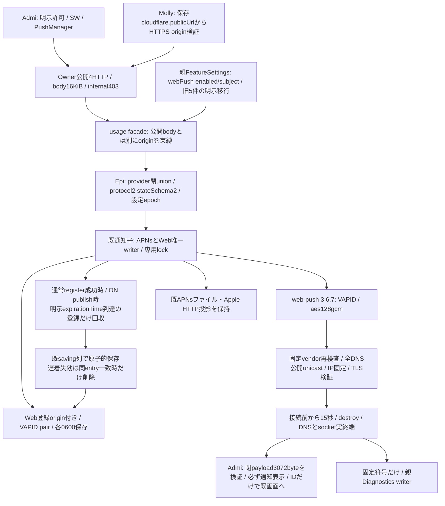

# Web Push：通知子の別provider

[usage正本](README.md) / [通知process](notification-process.md)。Root固定v1.1 `/srv/bellteam/bots/bot-7b140b27/docs/web-push-contract-20261103.md`（15087B/SHA256 b64a7c27e8a6da21d5011d77e2bd749ee27048a5ebff7a620392becd91ed66a2）に従う。旧2d39は契約入力として別branchに保存。Web無料/Apple購入専用、実送信/外部資格/Host本番0。

## 公開窓口と非公開DTO

GET `/api/web-push/status` は `{enabled,configured,publicKey,error}`。POST statusは `{endpoint}`→`{registered}`、subscriptionsは `{subscription,applicationServerKey,previousEndpoint?}`→`{registered:true}`、unregisterは `{endpoint}`→`{registered:false}`。POSTとwebPush設定PATCHはOwner認証に加えMollyの `assertWebPushOrigin(request)` をawait前に呼び、Origin必須/同一性/Sec-Fetch-SiteとJSONを検査する。GET以外はtrusted origin未設定503、不一致403。公開bodyのoriginは拒否。

facadeは `webStatus(endpoint?,origin?) / webRegister(value,origin) / webUnregister(value,origin) / configureWebPush(config) / initialWebStatus()`。既status/configure/register/unregisterはAPNs投影を維持。private method5種のpublishだけ既event union、他4種はprovider必須。Web公開状態status/configureはorigin無し、登録照会/register/unregisterは親検証済canonical origin必須。initializeは `{apns:{enabled,relayUrl},webPush:{enabled,subject}}`。ready/status/applyErrorは両providerを分ける。実channel/result相関/交換中設定epochはEpi所有。

`src/usage/web-push-schema.mjs` に閉params/subscription/P256/subject/endpoint/originとWebStatusの検証を集める。subscriptionはendpoint<=8192byte、expirationTime=null又は未来safe整数、keys=p256dh有効非圧縮P256 65byte/auth16byteの厳密base64url。公開originをendpointやHostから推測しない。

## writerと失敗

`src/web-push-notifications.mjs` が `state/web-push-subscriptions.json`（schema+origin/subscription配列）と `state/web-push-keys.json`（schema+VAPID public/private）を所有。明示enable保存後の初回configureだけ鍵生成し、既鍵は再生成しない。原子的0600保存/file同期/rename/dir同期が終わってから成功。保存不明時はWebだけ利用不可として再発行しない。登録・置換・解除・失効のsavingを一つへ直列化し、同origin所有と公開鍵/期限の検証を変更前に行う。別origin照会/解除はfalseで保持、同endpoint別origin/previousEndpoint非所有・欠測は同409で全変更0。

鍵/登録不正、登録有り鍵欠測はWebだけerror、空reset/rotation無し。OFFは新送信停止し鍵/登録とstatus/解除を保持。設定保存と適用成功は別、両provider errorを独立に保持する。quiesce/closeはAPNs/Web全inflightとsavingを待ち、60秒未終端は旧resume、新子0、再送0。

通常registerは所有/鍵/新入力の検証に成功した後の同じ保存で、既登録の明示expirationTimeが到達したentryだけを除く。拒否された登録は従来どおり全保存不変。ONの通常publishも送信せずに飛ばしていた期限到達entryを既expire(entry)へ渡し、同entryのままならsaving列で回収する。expirationTime=nullや未来の登録、更新されたentry、VAPID鍵は残す。登録の明示期限だけを使い、OFFでの無操作/再起動では保持契約を変えない。回収失敗は既保存失敗のWeb不可/固定診断に従う。

`src/web-push-provider.mjs` はweb-push本人generateRequestDetailsと標準httpsを使う。固定vendor（fcm.googleapis.com / updates.push.services.mozilla.com / ラベル境界の*.push.apple.com）だけ、HTTPS443/資格・fragment・IP literal・末尾dot・不正host無し。DNS全A/AAAA候補をNode標準BlockListによる公開unicast policyで検査し、検査済みIPだけを同接続へ供給。任意proxy/agent/headerは受けない。TTL86400/通常urgency/aes128gcm、redirect/自動再送0、開始から15秒でDNS取消/requestとsocket destroy、実終端までinflightを保持する。

2xxはservice受付のみ。404/410だけ対象の同登録を失効保存、401/403は保持して固定認証error、429/5xx/切断/timeoutは保持・再送0。body/header/endpoint/鍵を診断へ載せない。

## payloadと接続先

Web payloadはRoot固定10key、既event ID/種別/botId/roomId/表示snapshot/固定title-bodyだけ、JSON<=3072byte。各IDは制御文字無しUTF8<=200byteで切詰め0。表示名だけ固定名へ縮めても超過ならWebだけerror。秘密値/発言/質問文/ownerGuide/URL/endpoint/資格無し。SWでも余剰key・型・相関・byte上限を検証。不正は固定汎用通知/rootだけ。UI/SW内部はAdmi、認証/asset JS MIME-no-cache/Apple互換はMolly、channelはEpi、署名/ABI2同source builtin→signed→builtinの実物はCenti所有。

根拠はRoot正本と [library本人API](https://github.com/web-push-libs/web-push#generaterequestdetailspushsubscription-payload-options)、[IANA IPv4](https://www.iana.org/assignments/iana-ipv4-special-registry/)、[IANA IPv6](https://www.iana.org/assignments/iana-ipv6-special-registry/)。vendor向け公開IP policyは保守的にspecial-purpose帯を除外する。Rootの有限policyを標準必須条件とは説明しない。

## 有限fixtureと検証

`test/fixtures/notifications-web-push-state.mjs:writeNotificationsWebFixture(root)` は使い捨て人工rootへ実writerの設定/登録APIだけで0600のVAPID/登録と既APNs配列を作り、publish無しで閉じる。返却はorigin/otherOrigin/applicationServerKey/subscription/foreignSubscription/replacementSubscription/apnsDeviceと、両OFFのconfiguration。生成値は人工fixtureだけで実endpoint/実Owner値をコピーしない。CentiはこのAPIと固定P2 dispatcher/entryへ結合する。製品entryへ任意path/provider/envを追加しない。

必要直接試験はschema、旧5設定移行/破損拒否、キー永続/0600/欠測/破損/保存失敗、origin所有の原子的無変更、HTTP Owner/Origin/閉body/既APNs投影、両inflight/savingと実IPC drain。providerは合成DNS/人工TLSで公開IP固定・VAPID暗号化・redirect/401/403/404/410/未知・期限destroy/実socket終端を確認する。人工TLS用一時証明書は試験中の一時root内で生成し必ず回収、実serviceへ送信しない。ABI2の資材/両native受入は別Centi原本と結合するまで未成立。
