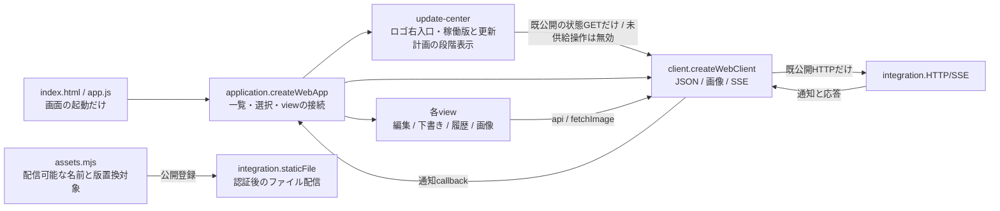

# Webアプリ

責任者：アドミ。Webの一覧・選択・編集・会話/下書き・履歴・接続・各操作結果を持つ。サーバー正本は各機能担当、Appleはベル。

[接続情報](module.json)から[全体図](../../feature-map.md)を生成する。[担当・変更手順](../../module-ownership.md)に従い、使用先の[integration](../integration/README.md)と[公開HTTP入口](../../entrypoints.md)を読む。現行の内部図はこのmoduleの[会話・履歴・SSE](conversation.md)と[編集・画像・Goal](management.md)だけで管理する。

## 起動・通信・公開登録



| 公開窓口 | 入力 | 出力・所有 |
| --- | --- | --- |
| `ui` / `createWebApp({client})` | ブラウザーDOMとclientの`api/fetchImage/watchEvents` | `start()`。構築/importでは通信を始めず、startでsession→設定→setup→一覧→SSE。app.jsが一度呼ぶ |
| `createWebClient({fetch,setTimeout,clearTimeout})` | 標準fetchとtimer（省略時はブラウザー） | `api(path,options)`はJSON/204とstatus付きError、`fetchImage`はResponse、`watchEvents(onEvent,onError)`は解除関数。人工fetchへ丸ごと差替可能 |
| `assets` / `assets.mjs` | integrationからのimport | `webAssetFiles`（公開path→Web内ファイル）、`versionedWebAssets`（版置換対象）。HTTP認証/stream/headerはintegrationが持つ |

通信の全callerはapplicationから各viewへ渡すapi、messageImagesとcharacterSheetsのfetchImage、SSEのwatchEvents。Viewは他moduleの内部サービスや保存データをimportしない。SSEは既存のTypeError/429/5xxだけ1.5秒後に再接続し、認証/JSON形式異常で停止表示する。正常EOFで再接続しない既存契約も維持する。表示GETの失敗はapplicationが表示へ返し、通信障害として再接続しない。

WebはHTTPとSSEだけを利用し、MCPを呼ばない。画面に表示するアバター等のURLをブラウザーが読む通常の画像表示も公開HTTPを使う。台帳、配送、予定、記憶、認証、Goalの正本と業務判断はサーバーに残す。

## Webが所有するデータ

- application：setup/authMode/settingsとBot/部屋/Ownerの表示cache、選択、部屋ごとの返信者、読取順、SSE解除関数。
- composer：会話別の未送信入力、添付URL、送信中の固定値、失敗時の回収欄。ページ内に保持する。
- timeline：開いた対象の履歴Map、前後ページ、queue、読取世代、スクロール。SSEは本文の代わりにしない。
- 各editor/Goal/補助view：開いた対象、入力、進行中の要求、最新観測、timerと局所URL。受付/保存と後続GET失敗を区別する。
- 画像cache：取得Promiseと所有URL。破棄は生成者が行う。
- localStorage：`bellteam-read-receipts.v1`の端末内既読だけ。サーバーの読了記録を作らない。
- update-center：選択中の全体/個別対象、実測snapshot/読取世代、dialogと戻りfocus。正式版・計画未供給ではレビュー用と表示して実行無効。永続版情報や成功判定を作らない。

APIの拒否や応答不明を未保存・未配送と断定しない。202は受付、Goal/nativeの実適用とAI回答完了は各サーバーの返す状態に従う。

## 実装と変更範囲

[web/](../../../../web/)全体、Webだけをimportする局所試験と`test/helpers/{editor-dom,web-dom}.mjs`を持つ。app.jsは起動、application.jsは画面組立て、client.jsは通信、assets.mjsは公開資材登録。各viewの内部状態と既callbackは[詳細図](conversation.md)へ辿る。

初回の共有差分は`src/http-assets.mjs`がWeb公開登録をimportする切替だけ。トロニーが統合する。その後のWeb内部変更と資材追加はWebの正本・登録・局所試験で完結する。公開HTTPの契約を変える時はサーバー所有者と調整し、全体の接続はトロニーが整合する。

今回の図変更は、共通文書にあったWeb内部図の移管と、起動/通信/資材登録の所有の明示。integrationから`assets`利用を追加する。既公開HTTP JSON、status、永続保存形式、画面操作の完了条件は変更しない。

## 単独試験

Node 24以上の標準機能だけで実行でき、サーバー・native・他機能の内部実装・実データは起動しない。

```sh
node --test test/web-client.test.mjs test/web-module.test.mjs test/web-event-refresh.test.mjs test/web-final-ownership.test.mjs test/web-bot-avatar-list.test.mjs test/bot-profile-ui.test.mjs test/editor-ownership.test.mjs test/conversation-composer.test.mjs test/timeline-open-queue.test.mjs test/message-images.test.mjs test/bot-read-views.test.mjs test/goals-view-order.test.mjs test/chat-input.test.mjs test/schedule-list.test.mjs test/memory-view.test.mjs
```

`web-module`は実際のapplication/各viewを人工HTTP/SSEと小さいDOMで接続し、起動前の無通信、会話別下書き、既読、対象外通知、受付後の表示失敗とPOST一回、pagehideを確認する。`web-client`はJSON/204/error、分割UTF-8、通知順、EOF、既存の再接続分類と解除を確認する。実ブラウザーのレイアウト・native実配送・本番反映を証明する試験ではない。

共有配信の直接境界は既存`http-server`の「HTMLへ起動単位」「Webアプリがimport」の2試験で確認する。全体試験を定型再走しない。

## 更新センターの段階導入

[Update通知と更新センター](update-notice-design.md)はロゴ右の入口、本体/moduleの稼働版と説明、全体/個別計画、影響確認、実結果表示の正本。`update-center.js`が現行公開GETのWeb受付状態だけを検証して表示する。通知moduleと共通計画の未供給はレビュー用の未接続状態で示し、実行を無効にする。起動時は通信せず、初回open/ready/updates/表示復帰/手動再取得で読む。破棄後や古いreadは適用しない。Webは版比較や更新実行の正本を持たず、既HTTP/SSEを使う。新部品はassetsの配信/版置換登録へ含めた。動作試験は`test/web-update-center.test.mjs`、既組立てとSSE境界は従来のWeb試験を使用する。
