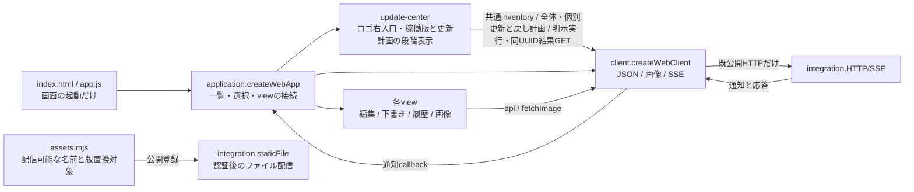

# Webアプリ

責任者：アドミ。Webの一覧・選択・編集・会話/下書き・履歴・接続・各操作結果を持つ。サーバー正本は各機能担当、Appleはベル。

[接続情報](module.json)から[全体図](../../feature-map.md)を生成する。[担当・変更手順](../../module-ownership.md)に従い、使用先の[integration](../integration/README.md)と[公開HTTP入口](../../entrypoints.md)を読む。現行の内部図はこのmoduleの[会話・履歴・SSE](conversation.md)と[編集・画像・Goal](management.md)だけで管理する。

## 起動・通信・公開登録



| 公開窓口 | 入力 | 出力・所有 |
| --- | --- | --- |
| `ui` / `createWebApp({client})` | ブラウザーDOMとclientの`api/fetchImage/watchEvents` | `start()`。構築/importでは通信を始めず、startでsession→設定→setup→一覧→SSE。app.jsが一度呼ぶ |
| `createWebClient({fetch,setTimeout,clearTimeout})` | 標準fetchとtimer（省略時はブラウザー） | `api(path,options)`はJSON/204とstatus付きError（公開されたcode/path/reasonも保持）、`fetchImage`はResponse、`watchEvents(onEvent,onError,onUpdates?)`は解除関数。人工fetchへ丸ごと差替可能 |
| `assets` / `assets.mjs` | integrationからのimport | `webAssetFiles`（公開path→Web内ファイル）、`versionedWebAssets`（版置換対象）。HTTP認証/stream/headerはintegrationが持つ |

通信の全callerはapplicationから各viewへ渡すapi、messageImagesとcharacterSheetsのfetchImage、SSEのwatchEvents。Viewは他moduleの内部サービスや保存データをimportしない。SSEは既存のTypeError/429/5xxだけ1.5秒後に再接続し、認証/JSON形式異常で停止表示する。正常EOFで再接続しない既存契約も維持する。表示GETの失敗はapplicationが表示へ返し、通信障害として再接続しない。

WebはHTTPとSSEだけを利用し、MCPを呼ばない。画面に表示するアバター等のURLをブラウザーが読む通常の画像表示も公開HTTPを使う。台帳、配送、予定、記憶、認証、Goalの正本と業務判断はサーバーに残す。

## Webが所有するデータ

[保存・回収の機能図とデータフロー](storage-lifecycle.md)で生成/保持/正常・異常終了の責任を定める。

- application：setup/authMode/settingsとBot/部屋/Ownerの表示cache、選択、部屋ごとの返信者、読取順、SSE解除関数。
- composer：会話別の未送信入力、添付URL、送信中の固定値、失敗時の回収欄。ページ内に保持する。
- timeline：開いた対象の履歴Map、前後ページ、queue、読取世代、スクロール。SSEは本文の代わりにしない。
- 各editor/Goal/補助view：開いた対象、入力、進行中の要求、最新観測、timerと局所URL。受付/保存と後続GET失敗を区別する。
- 画像cache：取得Promiseと所有URL。破棄は生成者が行う。
- localStorage：`bellteam-read-receipts.v1`の端末内既読だけ。サーバーの読了記録を作らない。
- update-center：選択中の全体/個別対象、実測snapshot/読取世代、dialogと戻りfocus。正式版・計画未供給ではレビュー用と表示して実行無効。永続版情報や成功判定を作らない。
- sessionStorage：`bellteam-update-request.v1`の現在requestId/planIdと、旧snapshot又は未読取requestId/planId参照のprevious配列。同じIDで再読込後も照会し、終端でも参照を保持する。受付・版・成功の正本にはしない。保存できない時は新しい更新を開始しない。[更新図と操作手順](update-notice-design.md#全体個別の計画実行戻し接続)に従い、旧結果を残して新しい個別操作へ進む。

APIの拒否や応答不明を未保存・未配送と断定しない。202は受付、Goal/nativeの実適用とAI回答完了は各サーバーの返す状態に従う。

## 実装と変更範囲

[web/](../../../../web/)全体、Webだけをimportする局所試験と`test/helpers/{editor-dom,web-dom}.mjs`を持つ。app.jsは起動、application.jsは画面組立て、client.jsは通信、assets.mjsは公開資材登録。各viewの内部状態と既callbackは[詳細図](conversation.md)へ辿る。

初回の共有差分は`src/http-assets.mjs`がWeb公開登録をimportする切替だけ。トロニーが統合する。その後のWeb内部変更と資材追加はWebの正本・登録・局所試験で完結する。公開HTTPの契約を変える時はサーバー所有者と調整し、全体の接続はトロニーが整合する。

今回の図変更は、共通文書にあったWeb内部図の移管と、起動/通信/資材登録の所有の明示。integrationから`assets`利用を追加する。既公開HTTP JSON、status、永続保存形式、画面操作の完了条件は変更しない。

## 設定画面のカード表示（2026-11-08, Owner via Trony）

Owner ruling: a text-only settings page is rejected. Same markup sections, same APIs and save contracts; presentation only.

| Function / edge | Input -> output and ownership |
| --- | --- |
| Section cards | Each `#owner-dialog .feature-settings-section` and the profile block render as a surface card with an icon tile (`data-settings-icon` on the section, CSS mask icon). Tabs stay scroll anchors and become sticky. |
| Whole stop (`ai-control.js`) | Existing server `control.state` -> `root.dataset.state` -> colored status pill (enabled ok / stopping info / stopped danger / unconfirmed attention / unknown muted) and the checkbox drawn as a switch. The view still never infers ON/OFF from a failed PATCH. |
| Settings read failures (`owner-editor.js`) | User rules / features / AI auth read errors -> plain sentence with what to do; the raw code goes under a `詳細` disclosure in the same alert element. No retry loop or new request is added. |
| Theme | Tokens on `#owner-dialog` with `prefers-color-scheme: dark` overrides (surface, fields, buttons, pills). Other dialogs are unchanged. |

Source reach: `web/index.html` (section icon attributes), `web/styles.css`, `web/ai-control.js`, `web/owner-editor.js`. No public HTTP, storage, or save behavior changes; no guard added.

## 単独試験

Node 24以上の標準機能だけで実行でき、サーバー・native・他機能の内部実装・実データは起動しない。

```sh
node --test test/web-client.test.mjs test/web-module.test.mjs test/web-event-refresh.test.mjs test/web-final-ownership.test.mjs test/web-bot-avatar-list.test.mjs test/bot-profile-ui.test.mjs test/editor-ownership.test.mjs test/conversation-composer.test.mjs test/timeline-open-queue.test.mjs test/message-images.test.mjs test/bot-read-views.test.mjs test/goals-view-order.test.mjs test/chat-input.test.mjs test/schedule-list.test.mjs test/memory-view.test.mjs
```

`web-module`は実際のapplication/各viewを人工HTTP/SSEと小さいDOMで接続し、起動前の無通信、会話別下書き、既読、対象外通知、受付後の表示失敗とPOST一回、pagehideを確認する。`web-client`はJSON/204/error、分割UTF-8、通知順、EOF、既存の再接続分類と解除を確認する。実ブラウザーのレイアウト・native実配送・本番反映を証明する試験ではない。

共有配信の直接境界は既存`http-server`の「HTMLへ起動単位」「Webアプリがimport」の2試験で確認する。全体試験を定型再走しない。

## 更新センターの段階導入

Web受付固有の内蔵版切替と採用状態は[内蔵版戻し](gateway-builtin.md)を正本とする。共通module adapter/排他と資材reader/Host配置は各接続先が所有する。

[Update通知と更新センター](update-notice-design.md)はロゴ右入口、実在moduleの稼働版と説明、計画・影響・実結果の正本。`update-center.js`は共通GET `/api/updates?runtime=1`から名称/説明/版/比較/実行可否/利用可否/publicationを表示する。[実行環境の4項目](update-notice-design.md#runtime-updates-in-the-normal-update-screen-2026-11-08-z-b2-slice-d)も通常一覧・個別計画で扱い、次回起動適用を表示する。厳密schema/有限例の正本はintegration公開`src/update-center-contract.mjs`。受入catalogとfeed取得確認を分離し、取得失敗/未確認を最新版と表示しない。未独立やprovider未供給は理由付き無効。

共通POST plansへ全体又は個別更新を要求し、個別moduleの戻しはaction:rollbackで可否を確認する。明示POST plansの固定target/期限/影響を確認し、再起動を要する計画はcheckbox確認後にPOST operationsを一回だけ発行する。UUIDとplanIdをsessionStorageへ保存してから要求し、POST応答不明/再読込/接続復帰は同UUIDのGETで確認する。inventoryが取得できなくても結果照会を行う。旧応答、別requestId/plan、期限切れ、保存不正を実行へ進めない。戻せる版をWebで推測せず、backend planのaction/全target/可否/影響を表示する。all/container戻しは非対応。WebからHostや任意shellへ直接接続しない。

構築時は無通信。認証後の起動、open、ready/updates、表示復帰、手動再取得で既clientから読む。手動再取得（「状態を再取得」）だけは先にPOST `/api/updates/catalog-check`で公式catalogの取得を要求し、その失敗（旧installerのHOST_UPDATE_ARGUMENTS等）は無視して従来のGETを行う。取得中もloading表示を保つ。要求ごとの「この要求の状態を再取得」は読取のみ。破棄後や古いreadは適用せず、最新の取得失敗時は古い版を最新として残さない。noticeと共通comparisonだけからロゴ右の状態語を表示し、Webは版を比較しない。operation/previousOperationのjobs[]とinventoryのrecent jobs[]を実記録として表示し、各jobId/state/reasonを詳細へ示す。[部品別status](update-notice-design.md#per-component-standard-status-2026-11-08)のある応答では通常画面を部品名とサーバーの説明・要対応文にし、技術値・ジョブ一覧・診断は詳細へ集める。statusのない旧本体では従来表示を維持する。親phaseから成功/進行/unknownを作らない。読取Errorは公開reason/pathを保持して表示し、SSE updatesも既GETへ再同期する。module_restart_limitは共通problems[]のopen/resolvedと実証跡を表示する。desktopは一覧内スクロール、狭幅は詳細から選択行へ戻る操作を持つ。資材登録/版置換は既assets、試験は`test/web-update-center.test.mjs`と従来の組立て/SSE。公開契約の9有限例を表示へ渡す局所検証と、実HTTP/共通投影→実ブラウザー/既SSE再同期を直接境界で確認する。

## Appleとの操作整合

[固定sourceの機能対応・検索/編集図](apple-parity.md)を正本とする。公開APIを増やさずWeb内部を更新する。未供給currentWorkは理由付き未取得表示で独立して扱う。

[Web通知のSW・設定・ID復帰](web-push.md)を担当内正本とする。既HTTP/SSE窓口のまま接続し、providerとoriginはintegration/usageが所有する。
