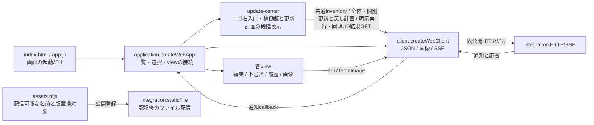
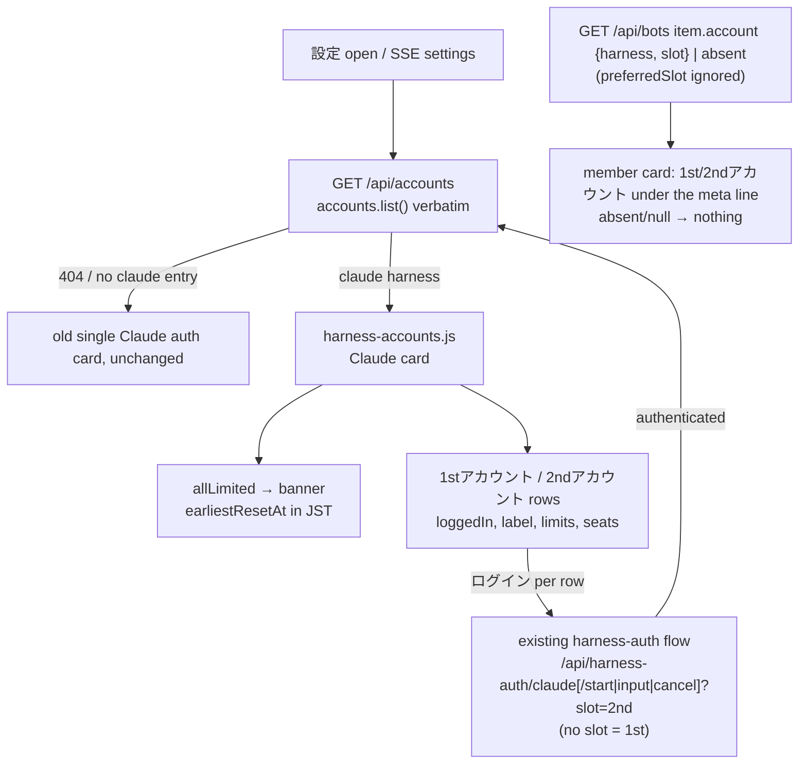
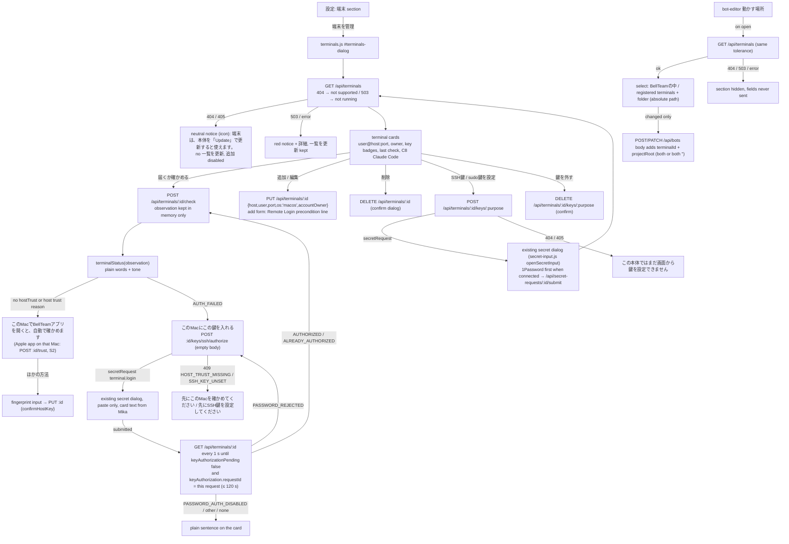

# Webアプリ

責任者：アドミ。Webの一覧・選択・編集・会話/下書き・履歴・接続・各操作結果を持つ。サーバー正本は各機能担当、Appleはベル。

[接続情報](module.json)から[全体図](../../feature-map.md)を生成する。[担当・変更手順](../../module-ownership.md)に従い、使用先の[integration](../integration/README.md)と[公開HTTP入口](../../entrypoints.md)を読む。現行の内部図はこのmoduleの[会話・履歴・SSE](conversation.md)と[編集・画像・Goal](management.md)だけで管理する。

## 起動・通信・公開登録



| 公開窓口 | 入力 | 出力・所有 |
| --- | --- | --- |
| `ui` / `createWebApp({client})` | ブラウザーDOMとclientの`api/fetchImage/watchEvents` | `start()`。構築/importでは通信を始めず、startでsession→設定→setup→一覧→SSE。setup未完了の初回画面は閉じられ、閉じても一覧→Update→SSEへ進む（[初回設定はあとへ回せる](conversation.md#初回設定はあとへ回せる)）。app.jsが一度呼ぶ |
| `createWebClient({fetch,setTimeout,clearTimeout})` | 標準fetchとtimer（省略時はブラウザー） | `api(path,options)`はJSON/204とstatus付きError（公開されたcode/path/reasonも保持）、`fetchImage`はResponse、`watchEvents(onEvent,onError,onUpdates?)`は解除関数。人工fetchへ丸ごと差替可能 |
| `assets` / `assets.mjs` | integrationからのimport | `webAssetFiles`（公開path→Web内ファイル）、`versionedWebAssets`（版置換対象）。HTTP認証/stream/headerはintegrationが持つ |

通信の全callerはapplicationから各viewへ渡すapi、messageImagesとcharacterSheetsのfetchImage、SSEのwatchEvents。Viewは他moduleの内部サービスや保存データをimportしない。SSEは既存のTypeError/429/5xxだけ1.5秒後に再接続し、認証/JSON形式異常で停止表示する。正常EOFで再接続しない既存契約も維持する。表示GETの失敗はapplicationが表示へ返し、通信障害として再接続しない。

WebはHTTPとSSEだけを利用し、MCPを呼ばない。画面に表示するアバター等のURLをブラウザーが読む通常の画像表示も公開HTTPを使う。台帳、配送、予定、記憶、認証、Goalの正本と業務判断はサーバーに残す。

## Webが所有するデータ

[保存・回収の機能図とデータフロー](storage-lifecycle.md)で生成/保持/正常・異常終了の責任を定める。

- application：setup/authMode/settingsとBot/部屋/Ownerの表示cache、選択、部屋ごとの返信者、読取順、SSE解除関数。
- composer：会話別の未送信入力、添付URL、送信中の固定値、失敗時の回収欄。ページ内に保持する。
- timeline：開いた対象の履歴Map、前後ページ、queue、読取世代、スクロール。SSEは本文の代わりにしない。
- 各editor/Goal/補助view：開いた対象、入力、進行中の要求、最新観測、timerと局所URL。受付/保存と後続GET失敗を区別する。
- 画像cache：取得Promiseと所有URL。破棄は生成者が行う。
- localStorage：`bellteam-read-receipts.v1`の端末内既読だけ。サーバーの読了記録を作らない。
- update-center：選択中の全体/個別対象、実測snapshot/読取世代、dialogと戻りfocus。正式版・計画未供給ではレビュー用と表示して実行無効。永続版情報や成功判定を作らない。
- sessionStorage：`bellteam-update-request.v1`の現在requestId/planIdと、旧snapshot又は未読取requestId/planId参照のprevious配列。同じIDで再読込後も照会し、終端でも参照を保持する。受付・版・成功の正本にはしない。保存できない時は新しい更新を開始しない。[更新図と操作手順](update-notice-design.md#全体個別の計画実行戻し接続)に従い、旧結果を残して新しい個別操作へ進む。

APIの拒否や応答不明を未保存・未配送と断定しない。202は受付、Goal/nativeの実適用とAI回答完了は各サーバーの返す状態に従う。

## 実装と変更範囲

[web/](../../../../web/)全体、Webだけをimportする局所試験と`test/helpers/{editor-dom,web-dom}.mjs`を持つ。app.jsは起動、application.jsは画面組立て、client.jsは通信、assets.mjsは公開資材登録。各viewの内部状態と既callbackは[詳細図](conversation.md)へ辿る。

初回の共有差分は`src/http-assets.mjs`がWeb公開登録をimportする切替だけ。トロニーが統合する。その後のWeb内部変更と資材追加はWebの正本・登録・局所試験で完結する。公開HTTPの契約を変える時はサーバー所有者と調整し、全体の接続はトロニーが整合する。

今回の図変更は、共通文書にあったWeb内部図の移管と、起動/通信/資材登録の所有の明示。integrationから`assets`利用を追加する。既公開HTTP JSON、status、永続保存形式、画面操作の完了条件は変更しない。

## 設定画面のカード表示（2026-11-08, Owner via Trony）

Owner ruling: a text-only settings page is rejected. Same markup sections, same APIs and save contracts; presentation only.

| Function / edge | Input -> output and ownership |
| --- | --- |
| Section cards | Each `#owner-dialog .feature-settings-section` and the profile block render as a surface card with an icon tile (`data-settings-icon` on the section, CSS mask icon). Tabs stay scroll anchors and become sticky. |
| Whole stop (`ai-control.js`) | Existing server `control.state` -> `root.dataset.state` -> colored status pill (enabled ok / stopping info / stopped danger / unconfirmed attention / unknown muted) and the checkbox drawn as a switch. The view still never infers ON/OFF from a failed PATCH. |
| Settings read failures (`owner-editor.js`) | User rules / features / AI auth read errors -> plain sentence with what to do; the raw code goes under a `詳細` disclosure in the same alert element. No retry loop or new request is added. |
| Theme | Tokens on `#owner-dialog` with `prefers-color-scheme: dark` overrides (surface, fields, buttons, pills). Other dialogs are unchanged. |

Source reach: `web/index.html` (section icon attributes), `web/styles.css`, `web/ai-control.js`, `web/owner-editor.js`. No public HTTP, storage, or save behavior changes; no guard added.

## Claude 1st/2nd accounts (2026-11-08, Owner via Trony)

Contract: [harness accounts](../execution/harness-accounts.md) (execution owns the registry and selection; Mika owns HarnessAuth slots; Molly owns the routes). The HTTP paths the Web calls are the canonical [Public HTTP](../execution/harness-accounts.md#public-http-fixed-2026-11-08-by-the-feature-owner-admis-web-shape-accepted) table there; the diagram below only names them. The Web only renders and calls those routes; it never picks a slot, parses a limit or computes a reset.



| Function / edge | Input -> output and ownership |
| --- | --- |
| `accountsView(list)` (harness-accounts.js, pure) | accounts.list() -> rows `{slot, title, state, label, limitTexts, seats}`, `banner`. `rules` is not read. Missing/odd fields -> neutral text, never a guessed state. |
| Limit text | `'all'` -> 「上限中 (HH:MMに解除)」; family -> 「Fableのみ上限中 (HH:MMに解除)」 (family capitalized); time in Asia/Tokyo, `M/D HH:MM` when not today (JST); null -> 「…(解除時刻不明)」. |
| Banner | `allLimited[]` non-empty -> 「両方のアカウントが上限中です」 + per scope earliest reset (same text rule). |
| Login | each row embeds the existing `harnessAuthItem` with `slot`; the slot travels only as `?slot=` so the strict input body is unchanged. 1st keeps the old start warning. In 設定 an authenticated row shows only the 認証済み badge, not the repeated 「認証が完了しました」 line (onboarding, which has no badge, keeps it). |
| No preference switch | Limit-driven only (Owner ruling 2026-11-09, contract #711): the Web has no 「Fableを2ndアカウントで使う」 switch, never calls `POST /api/accounts/rules` (removed), and never reads `rules` or `preferredSlot`. The server alone moves a limited model to the 2nd and back. |
| Member card | `bot.account?.slot` -> 「1stアカウント」/「2ndアカウント」 badge in the member header line, title 「…で動作中」. |
| Fallback | `/api/accounts` 404 (older body) -> exactly the previous single Claude card. Other harnesses keep the previous card. |

Source reach: `web/harness-accounts.js` (new), `web/harness-auth.js` (slot option, Claude delegates to the accounts card), `web/application.js` (member slot badge), `web/styles.css`, `web/assets.mjs`, `test/web-harness-accounts.test.mjs`. No storage and no guard added.

## Terminals and remote member binding (F-SEAT-HOST P2, 2026-11-09, Trony)

Contracts consumed unchanged: [terminals registry](../terminals/README.md) (Crust), Owner HTTP [RS09](../integration/remote-seat-ingress.md) (Molly), member [C1 binding](../members/remote-seat.md#c1-member-binding) (Belorta), [secret input](../usage/secret-credentials.md) (Mika). Key route adopted by Trony 2026-11-09: `POST /api/terminals/:id/keys/{ssh|sudo}` -> `{secretRequest:{id,label,inputOptions}}`, `DELETE` same path unbinds; projection adds `keySource` (`terminal-native` / `secret`). `terminals.js` handles only nonsecret metadata and never stores a key value, an `op://` reference or a key handle UUID; the existing secret dialog alone holds the ephemeral value or `op://` reference while the Owner types it and submits it once (its existing contract in [conversation](conversation.md)).



| Function / edge | Input -> output and ownership |
| --- | --- |
| `terminalStatus(observation)` (pure) | `null` -> 未確認 (muted). `reachable` -> つながります (ok). `SSH_KEY_UNSET` -> SSH鍵が未設定 (attention). `AUTH_FAILED` -> 鍵が通りません (danger, 「この鍵がまだMacに入っていないかもしれません」 + 「このMacにこの鍵を入れる」). `CONNECTION_REFUSED` -> 届きません (「Macのリモートログインがオンか確かめてください」). `UNREACHABLE` -> 届きません (「Macが起きていて、同じネットワークにあるか確かめてください」). Reasons are evidence, not diagnoses: the sentence offers the likely fix without asserting the cause. `CREDENTIAL_*` -> 鍵が使えません (danger). `HOST_TRUST_*` / `HOST_KEY_*` / `TARGET_MISMATCH` -> ホスト鍵の確認が必要 (danger, shows the fingerprint form). `REMOTE_AITERM_TOO_OLD` -> 端末のAitermが古い. `TERMINAL_NOT_FOUND` -> 登録がありません. Anything else -> 届きません with the server's `action` text when present, else: asleep or off the network; delivery resumes by itself. Raw codes only in the badge title. |
| Terminal card | Projection as served. Key badges: `sshKeyConfigured` / `sudoKeyConfigured` (absent -> 未確認, never guessed). Source per purpose, `keySourceOf(terminal, purpose)` (pure): SSH = `sshKeySource ?? keySource`; sudo = `sudoKeySource ?? 'secret'` (the native capability is SSH only, usage C5), so an SSH `terminal-native` key never decides the sudo row. `terminal-native` -> 端末の鍵, `secret` -> 秘密入力. `maintenance.after` -> Claude Code version line. `hostTrust` absent -> ホスト鍵 未登録. |
| Register / edit | One PUT per tap with the fixed body; `terminalId` is a lowercase slug and read-only when editing; `os` is always `macos` (only supported OS). Error code -> plain sentence; the server message goes under 詳細. No retry. The form draft carries an input revision (bot-editor pattern): a save captures `{draft, revision}` and its success closes the form only when the same dialog still shows that draft at that revision. A newer add/edit/cancel or input after the tap is kept (「保存しました。そのあとに変えた入力は残しています。」); a failure keeps the draft. |
| Host key confirm | Without `hostTrust` (or on a host-trust reason) the card says 「このMacでBellTeamアプリを開くと、自動で確かめます」 (S2, Apple app on that Mac); the manual sheet sits under a closed 「ほかの方法」 and still needs the SSH key first (PUT confirmHostKey uses the key's binding). Fingerprint must start with `SHA256:`; one `PUT {confirmHostKey}`; `HOST_KEY_FINGERPRINT_MISMATCH` -> 指紋が端末と一致しません. The Web never accepts a host key on its own. The typed fingerprint is cleared only on success, in the same open dialog, and only if the field still holds the submitted value; failed and newer input stay. |
| Keys | Setter calls the key route once and opens the existing secret dialog with the returned request; after it closes the list is read again. 404/405 -> setter disabled with a plain note until the dialog is reopened. Unbind asks first. |
| Key authorize (self-service step 4, Crust #858, Mika #855) | Shown only after a check answered `AUTH_FAILED`. One `POST :id/keys/ssh/authorize` with no body -> `{secretRequest}` opened as-is in the existing secret dialog (`terminal.login` is paste only; Mika's card text). 409 `HOST_TRUST_MISSING` -> 先にこのMacを確かめてください; 409 `SSH_KEY_UNSET` -> 先にSSH鍵を設定してください. After submit: `GET :id` every 1 s while the same dialog is open, until `keyAuthorizationPending` is false and `keyAuthorization.requestId` equals this request (the server clears pending before it records the outcome). Self-exit: match, dialog closed, GET error, or 120 s (-> もう一度お試しください). `AUTHORIZED` / `ALREADY_AUTHORIZED` -> check runs once automatically; `PASSWORD_REJECTED` -> パスワードが違いました + the button again; `PASSWORD_AUTH_DISABLED` -> このMacはパスワードでのログインを受け付けていません; anything else -> もう一度お試しください. The password never passes through `terminals.js`. |
| Member binding | Section shown only after `GET /api/terminals` succeeds. `projectRootProblem(path)` mirrors C1 (starts with `/`, no empty/`.`/`..` segment, no trailing `/`, ≤ 4096). Both empty or both set, checked before save. A bound terminal missing from the list stays selectable as 「(登録がありません)」 so the saved binding is never silently replaced. Fields go into the body only when they differ from the saved member (old bodies never see them). |

Ownership: results apply only to the same open dialog (`opened` token); close/reopen drops late replies. No storage, SSE or guard added; the only polling is the bounded key-authorize wait above. The server owns validation, trust and secrets.

Source reach: `web/terminals.js` (new), `web/secret-input.js` (export `openSecretInput`), `web/bot-editor.js`, `web/application.js`, `web/index.html`, `web/styles.css`, `web/assets.mjs`, `test/web-terminals.test.mjs`.

## 相関図

[相関図 page](work-graph.md): full-screen dialog drawing the work-graph contract with the shared behavior spec. Source reach: `web/work-graph-model.js`, `web/work-graph.js`, `web/index.html` (nav button + dialog), `web/application.js` (open, tap -> notification route), `web/notification-navigation.js` (`open`), `web/styles.css`, `web/assets.mjs`, `test/web-work-graph.test.mjs`.

## 単独試験

Node 24以上の標準機能だけで実行でき、サーバー・native・他機能の内部実装・実データは起動しない。

```sh
node --test test/web-client.test.mjs test/web-module.test.mjs test/web-event-refresh.test.mjs test/web-final-ownership.test.mjs test/web-bot-avatar-list.test.mjs test/bot-profile-ui.test.mjs test/editor-ownership.test.mjs test/conversation-composer.test.mjs test/timeline-open-queue.test.mjs test/message-images.test.mjs test/bot-read-views.test.mjs test/goals-view-order.test.mjs test/chat-input.test.mjs test/schedule-list.test.mjs test/memory-view.test.mjs test/web-harness-accounts.test.mjs test/harness-auth-client.test.mjs test/auth-poll-order.test.mjs test/web-work-graph.test.mjs
```

`web-module`は実際のapplication/各viewを人工HTTP/SSEと小さいDOMで接続し、起動前の無通信、会話別下書き、既読、対象外通知、受付後の表示失敗とPOST一回、pagehideを確認する。`web-client`はJSON/204/error、分割UTF-8、通知順、EOF、既存の再接続分類と解除を確認する。実ブラウザーのレイアウト・native実配送・本番反映を証明する試験ではない。

共有配信の直接境界は既存`http-server`の「HTMLへ起動単位」「Webアプリがimport」の2試験で確認する。全体試験を定型再走しない。

## 更新センターの段階導入

Web受付固有の内蔵版切替と採用状態は[内蔵版戻し](gateway-builtin.md)を正本とする。共通module adapter/排他と資材reader/Host配置は各接続先が所有する。

[Update通知と更新センター](update-notice-design.md)はロゴ右入口、実在moduleの稼働版と説明、計画・影響・実結果の正本。`update-center.js`は共通GET `/api/updates?runtime=1`から名称/説明/版/比較/実行可否/利用可否/publicationを表示する。[実行環境の4項目](update-notice-design.md#runtime-updates-in-the-normal-update-screen-2026-11-08-z-b2-slice-d)も通常一覧・個別計画で扱い、次回起動適用を表示する。厳密schema/有限例の正本はintegration公開`src/update-center-contract.mjs`。受入catalogとfeed取得確認を分離し、取得失敗/未確認を最新版と表示しない。未独立やprovider未供給は理由付き無効。

共通POST plansへ全体又は個別更新を要求し、個別moduleの戻しはaction:rollbackで可否を確認する。明示POST plansの固定target/期限/影響を確認し、再起動を要する計画はcheckbox確認後にPOST operationsを一回だけ発行する。UUIDとplanIdをsessionStorageへ保存してから要求し、POST応答不明/再読込/接続復帰は同UUIDのGETで確認する。inventoryが取得できなくても結果照会を行う。旧応答、別requestId/plan、期限切れ、保存不正を実行へ進めない。戻せる版をWebで推測せず、backend planのaction/全target/可否/影響を表示する。all/container戻しは非対応。WebからHostや任意shellへ直接接続しない。

構築時は無通信。認証後の起動、open、ready/updates、表示復帰、手動再取得で既clientから読む。手動再取得（「状態を再取得」）だけは先にPOST `/api/updates/catalog-check`で公式catalogの取得を要求し、その失敗（旧installerのHOST_UPDATE_ARGUMENTS等）は無視して従来のGETを行う。取得中もloading表示を保つ。要求ごとの「この要求の状態を再取得」は読取のみ。破棄後や古いreadは適用せず、最新の取得失敗時は古い版を最新として残さない。noticeと共通comparisonだけからロゴ右の状態語を表示し、Webは版を比較しない。operation/previousOperationのjobs[]とinventoryのrecent jobs[]を実記録として表示し、各jobId/state/reasonを詳細へ示す。[部品別status](update-notice-design.md#per-component-standard-status-2026-11-08)のある応答では通常画面を部品名とサーバーの説明・要対応文にし、技術値・ジョブ一覧・診断は詳細へ集める。statusのない旧本体では従来表示を維持する。親phaseから成功/進行/unknownを作らない。読取Errorは公開reason/pathを保持して表示し、SSE updatesも既GETへ再同期する。module_restart_limitは共通problems[]のopen/resolvedと実証跡を表示する。desktopは一覧内スクロール、狭幅は詳細から選択行へ戻る操作を持つ。資材登録/版置換は既assets、試験は`test/web-update-center.test.mjs`と従来の組立て/SSE。公開契約の9有限例を表示へ渡す局所検証と、実HTTP/共通投影→実ブラウザー/既SSE再同期を直接境界で確認する。

## Appleとの操作整合

[固定sourceの機能対応・検索/編集図](apple-parity.md)を正本とする。公開APIを増やさずWeb内部を更新する。未供給currentWorkは理由付き未取得表示で独立して扱う。

[Web通知のSW・設定・ID復帰](web-push.md)を担当内正本とする。既HTTP/SSE窓口のまま接続し、providerとoriginはintegration/usageが所有する。
